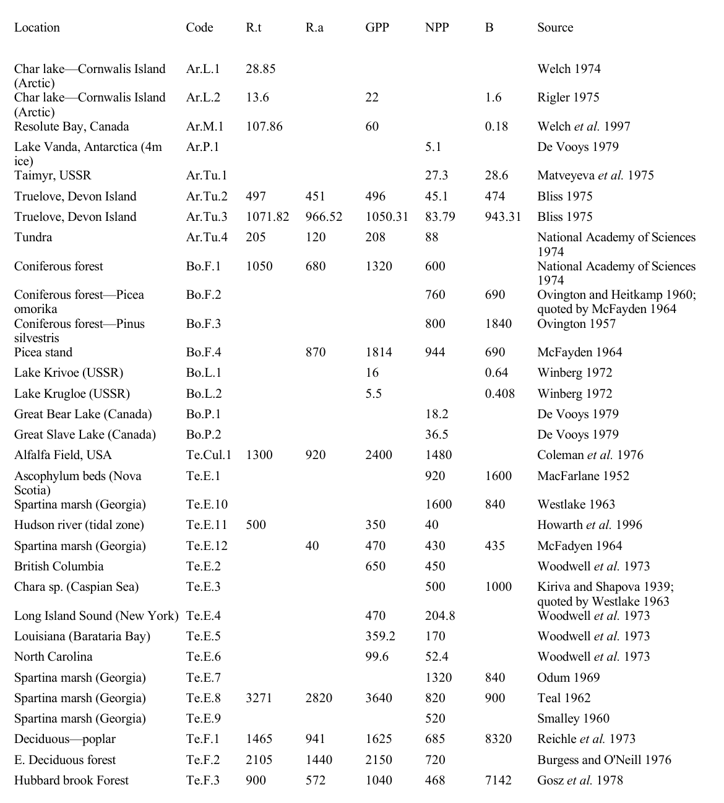
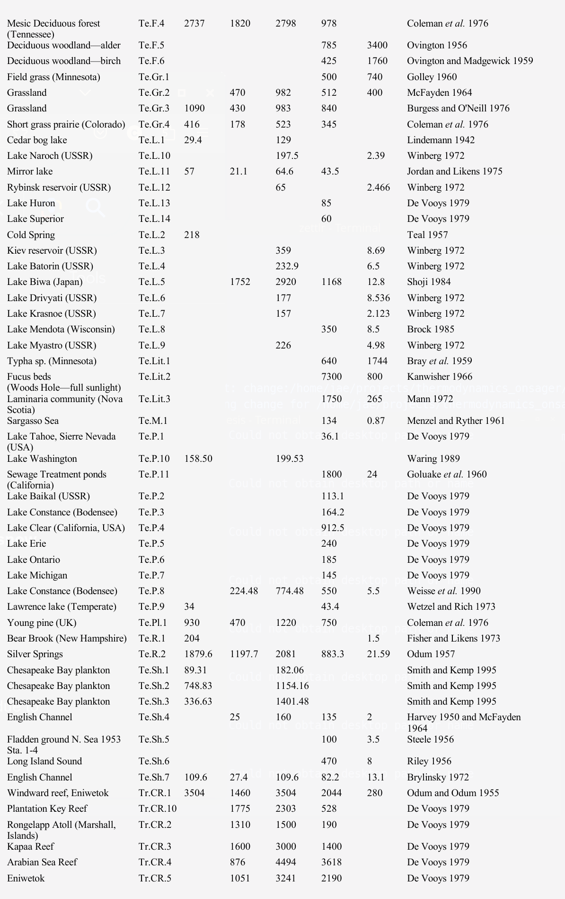
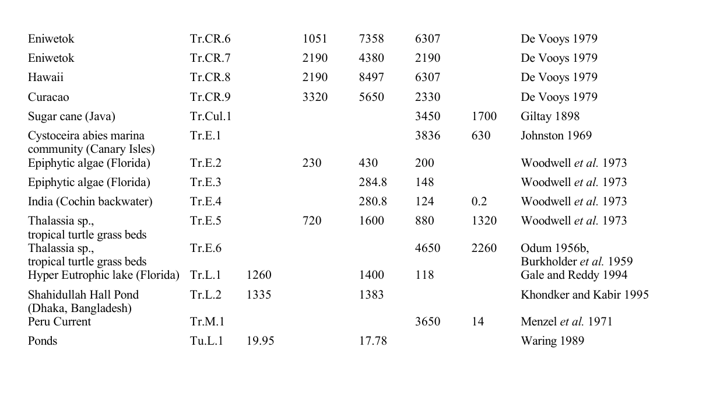

# Introduction

An understanding of macroscopic thermodynamic states of matter was established by Carnot (1824), Thomson (Lord Kelvin) (1849), and Clausius (1850), demonstrating that a small set of state variables (temperature, pressure, volume) were sufficient to characterize bulk physical behavior despite the systems being composed of a vast number of atoms and molecules. Non-statistical, axiomatic, and geometric formulations of the $2^{\text{nd}}$ law of thermodynamics subsequently provided rigorous metric foundations for thermodynamic entropy independent of thermal cycle heuristics (Carathéodory 1909, Lieb and Yngvason 1999). In parallel, Boltzmann (1877) and Gibbs (1902) developed a statistical-mechanical foundation based upon microscopic configuration counts, linking it to macroscopic entropy.

Owing to the success of Boltzmann's (1877) and Gibbs' (1902) statistical mechanics in describing molecular and kinetic systems, macroscopic entropy and microscopic **disorder** are frequently conflated under the single term **entropy**. This conflation has caused considerable confusion; here, the term **(dis)order** is used specifically to refer to the microscopic notion of statistical, information-theoretic entropy, whereas **entropy** is reserved for macroscopic thermodynamic physical **entropy**, which quantifies the irreversible dissipation of energy during macroscopic processes.

From these foundational developments, a system is physically understood only when microscopic **disorder** and macroscopic **entropy** converge via Boltzmann's constant $k_{\mathrm{B}}$. In molecular systems, this correspondence is well-established. In living ecological systems, however, microscopic and macroscopic representations remain far from convergent. All ecological processes are equally subject to thermodynamic laws[^1]. Even the most basic attempts to account for or model matter and energy flows necessarily begin by invoking conservation of energy and matter, and as such, irreversible losses of energy from the system. Numerous attempts have been made to formalize this connection and draw law-like inferences from it, motivated by the possibility of reducing the large degrees of freedom required to describe ecological systems into a compact set of ecological "state" variables and characterizing the directionality of ecological dynamics. Because all ecological systems exhibit matter and energy cycling and boundary flows across multiple spatial and temporal scales, direct empirical accounting of *entropy* remains challenging (Meysman and Bruers 2010). 
 
Here, issues concerning the application of non-equilibrium thermodynamics to ecology are examined (see also Chapman et al. 2016, Fath et al. 2004, Chakrabarti and Ghosh 2009, Meysman and Bruers 2010, Yen et al. 2014, Choi 2019). First we examine how Onsager's (1931a,b) formulation connecting microscopic fluctuations to macroscopic phenomenological transport might be used to frame ecological questions. Furthermore, the **Le Chatelier-Braun principle**[^2] is shown to provide an equivalent and familiar framework for gauging how ecosystems respond to perturbations. Then, building upon this foundation, we explore the empirical, multi-scale, and non-linear dimensions of this synthesis. First, the framework is evaluated empirically across contrasting aquatic biomes, comparing a benthic detritus-buffered cold spring (Cone Spring) with an open-ocean planktonic food web at the Bermuda Atlantic Time-series Study (BATS) site and an exploited marine pelagic fishery (NPZD-Fish). Second, the stability analysis is extended to continuous allometric size spectra by linking biomass capacitance and metabolic turnover to organismal body mass through Kleiber scaling and the Sheldon size spectrum. Third, a multi-scale energy cascade model analogous to Kolmogorov fluid turbulence is formulated to explain how macroscopic structural capacitors absorb bulk environmental forcing, cross-scale probability circulation transfers energy across size octaves, and microscopic organisms dissipate it into heat. Fourth, the linear theory is extended to non-linear Fokker-Planck quasi-potential landscapes, yielding physical early-warning diagnostics for catastrophic regime shifts. Formal coordinate-invariance proofs, non-linear phase-space derivations, compositional coordinate breakdowns, stochastic chemical master equations, and electrical circuit dualities are presented in Appendices A to D.

# Microscopic Order

Boltzmann (1877) and Gibbs (1902) developed the statistical-mechanical foundation, linking macroscopic entropy $S$ to the multiplicity of accessible microscopic configurations $\Omega$ in phase space:

$$S = k_{\mathrm{B}} \ln \Omega$$

where $k_{\mathrm{B}}$ is Boltzmann's constant (Planck 1901, Ehrenfest and Ehrenfest 1912). In this framework, thermodynamic state is defined by a probability distribution over phase space, and the equilibrium macrostate corresponds to the distribution with maximum entropy, reflecting maximal microscopic uncertainty. All deviations from equilibrium are transient fluctuations around this statistical average, vanishing in the thermodynamic limit ($N \to \infty$).

The canonical illustration is an isolated volume containing $N$ identical gas molecules initially constrained to uniform positions, velocities, and momenta. In the $6N$-dimensional phase space (three spatial coordinates and three momentum components per molecule), this highly constrained configuration occupies a minimal volume ($\Omega \approx 1$), corresponding to low microscopic dispersion and an initial reference entropy. When external constraints are removed, intermolecular collisions irreversibly disperse particle trajectories across a rapidly expanding volume of accessible phase space. Free energy is converted into distributed kinetic motion and irreversible entropy generation, driving the system monotonically toward thermodynamic equilibrium, where potential energy is minimized, and entropy $S$ and phase-space volume $\Omega$ attain their global maximum. 

Similarly, an internal combustion engine converts the chemical potential energy of fuel into dispersed gases, particulates, and heat, generating *entropy*. From a microscopic physical-chemical perspective, long-chain hydrocarbons with concentrated bond energies transition from a structured configuration to a disaggregated state with many more degrees of freedom, greater dispersion, and lower potential to perform useful work. In such isolated or closed systems, *order* $\rightarrow$ *disorder*.

Schrödinger (1944) pointed out that biological systems seem to operate in a different manner than simple heat engines. The example he used was DNA, which he described as a curious "aperiodic crystal". He noted that hereditary material replicates itself with high fidelity, as mutation rates are much lower than would be expected from unconstrained thermal degradation in chemical reactions of similarly large molecules (Drake et al. 1998). Even in the absence of an explicit genetic and biochemical understanding of DNA structure (Watson and Crick 1953) and kinetic proofreading (Hopfield 1974), he was able to deduce that it was this genetic fidelity that formed the basis for life: replication and fidelity. 

This local stability is maintained by chemical activation energies and covalent bond stability, proofreading enzyme systems and repair proteins (Hopfield 1974), and Darwinian selection (viability filter). Indeed, stable life cycles, developmental canalization (Waddington 1942, 1957), phenotypic plasticity, ordered metabolic pathways such as the tricarboxylic acid (Krebs) cycle (Krebs and Johnson 1937), predator-prey interactions, host-parasite interactions, habitat-niche partitioning, animal migration patterns, and spatial species distributions all represent examples of *constrained* dynamical processes of *order $\rightarrow$ order*. These are the mainstay of biology and ecology: feedback cycles and their regulatory inter-relationships (Levins 1968, May 1973, Yodzis 1981, 1988). More generally, such open self-maintaining configurations are known as *dissipative structures* (Prigogine 1967, Glansdorff and Prigogine 1971, Glansdorff et al. 1974, Nicolis and Prigogine 1977); they describe locally stable, *order $\rightarrow$ order* systems that maintain their internal structure and low local entropy at the cost of continuous free-energy degradation and entropy export to their surrounding environment. When the accounting boundary encompasses both the biological structure and its surrounding environment, the overall thermodynamic effect is *(local order $\leftrightarrow$ local order) $\rightarrow$ (global disorder)*, drawing high-grade free energy in and exporting entropy out. Physical and chemical analogues include turbulent energy cascades (Richardson 1922, Kolmogorov 1941), Rayleigh-Bénard convection cells (Bénard 1900, Rayleigh 1916), Belousov-Zhabotinsky oscillating chemical waves (Belousov 1959, Zhabotinsky 1964, Zaikin and Zhabotinsky 1970), and reaction-diffusion morphogenesis patterns (Turing 1952, Glansdorff and Prigogine 1971, Nicolis and Prigogine 1977). Living systems, in the act of growth, maintenance, and reproduction, tap into external matter and energy flows to sustain local order (Bertalanffy 1950, Zotin and Zotina 1967).

Schrödinger (1944) also considered the steps required for the origin and diversification of life, from simple prebiotic compounds to autocatalytic matter-energy cycles (Lotka 1922a,b) and eventually the evolution of template replication mechanisms involving RNA, DNA, proteins, and membrane compartmentalization in the presence of persistent free-energy gradients (*hypercycles* of Eigen and Schuster 1979, Wicken 1980). Each structural step represents an increase in complexity (*order*); and each diversification of a functional role or niche represents an expansion in the number of potential functional states (which can be formally represented as an expansion in accessible macroscopic or network states). These evolutionary dynamics operate under the perpetual selective pressure of co-evolving competitors, predators, and pathogens, epitomized by the Red Queen hypothesis (Van Valen 1973, 1976, Bell 1982), whereby continuous adaptation is mandatory merely to maintain persistent organismal fitness in a non-stationary adaptive landscape (England 2013). Thus in biological systems, transitions of the form *disorder $\rightarrow$ order*, or more accurately, *order $\rightarrow$ more complex order* via persistent dissipation, are frequently observed.

This apparent tension between local biological organization (*[dis]order $\rightarrow$ order*) and the $2^{\text{nd}}$ law expectation of increasing total *entropy* (*order $\rightarrow$ disorder*) has been proposed by several authors as a thermodynamic signature distinguishing living from non-living systems. Lovelock (1972) and Lovelock and Margulis (1974) used this logic to formulate the "Gaia hypothesis": planetary atmospheres dominated by living processes exhibit extreme, dis-equilibrated chemical compositions far removed from abiotic thermodynamic equilibrium. The continuous throughput of solar radiation and geochemical cycles drives living matter to construct and sustain internal organization by pumping out entropy into planetary reservoirs.

The presence of these three order principles has precipitated a wide, generally confusing discussion of their relevance in living systems. These discussions demonstrate the necessity of explicitly specifying the frame of reference: the focal perspective (microscopic order/disorder versus macroscopic energy/matter), the system constraints (boundary conditions and ground/reference states), and the relevant spatial and temporal scales.

![Heuristic representation of the principles of order and corresponding changes in entropy. (A) *order $\rightarrow$ disorder*: the $2^{\text{nd}}$ law such as in simple heat engines (red dashed lines); (B) *order $\rightarrow$ order*: stasis or homeostatic behavior in biochemical systems, stable ecological systems, and genetic stability (green self-loop, "dissipative structures"); and (C) *disorder $\rightarrow$ order*: a reversal such as development, evolution, succession, and adaptation (transition from red-dashed lines to green loops). The circles show the focal (local) processes for each order principle. Note the dissipation-cascade from top to bottom as each dissipative structure connects to other dissipative structures and manifested as Onsager Relations (blue arrows; see text below), interconnected vehicles of energy-cascades (turbulent dynamics, food-web dynamics, metabolic pathways, etc.). In all cases, when the boundaries are expanded to include both the local system and its immediate environment, global entropy increases monotonically (from state 1 to state 2), preserving the Second Law. \label{fig_cascade}](media/order_cascade.png){#fig_cascade width=65%}

To illustrate how these three regimes coexist within a single physical cascade, consider a parcel of water flowing downhill along multiple paths and streams (Fig. \ref{fig_cascade}, area A). A tagged volume of water in an elevated lake initially occupies a state of high gravitational potential energy, low macroscopic kinetic energy, and uniform temperature and pressure. As it flows downhill, gravitational potential energy transforms into kinetic energy, and viscous friction across channel beds gradually dissipates that kinetic energy into thermal heat and ambient entropy: *order $\rightarrow$ disorder* ($2^{\text{nd}}$ law). 

In ecological systems, biota intercept a small fraction of these downhill matter and energy flows, retarding their passage by redirecting mass into living structures through growth and reproduction ("standing biomass") before eventual metabolic dissipation: *order $\rightarrow$ order* (Fig. \ref{fig_cascade}, area B). Empirical syntheses initiated by Lindeman (1942) and extended by H. T. Odum (1956), E. P. Odum (1969), and Mann (1972) established that trophic transfer efficiencies generally range from 1 to 10%, while satellite radiation budgets indicate that terrestrial plant canopies dissipate over 99% of absorbed solar energy through evapotranspiration and respiration (Schneider and Kay 1994, Schneider and Sagan 2005). Only a small fraction of gross energy throughput is retained within the standing eddy of living biomass (Johnson 1981), while the bulk flux continues downhill into entropy export. Characterizing the boundary conditions and feedback mechanisms that sustain these locally ordered material and energy eddies across subcellular, organismal, population, community, and earth-system scales is a central task of biology and ecology.

Finally, when the applied free-energy gradient exceeds viscous or metabolic damping past a critical threshold, non-linear instabilities drive transitions toward new organized configurations: *disorder $\rightarrow$ order* (Fig. \ref{fig_cascade}, area C). In hydrodynamic flows, coherent multi-scale eddy hierarchies emerge to transport and dissipate kinetic energy across wavenumbers (Richardson 1922, Kolmogorov 1941); in ecological communities, biomass size spectra across aquatic and terrestrial biomes (Sheldon et al. 1972, Kerr 1974, Platt and Denman 1977, 1978, Rodriguez and Mullin 1986, Boudreau and Dickie 1992, Choi et al. 1999) manifest as analogous energy cascades across hierarchies of spatiotemporal scales. Across ecological and evolutionary timescales, bifurcations triggered by shifts in external free-energy gradients, novel biochemical pathways, speciation, range shifts, keystone interactions, or trophic cascades reorganize feedback networks and shift communities across alternative dynamical attractors. Through reproduction, heritable variation, and natural selection, viable variants are filtered, canalizing developmental pathways and directing ecological succession (*disorder $\rightarrow$ order*). Crucially, when the accounting boundary encompasses both the living community and its surrounding energetic reservoirs, the aggregate process yields a net increase in total entropy (from state 1 to state 2 in Fig. \ref{fig_cascade}): *(local order $\leftrightarrow$ local order) $\rightarrow$ (global disorder)*. Biological self-organization therefore operates as an engine of entropy production rather than a violation of physical law (Prigogine 1967, Schneider and Kay 1994, England 2013).

Numerous variational and "Order Principles" have been proposed to characterize the macroscopic directionality of biological systems. Lotka (1922a,b) suggested that natural selection maximizes total energy throughput: systems that capture more available power outcompete rivals (the "maximum power principle", later formalized by Odum and Pinkerton 1955). Shannon (1948) introduced an information-theoretic entropy to measure the uncertainty of discrete probability distributions, which Kullback and Leibler (1951) extended to relative entropy (informational divergence). Jaynes (1957) demonstrated that statistical mechanics can be formulated as an inference problem maximizing informational entropy subject to known physical constraints. In ecosystems, information-theoretic measures have been applied to trophic flow networks through Ulanowicz's concept of ascendency (Ulanowicz 1986, Ulanowicz and Hannon 1987).

A rigorous evaluation of microscopic *order* and *disorder* requires an explicit dynamical and statistical *model* of the system. Because information-theoretic measures depend on the chosen state variables, coarse-graining categories, and parameterization, purely formal entropy indices applied to ecological models such as Lotka-Volterra interaction models (Michaelian 2005, Chakrabarti and Ghosh 2009) or aggregate input-output flow networks (Patten 1978), yield model-dependent descriptors rather than absolute thermodynamic state functions. Historically, it was precisely the quantitative discrepancy between classical statistical models of molecular and radiation states and empirical calorimetry that revealed missing physical degrees of freedom, motivating quantum statistical mechanics (Planck 1901, Schrödinger 1944, Jaynes 1957). In ecology, information-theoretic indices have been applied to trophic flow topologies (Ulanowicz and Hannon 1987, Ulanowicz et al. 2006), genome size and coding complexity (Jørgensen et al. 1995), phylogenetic branching (Wicken 1980, Wiley and Brooks 1982), and maximum-entropy species distribution modeling (Elith et al. 2011). While these statistical tools quantify network diversity, constraint, or occurrence probability, connecting them to physical thermodynamics requires mapping their coarse-grained states to physical energy and matter pools with explicit microstate multiplicities and transition energetics.

# Macroscopic Entropy

Given the lack of satisfactory microscopic model representations of ecosystem phenomena, many have attempted instead to describe ecosystem processes in terms of macroscopic state variables. Such a whole system-level (*extensive*) approach is perhaps best exemplified by the engineering tradition which traces its origin directly to the founding work of Carnot (1824). The whole system free energy available to do useful work is the state variable of interest, carefully controlled and measured. Engineering applications usually focus upon systems whose boundaries can be defined explicitly (for example, a machine or heat engine) and revolve around well-defined forms of energy and matter transformation with an explicitly defined reference or ground state. These conditions permit repeated measurements of free energy and entropy, so that transfer efficiencies can be calculated to permit systematic performance analysis of the whole system.  

Following this macroscopic tradition, Lindeman (1942), E. P. Odum (1969), Kay (1991), Aoki (1993, 1995), Schneider and Kay (1994), Müller (1998), Choi et al. (1999), Schneider and Sagan (2005), and Jørgensen (2012) analyzed *extensive* free-energy gradients and their degradation across whole ecosystems. Aoki (1993, 1995) estimated whole-lake entropy production from radiation and heat budgets; Choi et al. (1999) examined dissipative signatures in plankton size spectra; and Schneider and Kay (1994) used satellite measurements of evapotranspiration and surface temperature as proxies for ecosystem energy degradation. However, applying whole-system *extensive* thermodynamics to open ecosystems encounters fundamental difficulties when multiple mass-energy transformations operate simultaneously across wide spatial, temporal, and organizational scales with porous boundaries, undefined chemical reference states, and internal trophic cycling (Meysman and Bruers 2010). Moreover, chemical compounds that serve as high-grade free-energy resources for one guild of organisms may be metabolically inert or even toxic to another. 

To address internal cycling in macroscopic budgets, Patten (1978) expanded steady-state compartment flows into first-order linear input-output transitive closures, while H. T. Odum (1996) traced cumulative solar energy transformations into "emergy" conversion ratios. While these accounting frameworks confirm that macroscopic irreversible dissipation is strictly positive in accordance with the $2^{\text{nd}}$ law, aggregate throughput alone does not uniquely determine the internal stability, feedback structure, or direction of perturbation recovery of multi-species communities. Resolving how internal ecological interactions respond to perturbations requires moving from aggregate black-box budgets to the linear and local non-equilibrium formalism of Onsager (1931a,b), Prigogine (1955), and de Groot and Mazur (1962).

# Onsager's relations and conjugate effects

Onsager's contributions (Onsager 1931a,b, Onsager and Machlup 1953, Casimir 1945, Mazur 1997, Verhás 2014) tied macroscopic entropy production to microscopic statistical mechanics for generalized thermodynamic systems. This formulation is revisited here, focusing on the relationship between Onsager's relations and the well-known Le Chatelier-Braun principle (Le Chatelier 1884, Braun 1887, Bertalanffy 1950, Prigogine and Defay 1954, de Groot and Mazur 1962, Gündüz and Gündüz 2014). When this extensive concept is applied to local control volume elements in an intensive field approach (Prigogine 1955, de Groot and Mazur 1962), a deeper and more rigorous understanding of the connections between thermodynamics and ecology emerges.

Onsager's relations generalize empirical transport laws, such as Fourier's law of thermal conduction (Fourier 1822), Ohm's law of electrical conduction (Ohm 1827), and Fick's law of molecular diffusion (Fick 1855), into a unified framework governed by total entropy production (Onsager 1931a,b, de Groot and Mazur 1962). In a system described by $n$ independent extensive state variables $\mathbf{x} = (x_1, \dots, x_n)^{\mathsf{T}}$ with stationary reference state $\mathbf{x}^*$ and deviations $\delta\mathbf{x} = \mathbf{x} - \mathbf{x}^*$, a second-order Taylor expansion of total entropy change yields $\Delta S_{\mathrm{tot}}(\delta\mathbf{x}) = -\frac{1}{2}\delta\mathbf{x}^{\mathsf{T}}\mathbf{H}\delta\mathbf{x} + \mathcal{O}(\|\delta\mathbf{x}\|^3)$, where $\mathbf{H} = -\partial^2\Delta S_{\mathrm{tot}}/\partial\mathbf{x}^2\big|_{\mathbf{x}^*} \succ 0$ is the symmetric positive-definite entropy Hessian (Einstein 1910, Greene and Callen 1951, Callen 1985). State fluctuations generate conjugate thermodynamic forces $\mathbf{X} = \nabla_{\delta\mathbf{x}}\Delta S_{\mathrm{tot}} = -\mathbf{H}\delta\mathbf{x}$ that drive linear conjugate fluxes $\mathbf{J}$ (or inverse resistivities $\mathbf{R} = \mathbf{L}^{-1}$ on an independent process basis):

$$J_i = \sum_{j=1}^{m} L_{ij} X_j \quad (\mathbf{J} = \mathbf{L}\mathbf{X}) \qquad \text{or} \qquad X_i = \sum_{j=1}^{m} R_{ij} J_j \quad (\mathbf{X} = \mathbf{R}\mathbf{J})$$

Under microscopic reversibility of equilibrium fluctuations (in the absence of time-reversal-odd magnetic or Coriolis fields), Onsager (1931a,b) proved that the phenomenological matrices are symmetric ($L_{ij} = L_{ji}$ and $R_{ij} = R_{ji}$; Casimir 1945). The internal entropy production rate $\sigma = d_i S / dt$ is the bilinear product of conjugate fluxes and forces:

$$\sigma = \frac{d_i S}{dt} = \mathbf{J}^{\mathsf{T}}\mathbf{X} = \sum_{i,j=1}^{m} L_{ij} X_i X_j = \mathbf{X}^{\mathsf{T}}\mathbf{L}_s\mathbf{X} = \mathbf{J}^{\mathsf{T}}\mathbf{R}_s\mathbf{J} \ge 0$$

Non-negative internal entropy production ($\sigma \ge 0$, distinct from the signed boundary entropy exchange $d_e S / dt$ in $dS/dt = \sigma + d_e S / dt$) requires the symmetric part of the conductivity matrix, $\mathbf{L}_s = \frac{1}{2}(\mathbf{L} + \mathbf{L}^{\mathsf{T}})$, to be positive semidefinite, and strictly positive definite ($\mathbf{L}_s \succ 0$) on a non-redundant process basis (de Groot and Mazur 1962).

When pairs of irreversible transport processes are coupled through these symmetric cross-coefficients, they are referred to as conjugate processes. Experimental confirmation of Onsager reciprocity across physical and chemical systems is extensive (reviewed by Miller 1960). Classic physical examples include thermoelectric coupling, where a temperature gradient drives an electric current (the Seebeck effect; Seebeck 1826) and an electrical current drives a reversible heat flux (the Peltier effect; Peltier 1834, Thomson 1854), as well as thermomagnetic Nernst-Ettingshausen effects (von Ettingshausen and Nernst 1886, Nernst 1887). In biological physics, analogous reciprocal couplings govern membrane electrodynamics and coupled enzymatic pathways (Kedem and Katchalsky 1958, Katchalsky and Curran 1965, Oster et al. 1971, Mikulecky 1985).

## Resolving the Apparent Breakdown of Reciprocity in Ecology

When theoretical ecologists and physicists first attempted to apply Onsager's reciprocal relations to living communities, they encountered an immediate conceptual paradox. Ecologists formulate multi-species interactions through demographic differential equations whose linearized dynamics near steady state are governed by the demographic community matrix or Jacobian $\mathbf{A}$ (May 1972, 1973, Yodzis 1981, 1988). Because feeding interactions are inherently directional, in that a predator gains biomass by consuming a prey population while the prey population declines, community interaction matrices are fundamentally asymmetric ($A_{ij} \ne A_{ji}$).

Assuming that the demographic matrix $\mathbf{A}$ must serve directly as the physical Onsager conductivity matrix $\mathbf{L}$, it was concluded that living communities violate Onsager reciprocity and operate outside the domain of non-equilibrium physical thermodynamics (MacArthur 1970, Ulanowicz and Hannon 1987, Michaelian 2005, Chakrabarti and Ghosh 2009, Meysman and Bruers 2010). MacArthur (1970) demonstrated that symmetric resource competition minimizes a scalar carrying-capacity potential, but noted that this variational principle collapsed when predation was included. Ulanowicz and Hannon (1987) examined input-output flow networks and asserted that ecological exchanges inherently break reciprocity. Michaelian (2005) tested Lotka-Volterra community matrices as Onsager conductivities and concluded that ecological networks violate reciprocal symmetry, challenging Prigogine's stationary dissipation theorems.

This apparent conflict arises from a conceptual conflation: the demographic community matrix $\mathbf{A}$ is not the physical conductivity matrix $\mathbf{L}$. The demographic matrix describes the temporal rate of change of population biomasses ($\delta\dot{\mathbf{x}} = \mathbf{A}\delta\mathbf{x}$), whereas Onsager conductivities relate physical thermodynamic fluxes to intensive driving forces ($\mathbf{J} = \mathbf{L}\mathbf{X}$). The community matrix is a composite dynamical operator that conflates underlying physical transport conductivities with the heterogeneous biomass storage capacities of biological compartments.

A physical analogy illustrates this distinction. Consider two fluid reservoirs connected by a physical pipe with conductivity $L$. One reservoir is a large freshwater lake (representing a large detrital or forest biomass pool), while the second reservoir is a small vessel (representing a specialized, low-biomass predator population). When fluid is transferred between them, the physical transport conductivity $L$ through the pipe is identical in both directions. However, transferring a fixed volume of water produces a negligible change in the surface level of the lake, whereas that same volume transfer induces a large water-level shift in the small vessel. The demographic interaction coefficient $A_{ij} = \partial \dot{x}_i / \partial x_j$ does not measure the physical pipe conductivity $L$; rather, it measures the rate of water-level change in compartment $i$ per unit level displacement in compartment $j$. Because the demographic community matrix scales the underlying physical fluxes by the inverse storage capacities of the receiving compartments, it is inherently asymmetric ($A_{ij} \ne A_{ji}$) even when the underlying physical transport conductivities are completely reciprocal and symmetric ($L_{ij} = L_{ji}$).

This conflation resolves through continuous Lyapunov covariance factorization (Appendix A; Lyapunov 1892, Tomita and Tomita 1974, Graham 1977, Ao 2004, Qian 2006). By Einstein's fluctuation relation (Einstein 1910, Greene and Callen 1951), the matrix inverse of the entropy Hessian $\mathbf{H}$ scaled by Boltzmann's constant $k_{\mathrm{B}}$ defines the stationary fluctuation covariance matrix $\mathbf{C} = \langle \delta\mathbf{x}\delta\mathbf{x}^{\mathsf{T}}\rangle = k_{\mathrm{B}}\mathbf{H}^{-1}$, which functions as the thermodynamic storage capacitance of the ecological network (mapping extensive state deviations $\delta\mathbf{x}$ to conjugate driving forces $\mathbf{X} = -k_{\mathrm{B}}\mathbf{C}^{-1}\delta\mathbf{x}$). The total demographic drift operator $-\mathbf{A}\mathbf{C}$ decomposes uniquely into a symmetric dissipative component and an antisymmetric circulation component:

$$-\mathbf{A}\mathbf{C} = \mathbf{D}_{\mathrm{sym}} + \boldsymbol{\Omega}$$

Inverting the capacitance matrix yields the structural factorization of the demographic community matrix:

$$\mathbf{A} = -(\mathbf{D}_{\mathrm{sym}} + \boldsymbol{\Omega})\mathbf{C}^{-1}$$

This factorization clarifies the dual nature of living ecosystems through two distinct physical operators. The symmetric Onsager dissipation tensor $\mathbf{D}_{\mathrm{sym}} = \mathbf{D}_{\mathrm{sym}}^{\mathsf{T}} \succ 0$ represents pure, irreversible thermodynamic dissipation. It acts as an energetic restorative pull that draws perturbed populations monotonically downhill along the thermodynamic entropy surface toward the stationary attractor, strictly satisfying Onsager reciprocity ($D_{ij} = D_{ji}$) and guaranteeing compliance with the Second Law of Thermodynamics. In contrast, the antisymmetric probability circulation tensor $\boldsymbol{\Omega} = -\boldsymbol{\Omega}^{\mathsf{T}}$ represents **non-dissipative** cyclic motion in state space, capturing the persistent directional trophic fluxes characteristic of living food webs, including predator-prey population cycles, seasonal succession, and microbial nutrient recycling loops. Because $\boldsymbol{\Omega}$ is skew-symmetric, it does no net thermodynamic work against the entropy gradient, circulating currents perpetually in state space as sustained by continuous boundary throughput of solar irradiance and chemical nutrients.

Thus, Onsager reciprocity is not broken in living systems. The symmetric dissipative core $\mathbf{D}_{\mathrm{sym}}$ preserves reciprocal symmetry, while the asymmetry of the demographic matrix $\mathbf{A}$ reflects the superposition of physical capacitance heterogeneity $\mathbf{C}^{-1}$ and non-equilibrium circulation $\boldsymbol{\Omega}$. See Appendix A for more details.

Because $\boldsymbol{\Omega}$ is skew-symmetric, it performs no net thermodynamic work against the potential gradient ($\delta\mathbf{x}^{\mathsf{T}}\mathbf{C}^{-1}\boldsymbol{\Omega}\mathbf{C}^{-1}\delta\mathbf{x} = 0$), functioning as a conservative energy and nutrient shuttler across compartments.

These physical operators map directly to ecological mechanisms. Biological standing stocks function as entropic capacitors ($\mathbf{C}$): detrital beds and forest boles store reserves of carbon and nutrients, providing physical inertia that buffers the community against seasonal droughts and resource lean periods. Metabolic dissipation ($\mathbf{D}_{\mathrm{sym}}$) represents the irreversible metabolic expenditure required to maintain living structure against thermal decay, pulling perturbations monotonically back toward stationary balance. Probability circulation ($\boldsymbol{\Omega}$) represents conservative transport within internal trophic loops, where feeding cycles and microbial recycling pathways shuttle matter and energy across species boundaries without degrading the local free-energy gradient.

Quantifying the departure from microscopic detailed balance is the network-wide magnitude of cyclic trophic transport relative to irreversible dissipative damping. This dimensionless non-equilibrium circulation ratio is:

$$\chi = \frac{\|\boldsymbol{\Omega}\|_F}{\|\mathbf{D}_{\mathrm{sym}}\|_F}$$

where $\|\mathbf{M}\|_F = \sqrt{\operatorname{tr}(\mathbf{M}^{\mathsf{T}}\mathbf{M})} = \sqrt{\sum_{i,j} M_{ij}^2}$ denotes the Frobenius matrix norm. Because symmetric and skew-symmetric matrices are mutually orthogonal under the Frobenius inner product ($\operatorname{tr}(\mathbf{D}_{\mathrm{sym}}^{\mathsf{T}}\boldsymbol{\Omega}) = 0$), the total squared norm of the covariance-weighted drift decomposes via the Pythagorean identity $\|-\mathbf{A}\mathbf{C}\|_F^2 = \|\mathbf{D}_{\mathrm{sym}}\|_F^2 + \|\boldsymbol{\Omega}\|_F^2 = \|\mathbf{D}_{\mathrm{sym}}\|_F^2(1 + \chi^2)$, where $\chi = \tan\theta$ is the tangent of the angle between the composite dynamical operator and the purely dissipative Onsager subspace. In an isolated system at thermodynamic equilibrium (or in a purely symmetric competitive community), detailed balance holds, circulation vanishes ($\boldsymbol{\Omega} = \mathbf{0}$, $\chi = 0$), and perturbations relax monotonically without rotation. In open ecosystems driven by solar irradiance and nutrient inflows, continuous boundary throughput sustains persistent cyclic currents ($\chi > 0$), indexing a continuum of dynamical regimes from capacitance-buffered overdamped relaxation ($\chi < 1$, as in detritus-dominated benthic streams) and active planktonic recycling ($\chi \sim 1\text{ to }1.5$, as in the open-ocean mixed layer) to volatile, unbuffered oscillatory spiraling when slow apex capacitors are stripped ($\chi \gg 1$, approaching a Hopf bifurcation). Coordinate-invariance proofs, geometric properties of the Frobenius ratio, and the canonical two-species prototype decomposition are presented in Appendices A.2 and D.1.

## The Connection of Onsager Reciprocity to the Le Chatelier-Braun Principle: Ecological Conjugate Effects

Within the linear range of non-equilibrium thermodynamics near a stationary state, Onsager's reciprocal relations provide a quantitative mathematical formulation of the Le Chatelier-Braun principle (Le Chatelier 1884, Braun 1887, Bertalanffy 1950, Prigogine and Defay 1954, de Groot and Mazur 1962, Horn and Johnson 2012, Gündüz and Gündüz 2014). In physical chemistry, this principle states that when a system at equilibrium is subjected to an external perturbation, internal processes adjust to oppose and moderate the perturbation. In open non-equilibrium systems, extremum properties of entropy production depend explicitly on which boundary variables are clamped[^3]: when thermodynamic forces $\mathbf{X}$ are held fixed, the linear constitutive response maximizes the Onsager-Machlup dissipation functional, whereas when boundary fluxes are fixed or unconstrained internal forces relax to zero-flux stationarity ($J_k = 0$), stationary relaxation minimizes entropy production with respect to the free forces (Onsager 1931a,b, Onsager and Machlup 1953, Prigogine 1955, Glansdorff and Prigogine 1971, Shiner and Sieniutycz 1994, Martyushev and Seleznev 2006, Reis 2014, Verhás 2014).

Specifically, positive-definiteness of the symmetric conductivity matrix ($\mathbf{L}_s \succ 0$) requires every diagonal self-conductivity to be strictly positive ($L_{ii} > 0$) and bounds all off-diagonal cross-conductivities $L_{ij}$ ($i \ne j$) via the Cauchy-Schwarz determinant condition $L_{ii}L_{jj} - \frac{1}{4}(L_{ij} + L_{ji})^2 > 0$. Individual cross-coefficients $L_{ij}$ may be either positive or negative, and entropy production is not separately defined for individual off-diagonal terms; only the complete quadratic form $\sigma = \mathbf{X}^{\mathsf{T}}\mathbf{L}_s\mathbf{X} \ge 0$ is constrained to be non-negative (de Groot and Mazur 1962).

 
Following the variational formulations of Onsager (1931a,b), Onsager and Machlup (1953), and Prigogine (1955), whether a linear non-equilibrium steady state maximizes or minimizes entropy production depends on which boundary variables are clamped (Shiner and Sieniutycz 1994, Martyushev and Seleznev 2006, Reis 2014). Under clamped thermodynamic forces $\mathbf{X}$, the Onsager-Machlup functional is (Onsager and Machlup 1953, Ziegler 1983, Dewar 2003):

$$\Phi(\mathbf{J}) = \sigma(\mathbf{J}, \mathbf{X}) - \Psi(\mathbf{J}) = \sum_{i} J_i X_i - \frac{1}{2}\sum_{i,j} R_{s;ij} J_i J_j$$

Setting the first variation with respect to flux $J_k$ to zero gives $\partial \Phi / \partial J_k = X_k - \sum_j R_{s;kj} J_j = 0 \implies \mathbf{J} = \mathbf{L}_s\mathbf{X}$. Because the Hessian with respect to $\mathbf{J}$ is negative definite ($\partial^2 \Phi / \partial \mathbf{J}^2 = -\mathbf{R}_s \prec 0$), the constitutive response maximizes $\Phi(\mathbf{J})$ (and thus boundary dissipation $\sigma = \mathbf{X}^{\mathsf{T}}\mathbf{L}_s\mathbf{X}$) at fixed driving forces.

Conversely, when boundary fluxes are clamped or a subset of internal forces $X_k$ are left unconstrained to relax to zero-flux stationarity ($J_k = 0$), differentiating $\sigma(\mathbf{X}) = \mathbf{X}^{\mathsf{T}}\mathbf{L}_s\mathbf{X}$ with respect to each free internal force $X_k$ yields:

$$\frac{\partial \sigma}{\partial X_k} = 2\sum_j L_{s;kj} X_j = 2 J_{s;k} = 0, \qquad \frac{\partial^2 \sigma}{\partial \mathbf{X}^2} = 2\mathbf{L}_s \succ 0$$

Because the Hessian $2\mathbf{L}_s$ is strictly positive definite, stationary relaxation of unconstrained internal forces minimizes entropy production (Prigogine 1955, 1967, Glansdorff and Prigogine 1971), with the minimized dissipation given directly by the Schur complement $\sigma_{\min} = L_{11,\mathrm{eff}}\,\delta X_1^2 \le L_{11}\,\delta X_1^2$.

When an external force perturbation $\delta X_i$ acts upon a primary process $i$ while all secondary forces are clamped ($\delta\mathbf{X}_{-i} = \mathbf{0}$), the system responds with a direct conjugate flux $\delta J_i = L_{ii}\delta X_i$ and positive dissipation $\sigma = L_{ii}\delta X_i^2 > 0$ that acts to deplete the imposed gradient. When the coupled secondary processes $\delta\mathbf{X}_{-i}$ are instead permitted to adjust freely until their conjugate fluxes reach stationary balance ($\delta\mathbf{J}_{-i} = \mathbf{0}$, so that $\delta\mathbf{X}_{-i} = -\mathbf{L}_{-i,-i}^{-1}\mathbf{L}_{-i,i}\delta X_i$), the induced cross-fluxes redistribute the disturbance across the network and moderate the primary response via the matrix Schur complement (Schur 1917, Prigogine and Defay 1954, de Groot and Mazur 1962, Horn and Johnson 2012; Appendix B):

$$\delta J_i = L_{ii,\mathrm{eff}}\,\delta X_i, \qquad L_{ii,\mathrm{eff}} = L_{ii} - \mathbf{L}_{i,-i}\mathbf{L}_{-i,-i}^{-1}\mathbf{L}_{-i,i} > 0$$

Because the secondary submatrix has a positive-definite symmetric part ($\mathbf{L}_{s;-i,-i} \succ 0$), the quadratic correction term in this Schur complement moderates perturbations through both direct symmetric dissipative couplings ($\mathbf{L}_s$) and effective cyclic indirect couplings ($\mathbf{L}_a = k_{\mathrm{B}}^{-1}\boldsymbol{\Omega}$; Appendix B). When cross-coupling is directly reciprocal and symmetric ($\mathbf{L}_{s;i,-i} = \mathbf{L}_{s;-i,i}^{\mathsf{T}}$, as in mutualistic co-transport), $\mathbf{L}_{s;i,-i}\mathbf{L}_{s;-i,-i}^{-1}\mathbf{L}_{s;i,-i}^{\mathsf{T}} \ge 0$ reduces the effective conductivity ($0 < L_{ii,\mathrm{eff}} \le L_{ii}$), moderating the net flux drawn from an imposed force gradient $\delta X_i$. Conversely, when cross-coupling acts through cyclic indirect links that are skew-symmetric ($\mathbf{L}_{a;i,-i} = -\mathbf{L}_{a;-i,i}^{\mathsf{T}}$, as in predator-prey or host-parasite negative feedback loops), secondary relaxation adds a positive-definite circulatory restoring term $+\mathbf{L}_{a;i,-i}\mathbf{L}_{s;-i,-i}^{-1}\mathbf{L}_{a;i,-i}^{\mathsf{T}} > 0$ to $L_{ii,\mathrm{eff}} \ge L_{ii}$, which decreases the stationary compliance ($0 < L_{ii,\mathrm{eff}}^{-1} \le L_{ii}^{-1}$) and reduces the force and state displacement ($|\delta X_i| = L_{ii,\mathrm{eff}}^{-1}|\delta J_i|$) induced by an external flux disturbance $\delta J_i$. In extensive state space $\delta\mathbf{x}$, perturbations decay monotonically along the quadratic Lyapunov availability functional $V(\delta\mathbf{x}) = \frac{1}{2}\delta\mathbf{x}^{\mathsf{T}}\mathbf{C}^{-1}\delta\mathbf{x} = -\Delta S_{\mathrm{tot}}(\delta\mathbf{x})/k_{\mathrm{B}}$:

$$\dot{V}(\delta\mathbf{x}) = -\delta\mathbf{x}^{\mathsf{T}}\mathbf{C}^{-1}\mathbf{D}_{\mathrm{sym}}\mathbf{C}^{-1}\delta\mathbf{x} < 0 \quad (\delta\mathbf{x} \ne \mathbf{0})$$

Coupled irreversible pathways thus absorb and redistribute disturbances, moderating net force displacements and driving asymptotic relaxation back toward the stationary state. These reciprocal stabilizing responses are designated here as **conjugate effects** to emphasize their constitutive mechanism through Onsager transport.

Not every biological interaction is automatically conjugated; however, recurrent mass and energy exchanges that generate irreversible entropy production across a stationary regime exhibit direct or effective (through cyclic indirect links) **conjugate effects**. In symbiotic and mutualistic partnerships, such as plant-mycorrhizal associations and coral-zooxanthellae symbioses (Boucher 1985, Bronstein 1994), reciprocal nutrient and carbohydrate exchanges create mutually reinforcing pathways that buffer both partners against environmental shortages. Under severe drought stress, terrestrial plants allocate up to twenty percent of their photosynthetically fixed carbon to arbuscular mycorrhizal fungal networks in the rhizosphere (Smith and Read 2008). In return, extensive fungal hyphae forage soil micropores for moisture and immobile phosphorus, buffering the plant against water-potential collapse. This reciprocal cross-coupling represents a direct biological manifestation of the matrix Schur complement, where secondary pathway relaxation moderates primary environmental stress ($L_{ii,\mathrm{eff}} \le L_{ii}$). Similarly, in soil microbial loops, plant roots release organic exudates in the rhizosphere that stimulate bacterial growth. In turn, bacterial grazing by protozoa and nematodes releases mineralized ammonium and orthophosphate directly adjacent to root hairs (Clarholm 1985, Bonkowski 2004). When environmental nutrient availability drops, increased root exudation accelerates bacterial grazing, releasing stored minerals back to the plant and moderating nutrient pulse shocks.

Host-parasite interactions exhibit a more nuanced, scale-dependent reciprocity across organismal and population levels. To an individual host, heavy parasitism is metabolically costly or detrimental; yet even at the physiological level, chronic low-level exposure to coevolved parasites and commensal microbiota stimulates and calibrates host immune regulation, such as regulatory T-cell pathways, protecting against secondary pathogens and moderating hyper-inflammatory or autoimmune responses, as described by the hygiene and "old friends" hypotheses (Strachan 1989, 2000, Rook 2009, Smith et al. 2012). At the population and evolutionary scales, density-dependent parasite transmission moderates host population explosions before the host exhausts its local resource base, while selective pressure on less adapted phenotypes maintains genetic polymorphism and accelerates reciprocal adaptive evolution in fluctuating environments (Van Valen 1973, Hamilton 1980).

Predator-prey interactions similarly act as stabilizing conjugate responses that regularize prey abundance and damp herbivore oscillations before herbivores exhaust their resource base (Paine 1966, Estes and Palmisano 1974, Estes et al. 1998). In North Pacific coastal ecosystems, sea otters (*Enhydra lutris*) prey upon herbivorous sea urchins (*Strongylocentrotus polyacanthus*); where otters are depleted, dense urchin populations overgraze sublittoral kelp beds (*Laminaria* and *Alaria fistulosa*), converting productive kelp forests into urchin barrens (Estes and Palmisano 1974, Estes et al. 1998). In terrestrial systems, the reintroduction of gray wolves (*Canis lupus*) to Yellowstone National Park moderated elk (*Cervus canadensis*) browsing along riparian corridors, permitting willow and aspen stands to recover (Ripple and Beschta 2004), whereas unchecked white-tailed deer (*Odocoileus virginianus*) populations in predator-depleted habitats chronically overbrowse forest understories and degrade plant community structure (Russell et al. 2001). In each case, secondary relaxation of predatory consumption moderates primary herbivory perturbations in accordance with the Le Chatelier-Braun principle.

Beyond direct trophic pairings, **conjugate effects** also manifest across coupled eco-physiological and biogeochemical processes operating within physical and chemical gradients (Kleiber 1947, Bertalanffy 1950). Photosynthetic biomass, evapotranspiration, and consumer respiration are reciprocally coupled across resource and microclimatic gradients, as seen in the benthic-pelagic coupling of lake ecosystems across oxygen, pH, and nutrient gradients (Regier and Kay 1996, Schindler and Scheuerell 2002) and in the marine biological carbon pump linking surface primary production to deep particulate carbon export (Eppley and Peterson 1979, Ducklow et al. 2001). Even when interactions are mediated indirectly across divergent timescales, Onsager reciprocity yields testable expectations that distinguish causal thermodynamic coupling from spurious correlation (Peters 1991). For instance, Halbach (1973) observed that rotifers (*Brachionus calyciflorus*) reared at higher temperatures matured at smaller body sizes and exhibited larger-amplitude population oscillations. In an uncoupled allometric model, experimentally shifting individuals to larger body sizes at fixed conditions would simply increase per-capita and total metabolic heat dissipation; under an effective conjugate feedback, however, an increase in individual body size should be compensated by a reduction in numerical density and net metabolic heat production.

At planetary scales, biotic feedbacks link local organismal and population processes to surface temperature, albedo, and atmospheric chemical disequilibrium, as explored in the Gaia hypothesis (Lovelock 1972, Lovelock and Margulis 1974) and Daisyworld simulations (Watson and Lovelock 1983), while anthropogenically driven greenhouse-gas forcing ($\mathrm{CO}_2$, methane, and chlorofluorocarbons) perturbs these global feedbacks. Conversely, when sustained exploitation or environmental forcing breaks existing **conjugate effects**, for example by persistently removing the largest body-size fraction and its storage capacitance, positive feedbacks can drive ecosystems into nonlinear transitions across alternative regimes. The collapse of Northwest Atlantic cod on the eastern Scotian Shelf and the shift of the continental shelf community toward small pelagic fishes and benthic macroinvertebrates (Choi et al. 2004, Frank et al. 2005), together with the subsequent exploration of alternative equilibria modulated by environmental variability (Choi 2023), illustrates how breaking historical conjugate feedbacks leads to the reorganization of trophic relations through order-through-fluctuation dynamics (Prigogine et al. 1972, Babloyantz 1986).

**Conjugate effects** (Onsager's relations and Le Chatelier-Braun principle) provide a mechanistic framework linking these empirical ecological observations to the underlying laws of non-equilibrium physics. Reciprocal trophic couplings reflect causal thermodynamic constraints rather than coincidental statistical correlations.

# Local stability, local order, and the resistance-resilience continuum

To apply non-equilibrium thermodynamics to open, spatially heterogeneous continuum systems, Meixner (1941, 1943), Prigogine (1947, 1955), de Groot and Mazur (1962), and Gyarmati (1970) formulated Onsager's relations as a *local, intensive* field description within a small control volume element $V^\ddagger$ (denoted here by ${}^\ddagger$). Within such a local control volume, the change in subsystem entropy $dS^\ddagger$ over time interval $dt$ is the sum of internal entropy production $d_i S^\ddagger \ge 0$ generated by irreversible processes inside the element and entropy exchange $d_e S^\ddagger$ transported across its boundary:

$$dS^\ddagger = d_i S^\ddagger + d_e S^\ddagger$$

Dividing the internal production rate by the control volume $V^\ddagger$ defines the local specific internal entropy production rate $\sigma^\ddagger$:

$$\sigma^\ddagger = \frac{1}{V^\ddagger}\frac{d_i S^\ddagger}{dt} = \sum_{i,j=1}^{m} L^\ddagger_{ij} X^\ddagger_i X^\ddagger_j = \mathbf{X}^{\ddagger\mathsf{T}}\mathbf{L}^\ddagger_s\mathbf{X}^\ddagger \ge 0$$

where $X^\ddagger_i$ are the local intensive thermodynamic forces and $L^\ddagger_{ij}$ are the local specific phenomenological conductivities.

This distinction between *extensive* whole-system budgets and *local, intensive* volume elements is foundational for ecological thermodynamics (Landsberg 1972, Choi et al. 1999, Choi and Patten 2001)[^4]. Whereas whole-ecosystem boundaries are often geographically and trophically porous (Meysman and Bruers 2010), a local biological compartment (such as an organism, a functional guild, or a well-mixed habitat patch) satisfies local thermodynamic linearizability provided explicit scope conditions are met:
- a well-defined local stationary or quasi-stationary reference state $\mathbf{x}^{\ddagger*}$ within the control volume and observation window $T_{\mathrm{obs}}$;
- identifiable local conjugate fluxes $\mathbf{J}^\ddagger$ and thermodynamic forces $\mathbf{X}^\ddagger$;
- perturbation amplitudes $\delta\mathbf{x}^\ddagger = \mathbf{x}^\ddagger - \mathbf{x}^{\ddagger*}$ small enough that higher-order terms in the local availability expansion are negligible; and
- explicit timescale separation $\tau_{\mathrm{mix}} \ll T_{\mathrm{obs}} \ll \tau_{\mathrm{evo}}$ among the fast fluctuation mixing time $\tau_{\mathrm{mix}}$, the observation window $T_{\mathrm{obs}}$, and the successional or evolutionary timescale $\tau_{\mathrm{evo}}$ over which slow structural parameters modify $\mathbf{L}^\ddagger$ (Landsberg 1972, Keizer 1987). Note that stationarity of the local distribution is distinct from detailed balance: an open volume element relaxes to a non-equilibrium steady state ($dS^\ddagger/dt = 0$ with $\sigma^\ddagger = -\frac{1}{V^\ddagger}\frac{d_e S^\ddagger}{dt} > 0$) rather than an isolated equilibrium.

Because the local entropy balance includes boundary export $d_e S^\ddagger$, an open biological compartment can maintain or decrease its internal entropy ($dS^\ddagger \le 0$) so long as it exports entropy to its environment at a rate exceeding its internal production ($-d_e S^\ddagger \ge d_i S^\ddagger \ge 0$), in full compliance with the $2^{\text{nd}}$ law (Prigogine 1955, Schneider and Kay 1994, England 2013). Moreover, unlike physical heat engines constrained by rigid walls of fixed geometry, living systems actively grow, contract, and restructure their total biovolume and standing biomass $B_i^*$ across orders of magnitude (Fig. \ref{fig_respiration_biomass}). Normalizing ecological budgets by arbitrary spatial surface area or water-column depth introduces extrinsic geometric artifacts between two-dimensional benthic habitats and deep pelagic waters; identifying **standing biomass** (or biovolume) as the true physical capacitance container resolves these dimensional ambiguities. Consequently, macroscopic extensive dissipation and local biomass-specific dissipation rate can diverge during transient disturbances, creating scale-dependent lags between rapid metabolic adjustments and slower structural biomass recovery.

In empirical comparative analyses across global ecosystems (Fig. \ref{fig_respiration_biomass}; Webster et al. 1975, DeAngelis 1980, Choi 2002), this interplay is captured by the inverse allometric relationship between the community respiration-to-biomass ratio ($R/B$, an empirical metabolic proxy for specific dissipation rate $\sigma^\ddagger$) and standing biomass $B$ (a proxy for biological storage capacitance $\mathbf{C} = k_{\mathrm{B}}\mathbf{H}^{-1}$). Because organismal metabolic rate scales allometrically with body mass according to Kleiber's law ($B^{-1/4}$; Kleiber 1932, 1947, Hemmingsen 1960, Peters 1983, Brown et al. 2004), mass-specific dissipation decreases systematically as individual body size and standing biomass increase. This constraint underpins the fundamental ecological trade-off between *Resilience* (kinetic recovery speed, governed by the mass-specific relaxation operator $\mathbf{C}^{-1}\mathbf{D}_{\mathrm{sym}}$) and *Resistance* (entropic insensitivity to displacement, governed by standing storage capacitance $\mathbf{C} = k_{\mathrm{B}}\mathbf{H}^{-1}$; Holling 1973, Webster et al. 1975, Pimm 1984, Grimm and Wissel 1997).

![The relationship between community respiration rate (a proxy for entropy production) and standing biomass (a proxy for biovolume and storage capacitance). Data were obtained from the literature (see Choi 2002, Appendix 7). The form of this relationship (purple curve) is constrained by allometric relationships between organismal size and metabolic rates. Due to this constraint, high-"resilience" systems (that is, high Respiration/Biomass ratios, e.g., (a), or alternatively high mass-specific conductivity) are generally lower-resistance systems (low standing biomass); conversely, lower-resilience systems (lower Respiration/Biomass ratios) are more resistant systems (higher standing biomass) relative to a given perturbation (e.g., system (b)). Any local deviation from this global pattern (e.g., (c) if perturbed from (b)) represents a globally unstable situation from which a return toward the global pattern becomes more probable. Within each system, local deviations from the system-specific expected behavior represent a more ecologically unstable situation. As such, ecologically ("local") and evolutionarily ("global") favored directions for change can be antagonistic or mutualistic, depending upon the specific configuration of the system concerned. NOTE: systems marked with an asterisk ($*$) represent order-of-magnitude estimates; italicized systems indicate the relative magnitude of net primary production of representative systems and so serve to approximately delineate a reasonable lower bound of community respiration rates for each representative system (respiration $\gg$ production). The codes are structured as follows: [ecological type].[climatic region].[ID number]. Climatic regions: Te=temperate; Tr=tropical; Ar=arctic; Bo=boreal. Ecological types: E=estuary/brackish water; L=whole lake; P=freshwater pelagic; Litt=littoral; M=marine pelagic; Sh=continental shelf; Corr=coral reef; R=river; Tundra=tundra; Gr=grassland; Cult=culture; and F=forest. \label{fig_respiration_biomass}](media/fig2.png){#fig_respiration_biomass width=80%}

Because the product of total standing biomass capacitance ($B_{\mathrm{tot}} \propto \operatorname{Tr}(\mathbf{C})$) and mass-specific metabolic turnover ($\mathcal{R} = R_{\mathrm{tot}} / B_{\mathrm{tot}} \propto \operatorname{Tr}(\mathbf{C}^{-1}\mathbf{D}_{\mathrm{sym}})$) equals the total community respiration flux ($B_{\mathrm{tot}} \times \mathcal{R} = R_{\mathrm{tot}}$) bounded by external solar and geochemical inputs, and because organismal storage capacitance ($C(M) \propto M^{1-b}$) and metabolic turnover rate ($\lambda(M) \propto M^{b-1}$, $b \approx 3/4$) have inverse allometric exponents ($C(M)\lambda(M) \propto M^0$), this trade-off organizes ecosystems along a hyperbolic stability frontier ($B_{\mathrm{tot}} \times \mathcal{R} \approx \text{constant}$): communities cannot maximize both Resistance and Resilience simultaneously (Choi et al. 1999, Choi and Patten 2001, Fath et al. 2001, Choi 2002). High-resilience communities at the lower left of the trajectory, such as pelagic plankton assemblages (Fig. \ref{fig_respiration_biomass}a) or ephemeral vernal pool blooms, maintain minimal standing capacitance and are easily displaced by acute environmental shocks (low Resistance), yet their high mass-specific metabolic turnover enables rapid recovery within days. Conversely, high-resistance communities along the upper right of the trajectory, such as higher-biomass lakes and shelf systems (Fig. \ref{fig_respiration_biomass}b), coral reefs, and mature temperate or redwood forests (*Sequoia sempervirens*), possess large standing biomass capacitance that buffers multi-year climatic anomalies with minimal state displacement, but require decades or centuries to recover if structurally cleared (low kinetic Resilience). The capacity of an ecosystem to partition energy and operate along this Resistance-Resilience continuum (purple curve in Fig. \ref{fig_respiration_biomass}) defines its *adaptive capacity*, while the realized stationary operating point represents a **Le Chatelier-Braun balance**.

In the local *intensive* approach, local **conjugate effects** (local steady-state moderation or homeostasis; Fig. \ref{fig_respiration_biomass}) emerge naturally across scales. Whereas organismal homeostasis is universally recognized as a physiological necessity, arguments for homeostatic regulation at population, ecosystem, or planetary scales have historically been criticized as teleological or vitalistic (Tansley 1935, Gould and Lewontin 1979, Dawkins 1986, Mayr 1991, Grimm and Wissel 1997). The local Onsager-Lyapunov formulation resolves this critique: local restorative directionality requires no teleological goal, following directly from the temporal arrow of positive-definite internal dissipation ($\mathbf{D}_{\mathrm{sym}} \succ 0$) and the Schur complement moderation of coupled pathways ($0 < L_{ii,\mathrm{eff}} \le L_{ii}$). Hierarchical cascades of Prigogine's (1955; Prigogine et al. 1972) "dissipative structures" (Fig. \ref{fig_cascade}, area (C); O'Neill et al. 1986, Choi and Patten 2001) thus represent local fluctuations ("perturbation spectra"; Choi et al. 1999) around stationary states across nested spatiotemporal scales, operating analogously to the Kolmogorov (1941) energy cascade in fluid turbulence while respecting the global $2^{\text{nd}}$ law.

Because mass-specific dissipation is governed by metabolic allometry (Kleiber 1947, Bertalanffy 1950, Choi et al. 1999, Choi and Patten 2001, Fath et al. 2001), local **conjugate effects** carry direct consequences for community size structure and evolution. Near a stationary Le Chatelier-Braun balance, altering the abundance or size structure of a predator reciprocally shifts the specific metabolic rate and size structure of its prey or competitors, and vice versa. If total community biomass is constrained, total community metabolism adjusts to compensate; if total metabolism is constrained, standing biomass adjusts; and if both biomass and metabolic throughput are constrained by boundary conditions, internal biochemical efficiencies, life-history adaptations, and species diversity must reorganize, yielding testable evolutionary and macroecological predictions directly from Onsager reciprocity.

When an acute environmental shock, climatic anomaly, or anthropogenic exploitation perturbs an ecosystem (for instance, displacing a community from (b) to (c) in Fig. \ref{fig_respiration_biomass}), the existing Le Chatelier-Braun balance is broken. If boundary conditions or structural compartments have been fundamentally altered, the system cannot simply return to its prior state; instead, a new Le Chatelier-Braun balance must dynamically re-establish, conditioned upon the altered **external gradients** (such as shifted radiative forcing, temperature baselines, hydrologic regimes, or nutrient loadings) and the **internal mechanisms that remain available** (surviving biomass capacitance $\mathbf{C}$ such as seed banks, detrital pools, and reproductive adults; intact size spectra; and functional circulation loops $\boldsymbol{\Omega}$). Because the composite community matrix $\mathbf{A} = -(\mathbf{D}_{\mathrm{sym}} + \boldsymbol{\Omega})\mathbf{C}^{-1}$ is non-normal ($\mathbf{A}\mathbf{A}^{\mathsf{T}} \ne \mathbf{A}^{\mathsf{T}}\mathbf{A}$), recovery trajectories across fast microbial/planktonic turnover ($\mathbf{C}^{-1}\mathbf{D}_{\mathrm{sym}}$), intermediate trophic circulation ($\boldsymbol{\Omega}$), and slow structural capacitance reconstruction ($\mathbf{C}$) can exhibit transient reactive amplification before Lyapunov damping ($\dot{V} < 0$) stabilizes the new balance, or, if standing capacitance and conjugate pathways are exhausted, transition into an alternative attractor.

A recurring source of ambiguity in ecological thermodynamics is the convention of normalizing ecosystem state variables solely by geographic area ($\mathrm{m}^2$) or water volume ($\mathrm{m}^3$). Although convenient for field sampling, treating fixed spatial areas or volumes as thermodynamic containers introduces dimensional artifacts when total standing biovolume varies across orders of magnitude. An open-water plankton column, a benthic detrital bed, and a forest stand of equal ground area contain vastly different quantities of active biological matter. In biological communities, the physical vessel storing chemical energy and configurational entropy is the standing biomass ($B$) within a local control volume.

Let an ecological compartment $i$ contain stationary standing biomass $B_i^*$ (measured in extensive units such as $\mathrm{g\,C}$, $\mathrm{kcal}$, or $\mathrm{mmol\,N}$). Near a local non-equilibrium steady state where elemental stoichiometry and specific chemical energy are maintained homeostatically, the diagonal entries of the symmetric, positive-definite entropy Hessian $\mathbf{H} = -\partial^2 \Delta S_{\mathrm{tot}} / \partial\mathbf{x}^2\big|_{\mathbf{x}^*}$ scale inversely with compartment standing stock ($H_{ii} \propto 1/B_i^*$, analogous to the ideal chemical curvature $H_{ii} = \frac{1}{T}\frac{\partial \mu_i}{\partial x_i} = \frac{R_{\mathrm{gas}}}{x_i^*}$). By the Einstein-Onsager fluctuation relation ($\mathbf{C} = \langle \delta\mathbf{x}\delta\mathbf{x}^{\mathsf{T}}\rangle = k_{\mathrm{B}}\mathbf{H}^{-1}$), the entropic storage capacitance of compartment $i$ is proportional to its standing biomass:

$$C_i \propto \frac{B_i^*}{k_{\mathrm{B}}}$$

Consequently, the conjugate thermodynamic driving force $\delta\mathbf{X} = -\mathbf{H}\delta\mathbf{x} = -k_{\mathrm{B}}\mathbf{C}^{-1}\delta\mathbf{x}$ induced by an extensive mass or energy perturbation $\delta\mathbf{x} = \delta\mathbf{B}$ is:

$$\delta\mathbf{X} = -k_{\mathrm{B}}\mathbf{C}^{-1}\delta\mathbf{B}, \qquad \delta B_i = -\frac{1}{k_{\mathrm{B}}}C_i\,\delta X_i$$

This constitutive capacitance relation clarifies how biomass governs entropic Resistance. For a given extensive mass or energy shock $\delta B_i$, both the induced shift in intensive thermodynamic potential ($|\delta X_i| = k_{\mathrm{B}}|\delta B_i| / C_i \propto |\delta B_i| / B_i^*$) and the relative fractional state displacement ($|\delta\tilde{x}_i| = |\delta B_i| / B_i^*$) scale inversely with standing biomass $B_i^*$. Equivalently, for a given shift in intensive boundary force $|\delta X_i|$, a compartment with large capacitance $C_i$ absorbs a correspondingly large extensive mass transfer $|\delta B_i| \propto B_i^*|\delta X_i|$ before its intensive potential is displaced. Large standing biomass $B_{\text{tot}} = \sum_i B_i^*$ therefore provides high entropic Resistance by buffering intensive potentials and relative community structure against external shocks.

Conversely, ecosystem Resilience is governed by the mass-specific dissipative turnover rate:

$$\mathcal{R} = \frac{\sum_i R_i}{\sum_i B_i^*} \quad (\mathrm{yr}^{-1})$$

which characterizes the trace of the kinetic relaxation operator $\mathbf{C}^{-1}\mathbf{D}_{\mathrm{sym}}$ and sets the characteristic return rate of perturbations to the stationary attractor. Normalizing extensive departures by reference standing biomass ($\delta\tilde{x}_i = \delta B_i / B_i^*$) renders the state coordinates dimensionless strain variables while preserving the positive definiteness of $\mathbf{D}_{\mathrm{sym}}$ under linear congruence transformations (Appendix A.2), whereas projecting onto closed compositional simplex fractions ($\sum_i b_i = 1$) introduces a null-space singularity ($\det\mathbf{C}_b = 0$; Appendix B).

## Biomass Capacitance and Kinetic Turnover: Resistance vs. Resilience

Grounding stability in biomass capacitance resolves the classical tension between ecological Resistance and ecological Resilience (Webster et al. 1975, Pimm 1984, Holling 1996, Gunderson 2000). Within this non-equilibrium thermodynamic framework, the two properties correspond to complementary physical operators. Entropic Resistance is governed by the stationary covariance capacitance $\mathbf{C}$ and measures the ability of an ecosystem to absorb extensive mass or energy disturbances without undergoing large shifts in intensive thermodynamic forces or fractional species composition. Ecosystems with large biomass reservoirs, such as old-growth forests, peatlands, and detritus-buffered streams, exhibit high Resistance. Kinetic Resilience is governed by the mass-specific turnover operator $\mathbf{C}^{-1}\mathbf{D}_{\mathrm{sym}}$ and measures the rate at which perturbations decay back to steady state. Ecosystems with small standing biomass but high mass-specific metabolic rates, such as open-ocean surface plankton, microbial biofilms, and ephemeral pools, exhibit high Resilience; although sensitive to initial displacement, their rapid specific turnover drives fast recovery.

Because biological tissue allocation faces allometric and resource-supply constraints, ecosystems organize along a hyperbolic Resistance-Resilience trade-off continuum (Fig. \ref{fig_ecosystem_comparison}; Fig. 2):

$$B_{\text{tot}} \times \mathcal{R} \approx \text{constant}$$

where $B_{\text{tot}}$ is total standing biomass capacitance and $\mathcal{R}$ is mass-specific metabolic turnover. Under a bounded area- or volume-specific primary energetic supply $P_{\mathrm{in}}$ balanced at stationarity by total community respiration $R_{\mathrm{tot}} = \sum_i R_i \approx P_{\mathrm{in}}$, the product $B_{\text{tot}} \times \mathcal{R} = B_{\text{tot}} \times (R_{\mathrm{tot}} / B_{\text{tot}}) = R_{\mathrm{tot}}$ is constrained by the environmental energy budget (and reinforced in frequency space by the Bode sensitivity integral; Appendix D.3). Dense benthic detrital beds and mature forests occupy the high-Resistance, low-Resilience region of this frontier, whereas open pelagic waters and microbial communities occupy the low-Resistance, high-Resilience region.

The capacity of an ecosystem to partition its life-history and metabolic investments along this hyperbolic frontier defines its adaptive capacity on the thermodynamic landscape. When a stationary homeostatic operating point along this frontier is established for a given environmental regime, the community maintains a **Le Chatelier-Braun balance**. In this state, primary perturbations are moderated by coupled secondary pathways via the matrix Schur complement (both through direct symmetric dissipative cross-couplings where $0 < L_{ii,\mathrm{eff}} \le L_{ii}$ and through cyclic indirect trophic feedbacks where stationary compliance $0 < L_{ii,\mathrm{eff}}^{-1} \le L_{ii}^{-1}$ is reduced; Appendix B) and decay monotonically along the quadratic Lyapunov availability functional ($\dot{V} < 0$; Appendix A.4). This stationary regime reflects a boundary-versus-interior variational duality (Appendix A.3): under fixed external driving forces $X_0$ (incident solar irradiance, ambient temperature, or chemical affinities), boundary transport maximizes dissipation ($P_{\mathrm{boundary}} = L_{\mathrm{boundary}} X_0^2$), whereas under fixed nutrient throughflows $J_0$, unconstrained internal forces relax toward minimum internal dissipation per unit squared biomass ($\sigma / B_{\mathrm{tot}} \propto B_{\mathrm{tot}}^{-2}$).

However, when an acute shock or sustained regime shift perturbs the ecosystem, this Le Chatelier-Braun balance is broken. To persist, the system must dynamically re-establish balance under the altered conditions, governed by the modified **external gradients** (boundary thermodynamic forces such as solar flux, temperature, or nutrient inputs) and the **internal mechanisms that remain available** (surviving biomass capacitance reserves $\mathbf{C}$, allometric size-spectrum diversity, and intact non-dissipative circulation pathways $\boldsymbol{\Omega}$). This re-equilibration unfolds across a temporal hierarchy: immediate kinetic resilience ($\mathbf{C}^{-1}\mathbf{D}_{\mathrm{sym}}$) dampens acute shocks within days via high-turnover guilds; seasonal reorganization recruits standing capacitance ($\mathbf{C}$) and reconfigures trophic circulation loops ($\boldsymbol{\Omega}$); and multi-decadal allometric succession reconstructs slow macroscopic order parameters ($C(M) \propto M^{1-b}$, $\lambda(M) \propto M^{b-1}$). Because the community matrix $\mathbf{A} = -(\mathbf{D}_{\mathrm{sym}} + \boldsymbol{\Omega})\mathbf{C}^{-1}$ is non-normal ($\mathbf{A}\mathbf{A}^{\mathsf{T}} \ne \mathbf{A}^{\mathsf{T}}\mathbf{A}$), transient reactive amplification can temporarily heighten variance or population fluctuations before asymptotic Lyapunov relaxation restores the stationary balance. If surviving internal mechanisms provide sufficient Adaptive Capacity to match the altered external gradient, the community re-equilibrates to a new Le Chatelier-Braun balance; if internal capacitors are degraded beyond recovery, the balance collapses into instability.

![Thermodynamic phase space of ecosystems: The Resistance-Resilience Trade-Off Continuum and non-equilibrium circulation. (A) The Resistance-Resilience trade-off continuum: plotting total biomass capacitance $\log_{10} B_{\text{tot}}$ (Resistance) against mass-specific metabolic turnover $\log_{10}\mathcal{R}$ (Resilience) reveals an overarching trade-off across world biomes, from dense benthic detrital beds and ancient forests to pelagic oceans. (B) Detailed balance violation: the non-equilibrium circulation ratio $\chi = \|\boldsymbol{\Omega}\|_{F} / \|\mathbf{D}_{\mathrm{sym}}\|_{F}$ quantifies driven cyclic currents in living food webs. (C) Phase space relaxation: state departures spiral inward under a negative-definite Lyapunov potential while driven currents maintain non-equilibrium circulation. (D) Characteristic relaxation timescales: complex eigenvalue distributions distinguish rapid kinetic recovery in pelagic plankton (period of approximately 42 days) from slow, massive detrital damping in benthic streams (period of approximately 296 days).](media/fig_ecosystem_comparison.png){#fig_ecosystem_comparison width=85%}

# Toy model

To verify continuous Lyapunov covariance factorization and estimator consistency across distinct physical and ecological network topologies, three analytical benchmark models implemented in `OnsagerNetwork` were evaluated (Fig. \ref{fig_app2_mock_results}):
- **Two-mode and four-mode thermal networks:** Two heat reservoirs ($T_1, T_2$) coupled by thermal conductances at $T = 300\ \mathrm{K}$ are simulated with and without non-reciprocal driving $\kappa$. At equilibrium ($\kappa = 0$), fluctuations obey detailed balance and the continuous-time quadrature estimator recovers the exact symmetric conductivity $\widehat{\mathbf{L}}_x \to \mathbf{L}$ with vanishing circulation ($\boldsymbol{\Omega} = \mathbf{0}$). Under non-equilibrium driving ($\kappa = 0.5\ \mathrm{s}^{-1}$), probability circulation $\Omega_{12}$ and excess dissipation $\sigma$ emerge and scale quadratically with $\kappa$ (Fig. \ref{fig_app2_mock_results}A,B), while diagonal coordinate rescaling $\boldsymbol{\Lambda} = \operatorname{Diag}(2.0, 0.5)$ and four-mode marginal coarse-graining confirm exact congruence transformation $\widehat{\mathbf{L}}_y = \boldsymbol{\Lambda}\widehat{\mathbf{L}}_x\boldsymbol{\Lambda}^{\mathsf{T}}$.
- **Fast-slow evolving trait network:** A two-pathway reversible Markov jump reaction network coupled to a slowly evolving behavioral or physiological trait $\theta_k$ demonstrates that adiabatic elimination of the secondary pathway via the Schur complement moderates the effective primary conductivity ($0 < L_{11,\mathrm{eff}}(\theta_k) \le L_{11}(\theta_k)$; Fig. \ref{fig_app2_mock_results}C).
- **Three-species trophic chain:** A three-species producer-herbivore-carnivore Ornstein-Uhlenbeck system with asymmetric community matrix $\mathbf{A}$ ($A_{ij} \ne A_{ji}$) confirms that continuous Lyapunov factorization recovers the positive-definite dissipative matrix $\widehat{\mathbf{K}}_{\mathrm{cov}} = -\widehat{\mathbf{A}}\widehat{\mathbf{C}}$ with relative Frobenius error below $2\%$, whereas naive biomass-fraction weighting $\mathbf{W}_B = \mathbf{A}\operatorname{Diag}(\mathbf{b})$ remains asymmetric (Fig. \ref{fig_app2_mock_results}D).

![Analytical verification of Onsager symmetry recovery, driven probability circulation, evolutionary trait adaptation, and coordinate invariance. (A) Two-mode thermal network decomposition: off-diagonal phenomenological conductivities in equilibrium ($\kappa = 0$) and driven non-equilibrium steady states (NESS, $\kappa = 0.5\ \mathrm{s}^{-1}$), showing exact recovery of symmetric conductivity $\mathbf{L}_{12}$ and emergent antisymmetric probability circulation $-\Omega_{12} / k_{\mathrm{B}}$. (B) Quadratic scaling: non-equilibrium probability circulation $\Omega_{12}^2$ and excess dissipation $\dot{S}_{\mathrm{diss}}$ scale quadratically with non-equilibrium driving force $\kappa$. (C) Fast-slow evolving trait adaptation: conditional conductivity and Schur complement moderation under Le Chatelier-Braun adaptation. (D) 3-species trophic chain: recovery of Onsager reciprocal symmetry and invariance under linear coordinate transformations.](media/fig_app2_mock_results.png){#fig_app2_mock_results width=85%}

# Empirical Applications: Benthic Cold Springs vs. Open-Ocean Plankton Ecosystems

To demonstrate the empirical utility of this non-equilibrium thermodynamic framework, the methodology is applied to two contrasting aquatic ecosystems with published empirical flow budgets: the classic benthic, detritus-buffered Cone Spring food web (Tilly 1968, Patten 1978, Ulanowicz 1986) and the open-ocean plankton network at the Bermuda Atlantic Time-series Study (BATS) site in the Sargasso Sea (Fasham et al. 1990, Spitz et al. 2001, Steinberg et al. 2001, Zheng et al. 2024). In addition, an exploited marine fishery model (NPZD-Fish) is evaluated to examine how harvesting pressure alters thermodynamic attractor stability.

## The Benthic Cold-Spring Ecosystem: High-Resistance Detrital Storage (Cone Spring)

Cone Spring is a cold limnocrene freshwater spring in Iowa characterized by steady subterranean discharge, a stenothermal temperature regime (approximately 10 degrees Celsius year-round), and heavy reliance on allochthonous organic matter inputs (Tilly 1968, Patten 1978, Ulanowicz 1986). The biological community is organized into five functional guilds (Table \ref{tbl:app_cone_full}): primary producers ($x_1$), organic detritus ($x_2$), decomposer microbes ($x_3$), benthic shredders and grazers ($x_4$), and benthic predators ($x_5$). Primary producers are dominated by rooted macrophyte beds of freshwater watercress (*Nasturtium officinale*) and epiphytic benthic microalgae that carpet the spring substrate, fixing solar irradiance during spring and summer. The organic detritus pool constitutes a large non-living organic matter reservoir comprising decaying deciduous tree litter, predominantly oak, elm, and hickory foliage from the surrounding riparian forest canopy, intermixed with submerged particulate organic muck. Decomposer microbes consist of benthic heterotrophic bacteria and microbial biofilms adhering to decaying leaves, secreting extracellular enzymes to digest cellulose and refractory structural lignin. Benthic shredders and grazers are dominated by cold-adapted amphipod crustacea (*Gammarus pseudolimnaeus*) and aquatic isopods (*Asellus militaris*), which shred coarse leaf litter while assimilating bacterial biofilms coating leaf surfaces. Finally, benthic predators comprise secondary and tertiary consumers including freshwater planarians (*Phagocata morgani*), leeches, and predatory larval salamanders (*Eurycea bislineata*) that feed upon amphipods and detritivores.

| Compartment ($i$) | $B_i^*$ | Inflow $z_i$ | To $x_1$ | To $x_2$ | To $x_3$ | To $x_4$ | To $x_5$ | Exports $E_i$ | Resp. $R_i$ | Flow $T_i$ |
|:-------------------------|:------:|:---------:|:-------:|:-------:|:-------:|:-------:|:-------:|:-----------:|:---------:|:--------:|
| **1. Plants** | $285.0$ | $11\,184$ | $0$ | $0$ | $0$ | $0$ | $0$ | $300$ | $2\,003$ | $11\,184$ |
| **2. Detritus** | $3\,580.0$ | $635$ | $8\,881$ | $0$ | $1\,600$ | $200$ | $167$ | $860$ | $3\,109$ | $11\,483$ |
| **3. Bacteria** | $116.6$ | $0$ | $0$ | $5\,205$ | $0$ | $0$ | $0$ | $255$ | $3\,275$ | $5\,205$ |
| **4. Detritivores** | $60.0$ | $0$ | $0$ | $2\,309$ | $75$ | $0$ | $0$ | $0$ | $1\,814$ | $2\,384$ |
| **5. Carnivores** | $17.0$ | $0$ | $0$ | $0$ | $0$ | $370$ | $0$ | $0$ | $203$ | $370$ |

Table: Complete steady-state energy flow matrix for Cone Spring ($\mathrm{kcal\,m^{-2}\,yr^{-1}}$; Tilly 1968, Patten 1978, Ulanowicz 1986). Column headers denote standing biomass $B_i^*$ ($\mathrm{kcal\,m^{-2}}$), external inflow $z_i$, internal trophic transfers $T_{j\to i}$ from source row $j$ to recipient column $i$ ($x_1$: Plants, $x_2$: Detritus, $x_3$: Bacteria, $x_4$: Detritivores, $x_5$: Carnivores), net exports $E_i$, respiration dissipation $R_i$, and total throughflow $T_i$. {#tbl:app_cone_full}

Following the energetic interaction parameterization of de Ruiter et al. (1995), the steady-state energy flows $F_{ji}$ from prey $j$ to consumer $i$, compartment throughflows $T_i$, and respirations $R_i$ define the linearized community matrix $\mathbf{A}_{\mathrm{CS}}$ for the three-compartment living heterotrophic food chain (1: Bacteria, 2: Detritivores, 3: Carnivores): direct consumer suppression of prey is $A_{ji} = -F_{ji} / B_i^*$, assimilated prey enhancement of consumer growth is $A_{ij} = +e_i F_{ji} / B_j^*$ with production efficiency $e_i = (T_i - R_i) / T_i$, and intraspecific self-damping is $A_{ii} = -s R_i / B_i^*$ ($s = 0.10$):

$$\mathbf{A}_{\mathrm{CS}} = \begin{bmatrix} -2.8087 & -1.2500 & 0 \\ 0.1538 & -3.0233 & -21.7647 \\ 0 & 2.7833 & -1.1941 \end{bmatrix}\ \mathrm{yr^{-1}}$$

Spectral decomposition of $\mathbf{A}_{\mathrm{CS}}$ yields a real eigenvalue $\lambda_1 = -2.8036\ \mathrm{yr^{-1}}$ and a complex conjugate pair $\lambda_{2,3} = -2.1113 \pm 7.7414i\ \mathrm{yr^{-1}}$, corresponding to an internal oscillation period of $T = 2\pi / |\operatorname{Im}(\lambda_{2,3})| = 296\ \mathrm{days}$. Naive attempts to construct a conductivity matrix by multiplying $-\mathbf{A}_{\mathrm{CS}}$ directly by diagonal standing biomass $\operatorname{Diag}(\mathbf{B}^*)$ produce an indefinite symmetric part with a negative eigenvalue ($\lambda_{\min} = -29.16\ \mathrm{kcal\,m^{-2}\,yr^{-1}}$; Fig. \ref{fig_app3_cone_spring}A), which would falsely suggest a violation of the Second Law. In contrast, solving the continuous Lyapunov equation $\mathbf{A}_{\mathrm{CS}}\mathbf{C}_{\mathrm{CS}} + \mathbf{C}_{\mathrm{CS}}\mathbf{A}_{\mathrm{CS}}^{\mathsf{T}} + 2\mathbf{D}_{\mathrm{CS}} = \mathbf{0}$ with metabolic fluctuation diffusion $\mathbf{D}_{\mathrm{CS}} = \operatorname{Diag}(s R_i B_i^*)$ yields the positive-definite stationary covariance matrix:

$$\mathbf{C}_{\mathrm{CS}} = \begin{bmatrix} 13\,629.90 & -77.16 & -69.10 \\ -77.16 & 3\,240.05 & 49.46 \\ -69.10 & 49.46 & 404.28 \end{bmatrix}\ (\mathrm{kcal\,m^{-2}})^2$$

and the skew-symmetric non-equilibrium probability circulation tensor $\boldsymbol{\Omega}_{\mathrm{CS}} = \frac{1}{2}(\mathbf{C}_{\mathrm{CS}}\mathbf{A}_{\mathrm{CS}}^{\mathsf{T}} - \mathbf{A}_{\mathrm{CS}}\mathbf{C}_{\mathrm{CS}})$:

$$\boldsymbol{\Omega}_{\mathrm{CS}} = \begin{bmatrix} 0 & 3\,833.33 & -132.26 \\ -3\,833.33 & 0 & 8\,959.08 \\ 132.26 & -8\,959.08 & 0 \end{bmatrix}\ (\mathrm{kcal\,m^{-2}})^2\,\mathrm{yr}^{-1}$$

Evaluating these operators across the Cone Spring guilds highlights three structural properties of cold-spring stability (Fig. \ref{fig_app3_cone_spring}). First, detrital storage capacitance dominates the network: the detrital reservoir ($B_2^* = 3\,580\ \mathrm{kcal\,m^{-2}}$, or approximately $358.3\ \mathrm{g\,C\,m^{-2}}$) accounts for over 88% of total standing stock, acting as an entropic shock absorber (Resistance) that buffers seasonal pulses of autumnal leaf fall and prevents boom-and-bust starvation cycles in detritivores. Second, the community operates at a low stationary entropy production rate density ($\sigma = 90.35\ \mathrm{yr^{-1}}$) with a slow relaxation period of 296 days. Third, the non-zero entries of $\boldsymbol{\Omega}_{\mathrm{CS}}$ quantify persistent cyclic trophic flow across the benthic food chain (detritivores grazing bacteria and carnivores preying upon detritivores, with mortality returning organic matter to detritus), maintaining moderate probability circulation ($\chi = 0.85$ across the five-compartment network; $\chi = 0.245$ within the three-guild heterotrophic chain) while $\mathbf{D}_{\mathrm{sym}} = \mathbf{D}_{\mathrm{CS}} \succ 0$ guarantees monotonic Lyapunov decay (Fig. \ref{fig_app3_cone_spring}B).

![Thermodynamic flow network decomposition of the Cone Spring benthic ecosystem (Tilly 1968). (A) Resolution of the indefinite symmetric part paradox: while the raw community matrix sum $\mathbf{A} + \mathbf{A}^{\mathsf{T}}$ contains spurious negative eigenvalues, the continuous Lyapunov transformation $-\mathbf{A}\mathbf{C} - \mathbf{C}\mathbf{A}^{\mathsf{T}} = 2\mathbf{D}_{\mathrm{sym}}$ is strictly positive-definite. (B) Monotonic Lyapunov decay: relaxation trajectories follow negative-definite quadratic potentials $V(\delta\mathbf{x}) = \delta\mathbf{x}^{\mathsf{T}}\mathbf{C}^{-1}\delta\mathbf{x}$, demonstrating global asymptotic stability. (C) Stationary covariance structure: cross-compartment correlations across the five trophic pools (Plants, Detritus, Herbivores, Carnivores, Deposit Feeders). (D) Resistance vs. Resilience across compartments: detritus dominates biomass capacitance ($B_2^* = 358.3\ \mathrm{g\,C\,m^{-2}}$, high Resistance), while active carnivores and herbivores govern kinetic turnover (high Resilience).](media/fig_app3_cone_spring.png){#fig_app3_cone_spring width=85%}

## The Open-Ocean Plankton Ecosystem: High-Resilience Kinetic Turnover (BATS Site)

In contrast to the benthic detrital spring, open-ocean planktonic ecosystems operate in an unattached, three-dimensional fluid environment driven by high-frequency solar irradiance and rapid nutrient cycling. A four-compartment Nutrient-Phytoplankton-Zooplankton-Detritus (NPZD) network is parameterized using observations from the Bermuda Atlantic Time-series Study (BATS) in the oligotrophic Sargasso Sea (Fasham et al. 1990, Spitz et al. 2001, Steinberg et al. 2001, Zheng et al. 2024).

The epipelagic euphotic zone comprises four coupled pools. Dissolved inorganic nitrogen ($N$) consists of bioavailable nitrate, nitrite, and ammonium drawn down to near-depletion in surface waters ($N^* = 0.10\ \mathrm{mmol\,N\,m^{-3}}$). The phytoplankton assemblage ($P$) is dominated by picoplanktonic cyanobacteria (*Prochlorococcus marinus* and *Synechococcus*) and small eukaryotic flagellates (prasinophytes and prymnesiophytes), supplemented by diatom blooms during winter convective mixing. Heterotrophic zooplankton grazers ($Z$) comprise microzooplankton (ciliates and dinoflagellates) and mesozooplankton dominated by calanoid and cyclopoid copepods (*Calanus*, *Oithona*, and *Pleuromamma*), chaetognaths, and salps. Particulate organic detritus ($D$) forms a sinking marine snow pool of planktonic detritus, fecal pellets, and transparent exopolymer particles.

### BATS Upper Mixed Layer NPZD Model and Fluctuation Dynamics

The nitrogen-currency mass balance for $(N, P, Z, D)$ (in $\mathrm{mmol\,N\,m^{-3}}$) is governed by Michaelis-Menten phytoplankton nutrient uptake $U(N, P) = \frac{V_{\max} N}{k_s + N}P$ and Holling Type-III zooplankton grazing $G(P, Z) = \frac{a_z \epsilon_z P^2 Z}{1 + \epsilon_z P^2}$:

$$\frac{dN}{dt} = I - U(N, P) + \mu_p m_p P + (1 - \gamma_z)G(P, Z) + \mu_z c_z Z^2 + \mu_d D$$

$$\frac{dP}{dt} = U(N, P) - G(P, Z) - m_p P$$

$$\frac{dZ}{dt} = \gamma_z G(P, Z) - c_z Z^2$$

$$\frac{dD}{dt} = (1 - \mu_p)m_p P + (1 - \mu_z)c_z Z^2 - (\mu_d + w_s)D$$

With rate parameters $V_{\max} = 1.20\ \mathrm{d^{-1}}$, $k_s = 0.70\ \mathrm{mmol\,N\,m^{-3}}$, $m_p = 0.09\ \mathrm{d^{-1}}$, $a_z = 2.00\ (\mathrm{mmol\,N\,m^{-3}})^{-1}\mathrm{d^{-1}}$, $\epsilon_z = 1.00\ (\mathrm{mmol\,N\,m^{-3}})^{-2}$, assimilation efficiency $\gamma_z = 0.75$, quadratic zooplankton loss $c_z = 0.20\ (\mathrm{mmol\,N\,m^{-3}})^{-1}\mathrm{d}^{-1}$, soluble recycling fractions $\mu_p = 0.20$ and $\mu_z = 0.20$, detrital remineralization $\mu_d = 0.05\ \mathrm{d}^{-1}$, sinking loss $w_s = 0.02\ \mathrm{d}^{-1}$, and external nutrient supply $I = 0.0050\ \mathrm{mmol\,N\,m^{-3}\,d^{-1}}$, the interior stationary state is $(N^*, P^*, Z^*, D^*) = (0.1000, 0.1615, 0.1906, 0.2492)\ \mathrm{mmol\,N\,m^{-3}}$. Converting living planktonic nitrogen ($P^* + Z^*$) to carbon via the Redfield ratio ($106\,\mathrm{C}:16\,\mathrm{N}$) gives a standing plankton biomass capacitance of $B_{\text{tot}} = 0.02802\ \mathrm{g\,C\,m^{-3}}$.

In the upper mixed layer (0 to 52 m), standing biomass capacitance is more than four orders of magnitude smaller than in Cone Spring, but mass-specific primary production and grazing rates are rapid. Linearizing the pelagic flux network around stationarity yields fast oscillatory grazing modes with a characteristic oscillation period of approximately 40 to 42 days ($\lambda_{1,2} = -50.82 \pm 54.66i\ \mathrm{yr}^{-1}$ in the reduced pelagic representation of Fig. \ref{fig_ecosystem_comparison}C,D; $\lambda_{3,4} = -62.95 \pm 57.73i\ \mathrm{yr}^{-1}$, $T = 39.8\ \mathrm{days}$ in the full mixed-layer budget of Table \ref{tbl:aquatic_comparison}), which is more than seven times faster in period and over twenty-four times faster in damping rate than Cone Spring:

$$\mathbf{A}_{\mathrm{NPZD}} = \begin{bmatrix} -73.05 & -36.52 & 0 & 18.26 \\ 73.05 & -18.26 & -91.31 & 0 \\ 0 & 36.52 & -36.52 & 0 \\ 0 & 18.26 & 36.52 & -27.39 \end{bmatrix}\ \mathrm{yr^{-1}}$$

Driven by continuous solar photon throughput and winter convective nitrate entrainment, the BATS upper mixed layer operates at a stationary entropy production rate density of $\sigma = 257.65\ \mathrm{yr^{-1}}$, nearly three times that of Cone Spring, and stabilizes perturbations through rapid kinetic turnover rather than static mass storage. Vertically across the water column, stratification establishes a Resistance-Resilience gradient: whereas the illuminated surface mixed layer (0 to 52 m) occupies the low-Resistance, high-Resilience regime, the subsurface Deep Chlorophyll Maximum (52 to 250 m) maintains a larger dissolved inorganic nitrogen reservoir ($N^* \approx 1.73\ \mathrm{mmol\,N\,m^{-3}}$) that buffers the euphotic zone against seasonal convective mixing.

To examine how anthropogenic harvesting alters this thermodynamic balance, the four-pool BATS plankton model is extended to a five-pool food web (NPZD-Fish) by coupling planktivorous and predatory fish ($F$) to zooplankton via Holling Type-II predation $G_F(Z, F) = \frac{a_f \epsilon_f Z F}{1 + \epsilon_f Z}$, with assimilation $\gamma_f = 0.70$, basal mortality $m_f = 0.02\ \mathrm{d}^{-1}$, and harvest mortality $H = q E F$. Under lightly exploited baseline conditions, adding the fish tier shifts the pelagic community along the Resistance-Resilience trade-off continuum toward higher Resistance: total standing biomass expands ($B_{\text{tot}} \approx 0.15\ \mathrm{g\,C\,m^{-3}}$), mass-specific turnover decreases ($\mathcal{R} \approx 18.7\ \mathrm{yr^{-1}}$), and the dominant relaxation period lengthens to approximately 254 days. The fish compartment acts as a multi-year entropic storage capacitor ($C_{55}$) that damps high-frequency planktonic bloom-and-bust oscillations.

When heavy industrial fishing mortality is imposed ($H = q E F$), the thermodynamic trajectory parallels documented marine groundfish collapses, such as the collapse of Northwest Atlantic cod (*Gadus morhua*) on the eastern Scotian Shelf and Grand Banks (Choi et al. 2004, Frank et al. 2005, Choi 2023). Selective harvesting of long-lived predatory fish drains the slow apex capacitor ($C_{55} \to 0$, reducing total standing stock to $B_{\text{tot}} \approx 0.035\ \mathrm{g\,C\,m^{-3}}$), removing the top-down buffer that regulated lower trophic tiers. Deprived of predatory damping, the food web truncates into a volatile community dominated by fast-turnover plankton, small pelagic forage fish, and macroinvertebrates. Probability circulation between phytoplankton and zooplankton surges ($\chi = 2.68$), the characteristic response timescale shortens to 18.5 days, and internal entropy production rate density rises to $\sigma = 425.03\ \mathrm{yr^{-1}}$ (4.7 times that of Cone Spring). Stripping the slow biomass capacitor flattens the local entropic potential well ($\mathbf{H} \to 0$), so that modest temperature or wind anomalies induce large-amplitude plankton swings and precondition the ecosystem for transition into an alternative degraded Le Chatelier-Braun regime.

\newpage

## Cross-System Fluctuation Thermodynamics: Comparative Analysis Across Aquatic Regimes

Comparing the three aquatic regimes highlights how environmental geometry, primary energy sources, and biological architectures dictate non-equilibrium thermodynamic state variables (Table \ref{tbl:aquatic_comparison}).

| Thermodynamic Metric | Benthic Cold Spring (Cone Spring) | Open-Ocean Mixed Layer (BATS NPZD) | Exploited Marine Fishery (NPZD-Fish) | Physical Significance |
|:-------------------|:-------------------|:-------------------|:-------------------|:----------------------------------------|
| **System Boundary** | Fixed benthic channel; localized spring | Upper mixed layer (0 to 52 m); fluid volume | Upper ocean with industrial harvesting | Controls transport constraints and external boundary inputs |
| **Primary Energy Driver** | Allochthonous organic detrital inflow | High solar photon irradiance | Solar flux coupled to external biomass export | Dictates the magnitude of non-equilibrium thermodynamic driving |
| **Standing Biomass ($B_{\text{tot}}$)** | $358.3\ \mathrm{g\ C\ m^{-2}}$ (high capacitance) | $0.028\ \mathrm{g\ C\ m^{-3}}$ (low capacitance) | $0.035\ \mathrm{g\ C\ m^{-3}}$ (stripped capacitance) | Determines entropic storage capacity and static Resistance |
| **Dominant Timescale ($\tau$)** | $296\ \mathrm{days}$ (slow, low frequency) | $39.8\ \mathrm{days}$ (fast, high frequency) | $18.5\ \mathrm{days}$ (volatile, erratic) | Reflects characteristic system response time to external shocks |
| **Circulation Ratio ($\chi$)** | $0.85$ (balanced cycling) | $1.42$ (strong planktonic loops) | $2.68$ (severe unbuffered circulation) | Quantifies departure from detailed balance and cyclic flux intensity |
| **Entropy Density ($\sigma$)** | $90.35\ \mathrm{yr^{-1}}$ (low dissipation) | $257.65\ \mathrm{yr^{-1}}$ (moderate dissipation) | $425.03\ \mathrm{yr^{-1}}$ (high dissipation) | Measures the rate of free-energy dissipation per unit volume |
| **Stability Regime** | High Resistance / Low Resilience | Low Resistance / High Resilience | Depleted Resistance / Fragile Turnover | Defines position along the overarching Resistance and Resilience trade-off continuum |

Table: Cross-system comparative analysis of non-equilibrium thermodynamic properties across three canonical aquatic ecosystems. {#tbl:aquatic_comparison}

These empirical findings demonstrate that ecosystems adapt to their physical environment by tuning the ratio of storage capacitance (Resistance) to kinetic turnover (Resilience). Whether an ecosystem organizes around massive detrital buffers or rapid planktonic recycling loops, its dynamics conform to the continuous Lyapunov balance equation, verifying the universality of the non-equilibrium thermodynamic framework.

# Extension to Allometric Size Spectra and Multi-Scale Energy Cascades

## Allometric Partitioning of Capacitance and Turnover Across the Size Spectrum

Living communities are not unstructured mixtures of species. Rather, they are organized across continuous spectra of organismal body size spanning more than twenty-two orders of magnitude, from marine picoplankton and soil bacteria ($10^{-14}\ \mathrm{g}$) to pelagic blue whales and giant forest trees ($10^8\ \mathrm{g}$). This physical size structuring governs how energy, mass, and thermodynamic entropy flow through the biosphere.

Empirical marine and terrestrial surveys reveal that total biomass tends to distribute evenly across logarithmic body-mass octaves, a macroecological regularity known as the biomass size spectrum (Sheldon et al. 1972, Kerr 1974, Platt and Denman 1977, 1978, Rodriguez and Mullin 1986, Boudreau and Dickie 1992, Choi et al. 1999, Kerr and Dickie 2001, Andersen 2019):

$$\frac{dB(m)}{d\ln m} \approx \text{constant}$$

When taken as a whole, the observation of biomass size spectra in aquatic and terrestrial systems (Sheldon et al. 1972, Kerr 1974, Platt and Denman 1977, 1978, Rodriguez and Mullin 1986, Boudreau and Dickie 1992, Choi et al. 1999) can be seen as energy cascades across hierarchies of spatiotemporal scales. While biomass density remains approximately invariant across mass octaves, metabolic rates scale non-linearly with individual organismal mass according to Kleiber's law (Kleiber 1932, 1947, West et al. 1997, Brown et al. 2004): individual metabolic rate scales as $B_{\text{ind}} \propto m^{3/4}$, which implies that mass-specific metabolic dissipation scales as:

$$\rho(m) \propto m^{-1/4}$$

This quarter-power allometric scaling creates a systematic functional partitioning across the size spectrum (Fig. \ref{fig_energy_cascade}A). At microscopic scales ($m \to 0$), high mass-specific turnover ($\rho(m) \propto m^{-0.25}$) combines with small individual storage capacitance ($C_{\text{ind}} \propto m^1$), such that small organisms, including bacteria, flagellates, and phytoplankton, function primarily as high-frequency kinetic dissipators conferring Resilience. At macroscopic scales ($m \to \infty$), low mass-specific turnover combines with large individual storage capacitance ($C_{\text{ind}} \propto m^1$), so that large organisms, such as trees, megafauna, and apex marine predators, function as low-frequency entropic shock absorbers conferring Resistance.

In the frequency domain, each organismal size class $m$ with characteristic relaxation rate $\lambda(m) \propto \rho(m) \propto m^{-1/4}$ and relaxation time $\tau(m) = \lambda(m)^{-1} \propto m^{1/4}$ acts as a first-order low-pass Fourier impedance filter with transfer function $|H(\omega; m)| = [1 + (\omega \tau(m))^2]^{-1/2}$ (Fig. \ref{fig_energy_cascade}B). Fast-turnover microbes ($\tau \sim \text{hours to days}$) track and dissipate high-frequency environmental fluctuations (such as diurnal solar cycles and synoptic weather events) into metabolic heat, whereas long-lived macroscopic organisms and detrital reservoirs ($\tau \sim \text{years to decades}$) attenuate high-frequency variance and integrate low-frequency planetary forcing (such as seasonal cycles, El Niño Southern Oscillation variability, and multi-decadal climate anomalies; Fig. \ref{fig_energy_cascade}C,D).

![The multi-scale energy dissipation cascade and size-spectrum impedance filtering. (A) Allometric partitioning of function: mass-specific metabolic dissipation $\rho(m) \propto m^{-0.25}$ (orange line) dominates microscopic scales, while standing biomass capacitance $B(m)$ (blue dashed line) acts as a high-inertia storage capacitor at macroscopic scales. (B) Dynamic frequency transfer functions $|H(\omega)|$: different body-mass classes act as tuned Fourier impedance filters, absorbing and damping environmental forcing across diurnal, seasonal, and decadal (ENSO) bands. (C) Planetary power absorption spectrum: ambient red environmental climate noise (dotted black line) is partitioned into high-frequency metabolic dissipation by microbial heatsinks (orange shaded region) and low-frequency memory integration within long-lived biomass buffers (blue shaded region). (D) Dynamic biospheric impedance across Earth system octaves, demonstrating progressive multi-scale damping from rapid diurnal solar fluctuations to multi-decadal climate stabilization.](media/fig_energy_cascade.png){#fig_energy_cascade width=85%}

## Biomass Size Spectra as Cross-Scale Signatures of Energy Dissipation

The empirical regularities of biomass size spectra in aquatic and terrestrial communities provide a direct macroecological signature of how living systems organize energy dissipation across spatiotemporal hierarchies (Sheldon et al. 1972, Kerr 1974, Platt and Denman 1977, 1978, Rodriguez and Mullin 1986, Boudreau and Dickie 1992, Choi et al. 1999). In continuum mechanics, Kolmogorov (1941) demonstrated that three-dimensional fluid turbulence resolves the disparity between macroscopic energy injection and microscopic molecular viscosity through a scale-invariant cascade across wavenumbers. In ecological communities, the continuous biomass size spectrum performs an analogous thermodynamic function across coupled spatial, temporal, and body-mass coordinates.

In classical fluid turbulence, kinetic energy enters at macroscopic integral length scales ($L_0$) driven by large-scale boundary forcing, cascades conservatively across an intermediate inertial subrange via non-linear vortex stretching, and terminates at the Kolmogorov microscale ($\eta$), where molecular viscosity converts kinetic motion irreversibly into heat. This cascade arises because macroscopic boundary forcing and molecular dissipation operate at widely separated scales.

Ecological communities confront an analogous scale disparity. Solar radiation, nutrient upwelling, seasonal hydrographic cycles, and climate anomalies inject free energy and physical perturbations across broad macroscopic spatial domains and low-frequency temporal bands, whereas irreversible biochemical respiration and nutrient mineralization occur across cellular membranes at micrometer spatial scales and sub-second biochemical reaction rates. As formulated in continuum theories of the pelagic biomass spectrum (Platt and Denman 1977, 1978, Kerr 1974, Boudreau and Dickie 1992), metabolic assimilation and trophic predation generate a continuous spectral flux of biomass and chemical free energy across logarithmic body-size octaves, coupled to the microbial and detrital remineralization loop. Within the non-equilibrium Onsager framework, this hierarchical cascade partitions into three complementary physical regimes across the spatiotemporal spectrum.

### Macro-Scale Capacitive Integration and Low-Frequency Storage

At the largest organismal and detrital scales ($m \to m_{\max}$), slow mass-specific metabolic turnover ($\rho(m) \propto m^{-1/4}$) and long generation times ($\tau(m) \propto m^{1/4}$) produce high entropic storage capacitance ($C(m) \propto B(m)/k_{\mathrm{B}}$). Large-bodied apex predators, long-lived trees, and recalcitrant soil or benthic detrital pools integrate energy and matter over large spatial foraging ranges and multi-annual to multi-decadal timescales.

Rather than tracking high-frequency environmental fluctuations, these macroscopic compartments act as low-pass thermodynamic capacitors that absorb pulse disturbances, seasonal resource deficits, and interannual climate anomalies without large excursions in intensive chemical potential ($\delta X_i = -k_{\mathrm{B}} C_i^{-1} \delta B_i$). In the size spectrum, the secondary domes and standing stocks of large-bodied guilds (Boudreau and Dickie 1992) represent localized capacitive reservoirs that anchor the low-frequency stability (Resistance) of the community.

### Trophic Spectral Transport and Cross-Scale Probability Circulation

Across intermediate body-size octaves, energy and matter are transported continuously along the size spectrum through size-selective predation, grazing, and detrital fragmentation (Kerr 1974, Platt and Denman 1977, 1978, Rodriguez and Mullin 1986). As biomass moves from primary producers through successive consumer size classes and returns via organic matter excretion and decomposition, each trophic transfer couples compartments with distinct characteristic timescales $\tau(m)$ and spatial ambits.

In the covariance-weighted drift decomposition $-\mathbf{A}\mathbf{C} = \mathbf{D}_{\mathrm{sym}} + \boldsymbol{\Omega}$, this directional cross-scale flux is governed by the skew-symmetric probability circulation tensor ($\boldsymbol{\Omega}$). Because $\boldsymbol{\Omega} = -\boldsymbol{\Omega}^{\mathsf{T}}$ is antisymmetric, purely circulatory transport across size classes conserves instantaneous thermodynamic availability ($\delta\mathbf{x}^{\mathsf{T}}\mathbf{C}^{-1}\boldsymbol{\Omega}\mathbf{C}^{-1}\delta\mathbf{x} = 0$), functioning as the ecological counterpart to the inertial transport subrange. It couples slow, broad-scale macroscopic biomass reservoirs to fast, fine-scale microbial guilds through closed biogeochemical cycles.

### Micro-Scale Metabolic Dissipation and High-Frequency Damping

At the smallest organismal scales ($m \to m_{\min}$), encompassing bacteria, picoplankton, and microflagellates, surface-to-volume ratios and mass-specific metabolic rates reach their maxima ($\rho(m) \propto m^{-1/4} \to \infty$, $\tau(m) \to 0$). Here, the symmetric Onsager dissipative conductivity ($\mathbf{D}_{\mathrm{sym}} \succ 0$, Resilience) dominates the dynamics.

As organic matter and chemical free energy circulate into the microbial and fine detrital pools, high-turnover enzymatic respiration and remineralization rapidly degrade chemical potential gradients into low-grade thermal entropy ($\sigma = k_{\mathrm{B}}^{-1}\mathbf{X}^{\mathsf{T}}\mathbf{D}_{\mathrm{sym}}\mathbf{X} > 0$) while regenerating inorganic nutrients for primary production. The high-frequency portion of the size spectrum thus acts as the primary dissipative sink of the biosphere, damping rapid environmental perturbations before they can accumulate or destabilize slower trophic tiers.

### Cross-Scale Integrity and Anthropogenic Truncation of the Size Spectrum

Viewing biomass size spectra as cross-scale signatures of energy dissipation clarifies why perturbations to the slope or extent of the size spectrum serve as sensitive indicators of ecosystem distress (Choi et al. 1999, Kerr and Dickie 2001). In an unperturbed community, the allometric scaling of capacitance $C(m)$ and turnover $\lambda(m)$ across the size spectrum maintains a balanced impedance profile across frequencies, seamlessly coupling multi-decadal storage to diurnal metabolic dissipation.

When size-selective industrial fishing, deforestation, or chronic eutrophication truncates the macroscopic end of the size spectrum or steepens its logarithmic slope, the community loses its slow, high-capacitance storage compartments ($C(m)$ at large $m$). Energy throughput is then forced exclusively through truncated, fast-turnover planktonic and microbial loops, inflating the circulation-to-dissipation ratio ($\chi$) and elevating specific entropy production ($\sigma$), as demonstrated empirically in the exploited NPZD-Fish food web (Table \ref{tbl:aquatic_comparison}). Conversely, degrading microbial and detrital recycling guilds impairs symmetric dissipation ($\mathbf{D}_{\mathrm{sym}}$), bottlenecking nutrient regeneration. Persistence across fluctuating environments therefore requires preserving the full allometric continuum of the biomass size spectrum so that storage capacitance, cross-scale circulation, and metabolic dissipation remain coupled across spatiotemporal scales.

# The Non-Linear Regime: Quasi-Potential Landscapes and Early-Warning Diagnostics

## The Non-Equilibrium Quasi-Potential Landscape

While linear non-equilibrium thermodynamics characterizes relaxation near a stationary state, living ecosystems frequently experience large perturbations, multi-stability, and regime transitions (Holling 1973, May 1977, Scheffer et al. 2001). In this non-linear regime, stochastic population dynamics are governed by continuous Fokker-Planck diffusion equations and non-equilibrium quasi-potential landscapes (Graham 1977, Freidlin and Wentzell 1984, Ao 2004, Wang et al. 2008, Zhou et al. 2012).

The scalar quasi-potential $U(\mathbf{x}) = -\lim_{\mathcal{V} \to \infty} \mathcal{V}^{-1}\ln P_{\mathrm{ss}}(\mathbf{x})$ defines the topographical stability basin of the community in extensive state space. A deep, steep potential basin corresponds to a well-buffered ecosystem that absorbs disturbances and returns rapidly to its stationary attractor, whereas a shallow, flattened basin indicates an eroded attractor vulnerable to noise-induced transitions across a saddle barrier into an alternative state.

As derived in Appendix A.4, any smooth non-linear ecological drift field $\mathbf{f}(\mathbf{x})$ admits a Helmholtz-Hodge decomposition into two orthogonal components:

$$\mathbf{f}(\mathbf{x}) = -\mathbf{D}(\mathbf{x})\nabla U(\mathbf{x}) + \mathbf{v}_{\mathrm{curl}}(\mathbf{x}), \qquad \nabla U(\mathbf{x}) \cdot \mathbf{v}_{\mathrm{curl}}(\mathbf{x}) = 0$$

The first component is the downhill dissipative gradient drift $-\mathbf{D}(\mathbf{x})\nabla U(\mathbf{x})$, governed by the symmetric, positive-definite diffusion tensor $\mathbf{D}(\mathbf{x}) \succ 0$, which draws trajectories down the gradient of $U(\mathbf{x})$ through irreversible metabolic dissipation. The second component is the solenoidal probability circulation velocity $\mathbf{v}_{\mathrm{curl}}(\mathbf{x}) = \mathbf{J}_{\mathrm{prob}}(\mathbf{x}) / P_{\mathrm{ss}}(\mathbf{x}) = \boldsymbol{\Omega}(\mathbf{x})\nabla U(\mathbf{x})$, generated by a state-dependent skew-symmetric circulation tensor $\boldsymbol{\Omega}(\mathbf{x}) = -\boldsymbol{\Omega}(\mathbf{x})^{\mathsf{T}}$. Because $\boldsymbol{\Omega}(\mathbf{x})$ is skew-symmetric, $\mathbf{v}_{\mathrm{curl}}(\mathbf{x})$ is orthogonal to $\nabla U(\mathbf{x})$ everywhere in phase space and circulates along iso-potential contours without performing net work against $U(\mathbf{x})$. Consequently, $U(\mathbf{x})$ serves as a non-equilibrium Lyapunov function within each basin of attraction: deterministic trajectories spiral inward down $U(\mathbf{x})$ while non-equilibrium forcing sustains persistent cyclic currents around the attractor.

## Physical Early-Warning Signals for Catastrophic Regime Shifts

As environmental forcing or harvesting pressure pushes an ecosystem toward a bifurcation, the local quadratic curvature of the quasi-potential well ($\mathbf{H} = k_{\mathrm{B}}\mathbf{C}^{-1} \propto \nabla^2 U(\mathbf{x}^*)$) degrades along distinct mechanistic pathways that yield quantitative early-warning diagnostics (Scheffer et al. 2009):

- **Curvature collapse and critical slowing down (fold bifurcation):** When chronic environmental stress weakens dissipative self-regulation ($\lambda_{\min}(\mathbf{D}_{\mathrm{sym}}) \to 0$) or erodes the entropic curvature ($\lambda_{\min}(\mathbf{H}) \to 0$), a real eigenvalue of $\mathbf{A}$ approaches zero ($\lambda_1 \to 0^-$). The restoring force along the soft eigenvector direction vanishes, lengthening recovery times after perturbations and causing stationary variance to diverge ($\mathbf{C}_{11} = k_{\mathrm{B}} / \lambda_{\min}(\mathbf{H}) \to \infty$) prior to a saddle-node transition.
- **Capacitance stripping and oscillatory destabilization (Hopf bifurcation):** When selective exploitation or habitat loss strips slow macroscopic biomass capacitors ($C_{ii} \to 0$) while strong trophic throughput sustains skew-symmetric circulation $\boldsymbol{\Omega}$, the non-equilibrium circulation ratio $\chi = \|\boldsymbol{\Omega}\|_F / \|\mathbf{D}_{\mathrm{sym}}\|_F$ surges, as observed in the exploited NPZD-Fish food web (Table \ref{tbl:aquatic_comparison}). A complex conjugate eigenvalue pair $\lambda_{1,2} = \alpha \pm i\omega$ approaches the imaginary axis ($\alpha \to 0^-$ with $\omega \ne 0$), generating amplified rotational fluctuation spirals and narrowband spectral ringing prior to oscillatory collapse.

For empirical monitoring and fisheries management, combining these thermodynamic diagnostics distinguishes directional attractor flattening from oscillatory destabilization. Lengthening recovery times and monotone variance inflation along a single trophic axis indicate fold-type curvature collapse ($\det \mathbf{H} \to 0$), whereas simultaneous inflation of the circulation ratio $\chi$, rising entropy production $\sigma$, and rotational phase-space spiraling indicate that apex or detrital storage capacitance has been stripped, providing an operational warning to reduce harvest mortality before a regime shift occurs.

# Discussion 

No novel mathematical theorems are claimed in this framework; its analytical methods are drawn directly from established principles in statistical physics, network theory, and control engineering. In stochastic thermodynamics and non-equilibrium statistical mechanics, partitioning drift vector fields into a symmetric dissipative friction tensor ($\mathbf{D}_{\mathrm{sym}} \succ 0$) that governs entropy production and an antisymmetric probability circulation tensor ($\boldsymbol{\Omega} \ne \mathbf{0}$) that breaks microscopic detailed balance is standard for driven molecular motors, chemical master equations, and biophysical reaction networks (Graham 1977, Ao 2004, Qian 2006, Seifert 2012). Analogous decompositions appear across physical and mathematical disciplines: Tellegen (1948) factored non-reciprocal electrical networks into symmetric dissipative conductances (resistors) and skew-symmetric non-dissipative couplings (gyrators); continuum mechanics partitions vector fields via the Helmholtz-Hodge decomposition into potential gradient descent and solenoidal vorticity circulation; and control theory evaluates stationary covariance and internal damping through the continuous algebraic Lyapunov equation $\mathbf{A}\mathbf{C} + \mathbf{C}\mathbf{A}^{\mathsf{T}} = -2\mathbf{D}_{\mathrm{sym}}$ (Lyapunov 1892, Bartels and Stewart 1972, Horn and Johnson 2012). Likewise, Gaussian fluctuation expansions around the entropy Hessian originate with Einstein (1910), Greene and Callen (1951), and Callen (1985), while the matrix Schur complement reduction underlying the Le Chatelier-Braun principle follows Schur (1917), Bertalanffy (1950), and Prigogine and Defay (1954).

The primary contribution of this work lies in the interdisciplinary translation and synthesis of these principles to resolve a long-standing theoretical impasse in ecology. Because theoretical ecology developed Lotka-Volterra dynamics through phenomenological population modeling rather than physical transport theory, the demographic community matrix $\mathbf{A}$ was treated either as an unstructured random matrix (May 1972) or as a direct physical conductivity (MacArthur 1970, Ulanowicz and Hannon 1987). Observing opposing demographic signs in predator-prey interactions ($A_{12} < 0, A_{21} > 0$), ecologists concluded that trophic networks violate Onsager reciprocity and lie outside classical non-equilibrium thermodynamics. The Lyapunov covariance factorization $\mathbf{A} = -(\mathbf{D}_{\mathrm{sym}} + \boldsymbol{\Omega})\mathbf{C}^{-1}$ demonstrates that $\mathbf{A}$ is not an unmediated Onsager conductivity, but a composite operator that convolves symmetric dissipation $\mathbf{D}_{\mathrm{sym}}$, antisymmetric circulation $\boldsymbol{\Omega}$, and standing biomass capacitance $\mathbf{C}$. Physical Onsager reciprocity holds strictly within the dissipative core $\mathbf{D}_{\mathrm{sym}} = \mathbf{D}_{\mathrm{sym}}^{\mathsf{T}} \succ 0$, whereas directional trophic asymmetry resides in the orthogonal circulation tensor $\boldsymbol{\Omega} = -\boldsymbol{\Omega}^{\mathsf{T}}$ (see Coda below).

Beyond resolving the reciprocity paradox, grounding ecological dynamics in physical biomass capacitance ($\mathbf{C} = k_{\mathrm{B}}\mathbf{H}^{-1}$) rather than arbitrary geometric boundaries aligns population state variables with intensive thermodynamic potentials. This formulation unifies the long-standing ecological debate surrounding ecosystem stability by showing that communities organize along an intrinsic Resistance-Resilience trade-off continuum (representing adaptive capacity along the Le Chatelier-Braun balance continuum in Fig. \ref{fig_respiration_biomass}) governed by standing capacitance storage $\mathbf{C}$ and mass-specific turnover velocity $\mathbf{C}^{-1}\mathbf{D}_{\mathrm{sym}}$ on the thermodynamic landscape. At a stationary operating point along this continuum, a Le Chatelier-Braun balance is established wherein coupled secondary pathways moderate external force displacements ($0 < L_{ii,\mathrm{eff}} \le L_{ii}$). When perturbed, this homeostatic balance dynamically re-establishes across hierarchical timescales to match altered external gradients through the internal biological and physical mechanisms that remain available. Coupled ecological feedbacks, such as mutualistic facilitation, host-parasite calibration, and predator-prey stabilization, thus emerge as physical manifestations of the Le Chatelier-Braun principle operating through convolved Onsager transport pathways.

## Implications for Ecosystem Management and Conservation

This thermodynamic framework carries direct implications for ecosystem monitoring, conservation, and resource management. Conventional management frequently targets single-species yield or uniform standing stock, for example through size-selective harvesting in capture fisheries or even-aged monocultures in forestry, without accounting for how these interventions alter the community's position along the Resistance-Resilience continuum (Fig. \ref{fig_respiration_biomass}). In demersal fisheries and old-growth forests, selectively removing the largest, longest-lived individuals depletes standing biomass capacitance ($\mathbf{C}$), eroding entropic Resistance and shifting the community toward smaller, higher-turnover guilds with elevated respiration-to-biomass ratios ($R/B$). Conversely, in agronomic or silvicultural monocultures, simplifying functional and size-structure diversity weakens the cross-trophic conjugate pathways ($\mathbf{L}_{i,-i}$) that moderate environmental shocks via the Schur complement ($L_{ii,\mathrm{eff}} = L_{ii} - \mathbf{L}_{i,-i}\mathbf{L}_{-i,-i}^{-1}\mathbf{L}_{-i,i}$). High-turnover systems such as pelagic upwelling fisheries exhibit rapid kinetic recovery ($\mathbf{C}^{-1}\mathbf{D}_{\mathrm{sym}}$) under moderate variability, but because their standing capacitance is small, sustained harvesting combined with climatic anomalies can rapidly exceed their buffering capacity when recruitment pathways are disrupted.

Furthermore, cyclic dynamics such as seasonal plankton blooms and predator-prey oscillations do not necessarily indicate ecological instability. Within the Lyapunov decomposition, the antisymmetric circulation tensor $\boldsymbol{\Omega}$ represents non-dissipative cyclic mass and energy transport across compartments ($\operatorname{Tr}(\boldsymbol{\Omega}\mathbf{C}^{-1}) = 0$); artificially suppressing natural population cycles or culling key trophic links distorts these rotational pathways and alters transient non-normal amplification. Finally, the factorization $\mathbf{A} = -k_{\mathrm{B}}^{-1}(\mathbf{D}_{\mathrm{sym}} + \boldsymbol{\Omega})\mathbf{H}$ separates two distinct physical mechanisms of regime shifts: in a fold (saddle-node) transition, loss of curvature in the entropy Hessian along a critical mode ($\lambda_{\min}(\mathbf{H}) \to 0^+$) directly inflates stationary state covariance ($\mathbf{C} = k_{\mathrm{B}}\mathbf{H}^{-1}$, variance explosion) and drives a real eigenvalue of $\mathbf{A}$ toward zero (critical slowing down); whereas in a Hopf (oscillatory) transition, nutrient enrichment or saturating functional responses erode symmetric dissipative damping ($\mathbf{D}_{\mathrm{sym}}$) along a coupled consumer-resource loop while circulation ($\boldsymbol{\Omega} \ne \mathbf{0}$) remains finite, driving a complex-conjugate eigenvalue pair toward the imaginary axis ($\operatorname{Re}(\lambda) \to 0^-, \operatorname{Im}(\lambda) = \pm\omega \ne 0$). Monitoring community size spectra, respiration-to-biomass ratios, and cross-species covariance structure thus provides mechanistically grounded early-warning indicators of declining adaptive capacity prior to regime transitions.

## Evolutionary Tuning of the Stability Frontier

The above thermodynamic framework and the empirical application here resolves the apparent conflict between May's (1972) result that random network complexity reduces linear stability and the empirical persistence of diverse natural food webs. Living communities are not unstructured random matrices; rather, their interactions are constrained by mass-balance stoichiometry, allometric scaling across body-size spectra, and positive-definite Onsager dissipation ($\mathbf{D}_{\mathrm{sym}} \succ 0$). Standing biomass capacitance ($\mathbf{C}$, Resistance) buffers low-frequency environmental shortages and pulse shocks, mass-specific metabolic turnover ($\mathbf{C}^{-1}\mathbf{D}_{\mathrm{sym}}$, Resilience) drives rapid recovery through microbial and primary producer guilds, and skew-symmetric probability circulation ($\boldsymbol{\Omega}$) redistributes energy and nutrients across trophic cycles without degrading the local potential gradient.

Across biomes, communities self-organize along the hyperbolic Resistance-Resilience trade-off continuum ($B_{\text{tot}} \times \mathcal{R} \approx \text{constant}$; Fig. \ref{fig_ecosystem_comparison}; Fig. 2). The realized stationary operating point along this frontier represents a homeostatic **Le Chatelier-Braun balance**, in which coupled secondary pathways moderate primary disturbances via the matrix Schur complement and Lyapunov relaxation. When acute shocks or chronic forcing disrupt this balance, the community re-equilibrates across hierarchical timescales, conditioned upon the altered boundary gradients and the internal biological capacitance and circulation pathways that remain intact.

## Haken's Slaving Principle and Planetary Stewardship

In synergetics, Haken's (1983) slaving principle establishes that in multi-scale dynamical systems, fast relaxing modes are adiabatically slaved to slow, high-inertia order parameters. Across the biospheric size spectrum, microscopic guilds (bacteria, phytoplankton, microzooplankton) relax on timescales of hours to days, whereas macroscopic biomass reservoirs (old-growth forest boles, soil humic pools, benthic detritus, and long-lived predatory fish) relax over decades to centuries. These slow macroscopic capacitors act as order parameters that bound the amplitude of fast microbial and planktonic cycles and filter low-frequency climate variability.

Anthropogenic activities that selectively remove slow macroscopic capacitors, including old-growth deforestation, peatland drainage, and size-selective industrial fishing, strip the biosphere's low-frequency impedance filters. Deprived of capacitive damping, fast trophic modes become unslaved, increasing probability circulation volatility ($\chi$), elevating specific dissipation ($\sigma$), and eroding the quasi-potential barriers that prevent irreversible transitions into degraded regimes. Ecosystem-based management therefore requires conserving not only aggregate production fluxes, but also the multi-decadal biomass capacitors and detrital reservoirs that anchor regional and planetary stability.

## Practical Guidelines for Empirical Ecologists

Applying this non-equilibrium thermodynamic framework to field and laboratory datasets involves four operational steps:
- **Measure state variables in extensive mass or energy units:** Quantify compartment stocks in extensive units (such as $\mathrm{g\,C}$, $\mathrm{kcal}$, or $\mathrm{mmol\,N}$) normalized by reference standing biomass ($\delta\tilde{x}_i = \delta B_i / B_i^*$) rather than closed compositional simplex fractions ($\sum_i b_i = 1$), which introduce covariance singularities ($\det\mathbf{C}_b = 0$; Appendix B).
- **Include detrital and resource reservoirs in mass-balanced budgets:** Because non-living detritus and dissolved nutrient pools frequently provide the dominant storage capacitance of aquatic and terrestrial ecosystems, omitting them truncates the Schur complement buffering pathways and distorts stability estimates.
- **Decompose dynamics via the continuous Lyapunov equation:** Rather than testing raw demographic Jacobians $\mathbf{A}$ or naive diagonal products $-\mathbf{A}\operatorname{Diag}(\mathbf{B}^*)$ for symmetry, estimate the stationary covariance $\mathbf{C}$ and drift $\mathbf{A}$ from multivariate time series (or solve $\mathbf{A}\mathbf{C} + \mathbf{C}\mathbf{A}^{\mathsf{T}} + 2\mathbf{D} = \mathbf{0}$) to separate positive-definite dissipation $\mathbf{D}_{\mathrm{sym}}$ from skew-symmetric circulation $\boldsymbol{\Omega}$.
- **Monitor $\det\mathbf{H}$, $\chi$, and $\sigma$ as early-warning indicators:** Track the entropic curvature $\mathbf{H} = k_{\mathrm{B}}\mathbf{C}^{-1}$, the circulation ratio $\chi$, and the stationary entropy production rate $\sigma$ across rolling time windows to detect capacitance loss and approaching bifurcations before regime shifts occur.

# Summary
 
Thermodynamics provides a systematic framework for ecological theory, bridging phenomenological population models and macroscopic non-equilibrium transport physics. By integrating Boltzmann's statistical entropy with Onsager's reciprocal theory, microscopic demographic interactions are formally coupled to macroscopic energy and material flows through the mathematical relationship between demographic community matrices, symmetric Onsager conductivities, the Le Chatelier-Braun principle, and the adaptive capacity balancing Resistance and Resilience to sustain or dynamically re-establish stationary homeostasis (Le Chatelier-Braun balance) across the thermodynamic landscape (Fig. \ref{fig_respiration_biomass}). The empirical applications and extensions of this framework: generalizing discrete compartments to continuous biomass spectra as Kolmogorov turbulence, and formulating non-linear demographic jump processes via chemical master equations and van Kampen expansions to derive Helmholtz-Hodge vector decompositions and stationary entropy production traces are promising. Future development in the nonlinear regime should be straightforward given the prior work found in control engineering and statistical physics.  

# Glossary of Core Concepts

**Onsager Reciprocal Relations.** Microscopic time-reversal invariance of equilibrium thermal fluctuations ensures that phenomenological transport cross-conductivities are symmetric ($L_{ij} = L_{ji}$).

**Demographic Community Matrix ($\mathbf{A}$).** The Jacobian matrix $A_{ij} = \left.\partial \dot{x}_i / \partial x_j\right|_{\mathbf{x}^*}$ governing linearized population dynamics $\delta\dot{\mathbf{x}} = \mathbf{A}\delta\mathbf{x}$ around a stationary state.

**Continuous Lyapunov Covariance Factorization.** The matrix identity $-\mathbf{A}\mathbf{C} = \mathbf{D}_{\mathrm{sym}} + \boldsymbol{\Omega}$ (equivalently $\mathbf{A}\mathbf{C} + \mathbf{C}\mathbf{A}^{\mathsf{T}} = -2\mathbf{D}_{\mathrm{sym}}$) that resolves demographic dynamics into symmetric dissipation and skew-symmetric probability circulation.

**Symmetric Dissipative Operator ($\mathbf{D}_{\mathrm{sym}}$).** The symmetric, positive-definite part $\mathbf{D}_{\mathrm{sym}} = -\frac{1}{2}(\mathbf{A}\mathbf{C} + \mathbf{C}\mathbf{A}^{\mathsf{T}}) \succ 0$ of the covariance-weighted drift governing irreversible entropy production and monotonic Lyapunov relaxation.

**Antisymmetric Probability Circulation Tensor ($\boldsymbol{\Omega}$).** The skew-symmetric part $\boldsymbol{\Omega} = \frac{1}{2}(\mathbf{C}\mathbf{A}^{\mathsf{T}} - \mathbf{A}\mathbf{C}) = -\boldsymbol{\Omega}^{\mathsf{T}}$ of the covariance-weighted drift quantifying non-dissipative cyclic trophic flows in state space.

**Non-Equilibrium Circulation Ratio ($\chi$).** The dimensionless Frobenius norm ratio $\chi = \|\boldsymbol{\Omega}\|_F / \|\mathbf{D}_{\mathrm{sym}}\|_F$ (with $\|-\mathbf{A}\mathbf{C}\|_F^2 = \|\mathbf{D}_{\mathrm{sym}}\|_F^2 + \|\boldsymbol{\Omega}\|_F^2 = \|\mathbf{D}_{\mathrm{sym}}\|_F^2(1 + \chi^2)$) measuring the root-mean-square magnitude of cyclic trophic probability currents relative to irreversible dissipative damping across the network.

**Biomass Capacitance ($C_i$).** The entropic storage capacity of an ecological compartment, proportional to its stationary standing stock ($C_i \propto B_i^* / k_{\mathrm{B}}$).

**Entropic Resistance.** The capacity of an ecosystem to absorb external mass or energy perturbations through standing biomass capacitance $\mathbf{C}$ without undergoing large shifts in intensive thermodynamic forces.

**Kinetic Resilience.** The mass-specific recovery rate $\mathcal{R}$ at which perturbations decay back to steady state, governed by the dissipative turnover operator $\mathbf{C}^{-1}\mathbf{D}_{\mathrm{sym}}$.

**Adaptive Capacity and Le Chatelier-Braun Balance.** The capacity of an ecosystem to partition its standing biomass capacitance and metabolic turnover along the hyperbolic trade-off frontier ($B_{\text{tot}} \times \mathcal{R} \approx \text{constant}$). The realized stationary operating point is a Le Chatelier-Braun balance in which coupled secondary pathways moderate primary perturbations via the matrix Schur complement and negative-definite Lyapunov decay ($\dot{V} < 0$).

**Sheldon Size Spectrum.** The empirical macroecological regularity in which standing biomass distributes approximately evenly across logarithmic body-mass octaves ($dB(m)/d\ln m \approx \text{constant}$).

**Kolmogorov Turbulence Cascade.** The multi-scale dissipative process in which energy injected at macroscopic scales is transferred across an inertial subrange via conservative circulation and dissipated into heat at microscopic scales.

**Quasi-Potential Landscape ($U(\mathbf{x})$).** The non-equilibrium scalar landscape $U(\mathbf{x}) = -\lim_{\mathcal{V}\to\infty}\mathcal{V}^{-1}\ln P_{\mathrm{ss}}(\mathbf{x})$ governing stationary probability basins and escape barriers in non-linear stochastic ecosystems.

# Coda: Reconciliation

The non-equilibrium thermodynamic framework developed in the present work resolves some of the tensions among several conceptual schools in theoretical ecology, systems science, and evolutionary physics. Across these paradigms, the continuous Lyapunov factorization $\mathbf{A} = -(\mathbf{D}_{\mathrm{sym}} + \boldsymbol{\Omega})\mathbf{C}^{-1}$ separates three distinct physical roles that were historically conflated: symmetric, positive-definite Onsager dissipation ($\mathbf{D}_{\mathrm{sym}} = \mathbf{D}_{\mathrm{sym}}^{\mathsf{T}} \succ 0$) governing irreversible entropy production; skew-symmetric probability circulation ($\boldsymbol{\Omega} = -\boldsymbol{\Omega}^{\mathsf{T}}$) governing non-dissipative cyclic trophic transport ($\operatorname{Tr}(\boldsymbol{\Omega}\mathbf{C}^{-1}) = 0$); and standing biomass capacitance ($\mathbf{C} = k_{\mathrm{B}}\mathbf{H}^{-1}$) defining the Riemannian curvature metric of the non-equilibrium potential landscape.

**Bernard C. Patten: Network Environ Analysis, Indirect Effects, and Dynamical Divergences**:

Patten (1978, 1981, 1982, 1991; Patten et al. 1976; Fath and Patten 1998, 1999; Fath et al. 2001) formulated Network Environ Analysis (NEA) via input-output flow algebra, demonstrating through geometric series expansions of dimensionless direct flow matrices ($\mathbf{N} = (\mathbf{I} - \mathbf{G})^{-1} = \sum_{k=0}^{\infty} \mathbf{G}^k$) that indirect flows passing through intermediate compartments dominate direct pairwise transfers. Through network utility analysis, Patten further showed that although direct trophic links are predatory ($+/-$) or competitive ($-/-$), the summation of indirect feedback pathways yields predominantly positive net utilities ($+/+$, "network mutualism").

The continuous Onsager-Lyapunov framework provides a continuous-time statistical-mechanical foundation for NEA while extending it beyond static accounting. The stationary covariance of biomass fluctuations is generated by integrating the matrix propagator across all lag times:

$$\mathbf{C} = \int_0^{\infty} e^{\mathbf{A}t} (2\mathbf{D}_{\mathrm{sym}}) e^{\mathbf{A}^{\mathsf{T}}t}\, dt$$

Normalizing the community matrix by diagonal compartment turnover rates $\mathbf{D}_{\mathrm{diag}}$ as $\mathbf{A} = \mathbf{D}_{\mathrm{diag}}(\mathbf{G} - \mathbf{I})$ with spectral radius $\rho(\mathbf{G}) < 1$, the negative inverse community matrix $-\mathbf{A}^{-1} = \int_0^{\infty} e^{\mathbf{A}t}\, dt = \left(\sum_{k=0}^{\infty} \mathbf{G}^k\right)\mathbf{D}_{\mathrm{diag}}^{-1}$ is the continuous-time Laplace resolvent of Patten's transitive closure $\mathbf{N}$. Whereas NEA evaluates time-averaged static flow fractions ($G_{ij} = T_{ij}/T_j$) and treats compartments as passive transit nodes, the Lyapunov formulation embeds the network in a continuous dynamical state space where standing biomass acts as a physical storage capacitor ($\mathbf{C}$) and qualitative network mutualism emerges physically from the Le Chatelier-Braun Schur complement ($0 < L_{ii,\mathrm{eff}} \le L_{ii}$), as secondary coupled pathways relax to moderate primary perturbations.

**Ichiro Aoki: Phenomenological Entropy Budgets, Calorimetry, and Statistical-Mechanical Divergences**:

Aoki (1989, 1993, 1995) investigated macroscopic entropy budgets in aquatic ecosystems ($dS/dt = d_i S/dt + d_e S/dt$) such as Lake Biwa and Lake Mendota, documenting an empirical rule of ecological succession: as communities develop from pioneer to mature stages, boundary entropy export ($|d_e S/dt|$) increases while internal entropy production per unit biomass ($d_i S/dt / B_{\mathrm{tot}}$) declines toward a minimum.

In the present framework, the macroscopic relaxation rate corresponds to the trace contraction of symmetric Onsager dissipation with the inverse capacitance metric:

$$-\operatorname{Tr}(\mathbf{A}) = \operatorname{Tr}(\mathbf{D}_{\mathrm{sym}}\mathbf{C}^{-1}) = k_{\mathrm{B}}^{-1}\sum_{i,j} D_{\mathrm{sym},ij} H_{ij}$$

Whereas Aoki calculated scalar entropy budgets from bulk heat fluxes and empirical respiration rates ($\Delta S = Q/T$), treating biological compartments as calorimetric black boxes, the Lyapunov formulation derives internal dissipation directly from demographic fluctuations via the Einstein-Onsager relation. Furthermore, scalar calorimetry aggregates all internal energetic fluxes into a single dissipative term, whereas factoring $\mathbf{A}$ into $\mathbf{D}_{\mathrm{sym}}$ and $\boldsymbol{\Omega}$ shows that mature communities reduce mass-specific dissipation both by accumulating large-bodied allometric biomass capacitance ($\mathbf{C} \propto B_{\mathrm{tot}}$, shifting from high kinetic Resilience toward high entropic Resistance) and by routing throughput into non-dissipative cyclic circulation ($\operatorname{Tr}(\boldsymbol{\Omega}\mathbf{C}^{-1}) = 0$).

**Alfred J. Lotka: Maximum Power, Predation Rotations, and the Resistance-Resilience Trade-Off**:

Lotka (1922a, 1922b, 1925) introduced both the Maximum Power Principle, proposing that natural selection favors systems that maximize energy throughput, and the classical Lotka-Volterra predator-prey equations, whose neutral, frictionless orbits were later criticized by May (1972, 1973) as structurally fragile to perturbation.

The factorization $-\mathbf{A}\mathbf{C} = \mathbf{D}_{\mathrm{sym}} + \boldsymbol{\Omega}$ clarifies both contributions. Classical predator-prey cycling corresponds to the skew-symmetric circulation tensor $\boldsymbol{\Omega} = -\boldsymbol{\Omega}^{\mathsf{T}}$, which generates conservative rotational currents in state space. The structural fragility of neutral Lotka-Volterra orbits is resolved because open ecosystems embed $\boldsymbol{\Omega}$ within a positive-definite dissipative core $\mathbf{D}_{\mathrm{sym}} \succ 0$: symmetric dissipation supplies the asymptotic Lyapunov restoring pull toward the stationary attractor, while external solar and geochemical driving sustains cyclic rotation against dissipative damping. Moreover, ecosystems do not unconditionally maximize power throughput across all developmental stages: pioneer communities favor high mass-specific kinetic turnover $\mathcal{R}$ (Resilience) to capture unexploited flux, whereas mature communities trade mass-specific power throughput for standing biomass capacitance $\mathbf{C}$ (Resistance).

**Howard T. Odum: Emergy, Transformity, and Dynamical Divergences**:

H. T. Odum (1971, 1983; Odum and Pinkerton 1955) advanced the Maximum Power Principle alongside an energetic hierarchy quantified by "emergy" and "transformity," modeling ecosystems through analog electrical circuit diagrams in which concentrated apex compartments feed regulatory work back down the trophic hierarchy to reinforce system-wide energy capture.

Within the continuous Onsager-Lyapunov framework, transformity maps onto the ratio of compartment storage capacitance to throughput flux across the allometric spectrum:

$$\text{Transformity} \propto \tau(M) = \frac{C(M)}{J(M)}$$

Large-bodied apex compartments maintain high capacitance per unit throughput, governing the slow relaxation modes of the community, while Odum's downward reinforcing control loops correspond to the off-diagonal entries of the skew-symmetric tensor $\boldsymbol{\Omega}$. At the same time, this formulation resolves three foundational ambiguities in Odum's paradigm: it replaces unconditional power maximization with the Resistance-Resilience trade-off continuum; it replaces path-dependent historical emergy bookkeeping with instantaneous state-space potentials ($\mathbf{X} = -\mathbf{H}\delta\mathbf{x}$) and the Riemannian metric $\mathbf{H} = k_{\mathrm{B}}\mathbf{C}^{-1}$; and, via Tellegen's (1948) theorem, it provides the formal matrix proof that Odum's non-reciprocal energy circuits decompose into Onsager-reciprocal resistors ($\mathbf{D}_{\mathrm{sym}}$) and non-dissipative gyrators ($\boldsymbol{\Omega}$).

**Eugene P. Odum: The Strategy of Ecosystem Development and Dynamical Divergences**:

E. P. Odum (1969) synthesized 24 empirical trends distinguishing pioneer from climax ecosystems across energetics, structure, and nutrient cycling (including declining production-to-biomass ($P/B$) and respiration-to-biomass ($R/B$) ratios, convergence of $P/R \to 1$, transition from linear grazing chains to detrital webs, and tightening internal nutrient cycles), interpreting these shifts as a holistic "strategy" directed toward maximum protection and stability.

Rather than treating these 24 trends as an empirical checklist or invoking a teleological ecosystem "strategy," the Lyapunov equation $\mathbf{A}\mathbf{C} + \mathbf{C}\mathbf{A}^{\mathsf{T}} = -2\mathbf{D}_{\mathrm{sym}}$ derives them as coupled consequences of allometric capacitance accumulation and non-equilibrium transport. As standing biomass capacitance $\mathbf{C}$ expands during succession, mass-specific metabolic dissipation ($R/B$) declines allometrically while the circulation ratio $\chi = \|\boldsymbol{\Omega}\|_{F} / \|\mathbf{D}_{\mathrm{sym}}\|_{F}$ increases, routing nutrients through conservative internal loops ($\boldsymbol{\Omega}$) rather than open boundary leakage. Crucially, this formulation replaces E. P. Odum's monolithic notion of "stability" with the hyperbolic Resistance-Resilience trade-off ($B_{\mathrm{tot}} \times \mathcal{R} \approx \text{constant}$): pioneer communities are not dynamically unstable, but specialize in rapid kinetic Resilience ($\mathbf{C}^{-1}\mathbf{D}_{\mathrm{sym}}$), whereas climax communities maximize capacitive Resistance ($\mathbf{C}$) at the expense of protracted recovery times following severe structural disturbance.

**Robert E. Ulanowicz: Information Metrics, the Reciprocity Paradox, and Dynamical Divergences**:

Ulanowicz (1986, 1997; Ulanowicz and Hannon 1987) argued that because predator-prey interactions have opposing demographic signs ($A_{ij} \ne A_{ji}$), ecological networks violate Onsager reciprocity and therefore lie outside physical thermodynamics, requiring an autonomous ontology based on autocatalytic agency. In parallel, Ulanowicz formulated Ecological Network Analysis (ENA) using Shannon flow information to partition network organization into coherent Ascendency ($A = T \times I$) and redundant pathway Overhead ($\Phi = T \times H - A$), proposing that persistent ecosystems operate within a balanced "Window of Vitality."

The factorization $\mathbf{A} = -(\mathbf{D}_{\mathrm{sym}} + \boldsymbol{\Omega})\mathbf{C}^{-1}$ resolves Ulanowicz's reciprocity paradox without invoking extra-physical agency: the demographic Jacobian $\mathbf{A}$ is not the physical Onsager conductivity $\mathbf{L}$, and Onsager reciprocity holds strictly in the dissipative core $\mathbf{D}_{\mathrm{sym}} = \mathbf{D}_{\mathrm{sym}}^{\mathsf{T}} \succ 0$ while trophic sign asymmetry resides in the gyrator tensor $\boldsymbol{\Omega} = -\boldsymbol{\Omega}^{\mathsf{T}}$. Dynamically, Ulanowicz's Window of Vitality corresponds to the balance between non-normal circulation $\boldsymbol{\Omega}$ (which sustains directed trophic throughflow, analogous to Ascendency, but can induce transient reactive amplification when $\mathbf{A}\mathbf{A}^{\mathsf{T}} \ne \mathbf{A}^{\mathsf{T}}\mathbf{A}$) and symmetric dissipation $\mathbf{D}_{\mathrm{sym}}$ coupled with biomass capacitance $\mathbf{C}$ (analogous to Overhead, which enforces monotonic Lyapunov decay $\dot{V} < 0$). Unlike ENA's static Shannon flow-share indices, this formulation grounds both components in physical master-equation fluctuations and continuous-time state-space stability.

**Jeffrey S. Wicken: Informational Entropy, Kinetic Constraints, and Dynamical Divergences**:

Wicken (1980, 1987) drew a strict boundary between Shannon informational indices and physical thermodynamic entropy ($dS = dQ/T$), arguing that statistical permutations of symbols carry no thermodynamic driving force, and conceptualized organisms and food webs as hierarchical "kinetic constraints" that channel and delay free-energy degradation through catalytic cycles before release as heat.

The present framework formalizes both of Wicken's insights in matrix terms. Demographic fluctuation covariance $\mathbf{C}$ is a statistical dispersion matrix that acquires physical thermodynamic meaning through the entropy Hessian $\mathbf{H} = -\nabla^2 \Delta S_{\mathrm{tot}}\big|_{\mathbf{x}^*} = k_{\mathrm{B}}\mathbf{C}^{-1}$, which measures the physical availability cost of state displacements. Wicken's qualitative "kinetic constraints" and "dissipative delay" are given exact linear-algebraic form by the orthogonal separation between $\boldsymbol{\Omega}$ and $\mathbf{D}_{\mathrm{sym}}$, quantified by the circulation ratio $\chi = \|\boldsymbol{\Omega}\|_{F} / \|\mathbf{D}_{\mathrm{sym}}\|_{F}$, while extending Wicken's purely kinetic view to include standing biomass capacitance $\mathbf{C}$ as the structural buffer that stores exergy across timescales.

**Ludwig von Bertalanffy: Open Systems, Fliessgleichgewicht, and Dynamical Divergences**:

Bertalanffy (1950, 1968) established that living organisms and communities are open thermodynamic systems that maintain a dynamic *Fliessgleichgewicht* (flowing balance) by continuously importing free energy and exporting entropy ($dS = d_e S + d_i S$ with $-d_e S \ge d_i S > 0$), exhibiting *equifinality*, or convergence to a common stationary state from disparate initial conditions.

Bertalanffy's *Fliessgleichgewicht* is realized mathematically by the continuous Lyapunov balance $\mathbf{A}\mathbf{C} + \mathbf{C}\mathbf{A}^{\mathsf{T}} = -2\mathbf{D}_{\mathrm{sym}}$ with non-vanishing circulation $\boldsymbol{\Omega} \ne \mathbf{0}$, while equifinality is proven by the quadratic Lyapunov functional $V(\delta\mathbf{x}) = \frac{1}{2}\delta\mathbf{x}^{\mathsf{T}}\mathbf{C}^{-1}\delta\mathbf{x}$, whose negative-definite derivative $\dot{V} < 0$ guarantees that arbitrary initial perturbations decay to $\mathbf{x}^*$. At the same time, the present formulation generalizes Bertalanffy's deterministic, single-compartment, surface-area ($M^{2/3}$) growth equations to stochastic multispecies networks governed by fractal Kleiber allometry ($C(M) \propto M^{1-b}$, $\lambda(M) \propto M^{b-1}$ with $b \approx 3/4$), showing that equifinality characterizes the entire stationary Gaussian fluctuation distribution $P_{\mathrm{st}}(\delta\mathbf{x}) \propto \exp(-V(\delta\mathbf{x}))$.

**Ilya Prigogine and the Brussels School: Minimum Entropy Production, Dissipative Structures, and Dynamical Divergences**:

Prigogine (1947, 1955) proved the Theorem of Minimum Entropy Production (MinEP) for linear systems near equilibrium with symmetric conductivities ($\mathbf{L} = \mathbf{L}^{\mathsf{T}} \succ 0$), while Glansdorff and Prigogine (1971) and Nicolis and Prigogine (1977) formulated the universal evolution criterion ($d_X P \le 0$) and second-order excess entropy criterion ($\delta^2 S < 0$) for far-from-equilibrium dissipative structures.

Because predator-prey Jacobians are asymmetric ($A_{ij} \ne A_{ji}$), the Brussels School treated ecological oscillations as strictly non-linear bifurcations far from the linear Onsager regime. Factoring $\mathbf{A} = -(\mathbf{D}_{\mathrm{sym}} + \boldsymbol{\Omega})\mathbf{C}^{-1}$ demonstrates that persistent cyclic currents ($\boldsymbol{\Omega} \ne \mathbf{0}$) coexist directly with linear Onsager reciprocity ($\mathbf{D}_{\mathrm{sym}} = \mathbf{D}_{\mathrm{sym}}^{\mathsf{T}} \succ 0$) in the local stationary regime without requiring supercritical limit-cycle bifurcations, because $\boldsymbol{\Omega}$ drops out of the Lyapunov derivative ($\delta\mathbf{x}^{\mathsf{T}}\mathbf{C}^{-1}\boldsymbol{\Omega}\mathbf{C}^{-1}\delta\mathbf{x} = 0$). Moreover, the Brussels School's formal macroscopic excess entropy $\delta^2 S < 0$ is identified explicitly with the negative quadratic form of the inverse fluctuation covariance, $\delta^2 S / k_{\mathrm{B}} = -\delta\mathbf{x}^{\mathsf{T}}\mathbf{C}^{-1}\delta\mathbf{x} < 0$, grounding macroscopic stability in empirical demographic variance and standing biomass capacitance rather than active dissipation alone.

**Lionel Johnson: Arctic Lake Climax Ecosystems, Least Action, and Dynamical Divergences**:

From multi-decadal studies of unexploited Arctic charr (*Salvelinus alpinus*) and lake trout (*Salvelinus namaycush*) populations in northern lakes, Johnson (1981, 1990, 1994) observed that undisturbed communities converge to dense, senescent, large-bodied standing stocks with minimal juvenile recruitment and low mass-specific turnover, interpreting this as a climax configuration through Maupertuis' Principle of Least Action.

Johnson's physical intuition was close to the mark. His unexploited Arctic lakes exemplify the high-Resistance, low-Resilience pole of the allometric trade-off continuum ($B_{\mathrm{tot}} \times \mathcal{R} \approx \text{constant}$), where large adult biomass capacitance ($C(M) \propto M^{1-b}$) acts as a low-pass impedance filter that damps recruitment fluctuations, representing a contextual adaptation to undisturbed, energy-limited habitats rather than a universal evolutionary endpoint for all biomes. Mathematically, although Johnson invoked Maupertuis' conservative Hamiltonian action ($\int 2T\,dt$), which applies only to frictionless mechanical systems, his core insight that climax communities follow a variational principle of least action is realized in dissipative open systems by the Onsager-Machlup and Freidlin-Wentzell path-integral action functional (Onsager and Machlup 1953, Freidlin and Wentzell 1984; Appendix A):

$$\mathcal{S}[\mathbf{x}(t)] = \int \frac{1}{4} (\dot{\mathbf{x}} - \mathbf{A}\mathbf{x})^{\mathsf{T}} \mathbf{D}_{\mathrm{sym}}^{-1} (\dot{\mathbf{x}} - \mathbf{A}\mathbf{x})\, dt$$

Because the path probability density of a fluctuation trajectory scales as $\mathcal{P}[\mathbf{x}(t)] \propto \exp(-\mathcal{S}[\mathbf{x}(t)])$, minimizing $\mathcal{S}[\mathbf{x}(t)]$ selects the most probable trajectory in path space without invoking a teleological orientor. For spontaneous relaxation back to the attractor, the minimum action $\mathcal{S}_{\min} = 0$ recovers the deterministic trajectory $\dot{\mathbf{x}} = \mathbf{A}\mathbf{x} = -(\mathbf{D}_{\mathrm{sym}} + \boldsymbol{\Omega})\mathbf{C}^{-1}\mathbf{x}$, whereas for noise-driven excursions from the attractor to a displaced state $\mathbf{x}_f$, the minimum action equals the quadratic Lyapunov availability barrier $\mathcal{S}_{\min}(\mathbf{x}_f) = \frac{1}{2}\mathbf{x}_f^{\mathsf{T}}\mathbf{C}^{-1}\mathbf{x}_f \propto \sum_i x_{f,i}^2 / B_i^*$. Consequently, accumulating large-bodied standing biomass $B_i^*$ in climax Arctic lakes maximizes the action barrier against demographic and environmental disturbances while still sustaining active internal trophic circulation ($\boldsymbol{\Omega} \ne \mathbf{0}$) along $\dot{\mathbf{x}} = \mathbf{A}\mathbf{x}$ at zero action cost, validating Johnson's empirical synthesis within stochastic non-equilibrium thermodynamics.

**Roderick Dewar and the Maximum Entropy Production (MaxEnt/MEPP) School: Boundary Decoupling and Dynamical Divergences**:

Dewar (2003, 2005, 2010; Dewar and Porté 2008) proposed via Maximum Caliber (MaxCal) path-space inference that open non-equilibrium systems select steady states that maximize thermodynamic entropy production (MEPP). Critics noted, however, that unconstrained maximization of dissipation would favor immediate thermal short-circuits (such as wildfires or bare blackbody absorption) over living food webs.

The present framework resolves the conflict between Dewar's MEPP and Prigogine's MinEP by decoupling external force-clamped boundary conditions from internal flux-clamped network pathways. At the external boundary, solar irradiance imposes a clamped thermodynamic force ($X_0$), so expanding canopy conductance $L_{\mathrm{boundary}}$ increases boundary dissipation ($P_{\mathrm{boundary}} = L_{\mathrm{boundary}}X_0^2$, consistent with MEPP). Internally, however, stoichiometric nutrient supply and mass conservation clamp throughflow fluxes ($J_0$), so dissipated power scales inversely with conductance ($P_{\mathrm{internal}} = R_{\mathrm{internal}}J_0^2 = J_0^2 / L_{\mathrm{internal}}$); internal metabolic networks therefore minimize phenomenological resistance and specific dissipation in accordance with MinEP while routing exergy into non-dissipative circulation $\boldsymbol{\Omega}$.

**Sven Erik Jørgensen and Brian D. Fath: Eco-Exergy, Goal Functions, and Dynamical Divergences**:

Jørgensen and colleagues (Jørgensen and Mejer 1977, Jørgensen 1992, 2012; Fath et al. 2001, 2004) proposed that ecosystems self-organize to maximize stored "Eco-Exergy" ($\mathrm{Ex}$, the Kullback-Leibler divergence of the living state from an inorganic reference soup, weighted by empirical genomic complexity multipliers $\beta_i$) alongside complementary ecological orientors and buffer capacities.

Near stationarity, the second-order Kullback-Leibler divergence reduces directly to the quadratic Lyapunov availability potential $V(\delta\mathbf{x}) = \frac{1}{2}\delta\mathbf{x}^{\mathsf{T}}\mathbf{C}^{-1}\delta\mathbf{x} = \frac{1}{2k_{\mathrm{B}}}\delta\mathbf{x}^{\mathsf{T}}\mathbf{H}\delta\mathbf{x}$. This identification grounds Eco-Exergy and ecological buffer capacity in physical fluctuation mechanics without requiring teleological goal-function maximization or heuristic genomic weighting factors ($\beta_i$): the thermodynamic metric $\mathbf{H} = k_{\mathrm{B}}\mathbf{C}^{-1}$ is determined objectively by stationary demographic covariance and allometric scaling ($C(M) \propto M^{1-b}$), while Jørgensen's isolated partial-derivative buffer capacities are unified along the Resistance-Resilience frontier.

**Eric D. Schneider and James J. Kay: Gradient Degradation, Boundary Decoupling, and Dissipative Divergences**:

Schneider and Kay (1994; Schneider and Sagan 2005) argued that living systems self-organize to degrade externally imposed exergy gradients, citing satellite thermal infrared measurements showing that mature forest canopies re-radiate incident solar energy at lower effective brightness temperatures than pioneer or disturbed landscapes.

As shown in the boundary-interior decoupling above, Schneider and Kay's empirical observations reflect force-clamped boundary conductance expansion ($P_{\mathrm{boundary}} = L_{\mathrm{boundary}}X_0^2$) rather than a teleological imperative to maximize internal entropy production. External gradient capture does not short-circuit into destructive internal heat generation because the community matrix diverts assimilated exergy into the skew-symmetric circulation tensor $\boldsymbol{\Omega}$ ($\operatorname{Tr}(\boldsymbol{\Omega}\mathbf{C}^{-1}) = 0$) and builds standing biomass capacitance $\mathbf{C}$, reconciling high boundary solar degradation with low internal mass-specific dissipation.

**Robert M. May: Resolution of the Complexity-Stability Paradox**:

May (1972, 1973) demonstrated via random matrix theory that unstructured networks with species richness $S$, connectance $C_c$, and interaction variance $\sigma_a^2$ become unstable once complexity exceeds $\sigma_a \sqrt{S C_c} > d$, posing the classical complexity-stability paradox.

The factorization $\mathbf{A} = -(\mathbf{D}_{\mathrm{sym}} + \boldsymbol{\Omega})\mathbf{C}^{-1}$ shows that real ecological community matrices are not unstructured random draws, but are physically constrained by non-equilibrium thermodynamics. Positive-definite symmetric dissipation ($\mathbf{D}_{\mathrm{sym}} \succ 0$) and positive-definite capacitance ($\mathbf{C} \succ 0$) confine all eigenvalues of $\mathbf{A}$ to the open left half-plane ($\operatorname{Re}(\lambda_i) < 0$) regardless of species richness, while skew-symmetric trophic couplings ($\boldsymbol{\Omega} = -\boldsymbol{\Omega}^{\mathsf{T}}$) contribute purely imaginary rotational components that stabilize rather than destabilize the spectrum.

**Jeremy England et al.: Dissipative Adaptation, Fluctuation Relations, and Thermodynamic Divergences**:

Grounded in microscopic fluctuation theorems (Crooks 1999, Seifert 2012), England (2013, 2015) showed that driven molecular assemblies coupled to a heat bath undergo dissipative adaptation, becoming kinetically trapped in configurations that reliably absorb and dissipate external work.

Translated to macroscopic demography, abiotic dissipation corresponds to pure symmetric friction ($\mathbf{D}_{\mathrm{sym}} \succ 0, \boldsymbol{\Omega} = \mathbf{0}$), whereas living communities channel external driving into persistent probability circulation ($\boldsymbol{\Omega} \ne \mathbf{0}$) and endogenous allometric capacitance ($\mathbf{C}$). Moreover, within stochastic thermodynamics, the Thermodynamic Uncertainty Relation (TUR; Barato and Seifert 2015, Gingrich et al. 2016, Horowitz and Gingrich 2020) establishes a lower bound on the metabolic dissipation $\sigma$ required to bound the relative variance of any non-equilibrium current $J$ over observation window $\tau$:

$$\frac{\operatorname{Var}(J)}{\langle J \rangle^2} \ge \frac{2 k_{\mathrm{B}}}{\sigma \tau} \quad \iff \quad \sigma \ge \frac{2 k_{\mathrm{B}} \langle J \rangle^2}{\operatorname{Var}(J) \tau}$$

Applied across all of the ecological schools above, the TUR demonstrates that maintaining precision in indirect network flows (Patten), cyclic predation (Lotka), regulatory feedbacks (Odum), closed nutrient loops, and homeostatic climax states (Bertalanffy, Johnson) is never energetically free: suppressing demographic variance in directed ecological fluxes requires continuous baseline dissipation within $\mathbf{D}_{\mathrm{sym}}$.

**Richard Dawkins: The Limits of Gene-Centric Reductionism and Whole-System Thermodynamics**:

Dawkins (1976, 1982) formulated the gene-centric view of evolution, treating genetic replicators as the primary units of selection and organisms or extended phenotypes (such as beaver dams and coral reefs) as disposable vehicles constructed to propagate replicators.

From the perspective of non-equilibrium physics, nucleic acid polymers possess no autonomous energetic agency or fitness outside the chemiosmotic gradients and catalytic networks of the host cell and ecosystem. While genetic sequences encode microscopic reaction parameters and allometric traits, demographic persistence is governed by the collective stability of $\mathbf{A} = -(\mathbf{D}_{\mathrm{sym}} + \boldsymbol{\Omega})\mathbf{C}^{-1}$ ($\operatorname{Re}(\lambda_i) < 0$): any variant that maximizes short-term replication by eroding collective capacitance $\mathbf{C}$ or positive-definite dissipation $\mathbf{D}_{\mathrm{sym}}$ destabilizes its own basin of attraction. Physically, the macroscopic vehicle and extended phenotype act as the standing biomass capacitor ($\mathbf{C} = k_{\mathrm{B}}\mathbf{H}^{-1}$) that filters environmental volatility and shields informational polymers from thermal and demographic disruption.

**Hermann Haken: Synergetics, the Slaving Principle, and Dynamical Divergences**:

Haken (1977, 1983) developed synergetics to describe self-organization near bifurcation instabilities ($\operatorname{Re}(\lambda) \to 0$), where fast-relaxing microscopic modes are adiabatically slaved to a few slow macroscopic order parameters.

In multi-species ecosystems, allometric metabolic scaling ($C(M) \propto M^{1-b}$ and $\lambda(M) \propto M^{b-1}$ with $b \approx 0.75$) provides a permanent, dimensional physical realization of Haken's slaving principle across body-size spectra. Unlike classical synergetics, which is restricted to the neighborhood of critical bifurcations and typically assumes dimensionless modal amplitudes descending scalar potentials, allometric timescale separation operates continuously within deeply stable stationary states ($\operatorname{Re}(\lambda_i) < 0$), where large-bodied biomass capacitors ($\mathbf{C}$) define the slow macroscopic order parameters, fast microbial and planktonic guilds relax adiabatically, and non-normal circulation ($\boldsymbol{\Omega}$) couples scales across the trophic hierarchy.

# Appendix A: The Details of **A** vs **L**

The relationship between the demographic community matrix $\mathbf{A}$ and the physical Onsager phenomenological conductivity matrix $\mathbf{L}$ follows directly from thermodynamic fluctuation theory and continuous Lyapunov covariance factorization.

Consider an ecological system described by $n$ independent extensive state variables $\mathbf{x} = (x_1, \dots, x_n)^{\mathsf{T}}$, representing compartment biomasses or energy pools in contact with external energetic and material reservoirs at temperature $T$, with stationary reference state $\mathbf{x}^*$ and state deviations $\delta\mathbf{x} = \mathbf{x} - \mathbf{x}^*$. Following Einstein (1910), Greene and Callen (1951), and Callen (1985), the total entropy change $\Delta S_{\mathrm{tot}}(\delta\mathbf{x})$ of the system plus its environment is expanded in a Taylor series about $\mathbf{x}^*$:

$$\Delta S_{\mathrm{tot}}(\delta\mathbf{x}) = \Delta S_{\mathrm{tot}}(\mathbf{0}) + \left.\nabla \Delta S_{\mathrm{tot}}\right|_{\mathbf{x}^*}^{\mathsf{T}}\delta\mathbf{x} - \frac{1}{2}\delta\mathbf{x}^{\mathsf{T}}\mathbf{H}\delta\mathbf{x} + \mathcal{O}(\|\delta\mathbf{x}\|^3)$$

At a stationary state, first-order variations vanish ($\left.\nabla \Delta S_{\mathrm{tot}}\right|_{\mathbf{x}^*} = \mathbf{0}$). Setting the reference $\Delta S_{\mathrm{tot}}(\mathbf{0}) = 0$, the second-order expansion is:

$$\Delta S_{\mathrm{tot}}(\delta\mathbf{x}) = -\frac{1}{2}\delta\mathbf{x}^{\mathsf{T}}\mathbf{H}\delta\mathbf{x}$$

where $\mathbf{H} = -\partial^2 \Delta S_{\mathrm{tot}} / \partial\mathbf{x}^2\big|_{\mathbf{x}^*}$ is the symmetric, positive-definite entropy Hessian (entropic curvature or thermodynamic stiffness matrix). Positive-definiteness ($\mathbf{H} = \mathbf{H}^{\mathsf{T}} \succ 0$) is required for local thermodynamic stability, ensuring that total entropy attains an isolated local maximum at the reference state (Glansdorff and Prigogine 1971, Callen 1985).

Thermodynamic conjugate forces $\mathbf{X} = (X_1, \dots, X_n)^{\mathsf{T}}$ are defined by the entropy gradient with respect to state displacements:

$$\mathbf{X} = \nabla_{\delta\mathbf{x}} \Delta S_{\mathrm{tot}} = -\mathbf{H}\delta\mathbf{x}$$

By Einstein's fluctuation formula, the stationary probability density $P(\delta\mathbf{x})$ of fluctuations about the reference state is:

$$P(\delta\mathbf{x}) \propto \exp\left( \frac{\Delta S_{\mathrm{tot}}(\delta\mathbf{x})}{k_{\mathrm{B}}} \right) = \exp\left( -\frac{1}{2k_{\mathrm{B}}}\delta\mathbf{x}^{\mathsf{T}}\mathbf{H}\delta\mathbf{x} \right)$$

which is a multivariate zero-mean Gaussian distribution with covariance matrix:

$$\mathbf{C} = \langle \delta\mathbf{x}\delta\mathbf{x}^{\mathsf{T}} \rangle = k_{\mathrm{B}}\mathbf{H}^{-1} \quad \iff \quad \mathbf{H} = k_{\mathrm{B}}\mathbf{C}^{-1}$$

The entropy Hessian $\mathbf{H}$ and the stationary fluctuation covariance matrix $\mathbf{C}$ are thus matrix inverses up to the fluctuation scale factor $k_{\mathrm{B}}$ (representing Boltzmann's constant in molecular systems or the effective demographic grain scale in finite-population master-equation expansions; Keizer 1987, van Kampen 1992, Qian 2006). In open systems at a non-equilibrium steady state, $\frac{1}{2}\delta\mathbf{x}^{\mathsf{T}}\mathbf{C}^{-1}\delta\mathbf{x} = -\Delta S_{\mathrm{tot}}(\delta\mathbf{x})/k_{\mathrm{B}}$ defines the local Gaussian approximation to the non-equilibrium quasi-potential or excess availability functional (Graham 1977, Ao 2004, Seifert 2012). Physically, $\mathbf{C}$ represents the thermodynamic storage capacitance matrix of the ecological network, quantifying the capacity of each compartment to store biomass and absorb fluctuations without generating steep thermodynamic force gradients.

In linear non-equilibrium thermodynamics, thermodynamic forces $\mathbf{X}$ drive conjugate fluxes $\mathbf{J} = (J_1, \dots, J_n)^{\mathsf{T}}$ of the state variables according to linear phenomenological relations (Onsager 1931a,b, de Groot and Mazur 1962):

$$\mathbf{J} = \mathbf{L}\mathbf{X}$$

where $\mathbf{L} = [L_{ij}]$ is the phenomenological conductivity matrix (if expressed in terms of $m$ underlying reaction pathways with stoichiometric matrix $\boldsymbol{\nu}$ and pathway conductivity $\mathbf{L}_r$, the state-space conductivity is the congruent projection $\mathbf{L} = \boldsymbol{\nu}\mathbf{L}_r\boldsymbol{\nu}^{\mathsf{T}}$). The internal entropy production rate $\sigma$ is the bilinear product of fluxes and forces:

$$\sigma = \mathbf{J}^{\mathsf{T}}\mathbf{X} = \mathbf{X}^{\mathsf{T}}\mathbf{L}_s\mathbf{X} \ge 0$$

where $\mathbf{L}_s = \frac{1}{2}(\mathbf{L} + \mathbf{L}^{\mathsf{T}}) \succ 0$ is the symmetric part of the conductivity matrix; under microscopic reversibility at equilibrium, $\mathbf{L} = \mathbf{L}^{\mathsf{T}} = \mathbf{L}_s$.

In theoretical ecology, the linearized dynamics of compartment biomass deviations are written in terms of the demographic community matrix (Jacobian) $\mathbf{A} = [\partial f_i / \partial x_j\big|_{\mathbf{x}^*}]$:

$$\delta\dot{\mathbf{x}} = \mathbf{A}\delta\mathbf{x}$$

Because the rate of change of the extensive state variables equals the net flux vector $\delta\dot{\mathbf{x}} = \mathbf{J}$, substituting the constitutive relation $\mathbf{J} = \mathbf{L}\mathbf{X}$ and the force definition $\mathbf{X} = -\mathbf{H}\delta\mathbf{x} = -k_{\mathrm{B}}\mathbf{C}^{-1}\delta\mathbf{x}$ yields:

$$\delta\dot{\mathbf{x}} = \mathbf{L}\mathbf{X} = -\mathbf{L}\mathbf{H}\delta\mathbf{x} = -k_{\mathrm{B}}\mathbf{L}\mathbf{C}^{-1}\delta\mathbf{x}$$

Comparing this expression with $\delta\dot{\mathbf{x}} = \mathbf{A}\delta\mathbf{x}$ establishes the structural identity:

$$\mathbf{A} = -\mathbf{L}\mathbf{H} = -k_{\mathrm{B}}\mathbf{L}\mathbf{C}^{-1}$$

This identity explains why the demographic community matrix $\mathbf{A}$ cannot be equated directly with the physical conductivity $\mathbf{L}$. Even when the phenomenological transport matrix $\mathbf{L}$ is strictly symmetric ($L_{ij} = L_{ji}$), the community matrix $\mathbf{A}$ right-multiplies $\mathbf{L}$ by the inverse capacitance matrix $\mathbf{C}^{-1} = \mathbf{H} / k_{\mathrm{B}}$. Because biological compartments differ by orders of magnitude in standing biomass and storage capacitance, $\mathbf{C}^{-1}$ is strongly heterogeneous, and the product of a symmetric matrix $\mathbf{L}$ with a heterogeneous matrix $\mathbf{C}^{-1}$ is asymmetric: $(\mathbf{L}\mathbf{C}^{-1})^{\mathsf{T}} = \mathbf{C}^{-1}\mathbf{L} \ne \mathbf{L}\mathbf{C}^{-1}$.

## Decomposition of **A** via Continuous Lyapunov Covariance Factorization

In open ecological networks driven far from detailed balance by persistent solar or geochemical throughput, the transport operator $k_{\mathrm{B}}\mathbf{L}$ also contains an antisymmetric rotational component in addition to its symmetric dissipative part. To decompose $\mathbf{A}$ into its dissipative and circulatory components directly from demographic dynamics, consider the linear Langevin equation around stationarity (Lyapunov 1892, Willems 1972, Tomita and Tomita 1974, Graham 1977, Ao 2004, Qian 2006):

$$\delta\dot{\mathbf{x}} = \mathbf{A}\delta\mathbf{x} + \boldsymbol{\xi}(t)$$

where $\boldsymbol{\xi}(t)$ is zero-mean Gaussian white noise with symmetric, positive-definite diffusion covariance $\langle \boldsymbol{\xi}(t)\boldsymbol{\xi}^{\mathsf{T}}(t') \rangle = 2\mathbf{D}_{\mathrm{sym}}\delta(t - t')$ ($\mathbf{D}_{\mathrm{sym}} = \mathbf{D}_{\mathrm{sym}}^{\mathsf{T}} \succ 0$). At stationarity, the state covariance matrix $\mathbf{C} = \langle \delta\mathbf{x}\delta\mathbf{x}^{\mathsf{T}} \rangle$ satisfies the continuous algebraic Lyapunov equation:

$$\mathbf{A}\mathbf{C} + \mathbf{C}\mathbf{A}^{\mathsf{T}} = -2\mathbf{D}_{\mathrm{sym}}$$

The covariance-weighted drift matrix $-\mathbf{A}\mathbf{C} = k_{\mathrm{B}}\mathbf{L}$ decomposes uniquely into its symmetric and antisymmetric parts:

$$-\mathbf{A}\mathbf{C} = \operatorname{sym}(-\mathbf{A}\mathbf{C}) + \operatorname{asym}(-\mathbf{A}\mathbf{C}) = \mathbf{D}_{\mathrm{sym}} + \boldsymbol{\Omega}$$

where the symmetric dissipative tensor $\mathbf{D}_{\mathrm{sym}} = k_{\mathrm{B}}\mathbf{L}_s$ and the antisymmetric probability circulation tensor $\boldsymbol{\Omega} = k_{\mathrm{B}}\mathbf{L}_a$ are given by:

$$\mathbf{D}_{\mathrm{sym}} = -\frac{1}{2}(\mathbf{A}\mathbf{C} + \mathbf{C}\mathbf{A}^{\mathsf{T}}) = \mathbf{D}_{\mathrm{sym}}^{\mathsf{T}} \succ 0$$

$$\boldsymbol{\Omega} = -\frac{1}{2}(\mathbf{A}\mathbf{C} - \mathbf{C}\mathbf{A}^{\mathsf{T}}) = -\boldsymbol{\Omega}^{\mathsf{T}}$$

Multiplying $-\mathbf{A}\mathbf{C} = \mathbf{D}_{\mathrm{sym}} + \boldsymbol{\Omega}$ on the right by the inverse capacitance matrix $\mathbf{C}^{-1}$ yields the factorization of the demographic community matrix:

$$\mathbf{A} = -(\mathbf{D}_{\mathrm{sym}} + \boldsymbol{\Omega})\mathbf{C}^{-1}$$

The demographic community matrix $\mathbf{A}$ thus factors into three distinct physical operators: a symmetric, positive-definite dissipative conductivity $\mathbf{D}_{\mathrm{sym}} = k_{\mathrm{B}}\mathbf{L}_s$ that satisfies Onsager reciprocity ($D_{\mathrm{sym},ij} = D_{\mathrm{sym},ji}$) and drives monotonic downhill relaxation; an antisymmetric probability circulation tensor $\boldsymbol{\Omega} = k_{\mathrm{B}}\mathbf{L}_a$ that quantifies non-dissipative cyclic trophic currents sustained by external throughput; and the inverse storage capacitance matrix $\mathbf{C}^{-1} = \mathbf{H} / k_{\mathrm{B}}$, which normalizes transport fluxes by the entropic stiffness of the receiving compartments. Empirically, these operators are uniquely identifiable either from multivariate population time series (where $\mathbf{C} = \langle\delta\mathbf{x}\delta\mathbf{x}^{\mathsf{T}}\rangle$ is estimated from zero-lag covariance and $\mathbf{A}$ from lagged cross-covariances $\langle\delta\mathbf{x}(t+\tau)\delta\mathbf{x}^{\mathsf{T}}(t)\rangle = e^{\mathbf{A}\tau}\mathbf{C}$) or from mass-balanced trophic budgets (where diagonal compartment capacitance scales with standing biomass, $C_{ii} \propto B_i^*$, and demographic shot noise $\mathbf{D}_{\mathrm{sym}}$ scales with reaction throughflows, uniquely determining $\mathbf{C}$ and $\boldsymbol{\Omega}$ via the Lyapunov equation).

Because $\boldsymbol{\Omega}$ is skew-symmetric, it performs no net thermodynamic work against the potential gradient ($\delta\mathbf{x}^{\mathsf{T}}\mathbf{C}^{-1}\boldsymbol{\Omega}\mathbf{C}^{-1}\delta\mathbf{x} = 0$), functioning as a conservative energy and nutrient shuttler across compartments.

These physical operators map directly to ecological mechanisms. Biological standing stocks function as entropic capacitors ($\mathbf{C}$): detrital beds and forest boles store reserves of carbon and nutrients, providing physical inertia that buffers the community against seasonal droughts and resource lean periods. Metabolic dissipation ($\mathbf{D}_{\mathrm{sym}}$) represents the irreversible metabolic expenditure required to maintain living structure against thermal decay, pulling perturbations monotonically back toward stationary balance. Probability circulation ($\boldsymbol{\Omega}$) represents conservative transport within internal trophic loops, where feeding cycles and microbial recycling pathways shuttle matter and energy across species boundaries without degrading the local free-energy gradient.

The dimensionless non-equilibrium circulation ratio quantifies the network-wide magnitude of cyclic trophic transport relative to irreversible dissipative damping and thus measures the departure from microscopic detailed balance. It is computed as:

$$\chi = \frac{\|\boldsymbol{\Omega}\|_F}{\|\mathbf{D}_{\mathrm{sym}}\|_F}$$

where $\|\mathbf{M}\|_F = \sqrt{\operatorname{tr}(\mathbf{M}^{\mathsf{T}}\mathbf{M})} = \sqrt{\sum_{i,j} M_{ij}^2}$ denotes the Frobenius matrix norm. Because symmetric and skew-symmetric matrices are mutually orthogonal under the Frobenius inner product ($\operatorname{tr}(\mathbf{D}_{\mathrm{sym}}^{\mathsf{T}}\boldsymbol{\Omega}) = 0$), the total squared norm of the covariance-weighted drift decomposes via the Pythagorean identity $\|-\mathbf{A}\mathbf{C}\|_F^2 = \|\mathbf{D}_{\mathrm{sym}}\|_F^2 + \|\boldsymbol{\Omega}\|_F^2 = \|\mathbf{D}_{\mathrm{sym}}\|_F^2(1 + \chi^2)$, where $\chi = \tan\theta$ is the tangent of the angle between the composite dynamical operator and the purely dissipative Onsager subspace. In an isolated system at thermodynamic equilibrium (or in a purely symmetric competitive community), detailed balance holds, circulation vanishes ($\boldsymbol{\Omega} = \mathbf{0}$, $\chi = 0$), and perturbations relax monotonically without rotation. In open ecosystems driven by solar irradiance and nutrient inflows, continuous boundary throughput sustains persistent cyclic currents ($\chi > 0$), indexing a continuum of dynamical regimes from capacitance-buffered overdamped relaxation ($\chi < 1$, as in detritus-dominated benthic streams) and active planktonic recycling ($\chi \sim 1\text{ to }1.5$, as in the open-ocean mixed layer) to volatile, unbuffered oscillatory spiraling when slow apex capacitors are stripped ($\chi \gg 1$, approaching a Hopf bifurcation). Coordinate-invariance proofs, geometric properties of the Frobenius ratio, and the canonical two-species prototype decomposition are presented in Appendices A.2 and D.1.

# Appendix B: Connecting the Le Chatelier-Braun Principle and Onsager Reciprocity via the Schur Complement

The Le Chatelier-Braun principle for coupled non-equilibrium networks arises algebraically from the moderation of primary perturbations by secondary coupled pathways via the matrix Schur complement, while global asymptotic relaxation in state space follows from a quadratic Lyapunov decay theorem.
 
Consider an ecological network whose linearized thermodynamic fluxes $\delta\mathbf{J}$ and conjugate forces $\delta\mathbf{X}$ are coupled through the phenomenological conductivity matrix $\mathbf{L} = \mathbf{L}_s + \mathbf{L}_a = k_{\mathrm{B}}^{-1}(\mathbf{D}_{\mathrm{sym}} + \boldsymbol{\Omega})$, whose symmetric part is strictly positive definite ($\mathbf{L}_s = \mathbf{L}_s^{\mathsf{T}} \succ 0$) and whose antisymmetric part is skew-symmetric ($\mathbf{L}_a = -\mathbf{L}_a^{\mathsf{T}}$). Partitioning the network into a primary perturbed process (subscript $i$) and the remaining $n - 1$ secondary coupled processes (subscript $-i$) gives:

$$\begin{pmatrix} \delta J_i \\ \delta\mathbf{J}_{-i} \end{pmatrix} = \begin{pmatrix} L_{ii} & \mathbf{L}_{i,-i} \\ \mathbf{L}_{-i,i} & \mathbf{L}_{-i,-i} \end{pmatrix} \begin{pmatrix} \delta X_i \\ \delta\mathbf{X}_{-i} \end{pmatrix}$$

where $L_{ii} > 0$ is the primary self-conductivity, $\mathbf{L}_{-i,-i} \in \mathbb{R}^{(n-1) \times (n-1)}$ is the secondary submatrix (with positive-definite symmetric part $\mathbf{L}_{s;-i,-i} \succ 0$, ensuring invertibility of $\mathbf{L}_{-i,-i}$), and $\mathbf{L}_{i,-i}, \mathbf{L}_{-i,i}$ represent cross-pathway couplings.

Two operational boundary conditions characterize the network's response to an external perturbation. Under clamped secondary forces (the isolated response, $\delta\mathbf{X}_{-i} = \mathbf{0}$), the primary flux response to an imposed force perturbation $\delta X_i$ is governed solely by the self-conductivity:

$$\left.\delta J_i\right|_{\mathrm{clamped}} = L_{ii}\delta X_i$$

Under free secondary relaxation (the unconstrained stationary response), secondary processes adjust until their net conjugate fluxes vanish ($\delta\mathbf{J}_{-i} = \mathbf{0}$). Solving $\delta\mathbf{J}_{-i} = \mathbf{L}_{-i,i}\delta X_i + \mathbf{L}_{-i,-i}\delta\mathbf{X}_{-i} = \mathbf{0}$ yields the relaxed secondary forces:

$$\delta\mathbf{X}_{-i} = -\mathbf{L}_{-i,-i}^{-1}\mathbf{L}_{-i,i}\delta X_i$$

Substituting $\delta\mathbf{X}_{-i}$ back into the primary flux equation gives:

$$\left.\delta J_i\right|_{\mathrm{free}} = L_{ii}\delta X_i + \mathbf{L}_{i,-i}\left( -\mathbf{L}_{-i,-i}^{-1}\mathbf{L}_{-i,i}\delta X_i \right) = \left( L_{ii} - \mathbf{L}_{i,-i}\mathbf{L}_{-i,-i}^{-1}\mathbf{L}_{-i,i} \right) \delta X_i$$

The effective phenomenological conductivity governing the primary process under free secondary relaxation is therefore the matrix Schur complement of $\mathbf{L}_{-i,-i}$ in $\mathbf{L}$ (Schur 1917, Boyd and Vandenberghe 2004, Horn and Johnson 2012):

$$L_{ii,\mathrm{eff}} = L_{ii} - \mathbf{L}_{i,-i}\mathbf{L}_{-i,-i}^{-1}\mathbf{L}_{-i,i}$$

This Schur complement identity unifies two complementary modes of Le Chatelier-Braun moderation across ecological networks:
- **Direct conjugate effects via symmetric dissipative cross-coupling ($\mathbf{L} = \mathbf{L}_s$, $\mathbf{L}_{i,-i} = \mathbf{L}_{-i,i}^{\mathsf{T}}$):** Because $\mathbf{L}_{-i,-i}^{-1} \succ 0$, the quadratic form $\mathbf{L}_{i,-i}\mathbf{L}_{-i,-i}^{-1}\mathbf{L}_{i,-i}^{\mathsf{T}}$ is strictly positive for any non-zero cross-coupling vector $\mathbf{L}_{i,-i} \ne \mathbf{0}$, and because the Schur complement of a positive-definite matrix is positive definite (Horn and Johnson 2012), $L_{ii,\mathrm{eff}}$ satisfies:

$$0 < L_{ii,\mathrm{eff}} \le L_{ii}$$

with strict inequality ($L_{ii,\mathrm{eff}} < L_{ii}$) whenever $\mathbf{L}_{i,-i} \ne \mathbf{0}$ (Le Chatelier 1884, Braun 1887, Prigogine and Defay 1954). In mutualistic and co-transport networks, unconstrained relaxation of secondary coupled pathways reduces the effective conductivity of a primary force perturbation.
- **Effective conjugate effects via cyclic indirect cross-coupling ($\mathbf{L}_{a;i,-i} = -\mathbf{L}_{a;-i,i}^{\mathsf{T}}$):** When primary and secondary compartments are coupled through skew-symmetric consumer-resource or host-parasite circulation ($\mathbf{L}_{i,-i} = -\mathbf{L}_{-i,i}^{\mathsf{T}}$ with diagonal secondary damping $\mathbf{L}_{s;-i,-i} \succ 0$), substituting $\mathbf{L}_{-i,i} = -\mathbf{L}_{i,-i}^{\mathsf{T}}$ into the Schur complement yields $L_{ii,\mathrm{eff}} = L_{ii} + \mathbf{L}_{i,-i}\mathbf{L}_{s;-i,-i}^{-1}\mathbf{L}_{i,-i}^{\mathsf{T}} \ge L_{ii}$. Under an external flux perturbation $\delta J_i$ (such as herbivore recruitment or nutrient loading), the stationary force and state displacement $\delta X_i = [(\mathbf{L}^{-1})_{ii}]\delta J_i = L_{ii,\mathrm{eff}}^{-1}\delta J_i$ satisfies $0 < L_{ii,\mathrm{eff}}^{-1} \le L_{ii}^{-1}$, demonstrating that predatory and parasitic feedback loops increase restorative stiffness and attenuate primary state displacements.

In extensive state space, asymptotic decay of perturbations back to the stationary state is governed by the quadratic Lyapunov availability functional $V(\delta\mathbf{x})$ defined by the inverse capacitance metric:

$$V(\delta\mathbf{x}) = \frac{1}{2}\delta\mathbf{x}^{\mathsf{T}}\mathbf{C}^{-1}\delta\mathbf{x} = \frac{1}{2k_{\mathrm{B}}}\delta\mathbf{x}^{\mathsf{T}}\mathbf{H}\delta\mathbf{x} = -\frac{\Delta S_{\mathrm{tot}}(\delta\mathbf{x})}{k_{\mathrm{B}}}$$

Because $\mathbf{C}^{-1} = \mathbf{H} / k_{\mathrm{B}} \succ 0$, $V(\delta\mathbf{x}) > 0$ for all $\delta\mathbf{x} \ne \mathbf{0}$ and $V(\mathbf{0}) = 0$. Differentiating $V(\delta\mathbf{x})$ with respect to time along trajectories of $\delta\dot{\mathbf{x}} = \mathbf{A}\delta\mathbf{x}$ gives:

$$\dot{V}(\delta\mathbf{x}) = \frac{1}{2}\delta\dot{\mathbf{x}}^{\mathsf{T}}\mathbf{C}^{-1}\delta\mathbf{x} + \frac{1}{2}\delta\mathbf{x}^{\mathsf{T}}\mathbf{C}^{-1}\delta\dot{\mathbf{x}} = \frac{1}{2}\delta\mathbf{x}^{\mathsf{T}}(\mathbf{A}^{\mathsf{T}}\mathbf{C}^{-1} + \mathbf{C}^{-1}\mathbf{A})\delta\mathbf{x}$$

Substituting the factorization $\mathbf{A} = -(\mathbf{D}_{\mathrm{sym}} + \boldsymbol{\Omega})\mathbf{C}^{-1}$ from Appendix A yields:

$$\mathbf{C}^{-1}\mathbf{A} = -\mathbf{C}^{-1}(\mathbf{D}_{\mathrm{sym}} + \boldsymbol{\Omega})\mathbf{C}^{-1}, \qquad \mathbf{A}^{\mathsf{T}}\mathbf{C}^{-1} = -\mathbf{C}^{-1}(\mathbf{D}_{\mathrm{sym}} - \boldsymbol{\Omega})\mathbf{C}^{-1}$$

Summing these two expressions cancels the antisymmetric circulation tensor $\boldsymbol{\Omega} = -\boldsymbol{\Omega}^{\mathsf{T}}$ identically ($\mathbf{A}^{\mathsf{T}}\mathbf{C}^{-1} + \mathbf{C}^{-1}\mathbf{A} = -2\mathbf{C}^{-1}\mathbf{D}_{\mathrm{sym}}\mathbf{C}^{-1}$), reducing the Lyapunov time derivative to:

$$\dot{V}(\delta\mathbf{x}) = -\delta\mathbf{x}^{\mathsf{T}}\mathbf{C}^{-1}\mathbf{D}_{\mathrm{sym}}\mathbf{C}^{-1}\delta\mathbf{x} = -k_{\mathrm{B}}^{-1}\delta\mathbf{X}^{\mathsf{T}}\mathbf{L}_s\delta\mathbf{X} < 0 \quad (\forall \; \delta\mathbf{x} \ne \mathbf{0})$$

Because $\mathbf{C}^{-1} \succ 0$ and $\mathbf{D}_{\mathrm{sym}} = k_{\mathrm{B}}\mathbf{L}_s \succ 0$, $\dot{V}(\delta\mathbf{x})$ is strictly negative for all non-zero displacements (Lyapunov 1892, Willems 1972, Tomita and Tomita 1974). Antisymmetric probability circulation $\boldsymbol{\Omega}$ performs no net thermodynamic work against the availability landscape ($\delta\mathbf{x}^{\mathsf{T}}\mathbf{C}^{-1}\boldsymbol{\Omega}\mathbf{C}^{-1}\delta\mathbf{x} = 0$), while positive-definite Onsager dissipation $\mathbf{D}_{\mathrm{sym}} = k_{\mathrm{B}}\mathbf{L}_s$ drives monotonic relaxation to the stationary attractor.

# Appendix C: Coordinate Invariance Under Linear Transformations

Following the geometric formulation of non-equilibrium diffusion processes on smooth manifolds (Graham 1977, Eyink 1990), let state departures be transformed by an invertible linear coordinate transformation $\delta\mathbf{y} = \mathbf{M}\delta\mathbf{x}$, where $\mathbf{M} \in \mathbb{R}^{n \times n}$ with $\det \mathbf{M} \ne 0$.

Under this transformation, dynamical and stochastic operators transform according to standard contravariant and covariant tensor rules. The linearized population dynamics transform via similarity:

$$\frac{d}{dt}\delta\mathbf{y} = \mathbf{M}\frac{d}{dt}\delta\mathbf{x} = \mathbf{M}\mathbf{A}\delta\mathbf{x} = \mathbf{M}\mathbf{A}\mathbf{M}^{-1}\delta\mathbf{y} \implies \mathbf{A}_y = \mathbf{M}\mathbf{A}\mathbf{M}^{-1}$$

The stationary fluctuation covariance and diffusion tensors transform contravariantly via congruence:

$$\mathbf{C}_y = \langle \delta\mathbf{y}\delta\mathbf{y}^{\mathsf{T}} \rangle = \mathbf{M}\mathbf{C}\mathbf{M}^{\mathsf{T}}, \qquad \mathbf{D}_y = \mathbf{M}\mathbf{D}\mathbf{M}^{\mathsf{T}}$$

while the entropic curvature tensor transforms covariantly:

$$\mathbf{H}_y = k_{\mathrm{B}}\mathbf{C}_y^{-1} = k_{\mathrm{B}}(\mathbf{M}\mathbf{C}\mathbf{M}^{\mathsf{T}})^{-1} = \mathbf{M}^{-\mathsf{T}}\mathbf{H}\mathbf{M}^{-1}$$

Evaluating the continuous Lyapunov balance in the transformed coordinates confirms exact tensorial invariance:

$$\mathbf{A}_y\mathbf{C}_y + \mathbf{C}_y\mathbf{A}_y^{\mathsf{T}} + 2\mathbf{D}_y = (\mathbf{M}\mathbf{A}\mathbf{M}^{-1})(\mathbf{M}\mathbf{C}\mathbf{M}^{\mathsf{T}}) + (\mathbf{M}\mathbf{C}\mathbf{M}^{\mathsf{T}})(\mathbf{M}^{-\mathsf{T}}\mathbf{A}^{\mathsf{T}}\mathbf{M}^{\mathsf{T}}) + 2\mathbf{M}\mathbf{D}\mathbf{M}^{\mathsf{T}} = \mathbf{M}(\mathbf{A}\mathbf{C} + \mathbf{C}\mathbf{A}^{\mathsf{T}} + 2\mathbf{D})\mathbf{M}^{\mathsf{T}} = \mathbf{0}$$

Similarly, the covariance-weighted drift $-\mathbf{A}_y\mathbf{C}_y$ transforms by congruence, preserving the symmetry and positive definiteness of $\mathbf{D}_{\mathrm{sym}}$ (by Sylvester's law of inertia) and the skew-symmetry of $\boldsymbol{\Omega}$:

$$-\mathbf{A}_y\mathbf{C}_y = \mathbf{M}(-\mathbf{A}\mathbf{C})\mathbf{M}^{\mathsf{T}} = \mathbf{D}_{\mathrm{sym},y} + \boldsymbol{\Omega}_y, \qquad \mathbf{D}_{\mathrm{sym},y} = \mathbf{M}\mathbf{D}_{\mathrm{sym}}\mathbf{M}^{\mathsf{T}} \succ 0, \qquad \boldsymbol{\Omega}_y = \mathbf{M}\boldsymbol{\Omega}\mathbf{M}^{\mathsf{T}} = -\boldsymbol{\Omega}_y^{\mathsf{T}}$$

All fundamental dynamical and thermodynamic scalars are invariant under any non-singular linear coordinate change $\mathbf{M}$:

- **Eigenvalue spectrum and total dissipative relaxation rate:** $\operatorname{spec}(\mathbf{A}_y) = \operatorname{spec}(\mathbf{A})$, and the aggregate kinetic relaxation rate satisfies $\operatorname{tr}(\mathbf{D}_{\mathrm{sym},y}\mathbf{C}_y^{-1}) = \operatorname{tr}(\mathbf{M}\mathbf{D}_{\mathrm{sym}}\mathbf{C}^{-1}\mathbf{M}^{-1}) = \operatorname{tr}(\mathbf{D}_{\mathrm{sym}}\mathbf{C}^{-1}) = -\operatorname{tr}(\mathbf{A})$.

- **Stationary entropy production rate:** $\sigma_y = k_{\mathrm{B}}\operatorname{tr}(\boldsymbol{\Omega}_y^{\mathsf{T}}\mathbf{C}_y^{-1}\boldsymbol{\Omega}_y\mathbf{D}_y^{-1}) = k_{\mathrm{B}}\operatorname{tr}(\mathbf{M}^{-\mathsf{T}}\boldsymbol{\Omega}^{\mathsf{T}}\mathbf{C}^{-1}\boldsymbol{\Omega}\mathbf{D}^{-1}\mathbf{M}^{\mathsf{T}}) = \sigma$.

- **Riemannian circulation ratio:** Evaluated in the natural Riemannian metric $\mathbf{C}^{-1}$ (standardized coordinates $\delta\tilde{\mathbf{x}} = \mathbf{C}^{-1/2}\delta\mathbf{x}$; Appendix D.1), the metric-weighted circulation ratio $\tilde{\chi} = \left[\operatorname{tr}(\boldsymbol{\Omega}^{\mathsf{T}}\mathbf{C}^{-1}\boldsymbol{\Omega}\mathbf{C}^{-1}) / \operatorname{tr}(\mathbf{D}_{\mathrm{sym}}\mathbf{C}^{-1}\mathbf{D}_{\mathrm{sym}}\mathbf{C}^{-1})\right]^{1/2}$ is strictly invariant under any invertible $\mathbf{M}$.

# References

Aitchison, J. (1986). *The Statistical Analysis of Compositional Data*. Chapman and Hall, London.

Amari, S. (1985). *Differential-Geometrical Methods in Statistics*. Lecture Notes in Statistics, Vol. 28. Springer-Verlag, New York.

Amari, S. (2016). *Information Geometry and Its Applications*. Applied Mathematical Sciences, Vol. 194. Springer, Tokyo.

Ao, P. (2004). Potential in stochastic differential equations: novel construction. *Journal of Physics A: Mathematical and General*, 37(3), pp. L25-L30.

Aoki, I. (1989). Holological study of lakes from an entropy viewpoint: Lake Mendota. *Ecological Modelling*, 45(2), pp. 81-93.

Aoki, I. (1993). Inclusive Kullback index: a macroscopic measure in ecological systems. *Ecological Modelling*, 66(3-4), pp. 289-299.

Aoki, I. (1995). Entropy production in living systems: from organisms to ecosystems. *Thermochimica Acta*, 250, pp. 359-370.

Babloyantz, A. (1986). *Molecules, Dynamics, and Life: An Introduction to Self-Organization of Matter*. John Wiley & Sons, New York.

Barato, A. C. and Seifert, U. (2015). Thermodynamic uncertainty relation for biomolecular processes. *Physical Review Letters*, 114(15), p.158101.

Bartels, R. H. and Stewart, G. W. (1972). Solution of the matrix equation AX + XB = C. *Communications of the ACM*, 15(9), pp. 820-826.

Bell, G. (1982). *The Masterpiece of Nature: The Evolution and Genetics of Sexuality*. University of California Press, Berkeley.

Belousov, B. P. (1959). A periodic reaction and its mechanism. *Compilation of Abstracts on Radiation Medicine*, 147, pp. 145-147.

Bénard, H. (1900). Les tourbillons cellulaires dans une nappe liquide transportant de la chaleur par convection en régime permanent. *Revue Générale des Sciences Pures et Appliquées*, 11, pp. 1261-1271, 1309-1328.

Bertalanffy, L. von (1950). The theory of open systems in physics and biology. *Science*, 111(2872), pp. 23-29.

Bertalanffy, L. von (1968). *General System Theory: Foundations, Development, Applications*. George Braziller, New York.

Bode, H. W. (1945). *Network Analysis and Feedback Amplifier Design*. D. Van Nostrand Company, New York.

Boltzmann, L. (1877). Über die Beziehung zwischen dem zweiten Hauptsatze der mechanischen Wärmetheorie und der Wahrscheinlichkeitsrechnung respektive den Sätzen über das Wärmegleichgewicht. *Wiener Berichte*, 76, pp. 373-435.

Bonkowski, M. (2004). Protozoa and plant growth: the microbial loop in soil revisited. *New Phytologist*, 162(3), pp. 617-631.

Boucher, D. H. (ed.) (1985). *The Biology of Mutualism: Ecology and Evolution*. Croom Helm, London.

Boudreau, P. R. and Dickie, L. M. (1992). Biomass spectra of aquatic ecosystems in relation to fisheries yield. *Canadian Journal of Fisheries and Aquatic Sciences*, 49(8), pp. 1528-1538.

Boyd, S. and Vandenberghe, L. (2004). *Convex Optimization*. Cambridge University Press, Cambridge.

Braun, F. (1887). Ueber die Gültigkeit des Le Chatelier-Braunschen Princips. *Annalen der Physik und Chemie*, 269(2), pp. 337-353.

Briedis, D. and Seagrave, R. C. (1984). Energy dissipation in oscillating chemical reactions. *The Journal of Chemical Physics*, 80(7), pp. 3209-3217.

Bronstein, J. L. (1994). Our current understanding of mutualism. *The Quarterly Review of Biology*, 69(1), pp. 31-51.

Brown, J. H., Gillooly, J. F., Allen, A. P., Savage, V. M. and West, G. B. (2004). Toward a metabolic theory of ecology. *Ecology*, 85(7), pp. 1771-1789.

Byers, R. E. and Hansell, R. I. C. (1996). Implications of semi-stable attractors for ecological modelling. *Ecological Modelling*, 89, pp. 59-65.

Callen, H. B. (1985). *Thermodynamics and an Introduction to Thermostatistics*. 2nd edn. John Wiley & Sons, New York.

Callen, H. B. and Welton, T. A. (1951). Irreversibility and generalized noise. *Physical Review*, 83(1), pp. 34-40.

Carathéodory, C. (1909). Untersuchungen über die Grundlagen der Thermodynamik. *Mathematische Annalen*, 67(3), pp. 355-386.

Carnot, S. (1824). *Réflexions sur la Puissance Motrice du Feu et sur les Machines Propres à Développer Cette Puissance*. Bachelier, Paris.

Casimir, H. B. G. (1945). On Onsager's principle of microscopic reversibility. *Reviews of Modern Physics*, 17(2-3), pp. 343-350.

Central Intelligence Agency (1996). *The World Factbook*. Central Intelligence Agency, Washington, DC.

Chakrabarti, C. G. and Ghosh, K. (2009). Non-equilibrium thermodynamics of ecosystems: Entropic analysis of stability and diversity. *Ecological Modelling*, 220, pp. 1950-1956.

Chapman, E. J., Childers, D. L. and Vallino, J. J. (2016). How the Second Law of Thermodynamics Has Informed Ecosystem Ecology through Its History. *BioScience*, 66, pp. 27-39.

Choi, J. S. (2002). *Dealing with uncertainty in a complicated thermodynamic world*. Doctoral dissertation, Université de Montréal, Montréal.

Choi, J. S. (2019). Thermodynamics in Ecology. In: Fath, B. D. (ed.), *Encyclopedia of Ecology*, 2nd edn., Vol. 1, pp. 653-662. Elsevier, Oxford.

Choi, J. S. (2023). Reconstructing the decline of Atlantic cod with the help of environmental variability in the Scotian Shelf of Canada. *bioRxiv preprint*, https://doi.org/10.1101/2022.05.05.490753.

Choi, J. S. (2026). Reconciling Ecological Population Dynamics with Non-Equilibrium Thermodynamics: II. Empirical Validation, Allometric Cascades, and Non-Linear Regime Shifts. *bioRxiv preprint*.

Choi, J. S. and Patten, B. C. (2001). Sustainable development: lessons from the paradox of enrichment. *Ecosystem Health*, 7, pp. 163-178.

Choi, J. S., Mazumder, A. and Hansell, R. I. C. (1999). Measuring perturbation in a complicated, thermodynamic world. *Ecological Modelling*, 117, pp. 143-158.

Choi, J. S., Frank, K. T., Leggett, W. C. and Drinkwater, K. (2004). Transition to an alternate state in a continental shelf ecosystem. *Canadian Journal of Fisheries and Aquatic Sciences*, 61(4), pp. 505-510.

Clarholm, M. (1985). Interactions of bacteria, protozoa and plants leading to mineralization of soil nitrogen. *Soil Biology and Biochemistry*, 17(2), pp. 181-187.

Clausius, R. (1850). Ueber die bewegende Kraft der Wärme und die Gesetze, welche sich daraus für die Wärmelehre selbst ableiten lassen. *Annalen der Physik*, 155(3), pp. 368-397.

Crooks, G. E. (1999). Entropy production fluctuation theorem and the nonequilibrium work relation for free energy differences. *Physical Review E*, 60(3), pp. 2721-2726.

Dawkins, R. (1976). *The Selfish Gene*. Oxford University Press, Oxford.

Dawkins, R. (1982). *The Extended Phenotype: The Long Reach of the Gene*. Oxford University Press, Oxford.

Dawkins, R. (1986). *The Blind Watchmaker: Why the Evidence of Evolution Reveals a Universe Without Design*. W.W. Norton & Company.

de Groot, S. R. and Mazur, P. (1962). *Non-Equilibrium Thermodynamics*. North-Holland Publishing Company, Amsterdam.

de Ruiter, P. C., Neutel, A. M. and Moore, J. C. (1995). Energetics, patterns of interaction strengths, and stability in real ecosystems. *Science*, 269(5228), pp.1257-1260.

DeAngelis, D.L. (1980). Energy flow, nutrient cycling, and ecosystem resilience. *Ecology*, 61(4), pp.764-771.

Dewar, R. C. (2003). Information theory explanation of the fluctuation theorem, maximum entropy production and self-organized criticality in non-equilibrium stationary states. *Journal of Physics A: Mathematical and General*, 36(3), pp. 631-641.

Dewar, R. C. (2005). Maximum entropy production and the fluctuation theorem. *Journal of Physics A: Mathematical and General*, 38(21), pp. L371-L381.

Dewar, R.C. (2010). Maximum entropy production and plant optimization theories. *Philosophical Transactions of the Royal Society of London B: Biological Sciences*, 365, pp.1429-1435.

Dewar, R.C. and Porté, A. (2008). Statistical mechanics unifies different ecological patterns. *Journal of Theoretical Biology*, 251, pp.389-403.

Drake, J. W., Charlesworth, B., Charlesworth, D. and Crow, J. F. (1998). Rates of spontaneous mutation. *Genetics*, 148(4), pp. 1667-1686.

Ducklow, H. W., Steinberg, D. K. and Buesseler, K. O. (2001). Upper ocean carbon export and the biological pump. *Oceanography*, 14(4), pp. 50-58.

Ehrenfest, P. and Ehrenfest, T. (1912). *The Conceptual Foundations of the Statistical Approach in Mechanics*. Cornell University Press, Ithaca, NY.

Eigen, M. and Schuster, P. (1979). *The Hypercycle: A Principle of Natural Self-Organization*. Springer-Verlag, Berlin.

Einstein, A. (1905). Über die von der molekularkinetischen Theorie der Wärme geforderte Bewegung von in ruhenden Flüssigkeiten suspendierten Teilchen. *Annalen der Physik*, 322(8), pp. 549-560.

Einstein, A. (1910). Theorie der Opaleszenz von homogenen Flüssigkeiten und Flüssigkeitsgemischen in der Nähe des kritischen Zustandes. *Annalen der Physik*, 338(16), pp. 1275-1298.

Elith, J., Phillips, S. J., Hastie, T., Dudík, M., Chee, Y. E. and Yates, C. J. (2011). A statistical explanation of MaxEnt for ecologists. *Diversity and Distributions*, 17(1), pp. 43-57.

Elton, C. (1927). *Animal Ecology*. Sidgwick and Jackson, London.

England, J. L. (2013). Statistical physics of self-replication. *The Journal of Chemical Physics*, 139(12), p. 121923.

England, J. L. (2015). Dissipative adaptation in driven self-assembly. *Nature Nanotechnology*, 10(11), pp. 919-923.

Eppley, R. W. and Peterson, B. J. (1979). Particulate organic matter flux and planktonic new production in the deep ocean. *Nature*, 282(5740), pp. 677-680.

Estes, J. A. and Palmisano, J. F. (1974). Sea otters: their role in structuring nearshore communities. *Science*, 185(4156), pp. 1058-1060.

Estes, J. A., Tinker, M. T., Williams, T. M. and Doak, D. F. (1998). Killer whale predation on sea otters linking oceanic and nearshore ecosystems. *Science*, 282(5388), pp.473-476.

Evans, D. J., Cohen, E. G. D. and Morriss, G. P. (1993). Probability of second law violations in shearing steady states. *Physical Review Letters*, 71(15), pp. 2401-2404.

Eyink, G. L. (1990). Dissipation and large fluctuations in nonequilibrium thermodynamics. *Journal of Statistical Physics*, 61(3-4), pp. 533-572.

Fasham, M. J. R., Ducklow, H. W. and McKelvie, S. M. (1990). A nitrogen-based model of plankton dynamics in the oceanic mixed layer. *Journal of Marine Research*, 48(3), pp.591-639.

Fath, B. D. and Patten, B. C. (1998). Network synergism: emergence of positive relations in ecological systems. *Ecological Modelling*, 107(2-3), pp. 127-143.

Fath, B. D. and Patten, B. C. (1999). Review of the foundations of network environ analysis. *Ecosystems*, 2(2), pp. 167-179.

Fath, B. D., Jørgensen, S. E., Patten, B. C. and Straškraba, M. (2004). Ecosystem growth and development. *Biosystems*, 77, pp. 213-228.

Fath, B. D., Patten, B. C. and Choi, J. S. (2001). Complementarity of ecological goal functions. *Journal of Theoretical Biology*, 208(4), pp. 493-506.

Fick, A. (1855). Ueber Diffusion. *Annalen der Physik und Chemie*, 170(1), pp. 59-86.

Fourier, J. (1822). *Théorie Analytique de la Chaleur*. Firmin Didot, Paris.

Frank, K. T., Petrie, B., Choi, J. S. and Leggett, W. C. (2005). Trophic cascades in a formerly cod-dominated ecosystem. *Science*, 308(5728), pp. 1621-1623.

Freidlin, M. I. and Wentzell, A. D. (1984). *Random Perturbations of Dynamical Systems*. Springer-Verlag, New York.

Freudenberg, J. S. and Looze, D. P. (1985). Right half plane poles and zeros and design limitations in feedback systems. *IEEE Transactions on Automatic Control*, 30(6), pp. 555-565.

Gallavotti, G. and Cohen, E. G. D. (1995). Dynamical ensembles in nonequilibrium statistical mechanics. *Physical Review Letters*, 74(14), pp. 2694-2697.

Gibbs, J. W. (1902). *Elementary Principles in Statistical Mechanics*. Charles Scribner's Sons, New York.

Gillespie, D. T. (1977). Exact stochastic simulation of coupled chemical reactions. *The Journal of Physical Chemistry*, 81(25), pp.2340-2361.

Gillespie, D. T. (1992). A rigorous derivation of the chemical master equation. *Physica A: Statistical Mechanics and its Applications*, 188(1-3), pp.404-425.

Gingrich, T. R., Horowitz, J. M., Perunov, N. and England, J. L. (2016). Dissipation bounds all steady-state current fluctuations. *Physical Review Letters*, 116(12), p.120601.

Gladyshev, G.P. (1978). On the thermodynamics of biological evolution. *Journal of Theoretical Biology*, 75, pp.425-441.

Glansdorff, P. and Prigogine, I. (1971). *Thermodynamic Theory of Structure, Stability and Fluctuations*. Wiley-Interscience, London.

Glansdorff, P., Nicolis, G. and Prigogine, I. (1974). The thermodynamic stability theory of non-equilibrium states. *Proceedings of the National Academy of Sciences*, 71(1), pp. 197-199.

Godrèche, C. and Luck, J. M. (2019). Characterising the nonequilibrium stationary states of Ornstein-Uhlenbeck processes. *Journal of Physics A: Mathematical and Theoretical*, 52(3), p. 035002.

Gould, S.J. and Lewontin, R.C. (1979). The spandrels of San Marco and the Panglossian paradigm: a critique of the adaptationist programme. *Proceedings of the Royal Society of London, Series B: Biological Sciences*, 205, pp.581-598.

Graham, R. (1977). Covariant formulation of non-equilibrium statistical thermodynamics. *Zeitschrift für Physik B Condensed Matter*, 26(4), pp. 397-405.

Grebogi, C., Ott, E. and Yorke, J. A. (1983). Crises, sudden changes in chaotic attractors, and transient chaos. *Physica D: Nonlinear Phenomena*, 7(1-3), pp.181-200.

Greene, R. F. and Callen, H. B. (1951). On the formalism of thermodynamic fluctuation theory. *Physical Review*, 83(6), pp. 1231-1235.

Grimm, V. and Wissel, C. (1997). Babel, or the ecological stability discussions: an inventory and analysis of terminology and a guide for avoiding confusion. *Oecologia*, 109, pp.323-334.

Gündüz, G. (2011). Autocatalysis as the natural philosophy underlying complexity and biological evolution. *Interdisciplinary Description of Complex Systems*, 9(1), pp. 1-22.

Gündüz, Ö. and Gündüz, G. (2014). The phase space interpretation of the Le Chatelier-Braun principle and its generalization as a principle of natural philosophy. *Physics Essays*, 27(3), pp. 404-412. https://doi.org/10.4006/0836-1398-27.3.404

Gyarmati, I. (1970). *Non-Equilibrium Thermodynamics: Field Theory and Variational Principles*. Springer-Verlag, Berlin.

Haken, H. (1977). *Synergetics: An Introduction. Nonequilibrium Phase Transitions and Self-Organization in Physics, Chemistry, and Biology*. Springer-Verlag, Berlin.

Haken, H. (1983). *Synergetics: An Introduction. Nonequilibrium Phase Transitions and Self-Organization in Physics, Chemistry, and Biology*. 3rd edn. Springer-Verlag, Berlin.

Halbach, U. (1973). Life table data and population dynamics of the rotifer *Brachionus calyciflorus* Pallas as influenced by periodically oscillating temperature. In: Wieser, W. (ed.), *Effects of Temperature on Ectothermic Organisms: Ecological Implications and Mechanisms of Compensation*. Springer-Verlag, New York, pp. 217-228.

Hamilton, W. D. (1980). Sex versus non-sex versus parasite. *Oikos*, 35(2), pp. 282-290.

Hastings, A. and Powell, T. (1991). Chaos in a three-species food chain. *Ecology*, 72(3), pp.896-903.

Helmholtz, H. von. (1858). Über Integrale der hydrodynamischen Gleichungen, welche den Wirbelbewegungen entsprechen. *Journal für die reine und angewandte Mathematik*, 55, pp. 25-55.

Hemmingsen, A. M. (1960). Energy metabolism in relation to body size across animal organisms. *Reports of the Steno Memorial Hospital*, 9(2), pp. 1-110.

Hodge, W. V. D. (1941). *The Theory and Applications of Harmonic Integrals*. Cambridge University Press, Cambridge.

Holdaway, R.J., Sparrow, A.D. and Coomes, D.A. (2010). Trends in entropy production during ecosystem development in the Amazon Basin. *Philosophical Transactions of the Royal Society of London B: Biological Sciences*, 365, pp.1437-1447.

Holling, C.S. (1973). Resilience and stability of ecological systems. *Annual Review of Ecology and Systematics*, 4, pp.1-23.

Hopfield, J. J. (1974). Kinetic proofreading: a new mechanism for reducing errors in biosynthetic processes requiring high specificity. *Proceedings of the National Academy of Sciences*, 71(10), pp. 4135-4139.

Horn, R. A. and Johnson, C. R. (2012). *Matrix Analysis*. 2nd edn. Cambridge University Press, Cambridge.

Horowitz, J. M. and Gingrich, T. R. (2020). Thermodynamic uncertainty relations constrain non-equilibrium fluctuations. *Nature Physics*, 16(1), pp. 15-20.

Hutchinson, G.E. (1959). Homage to Santa Rosalia, or why are there so many kinds of animals? *The American Naturalist*, 93(870), pp.145-159.

Jarzynski, C. (1997). Nonequilibrium equality for free energy differences. *Physical Review Letters*, 78(14), pp. 2690-2693.

Jaynes, E. T. (1957). Information theory and statistical mechanics. *Physical Review*, 106(4), pp. 620-630.

Johnson, J. B. (1928). Thermal agitation of electricity in conductors. *Physical Review*, 32(1), pp. 97-109.

Johnson, L. (1981). The thermodynamic origin of ecosystems. *Canadian Journal of Fisheries and Aquatic Sciences*, 38(5), pp.571-590.

Johnson, L. (1990). The thermodynamics of ecosystems. In: Hutzinger, O. (ed.), *The Handbook of Environmental Chemistry, Vol. 1, Part E: The Natural Environment and the Biogeochemical Cycles*. Springer-Verlag, Berlin, pp. 1-47.

Johnson, L. (1994). Pattern and process in ecological systems: a step in the development of a general ecological theory. *Canadian Journal of Fisheries and Aquatic Sciences*, 51(1), pp. 226-246.

Jørgensen, S. E. (1992). *Integration of Ecosystem Theories: A Pattern*. Kluwer Academic Publishers, Dordrecht.

Jørgensen, S. E. (2002). *Integration of Ecosystem Theories: A Pattern*. 3rd edn. Kluwer Academic Publishers, Dordrecht.

Jørgensen, S. E. (2012). *Integration of Ecosystem Theories: A Pattern*. 3rd edn. Springer, Dordrecht.

Jørgensen, S. E. and Mejer, H. (1977). Ecological buffer capacity. *Ecological Modelling*, 3(1), pp. 39-61.

Jørgensen, S. E., Nielsen, S. N. and Mejer, H. (1995). Emergy, environ, exergy and ecological modelling. *Ecological Modelling*, 77, pp. 99-109.

Katchalsky, A. and Curran, P. F. (1965). *Nonequilibrium Thermodynamics in Biophysics*. Harvard University Press, Cambridge, MA.

Kay, J. J. (1991). A nonequilibrium thermodynamic framework for discussing ecosystem integrity. *Environmental Management*, 15(4), pp. 483-495.

Kedem, O. and Katchalsky, A. (1958). Thermodynamic analysis of the permeability of biological membranes to non-electrolytes. *Biochimica et Biophysica Acta*, 27, pp. 229-246.

Keizer, J. (1987). *Statistical Thermodynamics of Nonequilibrium Processes*. Springer-Verlag, New York.

Kennett, D. J., Anderson, A. and Winterhalder, B. (2003). The ideal free distribution, food production, and the colonization of Oceania. In: Fitzhugh, B. and Habu, J. (eds.), *Beyond Foraging and Collecting*. Springer, Boston, MA, pp. 265-288.

Kerr, S. R. (1974). Theory of size distribution in ecological communities. *Journal of the Fisheries Research Board of Canada*, 31(12), pp. 1859-1862.

Kerr, S. R. and Dickie, L. M. (2001). *The Biomass Spectrum: A Predator-Prey Theory of Aquatic Production*. Columbia University Press, New York.

Kleiber, M. (1932). Body size and metabolism. *Hilgardia*, 6(11), pp. 315-353.

Kleiber, M. (1947). Body size and metabolic rate. *Physiological Reviews*, 27(4), pp. 511-541.

Kleidon, A. (2010). A basic introduction to the thermodynamics of the Earth system far from equilibrium and maximum entropy production. *Philosophical Transactions of the Royal Society of London B: Biological Sciences*, 365, pp.1303-1315.

Klein, M. J. and Meijer, P. H. E. (1954). Principle of minimum entropy production. *Physical Review*, 96(2), pp. 250-255.

Kolmogorov, A. N. (1941). The local structure of turbulence in incompressible viscous fluid for very large Reynolds numbers. *Proceedings of the USSR Academy of Sciences*, 30(4), pp. 301-305.

Kondepudi, D. and Prigogine, I. (1998). *Modern Thermodynamics: From Heat Engines to Dissipative Structures*. John Wiley & Sons, Chichester.

Krebs, H. A. and Johnson, W. A. (1937). The role of citric acid in intermediate metabolism in animal tissues. *Enzymologia*, 4, pp. 148-156.

Kubo, R. (1957). Statistical-mechanical theory of irreversible processes. I. General theory and simple applications to magnetic and conduction problems. *Journal of the Physical Society of Japan*, 12(6), pp. 570-586.

Kubo, R. (1966). The fluctuation-dissipation theorem. *Reports on Progress in Physics*, 29(1), pp. 255-284.

Kullback, S. and Leibler, R. A. (1951). On information and sufficiency. *The Annals of Mathematical Statistics*, 22(1), pp. 79-86.

Kuznetsov, Y. A. (1998). *Elements of Applied Bifurcation Theory*. 2nd ed. Springer-Verlag, New York.

Landi, G. T. and Paternostro, M. (2021). Irreversible entropy production, from quantum to classical. *Reviews of Modern Physics*, 93(3), p.035008.

Landsberg, P. T. (1961). *Thermodynamics with Quantum Statistical Illustrations*. Interscience Publishers, New York.

Landsberg, P. T. (1972). The fourth law of thermodynamics. *Nature Physical Science*, 238, pp. 229-231.

Lax, M. (1960). Fluctuations from the nonequilibrium steady state. *Reviews of Modern Physics*, 32(1), pp. 25-64.

Le Chatelier, H. (1884). Sur un énoncé général des lois des équilibres chimiques. *Comptes Rendus Hebdomadaires des Séances de l'Académie des Sciences*, 99, pp. 786-789.

Lebowitz, J. L. and Spohn, H. (1999). A Gallavotti-Cohen-type symmetry in the large deviation functional for stochastic dynamics. *Journal of Statistical Physics*, 95(1-2), pp. 333-365.

Levins, R. (1968). *Evolution in Changing Environments: Some Theoretical Explorations*. Princeton University Press, Princeton, NJ.

Lieb, E. H. and Yngvason, J. (1999). The physics and mathematics of the second law of thermodynamics. *Physics Reports*, 310(1), pp. 1-96.

Lieth, H. (1973). Primary production: Terrestrial ecosystems. *Human Ecology*, 1(4), pp. 303-332.

Lieth, H. (1975). Modeling the primary productivity of the world. In: Lieth, H. and Whittaker, R. H. (eds.), *Primary Productivity of the Biosphere*. Springer-Verlag, New York, pp. 237-263.

Lindeman, R. L. (1942). The trophic-dynamic aspect of ecology. *Ecology*, 23(4), pp. 399-417.

Lotka, A. J. (1920). Analytical note on certain rhythmic relations in organic systems. *Proceedings of the National Academy of Sciences*, 6(7), pp. 410-415.

Lotka, A. J. (1922a). Contribution to the energetics of evolution. *Proceedings of the National Academy of Sciences*, 8(6), pp. 147-151.

Lotka, A. J. (1922b). Natural selection as a physical principle. *Proceedings of the National Academy of Sciences*, 8(6), pp. 151-154.

Lotka, A. J. (1925). *Elements of Physical Biology*. Williams & Wilkins, Baltimore.

Lovelock, J. E. (1972). Gaia as seen through the atmosphere. *Atmospheric Environment*, 6(8), pp. 579-580.

Lovelock, J. E. and Margulis, L. (1974). Atmospheric homeostasis by and for the biosphere: the Gaia hypothesis. *Tellus*, 26(1-2), pp. 2-10.

Lurié, D. and Wagensberg, J. (1979). Non-equilibrium thermodynamics and biological growth and development. *Journal of Theoretical Biology*, 78, pp.241-250.

Lyapunov, A. M. (1892). *The General Problem of the Stability of Motion*. Kharkov Mathematical Society, Kharkov. (Reprinted: Taylor & Francis, London, 1992).

MacArthur, R. (1970). Species packing and competitive equilibrium for many species. *Theoretical Population Biology*, 1(1), pp.1-11.

MacArthur, R.H. and Pianka, E.R. (1966). On optimal use of a patchy environment. *The American Naturalist*, 100(916), pp.603-609.

Maes, C. (1999). The fluctuation theorem as a Gibbs property. *Journal of Statistical Physics*, 95(1-2), pp. 367-392.

Mann, K.H. (1972). Ecological energetics of the seaweed zone in a marine bay on the Atlantic Coast of Canada. I. Zonation and biomass of seaweeds. *Marine Biology*, 12, pp.1-10.

Margalef, R. (1963). On certain unifying principles in ecology. *The American Naturalist*, 97(897), pp.357-374.

Margalef, R. (1968). *Perspectives in Ecological Theory*. University of Chicago Press, Chicago.

Martyushev, L. M. and Seleznev, V. D. (2006). Maximum entropy production principle in physics, chemistry and biology. *Physics Reports*, 426(1), pp. 1-45.

Martyushev, L.M. (2010). The maximum entropy production principle: two basic questions. *Philosophical Transactions of the Royal Society of London B: Biological Sciences*, 365, pp.1333-1334.

Matsuno, K. (1978). Evolution of dissipative systems: a theoretical basis for Margalef's principle on ecosystems. *Journal of Theoretical Biology*, 70, pp.23-31.

May, R. M. (1972). Will a large complex system be stable? *Nature*, 238(5364), pp.413-414.

May, R. M. (1973). *Stability and Complexity in Model Ecosystems*. Princeton University Press, Princeton, NJ.

May, R. M. (1974). Biological populations with nonoverlapping generations: stable points, stable cycles, and chaos. *Science*, 186(4164), pp.645-647.

Mayr, E. (1991). The ideological resistance to Darwin's theory of natural selection. *Proceedings of the American Philosophical Society*, 135, pp.123-139.

Mazur, P. (1997). Onsager's reciprocal relations and thermodynamics of irreversible processes. *Periodica Polytechnica Chemical Engineering*, 41, pp. 197-204.

McCann, K. and Yodzis, P. (1994). Nonlinear dynamics and amoebic persistence. *The American Naturalist*, 144(6), pp.873-879.

Meixner, J. (1941). Zur Thermodynamik der Thermodiffusion. *Annalen der Physik*, 431(5), pp. 333-356.

Meixner, J. (1943). Zur Thermodynamik der irreversiblen Prozesse in Gasen. *Annalen der Physik*, 435(4), pp. 244-270.

Meixner, J. (1973). The entropy problem in thermodynamics of processes. *Rheologica Acta*, 12, pp. 465-467.

Meysman, F. J. and Bruers, S. (2010). Ecosystem functioning and maximum entropy production: a quantitative test of hypotheses. *Philosophical Transactions of the Royal Society of London B: Biological Sciences*, 365, pp. 1405-1416.

Michaelian, K. (2005). Thermodynamic stability of ecosystems. *Journal of Theoretical Biology*, 237, pp. 323-335.

Mikulecky, D. C. (1985). Network thermodynamics in biology and ecology: an introduction. In: Ulanowicz, R. E. and Platt, T. (eds.), *Ecosystem Theory for Biological Oceanography*. *Canadian Bulletin of Fisheries and Aquatic Sciences*, 213, pp. 163-175.

Miller, D. G. (1960). Thermodynamics of irreversible processes. The experimental verification of the Onsager reciprocal relations. *Chemical Reviews*, 60(1), pp. 15-37.

Müller, F. (1998). Gradients in ecological systems. *Ecological Modelling*, 108(1-3), pp. 3-21.

Nernst, W. (1887). Ueber die elektromotorischen Kräfte, welche durch den Magnetismus in von einem Wärmestrome durchflossenen Metallplatten geweckt werden. *Annalen der Physik und Chemie*, 267(8), pp. 760-789.

Nicolis, G. and Prigogine, I. (1977). *Self-Organization in Nonequilibrium Systems: From Dissipative Structures to Order through Fluctuations*. Wiley-Interscience, New York.

Nicolis, G. and Prigogine, I. (1989). *Exploring Complexity: An Introduction*. W.H. Freeman, New York.

Nyquist, H. (1928). Thermal agitation of electric charge in conductors. *Physical Review*, 32(1), pp. 110-113.

O'Neill, R.V., DeAngelis, D.L., Waide, J.B. and Allen, T.F.H. (1986). *A Hierarchical Concept of Ecosystems*. Monographs in Population Biology 23. Princeton University Press, Princeton, NJ. 253 p.

Odum, E. P. (1969). The strategy of ecosystem development. *Science*, 164(3877), pp. 262-270.

Odum, H. T. (1956). Primary production in flowing waters. *Limnology and Oceanography*, 1(2), pp. 102-117.

Odum, H. T. (1971). *Environment, Power, and Society*. Wiley-Interscience, New York.

Odum, H. T. (1983). *Systems Ecology: An Introduction*. John Wiley & Sons, New York.

Odum, H. T. (1988). Self-organization, transformity, and information. *Science*, 242(4882), pp. 1132-1139.

Odum, H. T. (1996). *Environmental Accounting: Emergy and Environmental Decision Making*. John Wiley & Sons, New York.

Odum, H. T. and Pinkerton, R. C. (1955). Time's speed regulator: the optimum efficiency for maximum power output in physical and biological systems. *American Scientist*, 43(2), pp. 331-343.

Ohm, G. S. (1827). *Die galvanische Kette, mathematisch bearbeitet*. T.H. Riemann, Berlin.

Olson, J. S. (1975). Productivity of forest ecosystems. In: Reichle, D. E. (ed.), *Productivity of World Ecosystems*. National Academy of Sciences, Washington, DC, pp. 33-43.

Onsager, L. (1931a). Reciprocal relations in irreversible processes. I. *Physical Review*, 37(4), pp. 405-426.

Onsager, L. (1931b). Reciprocal relations in irreversible processes. II. *Physical Review*, 38(12), pp. 2265-2279.

Onsager, L. and Machlup, S. (1953). Fluctuations and irreversible processes. *Physical Review*, 91(6), pp. 1505-1512.

Oster, G. F., Perelson, A. S. and Katchalsky, A. (1971). Network thermodynamics. *Nature*, 234(5329), pp. 393-399.

Öttinger, H.C., Peletier, M.A. and Montefusco, A. (2021). A framework of nonequilibrium statistical mechanics. I. Role and types of fluctuations. *Journal of Non-Equilibrium Thermodynamics*, 46, pp.1-13.

Paine, R. T. (1966). Food web complexity and species diversity. *The American Naturalist*, 100(910), pp. 65-75.

Patten, B. C. (1978). Systems approach to the concept of environment. *The Ohio Journal of Science*, 78(4), pp. 206-222.

Patten, B. C. (1981). Environs: the superniches of ecosystems. *American Zoologist*, 21(4), pp. 845-852.

Patten, B. C. (1982). Environs: relativistic elementary particles for ecology. *The American Naturalist*, 119(2), pp. 179-219.

Patten, B. C. (1991). Network ecology: indirect determination of the life-environment relationship in ecosystems. In: Higashi, M. and Burns, T. P. (eds.), *Theoretical Studies of Ecosystems: The Network Perspective*. Cambridge University Press, Cambridge, pp. 288-351.

Patten, B. C., Bosserman, R. W., Finn, J. T. and Cale, W. G. (1976). Propagation of cause in ecosystems. In: Patten, B. C. (ed.), *Systems Analysis and Simulation in Ecology*, Vol. 4. Academic Press, New York, pp. 457-579.

Peltier, J. C. A. (1834). Nouvelles expériences sur la caloricité des courans électriques. *Annales de Chimie et de Physique*, 56, pp. 371-386.

Peters, R. H. (1983). *The Ecological Implications of Body Size*. Cambridge University Press, Cambridge.

Peters, R. H. (1991). *A Critique for Ecology*. Cambridge University Press, Cambridge.

Pimm, S. L. (1984). The complexity and stability of ecosystems. *Nature*, 307(5949), pp. 321-326.

Planck, M. (1901). Ueber das Gesetz der Energieverteilung im Normalspektrum. *Annalen der Physik*, 309(3), pp. 553-563.

Platt, T. and Denman, K. (1977). Organisation in the pelagic ecosystem. *Helgoländer wissenschaftliche Meeresuntersuchungen*, 30(1-4), pp. 575-581.

Platt, T. and Denman, K. (1978). The structure of pelagic ecosystems. *Rapports et Procès-Verbaux des Réunions du Conseil International pour l'Exploration de la Mer*, 173, pp. 60-65.

Prigogine, I. (1947). *Étude Thermodynamique des Phénomènes Irréversibles*. Desoer, Liège.

Prigogine, I. (1955). *Introduction to Thermodynamics of Irreversible Processes*. Charles C Thomas, Springfield, IL.

Prigogine, I. (1967). Structure, dissipation and life. In: Marois, M. (ed.), *Theoretical Physics and Biology*. North-Holland, Amsterdam, pp. 23-52.

Prigogine, I. and Defay, R. (1954). *Chemical Thermodynamics*. Longmans Green & Co., London.

Prigogine, I., Nicolis, G. and Babloyantz, A. (1972). Thermodynamics of evolution. *Physics Today*, 25(11), pp. 23-28.

Qian, H. (2001). Mesoscopic biochemical basis of entropy production and the detailed balance. *Physical Review E*, 65(1), p.012101.

Qian, H. (2006). Open-system nonequilibrium steady state: statistical thermodynamics, fluctuations, and chemical oscillations. *The Journal of Physical Chemistry B*, 110(31), pp. 15063-15074.

Rayleigh, Lord (1916). On convection currents in a horizontal layer of fluid, when the higher temperature is on the under side. *Philosophical Magazine*, 32(192), pp. 529-546.

Regier, H. A. and Kay, J. J. (1996). An heuristic model of transformations of the aquatic ecosystems of the Great Lakes-St. Lawrence River Basin. *Journal of Aquatic Ecosystem Health*, 5(1), pp. 3-21.

Reis, A. H. (2014). Use and validity of principles of extremum of entropy production in the study of complex systems. *Annals of Physics*, 346, pp. 22-27.

Richardson, L. F. (1922). *Weather Prediction by Numerical Process*. Cambridge University Press, Cambridge.

Ripple, W. J. and Beschta, R. L. (2004). Wolves and the ecology of fear: can predation risk structure ecosystems? *BioScience*, 54(8), pp. 755-766.

Rodin, L. E., Bazilevich, N. I. and Rozov, N. N. (1975). Productivity of world ecosystems. In: Reichle, D. E. (ed.), *Productivity of World Ecosystems*. National Academy of Sciences, Washington, DC, pp. 13-26.

Rodriguez, J. and Mullin, M. M. (1986). Relation between biomass and body weight of plankton in a steady state oceanic ecosystem. *Limnology and Oceanography*, 31(2), pp. 361-370.

Rook, G. A. W. (2009). Review series on helminths, immune modulation and the hygiene hypothesis: the broader implications of the hygiene hypothesis. *Immunology*, 126(1), pp. 3-11.

Russell, F. L., Zippin, D. B. and Fowler, N. L. (2001). Effects of white-tailed deer (*Odocoileus virginianus*) on plants, plant populations and communities: a review. *The American Midland Naturalist*, 146(1), pp. 1-26.

Scheffer, M., Carpenter, S., Foley, J. A., Folke, C. and Walker, B. (2001). Catastrophic shifts in ecosystems. *Nature*, 413(6856), pp.591-596.

Schindler, D. E. and Scheuerell, M. D. (2002). Habitat coupling in lake ecosystems. *Oikos*, 98(2), pp. 177-189.

Schnakenberg, J. (1976). Network theory of microscopic and macroscopic behavior of master equation systems. *Reviews of Modern Physics*, 48(4), pp. 571-585.

Schneider, E. D. and Kay, J. J. (1994). Life as a manifestation of the second law of thermodynamics. *Mathematical and Computer Modelling*, 19(6-8), pp. 25-48.

Schneider, E. D. and Sagan, D. (2005). *Into the Cool: Energy Flow, Thermodynamics, and Life*. University of Chicago Press, Chicago.

Schrödinger, E. (1944). *What is Life? The Physical Aspect of the Living Cell*. Cambridge University Press, Cambridge.

Schur, J. (1917). Über Potenzreihen, die im Innern des Einheitskreises beschränkt sind. *Journal für die reine und angewandte Mathematik*, 147, pp. 205-232.

Seebeck, T. J. (1826). Magnetische Polarisation der Metalle und Erze durch Temperatur-Differenz. *Annalen der Physik und Chemie*, 82(2), pp. 133-160.

Seifert, U. (2005). Entropy production along a stochastic trajectory and an integral fluctuation theorem. *Physical Review Letters*, 95(4), p. 040602.

Seifert, U. (2012). Stochastic thermodynamics, fluctuation theorems and molecular machines. *Reports on Progress in Physics*, 75(12), p. 126001.

Shannon, C. E. (1948). A mathematical theory of communication. *Bell System Technical Journal*, 27(3), pp. 379-423.

Sheldon, R. W., Prakash, A. and Sutcliffe, W. H. (1972). The size distribution of particles in the ocean. *Limnology and Oceanography*, 17(3), pp. 327-340.

Shiner, J. S. and Sieniutycz, S. (1994). The chemical dynamics of biological systems: variational and extremal formulations. *Progress in Biophysics and Molecular Biology*, 62, pp. 203-221.

Smith, R. S., Bloomfield, S. F. and Rook, G. A. (2012). *The Hygiene Hypothesis and its implications for home hygiene, lifestyle and public health*. International Scientific Forum on Home Hygiene (IFH), Best Practice Review.

Smith, S. E. and Read, D. J. (2008). *Mycorrhizal Symbiosis*. 3rd edn. Academic Press, London.

Strachan, D. P. (1989). Hay fever, hygiene, and household size. *BMJ*, 299(6710), pp. 1259-1260.

Strachan, D. P. (2000). Family size, infection and atopy: the first decade of the 'hygiene hypothesis'. *Thorax*, 55(Suppl 1), pp. S2-S10.

Strogatz, S. H. (2018). *Nonlinear Dynamics and Chaos: With Applications to Physics, Biology, Chemistry, and Engineering*. 2nd ed. CRC Press, Boca Raton.

Tansley, A. G. (1935). The use and abuse of vegetational terms and concepts. *Ecology*, 16(3), pp. 284-307.

Tellegen, B. D. H. (1948). The gyrator, a new electric network element. *Philips Research Reports*, 3(2), pp. 81-101.

Thomson, W. (1854). On the dynamical theory of heat. Part V. On the thermo-electric currents in fluids. *Transactions of the Royal Society of Edinburgh*, 21(1), pp. 123-170.

Thomson, W. (Lord Kelvin) (1849). An account of Carnot's theory of the motive power of heat; with numerical results deduced from Regnault's experiments on steam. *Transactions of the Royal Society of Edinburgh*, 16(5), pp. 541-574.

Tilly, L. J. (1968). The structure and dynamics of Cone Spring. *Ecological Monographs*, 38(2), pp.169-197.

Tomé, T. (2006). Entropy production in nonequilibrium steady states: A Fokker-Planck study. *Brazilian Journal of Physics*, 36(4A), pp. 1285-1289.

Tomita, K. and Tomita, H. (1974). Irreversible circulation of fluctuation. *Progress of Theoretical Physics*, 51(6), pp. 1731-1749.

Turing, A. M. (1952). The chemical basis of morphogenesis. *Philosophical Transactions of the Royal Society of London B: Biological Sciences*, 237(641), pp. 37-72.

Ulanowicz, R. E. (1986). *Growth and Development: Ecosystems Phenomenology*. Springer-Verlag, New York.

Ulanowicz, R. E. (1997). *Ecology, the Ascendent Perspective*. Columbia University Press, New York.

Ulanowicz, R. E. and Hannon, B. M. (1987). Life and the production of entropy. *Proceedings of the Royal Society of London Series B*, 232, pp. 181-192.

Ulanowicz, R. E., Jørgensen, S. E. and Fath, B. D. (2006). Exergy, information and aggradation: an ecosystems reconciliation. *Ecological Modelling*, 198, pp. 520-524.

van Kampen, N. G. (1992). *Stochastic Processes in Physics and Chemistry*. North-Holland, Amsterdam.

Van Valen, L. (1973). A new evolutionary law. *Evolutionary Theory*, 1, pp. 1-30.

Van Valen, L. (1976). Energy and evolution. *Evolutionary Theory*, 1, pp. 179-229.

Vanriel, P. and Johnson, L. (1995). Action principles as determinants of ecosystem structure: the autonomous lake as a reference system. *Ecology*, 76, pp.1741-1757.

Verhás, J. (2014). Gyarmati's Variational Principle of Dissipative Processes. *Entropy*, 16(4), pp. 2362-2383. https://doi.org/10.3390/e16042362

von Ettingshausen, A. and Nernst, W. (1886). Ueber das Auftreten electromotorischer Kräfte in Metallplatten, welche von einem Wärmestrome durchflossen werden und sich im magnetischen Felde befinden. *Annalen der Physik und Chemie*, 265(10), pp. 343-347.

Waddington, C. H. (1942). Canalization of development and the inheritance of acquired characters. *Nature*, 150(3811), pp. 563-565.

Waddington, C. H. (1957). *The Strategy of the Genes*. George Allen & Unwin, London.

Washida, T. (1995). Ecosystem configurations consequent on the maximum respiration hypothesis. *Ecological Modelling*, 78, pp.173-193.

Watson, A. J. and Lovelock, J. E. (1983). Biological homeostasis of the global environment: the parable of Daisyworld. *Tellus B*, 35(4), pp. 286-289.

Watson, J. D. and Crick, F. H. C. (1953). Molecular structure of nucleic acids: a structure for deoxyribose nucleic acid. *Nature*, 171(4356), pp. 737-738.

Webster, J. R., Waide, J. B. and Patten, B. C. (1975). Nutrient cycling and the stability of ecosystems. In: Howell, F. G., Gentry, J. B. and Smith, M. H. (eds.), *Mineral Cycling in Southeastern Ecosystems*. ERDA Symposium Series, Washington, DC, pp. 1-27.

West, G. B., Brown, J. H. and Enquist, B. J. (1997). A general model for the origin of allometric scaling laws in biology. *Science*, 276(5309), pp. 122-126.

Whittaker, R.H. (1953). A consideration of climax theory: the climax as a population and pattern. *Ecological Monographs*, 23, pp.41-78.

Wicken, J. S. (1980). A thermodynamic theory of evolution. *Journal of Theoretical Biology*, 87(1), pp. 9-23.

Wicken, J. S. (1987). *Evolution, Thermodynamics, and Information: Extending the Darwinian Program*. Oxford University Press, New York.

Wiesenfeld, K. and Moss, F. (1995). Stochastic resonance and the benefits of noise: from ice ages to crayfish and SQUIDs. *Nature*, 373(6509), pp. 33-36.

Wiley, E. O. and Brooks, D. R. (1982). Victims of history: a nonequilibrium approach to evolution. *Systematic Zoology*, 31(1), pp. 1-24.

Willems, J. C. (1972). Dissipative dynamical systems part I: General theory. *Archive for Rational Mechanics and Analysis*, 45(5), pp. 321-351.

World Conservation Monitoring Centre (1992). *Global Biodiversity: Status of the Earth's Living Resources*. Chapman & Hall, London.

Yen, J. D. L., Paganin, D. M., Thomson, J. R. and Mac Nally, R. (2014). Thermodynamic extremization principles and their relevance to ecology. *Austral Ecology*, 39(6), pp. 619-632.

Yodzis, P. (1981). The stability of real ecosystems. *Nature*, 289(5799), pp. 674-676.

Yodzis, P. (1988). The indeterminacy of ecological interactions as perceived through perturbation experiments. *Ecology*, 69(2), pp. 508-515. https://doi.org/10.2307/1940449

Zaikin, A. N. and Zhabotinsky, A. M. (1970). Concentration wave propagation in two-dimensional liquid-phase self-oscillating system. *Nature*, 225(5232), pp. 535-537.

Zhabotinsky, A. M. (1964). Periodic liquid phase oxidation reactions. *Doklady Akademii Nauk SSSR*, 157(2), pp. 392-395.

Zhang, X.-J., Qian, H. and Qian, M. (2012). Stochastic theory of nonequilibrium steady states and its applications: A network perspective. *Physics Reports*, 518(1-2), pp. 1-70.

Ziegler, H. (1983). *An Introduction to Thermomechanics*. 2nd edn. North-Holland, Amsterdam.

Zotin, A. I. and Zotina, R. S. (1967). Thermodynamic aspects of developmental biology. *Journal of Theoretical Biology*, 17(1), pp. 57-75.

Aitchison, J. (1986). *The Statistical Analysis of Compositional Data*. Chapman and Hall, London.

Amari, S. (1985). *Differential-Geometrical Methods in Statistics*. Lecture Notes in Statistics, Vol. 28. Springer-Verlag, New York.

Amari, S. (2016). *Information Geometry and Its Applications*. Applied Mathematical Sciences, Vol. 194. Springer, Tokyo.

Ao, P. (2004). Potential in stochastic differential equations: novel construction. *Journal of Physics A: Mathematical and General*, 37(3), pp.L25-L30.

Andersen, K. H. (2019). *Fish Ecology, Evolution, and Exploitation: A New Theoretical Synthesis*. Princeton University Press, Princeton.

Babloyantz, A. (1986). *Molecules, Dynamics and Life: An Introduction to Self-Organization of Matter*. Wiley-Interscience, Toronto.

Barato, A. C. and Seifert, U. (2015). Thermodynamic uncertainty relation for biomolecular processes. *Physical Review Letters*, 114(15), p.158101.

Bode, H. W. (1945). *Network Analysis and Feedback Amplifier Design*. D. Van Nostrand Company, New York.

Boltzmann, L. (1877). Über die Beziehung zwischen dem zweiten Hauptsatze der mechanischen Wärmetheorie und der Wahrscheinlichkeitsrechnung respektive den Sätzen über das Wärmegleichgewicht. *Wiener Berichte*, 76, pp.373-435.

Boudreau, P. R. and Dickie, L. M. (1992). Biomass spectra of aquatic ecosystems in relation to fisheries yield. *Canadian Journal of Fisheries and Aquatic Sciences*, 49(8), pp. 1528-1538.

Boyd, S. and Vandenberghe, L. (2004). *Convex Optimization*. Cambridge University Press, Cambridge.

Brown, J. H., Gillooly, J. F., Allen, A. P., Savage, V. M. and West, G. B. (2004). Toward a metabolic theory of ecology. *Ecology*, 85(7), pp. 1771-1789.

Braun, F. (1887). Ueber die Gültigkeit des Le Chatelier-Braunschen Princips. *Annalen der Physik und Chemie*, 269(2), pp. 337-353.

Byers, R. E. and Hansell, R. I. C. (1996). Implications of semi-stable attractors for ecological modelling. *Ecological Modelling*, 89, pp. 59-65.

Callen, H. B. (1985). *Thermodynamics and an Introduction to Thermostatistics*. 2nd ed. John Wiley & Sons, New York.

Casimir, H. B. G. (1945). On Onsager's principle of microscopic reversibility. *Reviews of Modern Physics*, 17(2-3), pp.343-350.

Chakrabarti, C. G. and Ghosh, K. (2009). Non-equilibrium thermodynamics of ecosystems: Entropic analysis of stability and diversity. *Ecological Modelling*, 220(16), pp.1950-1956.

Choi, J. S. (2002). *Dealing with uncertainty in a complicated thermodynamic world*. Doctoral dissertation, Université de Montréal, Montréal.

Choi, J. S. (2023). Reconstructing the decline of Atlantic cod with the help of environmental variability in the Scotian Shelf of Canada. *bioRxiv preprint*, https://doi.org/10.1101/2022.05.05.490753.

Choi, J. S. and Hansell, R. I. C. (2026). Reconciling Ecological Population Dynamics with Non-Equilibrium Thermodynamics: I. Onsager Reciprocity, Biomass Capacitance, and Conjugate Stability. *bioRxiv preprint*.

Choi, J. S. and Patten, B. C. (2001). Sustainable development: lessons from the paradox of enrichment. *Ecosystem Health*, 7, pp. 163-178.

Choi, J. S., Frank, K. T., Leggett, W. C. and Drinkwater, K. (2004). Transition to an alternate state in a continental shelf ecosystem. *Canadian Journal of Fisheries and Aquatic Sciences*, 61(4), pp. 505-510.

Choi, J. S., Mazumder, A. and Hansell, R. I. C. (1999). Measuring perturbation in a complicated, thermodynamic world. *Ecological Modelling*, 117, pp. 143-158.

de Groot, S. R. and Mazur, P. (1962). *Non-Equilibrium Thermodynamics*. North-Holland Publishing Company, Amsterdam.

de Ruiter, P. C., Neutel, A. M. and Moore, J. C. (1995). Energetics, patterns of interaction strengths, and stability in real ecosystems. *Science*, 269(5228), pp.1257-1260.

Dewar, R. C. (2003). Information theory explanation of the fluctuation theorem, maximum entropy production and self-organized criticality in non-equilibrium stationary states. *Journal of Physics A: Mathematical and General*, 36(3), pp. 631-641.

Eigen, M. and Schuster, P. (1979). *The Hypercycle: A Principle of Natural Self-Organization*. Springer-Verlag, Berlin.

Einstein, A. (1910). Theorie der Opaleszenz von homogenen Flussigkeiten und Flussigkeitsgemischen in der Nahe des kritischen Zustandes. *Annalen der Physik*, 338(16), pp. 1275-1298.

Estes, J. A., Tinker, M. T., Williams, T. M. and Doak, D. F. (1998). Killer whale predation on sea otters linking oceanic and nearshore ecosystems. *Science*, 282(5388), pp.473-476.

Eyink, G. L. (1990). Dissipation and large fluctuations in nonequilibrium thermodynamics. *Journal of Statistical Physics*, 61(3-4), pp. 533-572.

Fasham, M. J. R., Ducklow, H. W. and McKelvie, S. M. (1990). A nitrogen-based model of plankton dynamics in the oceanic mixed layer. *Journal of Marine Research*, 48(3), pp.591-639.

Frank, K. T., Petrie, B., Choi, J. S. and Leggett, W. C. (2005). Trophic cascades in a formerly cod-dominated ecosystem. *Science*, 308(5728), pp. 1621-1623.

Freidlin, M. I. and Wentzell, A. D. (1984). *Random Perturbations of Dynamical Systems*. Springer-Verlag, New York.

Freudenberg, J. S. and Looze, D. P. (1985). Right half plane poles and zeros and design limitations in feedback systems. *IEEE Transactions on Automatic Control*, 30(6), pp. 555-565.

Gillespie, D. T. (1977). Exact stochastic simulation of coupled chemical reactions. *The Journal of Physical Chemistry*, 81(25), pp.2340-2361.

Gillespie, D. T. (1992). A rigorous derivation of the chemical master equation. *Physica A: Statistical Mechanics and its Applications*, 188(1-3), pp.404-425.

Gingrich, T. R., Horowitz, J. M., Perunov, N. and England, J. L. (2016). Dissipation bounds all steady-state current fluctuations. *Physical Review Letters*, 116(12), p.120601.

Glansdorff, P. and Prigogine, I. (1971). *Thermodynamic Theory of Structure, Stability and Fluctuations*. Wiley-Interscience, London.

Graham, R. (1977). Covariant formulation of non-equilibrium statistical thermodynamics. *Zeitschrift für Physik B Condensed Matter*, 26(4), pp. 397-405.

Grebogi, C., Ott, E. and Yorke, J. A. (1983). Crises, sudden changes in chaotic attractors, and transient chaos. *Physica D: Nonlinear Phenomena*, 7(1-3), pp.181-200.

Gunderson, L. H. (2000). Ecological resilience, in theory and application. *Annual Review of Ecology and Systematics*, 31, pp. 425-439.

Haken, H. (1983). *Synergetics: An Introduction. Nonequilibrium Phase Transitions and Self-Organization in Physics, Chemistry, and Biology*. Springer-Verlag, Berlin.

Hastings, A. and Powell, T. (1991). Chaos in a three-species food chain. *Ecology*, 72(3), pp.896-903.

Helmholtz, H. von. (1858). Uber Integrale der hydrodynamischen Gleichungen, welche den Wirbelbewegungen entsprechen. *Journal fur die reine und angewandte Mathematik*, 55, pp. 25-55.

Hodge, W. V. D. (1941). *The Theory and Applications of Harmonic Integrals*. Cambridge University Press, Cambridge.

Holling, C. S. (1973). Resilience and stability of ecological systems. *Annual Review of Ecology and Systematics*, 4, pp. 1-23.

Holling, C. S. (1996). Engineering resilience versus ecological resilience. In: Schulze, P. C. (ed.), *Engineering Within Ecological Constraints*. National Academy Press, Washington, DC, pp. 31-44.

Horn, R. A. and Johnson, C. R. (2012). *Matrix Analysis*. 2nd ed. Cambridge University Press, Cambridge.

Itô, K. (1951). On stochastic differential equations. *Memoirs of the American Mathematical Society*, 4, pp. 1-51.

Kerr, S. R. (1974). Theory of size distribution in ecological communities. *Journal of the Fisheries Research Board of Canada*, 31(12), pp. 1859-1862.

Kerr, S. R. and Dickie, L. M. (2001). *The Biomass Spectrum: A Predator-Prey Theory of Aquatic Production*. Columbia University Press, New York.

Kleiber, M. (1932). Body size and metabolism. *Hilgardia*, 6(11), pp. 315-353.

Kleiber, M. (1947). Body size and metabolic rate. *Physiological Reviews*, 27(4), pp.511-541.

Kolmogorov, A. N. (1941). The local structure of turbulence in incompressible viscous fluid for very large Reynolds numbers. *Doklady Akademii Nauk SSSR*, 30, pp. 301-305.

Kuznetsov, Y. A. (1998). *Elements of Applied Bifurcation Theory*. 2nd ed. Springer-Verlag, New York.

Landi, G. T. and Paternostro, M. (2021). Irreversible entropy production, from quantum to classical. *Reviews of Modern Physics*, 93(3), p.035008.

Lax, M. (1960). Fluctuations from the nonequilibrium steady state. *Reviews of Modern Physics*, 32(1), pp. 25-64.

Le Chatelier, H. (1884). Sur un \'enonc\'e g\'en\'eral des lois des \'equilibres chimiques. *Comptes Rendus Hebdomadaires des S\'eances de l'Acad\'emie des Sciences*, 99, pp. 786-789.

Lindeman, R. L. (1942). The trophic-dynamic aspect of ecology. *Ecology*, 23(4), pp.399-417.

Lotka, A. J. (1925). *Elements of Physical Biology*. Williams & Wilkins, Baltimore.

Lyapunov, A. M. (1892). *The General Problem of the Motion's Stability*. Kharkov Mathematical Society, Kharkov. (English translation: *International Journal of Control*, 1992, 55(3), pp. 531-773).

MacArthur, R. (1970). Species packing and competitive equilibrium for many species. *Theoretical Population Biology*, 1(1), pp.1-11.

Martyushev, L. M. and Seleznev, V. D. (2006). Maximum entropy production principle in physics, chemistry and biology. *Physics Reports*, 426(1), pp. 1-45.

May, R. M. (1972). Will a large complex system be stable? *Nature*, 238(5364), pp.413-414.

May, R. M. (1973). *Stability and Complexity in Model Ecosystems*. Princeton University Press, Princeton.

May, R. M. (1974). Biological populations with nonoverlapping generations: stable points, stable cycles, and chaos. *Science*, 186(4164), pp.645-647.

May, R. M. (1977). Thresholds and breakpoints in ecosystems with a multiplicity of stable states. *Nature*, 269(5628), pp. 471-477.

McCann, K. and Yodzis, P. (1994). Nonlinear dynamics and amoebic persistence. *The American Naturalist*, 144(6), pp.873-879.

Meysman, F. J. R. and Bruers, S. (2010). Ecosystem functioning and maximum entropy production: a quantitative test of hypotheses. *Philosophical Transactions of the Royal Society B: Biological Sciences*, 365(1545), pp.1405-1416.

Michaelian, K. (2005). Thermodynamic stability of ecosystems. *Journal of Theoretical Biology*, 237(3), pp.323-335.

Mikulecky, D. C. (1985). Network thermodynamics in biology and medicine. *American Journal of Physiology*, 249(3), pp.R317-R330.

Nicolis, G. and Prigogine, I. (1977). *Self-Organization in Nonequilibrium Systems: From Dissipative Structures to Order through Fluctuations*. John Wiley & Sons, New York.

Onsager, L. (1931a). Reciprocal relations in irreversible processes. I. *Physical Review*, 37(4), pp.405-426.

Onsager, L. (1931b). Reciprocal relations in irreversible processes. II. *Physical Review*, 38(12), pp.2265-2279.

Onsager, L. and Machlup, S. (1953). Fluctuations and irreversible processes. *Physical Review*, 91(6), pp. 1505-1512.

Oster, G. F., Perelson, A. S. and Katchalsky, A. (1971). Network thermodynamics. *Nature*, 234(5329), pp.393-399.

Patten, B. C. (1978). Systems approach to the concept of environment. *The Ohio Journal of Science*, 78(4), pp.206-222.

Pimm, S. L. (1984). The complexity and stability of ecosystems. *Nature*, 307(5949), pp. 321-326.

Platt, T. and Denman, K. (1977). Organisation in the pelagic ecosystem. *Helgoländer wissenschaftliche Meeresuntersuchungen*, 30(1-4), pp. 575-581.

Platt, T. and Denman, K. (1978). The structure of pelagic ecosystems. *Rapports et Procès-Verbaux des Réunions du Conseil International pour l'Exploration de la Mer*, 173, pp. 60-65.

Prigogine, I. (1947). *Étude Thermodynamique des Phénomènes Irréversibles*. Desoer, Liège.

Prigogine, I. (1955). *Introduction to Thermodynamics of Irreversible Processes*. Charles C Thomas, Springfield.

Prigogine, I. (1967). *Introduction to Thermodynamics of Irreversible Processes*. 3rd ed. Interscience Publishers, New York.

Prigogine, I. and Defay, R. (1954). *Chemical Thermodynamics*. Longmans Green and Co., London.

Prigogine, I., Nicolis, G. and Babloyantz, A. (1972). Thermodynamics of evolution. *Physics Today*, 25(11), pp.23-28.

Qian, H. (2001). Mesoscopic biochemical basis of entropy production and the detailed balance. *Physical Review E*, 65(1), p.012101.

Qian, H. (2006). Open-system nonequilibrium steady state: statistical thermodynamics, fluctuations, and chemical oscillations. *The Journal of Physical Chemistry B*, 110(31), pp. 15063-15074.

Reis, A. H. (2014). Use and validity of principles of extremum of entropy production in the study of complex systems. *Annals of Physics*, 346, pp. 22-27.

Rodriguez, J. and Mullin, M. M. (1986). Relation between biomass and body weight of plankton in a steady state oceanic ecosystem. *Limnology and Oceanography*, 31(2), pp. 361-370.

Scheffer, M., Carpenter, S., Foley, J. A., Folke, C. and Walker, B. (2001). Catastrophic shifts in ecosystems. *Nature*, 413(6856), pp.591-596.

Scheffer, M. (2009). *Critical Transitions in Nature and Society*. Princeton University Press, Princeton.

Scheffer, M., Bascompte, J., Brock, W. A., Brovkin, V., Carpenter, S. R., Dakos, V., Held, H., van Nes, E. H., Rietkerk, M. and Sugihara, G. (2009). Early-warning signals for critical transitions. *Nature*, 461(7260), pp. 53-59.

Schnakenberg, J. (1976). Network theory of microscopic and macroscopic behavior of master equation systems. *Reviews of Modern Physics*, 48(4), pp. 571-585.

Schur, J. (1917). Über Potenzreihen, die im Innern des Einheitskreises beschränkt sind. *Journal für die reine und angewandte Mathematik*, 147, pp. 205-232.

Schrödinger, E. (1944). *What is Life? The Physical Aspect of the Living Cell*. Cambridge University Press, Cambridge.

Seifert, U. (2012). Stochastic thermodynamics, fluctuation theorems and molecular machines. *Reports on Progress in Physics*, 75(12), p.126001.

Sheldon, R. W., Prakash, A. and Sutcliffe, W. H. (1972). The size distribution of particles in the ocean. *Limnology and Oceanography*, 17(3), pp.327-340.

Shiner, J. S. and Sieniutycz, S. (1994). The chemical dynamics of biological systems: variational and extremal formulations. *Progress in Biophysics and Molecular Biology*, 62, pp. 203-221.

Spitz, Y. H., Moisan, J. R. and Abbott, M. R. (2001). Configuring an ecosystem model using data from the Bermuda Atlantic Time-series Study (BATS). *Deep Sea Research Part II: Topical Studies in Oceanography*, 48(8-9), pp. 1733-1768.

Steinberg, D. K., Carlson, C. A., Bates, N. R., Johnson, R. J., Michaels, A. F. and Knap, A. H. (2001). Overview of the US JGOFS Bermuda Atlantic Time-series Study (BATS): a decade-scale look at ocean biology and biogeochemistry. *Deep Sea Research Part II: Topical Studies in Oceanography*, 48(8-9), pp. 1405-1447.

Strogatz, S. H. (2018). *Nonlinear Dynamics and Chaos: With Applications to Physics, Biology, Chemistry, and Engineering*. 2nd ed. CRC Press, Boca Raton.

Tellegen, B. D. H. (1948). The gyrator, a new electric network element. *Philips Research Reports*, 3(2), pp. 81-101.

Tellegen, B. D. H. (1952). A general network theorem, with applications. *Philips Research Reports*, 7, pp. 259-269.

Tilly, L. J. (1968). The structure and dynamics of Cone Spring. *Ecological Monographs*, 38(2), pp.169-197.

Tomé, T. (2006). Entropy production in nonequilibrium steady states: A Fokker-Planck study. *Brazilian Journal of Physics*, 36(4A), pp. 1285-1289.

Tomita, K. and Tomita, H. (1974). Irreversible circulation of fluctuation. *Progress of Theoretical Physics*, 51(6), pp. 1731-1749.

Ulanowicz, R. E. (1986). *Growth and Development: Ecosystems Phenomenology*. Springer-Verlag, New York.

Ulanowicz, R. E. and Hannon, B. M. (1987). Life and the production of entropy. *Proceedings of the Royal Society of London Series B*, 232, pp. 181-192.

van Kampen, N. G. (1992). *Stochastic Processes in Physics and Chemistry*. North-Holland, Amsterdam.

Volterra, V. (1926). Variazioni e fluttuazioni del numero d'individui in specie animali conviventi. *Memorie della Reale Accademia Nazionale dei Lincei*, 2, pp.31-113.

Wang, J., Xu, L. and Wang, E. (2008). Potential landscape and flux framework of nonequilibrium networks: robustness, dissipation, and coherence of biochemical oscillations. *Proceedings of the National Academy of Sciences*, 105(34), pp. 12271-12276.

Webster, J. R., Waide, J. B. and Patten, B. C. (1975). Nutrient cycling and the stability of ecosystems. In: Howell, F. G., Gentry, J. B. and Smith, M. H. (eds.), *Mineral Cycling in Southeastern Ecosystems*. ERDA Symposium Series, Washington, DC, pp. 1-27.

West, G. B., Brown, J. H. and Enquist, B. J. (1997). A general model for the origin of allometric scaling laws in biology. *Science*, 276(5309), pp. 122-126.

Wiesenfeld, K. and Moss, F. (1995). Stochastic resonance and the benefits of noise: from ice ages to crayfish and SQUIDs. *Nature*, 373(6509), pp. 33-36.

Willems, J. C. (1972). Dissipative dynamical systems part I: General theory. *Archive for Rational Mechanics and Analysis*, 45(5), pp. 321-351.

Yodzis, P. (1981). The stability of real ecosystems. *Nature*, 289(5799), pp.674-676.

Yodzis, P. (1988). The indeterminacy of ecological interactions as perceived through perturbation experiments. *Ecology*, 69(2), pp. 508-515. https://doi.org/10.2307/1940449

Zhang, X.-J., Qian, H. and Qian, M. (2012). Stochastic theory of nonequilibrium steady states and its applications: A network perspective. *Physics Reports*, 518(1-2), pp. 1-70.

Ziegler, H. (1983). *An Introduction to Thermomechanics*. 2nd ed. North-Holland Publishing Company, Amsterdam.

Zheng, Y., Pasquero, C. and Schartau, M. (2024). Multi-decadal biogeochemical dynamics and planktonic turnover at the Bermuda Atlantic Time-series Study site. *Global Biogeochemical Cycles*, 38(2), e2023GB007890.

Zhou, J. X., Aliyu, M. D. S., Aurell, E. and Huang, S. (2012). Quasi-potential landscape in complex multi-stable systems. *Journal of the Royal Society Interface*, 9(77), pp. 3539-3553.

<!--
Data for Figure 2.

Rates are expressed as g C m^-2 yr^-1 and the mean standing biomass (B) as g C m^-2. R.t is the total system respiration rate; R.a is the autotrophic respiration rate; GPP is gross primary production; NPP is net primary production. The codes are structured as follows: [climatic region].[ecological type].[ID number]. Climatic regions: Te=temperate; Tr=tropical; Ar=arctic; Bo=boreal. Ecological types: E=estuary/brackish water; L=whole lake; P=freshwater pelagic; Lit=littoral; M=marine pelagic; Sh=continental shelf; CR=coral reef; R=river; Tu=tundra; Gr=grassland; Cul=culture and F=forest. Conversion factors are given in Appendix 8. Net Primary Production (NPP) and Average Standing Biomass (B) estimates were calculated from percentage cover of vegetational type (World Conservation Monitoring Centre 1992, Central Intelligence Agency 1996), in conjunction with NPP and B estimates for each vegetational type compiled by the IBP (Rodin et al. 1975, Olson 1975, Lieth 1973, 1975).

-->

[^1]: Landsberg's (1961, 1972) representation of the laws of thermodynamics is among the most concise and clear, as the laws are stated as simple postulates of existence: the zeroth law postulates that empirical temperature exists; the first law establishes that internal energy exists and is conserved; the second law dictates that entropy and absolute temperature exist, such that every transformation incurs unrecoverable loss; the third law states that systems cannot attain absolute zero; and the fourth law asserts that extensive (aggregate) and intensive (density) variables exist for equilibrium states and at least some subset of near-equilibrium and non-equilibrium states.

[^2]: The Le Chatelier-Braun principle, formulated in 1884-1888 (Le Chatelier 1884, Braun 1887, Gündüz and Gündüz 2014), describes how physical-chemical systems in equilibrium respond to external perturbations by shifting internal equilibria to moderate the perturbation. The generalized linear non-equilibrium manifestation of this moderation is designated as *conjugate effects* to highlight the underlying Onsager transport mechanism.

[^3]: Extremum principles for entropy production have generated substantial debate. Following Onsager (1931a,b) and Onsager and Machlup (1953), and later formalized by Shiner and Sieniutycz (1994), linear near-equilibrium systems exhibit minimum dissipation when unconstrained internal forces relax toward steady state under fixed boundary fluxes, and maximum dissipation under fixed boundary forces. This work operates strictly within the linear range of Onsager's relations, where these extremum properties are mathematically well-defined.

[^4]: The $4^{\text{th}}$ law, attributable to Landsberg (1972), is not universally acknowledged as a thermodynamic "law". Though not controversial, it is important in the Onsager-Prigogine-Landsberg school and merits emphasis as it is not always appreciated in the ecological literature. To emphasize this distinction, the qualification (*local, intensive*) is highlighted throughout this work. When system volume is assumed constant, *intensive* and *extensive* quantities are frequently conflated, particularly in atmospheric applications. In ecological systems, macroscopic (*extensive*) biovolume variations of several orders of magnitude complicate naive applications of whole-system Onsager relations. Defining thermodynamic states within constant local biovolume elements provides a mathematically rigorous foundation for applying Onsager's reciprocity.
