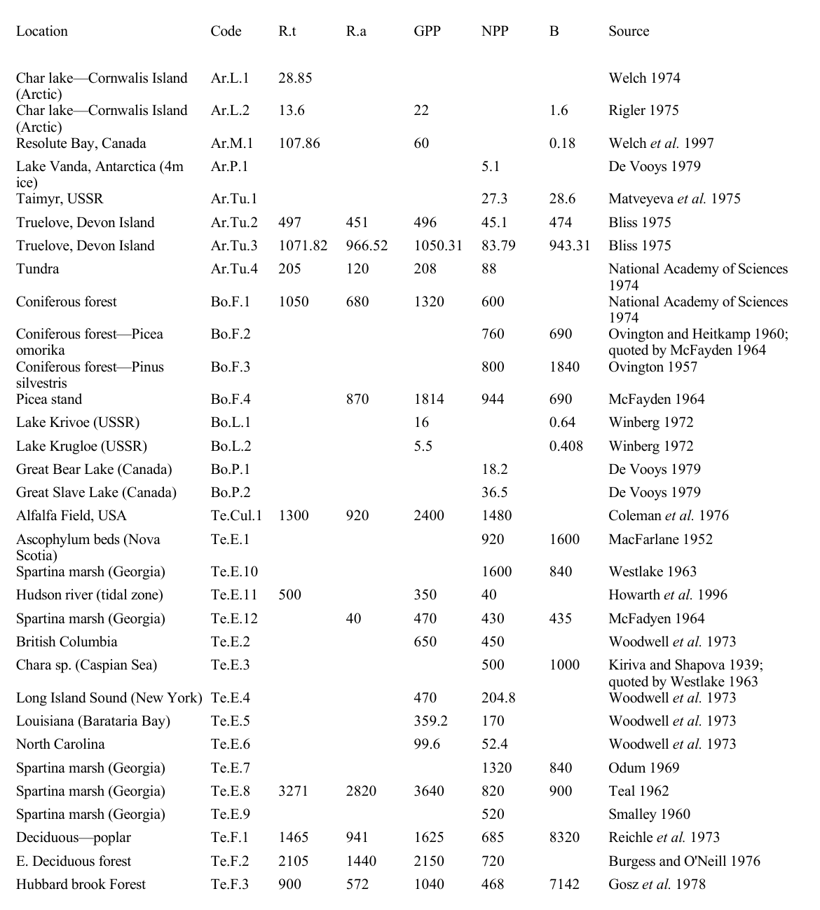
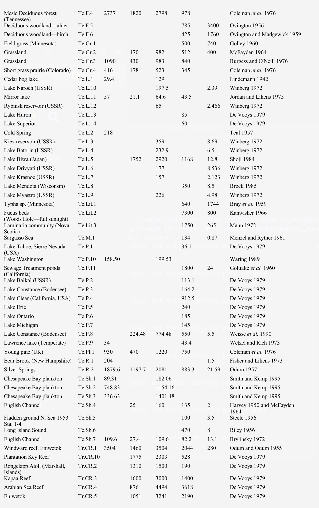
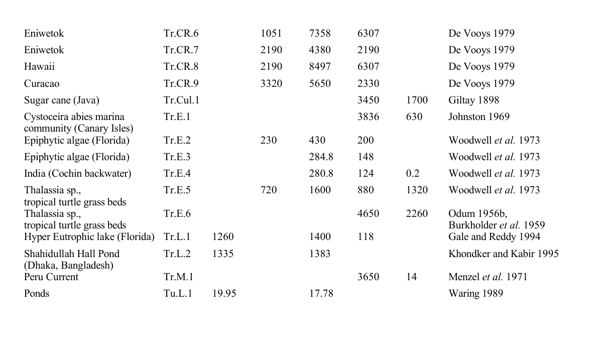

<!---

css: some useful ones here: https://markdowncss.github.io/

template related ...to get started:

Write paper in as *.md, refs in references.bib and use my_template.tex as a pandoc template
Modify makefile as required

citations: are cited as \cite{mittner2014brain} 

equations: 
	referenced as:  eq. (\ref{1}) 
	tagged as:  $$ \pi=\pi \tag{1a} \label{1}$$

pictures:
	referenced as: figure \ref{fig2}
    tagged as: {width=100px height=50px} 
    
    no working: fignos ..  Fig. @fig:dummy{#fig:dummy width=40% height=20%}

tables: 
	do same as pictures or
	direct latex Tables: 
	
	\begin{table}[ht]
	\centering
	\caption{Probability to observe Bayes Factors of a certain magnitude or above for the used sample-size of $N=60$ assuming the original and the null-hypothesis.}
	\begin{tabular}{llrrr}
	  & & \multicolumn{3}{l}{$P(\text{BF}\ge\theta)$}\\
	  Hypothesis & BF Type & $\theta=3$ & $\theta=10$ & $\theta=20$ \\
	  \hline
	  $d\sim \mathcal{N}(1.57, 0.51)$ & JZS BF$_{10}$ & 0.98 & 0.97 & 0.96 \\
		 & Replication BF$_{10}$ & 0.98 & 0.96 & 0.96 \\
		 & Meta-Analysis BF$_{10}$ & 0.99 & 0.99 & 0.99 \\\cline{2-5}
		$d=0$ & JZS BF$_{01}$ & 0.81 & 0.00 & 0.00 \\
	   & Replication BF$_{01}$ & 0.98 & 0.95 & 0.91 \\
		 & Meta-Analysis BF$_{01}$ & 0.63 & 0.27 & 0.06 \\
	   \hline
	\end{tabular}
	\label{tab:probbf}
	\end{table}

-->

<!-- NOTE to self: -->
<!-- check out media/template.tex for more YAML/latex options -->
<!-- run make at command prompt -->
<!-- citations: [@capretz2017soft] -->

<!-- -- estimation of size- abundance relationships  and general problem with  autocorrelation  in space and time and size ..   -->

<!-- -- FFT    - independence of cross section == better estimate     - direct relationship to space and or time structure   - elaborate upon these      -->

 
 
# Introduction[^1]

A coherent understanding of empirically observed *thermodynamic* states of matter was developed by Carnot (1824), Thompson (1849) and Clausius (1850). It was a monumental feat in that only a few variables of state (temperature, pressure, volume) were sufficient to describe the behavior of matter even if they were composed of an enormous number of atoms and molecules. Shortly thereafter, Boltzmann (1877) and Gibbs (1902) developed a statistical-mechanical description of the component parts that was complementary and related to the former by a proportionality factor (Boltzmann's constant; Planck 1901). 

<!--

Thereafter, non-statistical, axiomatic and geometric formulations of the $2^\text{nd}$ law of thermodynamics were made by Carathéodory (1909) and Lieb and Yngvason (1999). 

-->

All ecological processes are subject to these same thermodynamic laws[^2]. Even the most basic attempts to account or model matter and energy flows necessarily begin by invoking conservation of energy and matter, and as such, irreversible losses of energy from the system. There have been many attempts to understand this connection and draw inferences from it, due to the possibility of similarly and dramatically reducing the very large degrees of freedom required to describe ecological systems into a few variables of ecological "state", and perhaps, even understanding the directionality of ecological dynamics. 

<!-- REVIEW NOTE: Clarify that a distribution over species or organismal containers is statistically meaningful, but not automatically physical entropy. Suggested replacement: "Probability distributions over biological accounting states provide a statistical description. When those states correspond to physical microstates or a defined coarse-graining, with multiplicities, energetics, and exchanges specified, Gibbs entropy connects that distribution to thermodynamic entropy. Without this mapping, keep the statistical and physical quantities distinct." -->
Unfortunately, most ecological systems exhibit matter and energy cycling and boundary flows that occur at many space and time scales. This makes accounting for *entropy* very difficult/impossible (Meysman and Bruers 2010). As such, many resort to a model-based, information-theoretic representations of microscopic variability as an analogue to microscopic *disorder*. Further, due to the rather spectacular successes of Boltzmann (1877), most authors conflate the two concepts of macroscopic entropy and microscopic disorder. Indeed, it is only when both the microscopic and the macroscopic descriptions of a given system in focus can be shown to converge that we can begin to suggest that we reasonably understand the system. In molecular motion, certainly this connection has been demonstrated and so we say we "understand" it. But in ecological systems, both microscopic and macroscopic representations are far from convergent. It is, therefore, necessary to keep these two streams separate as they carry different perspectives and we need to be cognizant of, how much, or how little, they converge, such that we can gauge how well we  "understand" an ecological system. 

Here we review some of the key issues related to the application of thermodynamics in the field of ecology (see also: Fath et al. 2004, Chakrabarti and Ghosh 2009, Meysman and Bruers 2010, Yen et al. 2014, Choi 2019). In particular, we touch upon the conceptual beauty and challenges of information theoretic Order Principles; the macroscopic, *extrinsic* focus of free energy gradient dissipation approaches and with similar limitations; and finally upon Onsager's (1931a,b) far-reaching contributions to connect the two: microscopic with the macroscopic, which has still not yet been sufficiently appreciated by ecologists, even after almost a hundred years since their expression.

# Microscopic Order

Boltzmann (1877) connected the logarithm of the number of possible configurations of microscopic states in the phase space (statistical-mechanical) representation of a system to its macroscopic state variable, *entropy*, through a proportionality factor. Boltzmann (1877) and subsequently, Gibbs (1902) suggested that this increase in the number of microscopic states in phase space represents the amount of randomness or variability in potential microscopic states. The canonical example is an isolated container filled with *n* molecules of some gas, identical in all respects including, velocity and momentum. As it would take much energy and effort to force the molecules to stay in such a *uniform* state, the potential energy can be considered high and the *entropy* associated with this configuration can be considered to be at some reference value. As it has only one microscopic state in the 6*n*-dimensional phase space (2 variables of state $\times$ 3 dimensions $\times$ *n* molecules), the microscopic variability of the system can also be considered low. Releasing the constraints that forced it to stay in this state, the potential energy is eventually converted into kinetic energy and residual *entropy*. The latter quantity continues to increase relative to the reference entropy state, as by definition it is irreversible. Simultaneously, the movements and collisions of the gas molecules will result in a spread of the velocity and momentum distributions with each collision until eventually this distribution no longer changes. The number of possible microscopic representations in phase space increases to a maximum level of randomness or microscopic (*order $\rightarrow$ disorder*) with a corresponding increase in macroscopic *entropy*. Basic elementary grade physics. 

Similarly, an internal combustion engine takes the chemical potential energy of fuel and in the process of burning it, converts it into dispersed gases, small particulates and heat, some fraction of which becomes *entropy*. From a microscopic perspective: the physical-chemical model of long-chained hydrocarbons and associated bond energies, the fuel goes from a structured to a dis-aggregated state; that is, the number of possible microscopic states in phase space has increased (*order $\rightarrow$ disorder*). 
 
Schrödinger (1944) pointed out that biological systems seem to operate in a different manner. The example he used was DNA, which he described as a curious "aperiodic crystal" of extremely high information content, that is, with all the information required to create and maintain life. He noted that DNA manages to replicate itself with extreme stability as mutation rates are much lower than might be expected simply due to thermal replacement and degradation in chemical reaction of similarly large molecules. If DNA is represented as a phase space with dimensionality equal to the number of base pairs; this implies a model that assumes each base pair acts independently, which is of course incorrect. But nonetheless, with each replication from parent to child the amount of order remains roughly constant and the range of variability at each base pair constrained to be within a range not too dissimilar from the previous generation. Thus, the range of possible microscopic states are narrow, stable and robust, suggesting an *order $\rightarrow$ order* process.  

This stability is due to chemical activation energies and chemical bond stability; self-correcting enzyme systems and proteins; and of course Darwinian selection. Indeed, stable life cycles, developmental processes, canalization, phenotypic plasticity, ordered metabolic pathways such as the Krebs cycle, predator-prey interactions, host-parasite interactions, habitat-niche considerations, animal migration patterns, species distributions in space, all represent examples of intricately patterned or constrained processes of *order $\rightarrow$ order*. They are the mainstay of biology and ecology: feedback cycles and their inter-relationships (Yodzis 1981, 1988). More generally, such structures are also known as *dissipative structures* (Kolmogorov 1941, Glansdorff and Prigogine 1974); they describe these stable, *order $\rightarrow$ order* systems that maintain their internal (local) structure/order, at the cost of elevated energy degradation to their environment. In other words, if the focus includes these structure and its surrounding environment, then the overall effect is *(local order $<=>$ local order) $\rightarrow$ (global disorder)*, literally pumping free energy in and entropy out. Other examples of this have been identified including: Rayleigh-Bénard convection cells, the Zhabotinsky reactions and Turing waves (Glansdorff and Prigogine 1974). Living systems, in the act of growth and maintenance, tap into these external matter and energy flows to maintain local order (Zotin and Zotina 1967).  

Schrödinger (1944) also considered the steps that might be required to lead to the origin of life, from simple chemical compounds to more complex matter/energy cycles or "hypercycles" and eventually the evolution of replication mechanisms such as RNA, DNA, proteins and membrane based compartmentalization in the backdrop of strong energy gradients (Eigen and Schuster 1979; Wicken 1980). They clearly suggest the operation of yet another principle, *disorder $\rightarrow$ order* and much has been said on this topic (Lotka 1922, Schrödinger 1944, Bertalanffy 1950, Eigen and Schuster 1979, Wicken 1980, Wiley and Brooks 1982, Schneider and Kay 1994, Schneider and Sagan 2005, England 2013). In general, they suggest that living systems seem to increase in complexity over evolutionary time: the sheer number, types and hierarchical organization of structures and metabolic pathways is high relative to our primordial ancestors that were presumably much simpler and had shorter snippets of (D/R)NA, and in terms of the metabolic and organizational structures that they encoded. With this increase in complexity, there is seemingly a corresponding increase in *order* in the biota, due to the additional effort required to maintain this complex and often intricate biological structure. In other words, the action of Darwinian selection in the short-term seems to be to stabilize (*order $\rightarrow$ order*) and in the long-term to increase order (*disorder $\rightarrow$ order*); where the latter occurs presumably through the accumulation of strategies for survival in the face of a relentlessly variable abiotic and biotic environment (van Valen 1976, Bell 1982).  

This potential incongruence of *(dis)order $\rightarrow$ order* with the $2^\text{nd}$ law expectation of ever increasing *entropy* (and *order $\rightarrow$ disorder*) has even been suggested by many of the above authors as being a means of defining or distinguishing between life and nonlife. Indeed, Lovelock (1972), Lovelock and Margulis (1974) used this logic to advantage and suggested the "Gaia hypothesis", that the presence of atmospheric homeostasis (i.e., a non-equilibrium stable state) can be used as an indicator of the presence of life on other planets and is now even used as an organizing principle of planetary-scale atmospheric models (Kleidon 2010). Similar kinds of thermodynamic inference have been made for ecological succession, the stage-like patterns of colonization and abundance in various landscapes and increase in order over ecological time scales (Odum and Pinkerton 1955, MacArthur and Pianka 1966, E.P. Odum 1969, Margalef 1963, Gladyshev 1978, Matsuno 1978, Johnson 1981, Vanriel and Johnson 1995, Washida 1995, Kay 1991) and embryonic and developmental patterns (Zotin and Zotina 1967, Lurié and Wagensberg 1979, Briedis and Seagrave 1984, Aoki 1989, Holdaway et al. 2010).  

The presence of these three order principles has precipitated a wide, generally confusing discussion of their relevance in living systems. What has been learned through these discussions is that it is absolutely necessary to specify explicitly the frames of reference by which we mean: (1) the focal perspective (microscopic order/disorder or macroscopic energy/matter); (2) the constraints such as boundary conditions, ground/reference states; and (3) the space-time scales. 

&nbsp; 

![Heuristic representation of the principles of order principles and corresponding changes in entropy. (A) *order $\rightarrow$ disorder*: the $2^\text{nd}$ law such as in simple heat engines (red dashed lines); (B) *order $\rightarrow$ order*: a seeming stasis, that is, homeostatic behavior in biochemical systems, stable ecological systems, genetic stability (green self-loop, and "dissipative structures"); and (C) *disorder $\rightarrow$ order*: a seeming reversal of the $2^\text{nd}$ law, observed in embryogenesis, succession, biodiversity increase over evolutionary time scales (transition from red-dashed lines to green loops). The circles show the focal (local) processes for each order principle. Note the dissipation-cascade from top to bottom as each dissipative structure connects to other dissipative structures and manifested as Onsager Relations (blue arrows; see text below), interconnected vehicles of energy-cascades (turbulent dynamics, food-web dynamics, metabolic pathways, etc.). Adapted from Choi (2019). \label{fig_cascade}](media/order_cascade.png){width=80%}

&nbsp; 

To illustrate the above, we use the simple metaphor of a parcel of water flowing downhill along multiple paths/streams (Fig. \ref{fig_cascade}, area A). The potential energy of the parcel of water, a certain volume tagged in the middle of a lake, at elevation is initially in a low kinetic energy and high potential energy configuration, and being otherwise in a similar state (pressure, volume, temperature), at some initial level of entropy. As some of it flows down hill, some of the potential energy is converted into kinetic energy and some dissipated as heat, noise, erosion, percolation into groundwater, evaporation and ultimately entropy. Given enough time, it will eventually reach the lowest elevation possible (the equilibrium "reference" state in this example), where it is in the highest possible *entropy* state in that all potential energy has been converted to entropy or kinetic molecular energy. Simultaneously, the *order* in the initial state (low and uniform molecular momentum and velocity of the initial parcel of water) when exposed to different pathways (streams, groundwater, evaporation) progressively takes on increasingly more variable distributions of momentum and velocity: spread out through the atmosphere, in the lake, rivers, falls, in the ground, and the ocean (*disorder*) until it reaches the final highest disordered reference state (the definition of which, depends upon the available free energy entering the system).

However, under certain circumstances and space-time scales of observation, the flow of water might seem to persist and gather together, for a short period, such as for example, in eddies and pools near rapids and falls. In the frame of these smaller windows (scales) of time and space, these cycling structures can seem stable and self-perpetuating: that is *order $\rightarrow$ order* (Fig. \ref{fig_cascade}, area (B)). Though of course, it is only a small volume that becomes part of the eddy and the bulk of the water continues to flow downhill. And so the question is: what are these special "certain circumstances"? As biologists and ecologists we endeavor to detail all these special "certain circumstances" and pre-conditions to stable material and energy flows, be they at subcellular, cellular, organismal, population, community, ecosystem or earth-system levels of organization.  

In ecology, there is an *implicit* understanding that these matter and energy flows are only borrowed by biota, taking in a small fraction of energy and matter (ecological efficiencies tend to be low relative to "bulk flow", see below) and so slowing down its eventual passage by redirecting them into organisms and ecosystems by growth and reproduction (biomass, chemical bonds), before their final release back into the entropic flow, "down the river" in the form heat, noise, breaking of molecular bonds, etc. Biota and ecological structures are like these eddies and energy cascades. Indeed, this is so implicit that seldom are the entropic flows and constraints the explicit focus in biological and ecological studies. There is a matter-of-fact, *apriori* awareness that they are systems open to energy and matter flows, where boundary inflows must be much larger than the outflows to sustain life. Instead, ecologists tend to focus preferentially upon the more "interesting" features of stable interactions and negative feedback dynamics in the 1 to 10% that is used or retained by biota.  

Nonetheless, these more "interesting" eddy-like matter/energy interactions facilitate the overall boundary losses of energy and create *entropy* by "exporting" it, e.g., as waste heat, via respiration, transpiration, mixing of degraded molecules, etc. As such, they act as free energy dissipating structures (the eddies in the river metaphor) that borrow free energy and so helps to dissipate it more than if there had not been dissipative structures. Lindeman (1942) was amongst the first to explicitly estimate such losses; his and subsequent estimates by H.T. Odum 1956, E.P Odum 1969, Mann 1972 and others suggest ecological (trophic) efficiency to be generally quite low, ranging from <1% upto 10% for some interactions. That is, entropic losses actually dominate most energy transformations in an ecological setting. Indeed, from satellite-based radiation estimates, for many plants, >99% of incoming solar energy can be lost due to evapo-transpiration and respiration (Schneider and Kay 1994, Schneider and Sagan 2005) though of course these processes are "functional" in that they are used to draw water and minerals from the soil (work is done). Only a very small fraction of inputs are aggregated and sequestered as biomass and with it, an associated local decrease in *entropy*. Yet even with such low efficiencies, biota continue to manifest and exert their global influence over geological time scales (Lovelock and Margulis 1974).  

Finally, if the frame shifts to ever smaller space-time scales, we can focus upon the transition from downward flow to a upward flow of water, that is, to the initiation of an eddy (Fig. \ref{fig_cascade}, area (C)). In this extreme close-up frame, an even smaller fraction of the flow of water actually seem to be reversing direction and moving uphill (*disorder $\rightarrow$ order*), though of course the bulk of the water does continue to flow downhill (*order $\rightarrow$ disorder*). The empirical observations in hydrodynamics suggest that stable laminar flow changes into non-laminar flow once frictional (dissipative) forces increase in importance due to higher kinetic energy. These fluctuations selectively increase and if the higher kinetic energy conditions are sustained, alternate stability regimes can manifest via bifurcation of the dynamical attractors. In switching to an alternate stability regime, they seem to "self-organize". Empirically, such observations of switching behavior are also documented in ecology and evolution, often associated with feedback mechanisms altering due to major changes in external conditions (free energy gradients) and/or novel biochemical processes, or species-interactions due to speciation or range expansions/contractions, keystone species interactions or trophic cascades causing new stable associations.  

A clear understanding of order/disorder requires a reasonable representation of the system being described, that is some *model*. As such descriptions are inherently sensitive to the structure and parameterizations of the model representation and as multiple models can represent the same system, divergent conclusions are possible. In the example of molecular motion, some minor divergence was eventually found between entropy and disorder, this precipitated the description of new physical processes that had not been previously considered: quantum effects (Schrödinger 1944, Jaynes 1957). Unfortunately, there is as yet, no mechanistic model that can be said to reasonably represent an ecosystem in any but the most simplistic of terms. The usual choices are some variations of a Lotka-Volterra formulation (e.g., Michaelian 2005, Chakarbarti and Ghosh 2009) or the even more aggregate ("black-box") models of first order input-output analysis (Patten 1978). As there exists subjectivity in what the categories are in such models and the choice of parameterizations of these dynamics, the information content (i.e., *order*) also becomes a subjective concept. But similar to the case of molecular motion, their divergence from reality will point to new processes that need to added to the model representation.

With such ambitions, the information-theoretic representations of the topology of feeding networks were proposed by Ulanowicz and Hannon (1987) and Ulanowicz et al. (2006) as a first approximation to these microscopic representations of order/disorder. Jørgensen et al. (1995) tried to define *order* on the basis of the number of "genes" in various organisms with the assumption that this number would represent the information content and, therefore, the *order* associated with an organism; of course, there was no formal model representation of an organism's energetic dynamics and gene number. Wicken (1980) and Wiley and Brooks (1982) focused upon similar approaches to describe information-theoretic and topological components of phylogenetic complexity; but again, a mechanistic model relating phylogenetic dynamics to a phase space representation was not definitive. 

# Macroscopic Entropy

Given the lack of satisfactory microscopic model representations of ecosystem phenomena, many have attempted instead to try to describe ecosystem processes in terms of some macroscopic state variables. Such a whole system-level (*extensive*) approach is perhaps best exemplified by the engineering tradition which traces its origin directly to the founding work of Carnot (1824). The whole system free energy available to do some form of work is the state variable of interest, and carefully controlled and measured. Engineering applications usually focus of upon systems whose bounds can be defined explicitly (e.g., some machine or production process) and revolve around a few well defined forms of energy and matter transformation, and an explicitly defined reference/ground state. These conditions permit repeated measurements of free energy and entropy, and transfer efficiencies can be calculated to permit cost-benefit or efficiency analysis of the whole system.  

Following in this tradition, Lindeman (1942), Odum (1969), Kay (1991), Aoki (1993), Schneider and Kay (1994), Müller (1998), Schneider and Sagan (2005) and Jørgensen (2012) and many others have focused upon an analysis of *extensive* free energy gradients and ultimately their degradation (into entropy). In a similar perspective, Aoki (1993, 1995) estimated whole system entropy production from energy balance of lakes. Choi et al (1999) estimated entropy flux from plankton size spectra. Schneider and Kay (1994) used satellite-based measurements of evapo-transpiration as a proxy of entropy production and related this to vegetation cover. These *extensive* accounting approaches, however, suffer a difficulty similar to those faced in defining any quantity with many mass-energy transformation processes occurring at large ranges of spatial and temporal and organisational scales of open, nonequilibrium systems with ill-defined boundaries and reference states, often in cycles! Further, that which is a resource for one organism can be irrelevant for another or even a toxin. These complex relationships between *extensive* variables of state and system stability suggests that a naive application of the *extensive* thermodynamics can be more than a little problematic (Meysman and Bruers 2010). 

To overcome or at least to acknowledge some of these challenges, Patten (1978) attempted to unravel the energy transformation cycles as a first order linear expansion of input-output relations. Similarly, Odum (1996) attempted to trace and unroll all energy transformation steps starting from solar radiation to the component of interest and expresses it in terms of solar energy units. Generally, the conclusion is that macroscopic entropy production will increase monotonically (i.e., the $2^\text{nd}$ law) and biological and ecological complexity might be associated with this but sometimes not, and exactly how is not clear, other than a series of accumulated thermodynamic accidents/incidents, as the state space becomes more extensively explored.  

# Onsager's relations

<!-- REVIEW NOTE: Replace the implied universal identity between macroscopic entropy and "information-theoretic entropy" with a qualified bridge. Suggested text: "The Gibbs entropy of a probability distribution over physically defined microstates has the same mathematical form as Shannon entropy. This is a meaningful convergence, not a blanket identity: its thermodynamic interpretation depends on the physical states, their multiplicities and energies, and the system constraints and exchanges." Then connect physical transition rates and local detailed balance to entropy production. -->
Onsager's remarkable contributions (Onsager 1931b, Onsager and Machlup 1953, Mazur 1996, Verhás 2014) tied *macroscopic entropy* with *microscopic order* (Boltzmann's information-theoretic entropy) for any generalized thermodynamic system. Here we repeat this because it is so very important and for the sake of clarity; and then, we focus upon the fascinating relationship between Onsager's relations (*Conjugate effects*) with the well known Le Chatelier-Braun Principle (Bertalanffy 1950, Gündüz and Gündüz 2014). When this *extensive* concept is applied to arbitrarily small volume elements in an *intensive* local approach (Prigogine 1955), we obtain a potentially deeper understanding of the pragmatic connections between Thermodynamics and Ecology.

### Conjugate effects

<!-- REVIEW NOTE: Define the process basis and force convention before asserting reciprocity. Suggested replacement: "For specified independent extensive coordinates, define conjugate fluxes and thermodynamic forces with consistent units so that the internal entropy-production rate is sigma = J dot X. Near equilibrium, microscopic reversibility implies Onsager reciprocity for the appropriate time-reversal parities; with time-reversal-odd fields, use Onsager-Casimir relations. The resistivity R = L inverse exists only when L is invertible." -->
*Onsager's relations* are a generalization of well known phenomena such as Fick's law of diffusion, Fourier's law of thermal conduction and Ohm's law of electrical current, expressed in terms of entropy. More generally, for $n$ *extensive* variables of state (e.g., volume, energy, mass, etc.), the vector $\boldsymbol{\alpha}$ defined such that $\boldsymbol{\alpha}_{i=1, \dots, n} = 0$ when in equilibrium and the entropy is a function of the state vectors: $S=S(\boldsymbol{\alpha}_i)$. If there are fluctuations from equilibrium, the thermodynamic forces that restore equilibrium back to maximum entropy $S_0 = S(\boldsymbol{\alpha}_i = 0)$ are:
$$X_i = \frac{\partial S}{\partial \alpha_i}.$$

That is, the forces (e.g., a gradient in temperature, pressure, voltage difference, etc.,  expressed in terms of entropy production), "cause" matter/energy flows (of heat, particles, electrons, etc.) that restore equilibrium. These flows of extensive variables (thermodynamic fluxes) per unit time ($J = \frac{d\alpha}{dt}$) are generally (that is, empirically found to be) proportional to the force: $J \propto X$. Further, it is generally (that is, empirically found to be) known that the force of one process $j$ can also alter the flux of another process $i$. The fluxes and forces can be approximated upon linearization near equilibrium as, respectively:
$$J_i = \sum_{j=1}^{n} L_{ij} X_j \quad \text{or} \quad X_i= \sum_{j=1}^{n} R_{ij} J_j,$$

with $L = R^{-1}$. These empirically derived matrices of parameters are known as phenomenological conductivities ($L$) and resistivities ($R$). With assumptions of microscopic reversibility, these become symmetric matrices, that is:
$$L_{ij} = L_{ji} \quad \text{or} \quad R_{ij} = R_{ji}.$$
 
When quantities are connected reciprocally in this fashion, they are referred to as *conjugate variables*. Confirmation of the *reciprocal* nature of these relationships in energy transformation process (i.e., a "phenomenological force") affecting the speed (flow) of another seemingly unconnected transformation process have been found experimentally for many physical processes (reviewed in depth by Miller 1959). A well-known, concrete physical example is the *Seebeck effect* where electrons flow in the presence of a temperature gradient which serves as the basis of thermocouples; and the subsequent discovery of the reciprocal relation, the flow of heat with application of electricity, known as the *Peltier effect*, which serves as the basis for thermistors. For thermal-electromagnetic coupling, the relations are known as the *Nernst-Ettingshausen effects*. The same reciprocal coupling have been explored in chemical reactions and cell membrane dynamics (Oster et al. 1971, Glansdorff et al. 1974, Mikulecky 1985). 

<!-- REVIEW NOTE: Distinguish internal entropy production from the time derivative of entropy stored in an open subsystem. Suggested replacement: "The internal entropy-production rate is sigma = sum_j X_j J_j. For J = L X, sigma = X transpose L X; nonnegative production constrains the symmetric part of L to be positive semidefinite. The subsystem entropy balance also includes signed entropy exchange across its boundary." -->
As entropy production is the sum of all interacting process (inner products of forces and fluxes):
$$\frac{dS}{dt} = \sum_{j=1}^{n}  \frac{\partial S}{\partial \alpha_j } J_j =\sum_{j=1}^{n} X_j J_j,$$
it can be expressed in terms of gradients or flows, respectively:
$$\frac{dS}{dt} = \sum_{i,j=1}^{n} L_{ij} X_i X_j \quad \text{or} \quad \frac{dS}{dt} = \sum_{i,j=1}^{n} R_{ij} J_i J_j. \qquad \text{eq. 1 (a, b) }$$

<!-- REVIEW NOTE: Qualify the claim that L and R are positive definite and that a stationary state minimizes entropy production. Suggested replacement: "In the stated near-equilibrium regime, reciprocity follows under microscopic reversibility. Nonnegative entropy production requires the symmetric part of L to be positive semidefinite; strict positive definiteness additionally requires a nonredundant basis with no null modes. These conditions do not establish a universal minimum-entropy-production principle for arbitrary driven or evolving systems; any variational claim needs its own assumptions." -->
The remarkable result is that "*reciprocal relations must hold if … entropy production has an extremum at the stationary state*" (Onsager 1931a,b).  This is the case as, $\frac{dS}{dt} \geq 0$ due to the $2^\text{nd}$ law, and the other terms in eq. 1 being quadratic, the $L$ and $R$ are also positive definite. This translates to minimal entropy production or minimal energy dissipation at the stationary state due to fluctuations (random or otherwise) being dampened (via reciprocal processes; see below). This "least dissipation of *energy*" principle was elaborated upon in Onsager and Machlup (1953)[^5] and extended and generalized further to a Lagrangian dynamics perspective / Hamiltons' principle (Shiner and Sieniutycz 1994) and for *intensive* entropic processes by Prigogine (1955) with variational / *Lyapunov functional* approaches for (local) fluctuations near the linear range and further (Glansdorff et al. 1974) and Verhás (2014).

<!--

In terms of entropy, Onsager (1931a), and Onsager and Machlup (1953) define a generalized "dissipation functions" based on symmetry with Raleigh's hydrodynamical dissipation functions, that acts as thermodynamic potentials: 
$$\Psi = \frac{1}{2} \sum_{i,j=1}^{n} L_{ij} X_i X_j \quad \text{or} \quad \Phi = \frac{1}{2} \sum_{i,j=1}^{n} R_{ij} J_i J_j$$
They expand the entropy equation as a Taylor series at equilibrium:
$$S = S_0 - \frac{1}{2} \sum_{i,j=1}^{n}  S^*_{ij}  \alpha^*_i  \alpha^*_j + \text{higher order terms}$$
and the associated Boltzmann probability of a given Gaussian fluctuation $\alpha^*$ as:
$$Pr(\alpha^*) \propto \text{exp}(S/k) \propto \text{exp} \left[ - \frac{ \sum_{i,j=1}^{n}  S^*_{ij} \alpha_i^* \alpha_j^*}{2k}  \right],$$
which has a restoring force:
$$X_i = - \sum_{j=1}^{n}  S^*_{ij} \alpha^*_j,$$
and thus phenomenological laws:
$$\sum_{j=1}^{n}( R_{ij} J_j + S^*_{ij} \alpha^*_j) = 0.$$
They continue with a statistical analysis of fluctuations as Markov processes and conclude that: 

$$\frac{dS}{dt} - \Psi_{ij} = \text{max};$$
that is, as the energy dissipation potential will decline as m,uch as possible, the there is any increase in entropy production and energy dissipation will increase as much as possible.

-->

<!-- REVIEW NOTE: The diagonal response does not by itself prove that an imposed force decays, and individual cross terms can be negative. Suggested replacement: "A positive diagonal coefficient describes the local self-response of a flux to its conjugate force. Whether the perturbation relaxes depends on the full dynamics, constraints, and reservoirs. Cross coefficients may have either sign; only the complete quadratic form X transpose L X is constrained by nonnegative entropy production. Treat the Le Chatelier analogy as conditional, not as a general dynamical theorem." -->
The Onsager relations are, therefore, in their range of validity close to stationary states, essentially entropy production based linearized representations of the Le Chatelier-Braun's principle[^4]: the diagonals of Onsager's phenomenological coefficients represent linearized (approximate, first order) self-effects (Bertalanffy 1950. Gündüz and Gündüz 2014). If a system is perturbed by a small external force upon one of the processes: $\delta X_i$, this will result in a small associated flux $\delta J_i = L_{ii} \delta X_i$.  If no other process is allowed to react/adjust, and as $L_{ii} > 0$ because the transport process produces entropy and $\delta S_i = L_{ii} \delta X_i^2 >0$. That is, any small perturbing force $\delta X_i$ will increase the flux $\delta J_i$ that in turn will result in a decrease in the force $\delta X_i$. That it, the system will "resist" the change (self-dampen) and so act in concordance with the Le Chatelier-Braun principle (Gündüz and Gündüz 2014). 

Similarly, the off-diagonals represent the linearized (approximate, first order) indirect/cross effects. If, in the above example, another process $j$ were permitted to adjust, but not $i$ (that is, $\delta J_i=0$ is forced) then the conjugate flux $\delta J_j = L_{ij} \delta X_i$ increases entropy associated with the $j$'th process $\delta S_j = L_{ij} \delta X_i^2 >0$. This will result in dissipation of the perturbation and reduce the magnitude of the perturbing force $X_i$, again, "resisting" the perturbation, in this case by a transport process of a conjugated variable $j$.  

<!-- REVIEW NOTE: Recast symbiosis, parasitism, predator-prey feedback, and climate coupling as candidate ecological mechanisms or hypotheses, not established Onsager reciprocal pairs. Suggested insertion: "Biological interdependence motivates candidate coupled processes, but mutual benefit, feedback, or correlation does not establish Onsager reciprocity. That interpretation requires identifiable conjugate physical fluxes and forces, controlled cross-perturbations, and a valid near-equilibrium reference." -->
Thus Onsager's relations help make explicit Le Chatelier-Braun's principle (herein, we will call it, *Conjugate effects* to emphasize the connection to Le Chatelier-Braun principle and not taint the meaning of the latter), in a linearized framework. So, the question that begs to be asked is: What are the *Conjugate effects* in ecological systems? It is not a given that energy and matter exchange processes will be *conjugate* with each other, although there is a high chance of them being so if the relationship involves energy or mass transfers which can be expressed in terms of entropy production, and, is not an one-off event (that is, it occurs with sufficient frequency that is can be expressed statistically with rigor). In ecology, the classical such example is *symbiotic* relationships, where both interacting species benefit from each other. There are even more specialized *synergistic* relationships that require each other for survival. Both are clear examples of reciprocal relations (*Conjugate effects*), both at the individual and species/population level. 

How about parasitism? Is there a reciprocal relationship between host and parasite? Yes! Co-evolution between host and parasite, represents an intricate interplay between both. Their overall relationship, can in the long-run, help keep a host population strong by incremental removal of mal-adapted individuals, *accelerating* adaptive change in environments that are dynamically challenging/unstable. Thus, parasitism can have "beneficial" effects upon its host at a population or species level. However, to the individual being parasitized, it is usually detrimental; though it has also been suggested in the form of the "Hygene Hypothesis" that some exposure can help stimulate the hosts' immune system against other antagonists and even act as protective/commensal organisms (Strachan 2000, Smith et al. 2012). Predator-prey relations can also be mutually beneficial if the influence upon the prey is sufficient to promote rapid (or better, accelerate) adaptive change of the prey to environmental challenges while also benefiting the predator. Predators and parasites, can also help regulate prey/host populations such that the latter do not grow too large and exhaust its own resources. The classic example is white tailed deer being introduced on a small island, eating everything and then going extinct due to a lack of predator-control (Russell et al 2001). Predation helps regularize/stabilize a prey population such that the latter does not suffer through large fluctuations and potentially extirpation/extinction. Though conceptually connected, these relationships have yet to be measured and expressed in terms of entropy production and so remains a relationship that required more careful study. There is also asymmetry in the timescales of reciprocal effects of parasite-host and many predator-prey relationships. Do such potentially nonlinear reciprocal relations due to divergent timescales assist the perpetuation of these time-asymmetrical and stabilize them? All very interesting questions, inspired solely from consideration of *Conjugate effects*. 

Indeed, the Gaia hypothesis (Lovelock 1971, Lovelock and Margulis 1974) and related Daisy world simulations (Watson & Lovelock 1983) are similar examples of the potential connection between microscopic (individual-population scale) processes and macroscopic (planetary earth-system scale) climate and albedo effects. That one can affect the other and vice versa (that is, the existence of a feedback loop), suggests *Conjugate effects*. Though some are well established, there may be others that require careful measurement to express properly and clearly. Even the current anthropogenically caused rapid climate change can be seen as an example of these unexpected reciprocal effects (CFC's, methane, methane hydrates (i.e., "Clathrate gun hypothesis"), CO$_2$, sulfur, human abundance and activities, etc.), and as a consequence, a potential route to their mitigation.

In a similar vein, can *Conjugate effects* be responsible for the correlations seen between energy transformation processes such as respiration, growth/biomass production, photosynthesis, and evapotranspiration in biota? That is, can they represent thermodynamic/mechanistic causality and not just simply biochemical correlation (Kleiber 1947, Bertalanffy 1950). For this to be, one flow must have must have an inverse effect upon the other flow, which can only be detected with strict physiological experimentation. Conversely, this can be stated in terms of the effect of perturbations of one "thermodynamic force" (gradient) upon another gradient (i.e., Eq. 1). The interactions and relationships between organisms via competition, predation, consumption, mutualism, etc., occur in the presence of bio-chemical-physical gradients. And indeed, there are correlations between many of these metabolic processes and resource and consumer dynamics at eco-physiological levels. The amount of photosynthetic biomass can affect the rate of evapotranspiration and even the rate of consumer metabolism. Another example can be seen in the complex benthic-pelagic coupling of lakes as a function of nutrient, oxygen and pH gradients (Regier and Kay 1996) or the related concept of the marine biological carbon pump (i.e., production vs carbon gradients; Eppley and Peterson 1967) and even the relationship between evapotranspiration and sediment mineral profiles (gradients) in tropical vs temperate environments. 

Not all relationships may be directly conjugated; however, indirect interactions can result in *effective* conjugation, though the magnitude of these interactions can deviate from exact reciprocity as the timescales of processes may vary. Thus, an important biological/ecological question is: what traits enhance or reduce the strength of *Conjugate effects* or even **break** them? For example, Halbach (1973) suggested a connection between temperature and growth in rotifers: when exposed to higher temperatures, they grew smaller in size and had higher population abundance oscillations. If there is a reciprocal relation, then we might expect that if they are allowed to grow large, and all else were kept constant, then there might be a testable effect upon temperature. In the nonconjugate case, as rotifer metabolism, like most organisms, are allometric, larger size would mean higher total metabolism; there would be an expectation of greater heat production. If, however, a *Conjugate effect* or an *effective* conjuage effect (though indirect interactions) were present, then we would expect a decrease in temperature; that is, though body size may increase, numerical density (and therefore total metabolism/heat production) should decrease. Of course, this test would need to be very carefully conducted. A testable expectation, based solely on observation and a basic thermodynamic principle to distinguish between a spurious correlation and causality (Peters 1991)! 

Similarly, positive feedback dynamics can lead to extremes and highly non-linear consequences. The collapse of the North-West Atlantic cod (Choi et al. 2004) and subsequent exploration of alternative equilibria as a result, possibly modulated or even caused by environmental variability (Choi 2023) can be seen as a **breaking** of the *Conjugate effects* and creation of a new set of relations (*Order through fluctuation*, sensu Prigogine et al 1972, Babloyantz 1986).

The observation/expectation of these relationships is not controversial. Indeed, that is the real point, there is no surprise here. Ecologists understand these connections and have been studying them carefully. What is novel is that Onsager's relations and the concept of *Conjugate effects* provides a ready thermodynamic scaffolding to see all the moving parts and their relationships; that there should be an expectation of reciprocal relations with consumer abundance having a reciprocal effect upon photosynthetic rates, etc. The thermodynamic lens can help to generate new hypotheses on mechanism and distinguish between causality (conjugated variables) and spurious correlations (non-conjugated variables). Again, though these connections are not controversial, they can be re-interpreted under a thermodynamic lens of *Conjugate effects* to reveal potentially new mechanisms and illustrate a deeper connection to entropy, disorder and time.

# Local stability, local order

<!-- REVIEW NOTE: Replace the claim that an arbitrarily small space-time element can be presumed locally balanced. Suggested text: "A local Onsager description is justified only when the chosen control volume and observation window exhibit a near-stationary reference, identifiable physical fluxes and forces, and small perturbations. Stationarity is not detailed balance; detailed balance is a property of a specified transition generator and requires pairwise equality of stationary forward and reverse probability flows. For a changing meta-state theta, a conditional L(theta) requires tau_mix much less than T_obs much less than tau_evo. If no such window exists, use a transient or joint fast-slow model." Also write the entropy-production equation as internal production, not total subsystem entropy change. -->
Particularly useful in an ecological setting, Prigogine (1955) applied Onsager's relations to entropy production as an *intensive* process for a sufficiently small volume element (herein, indicated by ${}^\ddagger$):
$$\frac{\mathrm{d} S^\ddagger}{\mathrm{d} t} = \sum_{i,j=1}^{k} \boldsymbol{L}_{ij} F_i^\ddagger F_j^\ddagger.$$
This is a small but important distinction that enables accounting of both *intensive* and *extensive* processes (Choi et al 1999, 2001). It also greatly expands the range of applicability of the Onsager relations, in that linearizability of fluxes is reasonable for small local, *intensive* processes/variables but it is not necessarily a reasonable assumption for *extensive* processes/variables (due to ambiguous boundaries; Meysman and Bruers 2010). The reason for this is that an arbitrarily small space-time element can be specified such that it is in approximate steady state with its immediate neighbourhood (i.e., forward and backward rates are locally in balance, albeit with some "fluctuations"; e.g., Prigogine 1955, Oster et al. 1971, Landsberg 1972, Verhás 2014); this of course depends upon the magnitudes of the variables, fluxes and gradients, but has the effect of extending the range of applicability of the linearization. Indeed, this is the basis for most space-time discretization schemas; and even applicable in very "stiff" problems such as strong hydrodynamic turbulence, where eddies form at many scales with energy cascades to molecular scales and diffusion (Kolmogorov 1941). Landsberg (1972) called such quasi-steady state elements, "local semi-stable equilibria with small fluctuations from reference states" and even elevated this distinction to the level of a 4$^{th}$ law[^3] to highlight its significance and utility. 

In such an approach, the local entropy change of a volume element $dS^\ddagger$ is the sum of that which is produced internally ($dS^\ddagger_i$) and that which is transported to or from the exterior ($dS^\ddagger_e$) of the local (bio)volume element as an additional process:

$$dS^\ddagger = dS^\ddagger_i + dS^\ddagger_e.$$

This addition of this entropy transport process permits the dynamics of entropy internal to a system to behave in ways that might seem locally counter to the $2^{nd}$ law, though of course the overall entropy will increase in accordance with the  $2^{nd}$ law. In this manner, we can apply with even more strength, the expectations of local *Conjugate effects* which would coincide with a local least *specific* dissipation of energy principle (Choi et al. 1999, 2001). Here, we add "specific" to emphasize that this is an expectation of the local *intensive* variables ($\alpha_i^\ddagger$). For the general theorists, this is a trivial distinction as they integrate across the volume elements and expect overall system/aggregate behavior of entropy production to be largely the same. This is because the systems they study (cell membranes, atmosphere, earth systems) are also, largely assumed to have a constant total volume. Ignored of course is the variability of volume (or better, biovolume) which has its own dynamic and structural properties in living systems; and as a consequence, macroscopic and microscopic thermodynamic processes may not be concordant (Fig. \ref{fig_lsd}). That is, there will be transient lags and structure internal to the system that may be irrelevant to the macroscopic view, but those transients may be significant to the space-time scales of the observers and participants of the microscopic view (biota, humans included). The response to such *fluctuations* can be seen in terms of the speed of recovery (resilience, slope of the blue lines in Fig. \ref{fig_lsd}) and resistance to change (length of the vector in Fig. \ref{fig_lsd}), the balance of which describes the overall *adaptive capacity* of a system, given the specifics of their constraints (Fig. \ref{fig_lsd}; purple line). 

<!-- REVIEW NOTE: Label respiration and biomass here as proxies, not direct measurements of entropy production or Onsager conductivity. Suggested addition to the caption: "The plotted respiration-to-biomass ratio is a metabolic proxy; it is not a calibrated entropy-production density or a measured coefficient L. Its thermodynamic interpretation requires process and boundary accounting." -->
![The relationship between Respiration rate (a proxy for entropy production) and biomass (a proxy for biovolume). Data were obtained from the literature (see Choi 2002, Appendix 7). The form of this relationship is constrained by allometric relationships between size and metabolic rates. Due to this constraint, high "resilience" systems (that is, high Respiration/Biomass ratios, eg. (a), or alternatively high conductivity) are also generally lower resistance systems (low biomass); and low resilience systems (low Respiration/Biomass ratios) are also more resistant systems (high biomass), resistant in the sense of the relative size of a perturbation (e.g. system (b)). Any local deviations from this pattern (e.g., c if perturbed from b) represents a globally unstable situation and a return towards the global pattern becomes more probable. Within each system, local deviations from the system-specific expected behaviour represents a more ecologically unstable situation. As such, ecologically ("local") and evolutionarily ("global") favored directions for change can be antagonistic or mutualistic, depending upon the specifics of the configuration of the system concerned. NOTE: systems marked with an asterisk ($*$) represent order of magnitude estimates; italicized systems indicate the relative magnitude of the Net primary production of representative systems and so serves to approximately delineate a reasonable lower bound of community respiration rates for each representative system (respiration >> production). The codes are structured as follows: [ecological type].[climatic region].[ID number]. Climatic regions: Te=temperate; Tr=tropical; Ar=arctic; Bo=boreal. Ecological types: E=estuary/brackish water; L=whole lake; P=freshwater pelagic; Lit=littoral;  M=marine  pelagic;  Sh=continental  shelf;  CR=coral  reef;  R=river;  Tu=tundra; Gr=grassland; Cul=culture; and F=forest. \label{fig_lsd}](media/fig2.png){width=80%}
     

In the *intensive* approach, there is an explicit expectation of local *Conjugate effects* (i.e., local "steady-states" or local "homeostasis"; Fig. \ref{fig_lsd}). At an organismal level, this expectation of homeostasis is not usually considered surprising by the medical and organismal health literature as it is a necessary constraint for the continuity of life. However, at the population, ecological, evolutionary or even planetary levels of organization/space-time scales, arguments relating to homeostasis has usually been met with skepticism and ridicule, and pejoratively labeled as "vitalism", "Lamarckism", "Panglossianism" or "teleological" (e.g., Tansley 1935, Gould and Lewontin 1979, Dawkins 1986, Mayr 1991, Grimm and Wissel 1997). The importance, in this context, is that this thermodynamic principle provides a local directionality of change that is clear and consistent from organismal to sub-cellular to earth-system scales, without resorting to teleology -- an expectation that is based upon, simply the directionality of time; and potentially independent of the macroscopic *extensive* thermodynamic variables/processes. 

This is a very significant contribution to ecology as prior to Onsager and Prigogine, macroscopic thermodynamics only gave an indication that entropy of the universe increased monotonically, free energy gradients tend to dissipate and microscopic disorder would increase. Prigogine (1955) and Prigogine et al. (1972) used the term, "dissipative structures", to denote these (locally) structured flows of matter and energy (reactions; $dS^\ddagger_i$) that results in low (local, intensive)$^2$ entropy by either producing less entropy and/or "exporting" it to the external environment, and so respecting the overall expectations of the (macroscopic extrinsic) *entropy* to increase over time. In other words, life can borrow free energy from the environment to create local order (*(local order $<=>$ local order) $\rightarrow$ (global disorder)*); exporting entropy to the exterior. The interpretation is that these hierarchical *cascades* of dissipative structures (Fig. \ref{fig_cascade}, area (C); Choi and Patten 2001, O'Neill et al. 1986) represent *local* departures (fluctuations) from steady states, across multiple scales, such that they operate in a manner analogous to the cascade of energy in turbulent phenomena (Kolmogorov 1941), while still respecting the macroscopic propensity of the $2^{nd}$ law. Again, there is nothing controversial here, and that is exactly the point. The exception being that directionality now does not simply follow empirical patterns but rather, there may be a thermodynamic basis for the expectations and observations.

Some of the expectations of the "least *specific* dissipation of energy" have been examined and suggested to be related to overall size-structure of ecosystems. They lead to a simple and unambiguous way of measuring ecosystem-level fluctuations (perhaps better called, "perturbation spectra"; Choi et al. 1999). The study of *intensive* thermodynamic processes in ecosystems shows much promise due to their strong connections with the ideas of stability and integrity in systems that are the product of numerous processes, spanning large ranges in space, time and organisational scales (Choi and Patten 2001). 

<!-- REVIEW NOTE: This is the key unsupported mapping. Replace the suggestion that a community matrix becomes L by biomass or abundance weighting with a conditional derivation. Suggested insertion: "Let x be physical pool amounts, B the process stoichiometry, H the local Hessian of free-energy density, and j = L X the process response, with X = -(B transpose grad G + g_res)/T. Then x dot = B j gives A = -(1/T) B L B transpose H, so -T A H inverse = B L B transpose is symmetric positive semidefinite under local detailed balance and the stated near-equilibrium assumptions. A alone cannot identify L unless B, H, reservoir exchanges, and an independent process basis are known." Add a clearly labeled two-pool numerical example, and state that generic demographic Jacobians need not satisfy this form. -->
A particularly promising and interesting connection that is worth noting is the relationship of $L$ to the *community matrix* of multi-species interactions in ecology (Yodzis 1981, Michaelian 2005). If the latter are expressed as (local, intensive)$^2$ entropy production per unit biomass or number (i.e., in units of a "phenomenological force"), relative to a reference state (biomass or numerical density centered to their respective means), then they can behave as "conductivities" in Onsager relations: we may expect reciprocity relations between species if their relationships are causal and not spurious! Some will be weak and others strong. The question becomes: What conditions permit these *Conjugate effects* to increase or decrease/strengthen/weaken?  What conditions make these *Conjugate effects* alter completely and new relations and new transport processes to be established? In other words, this is evolution: selection and adaptation, genetic and phenotypic plasticity, expressed in terms of specific entropy production!

For example, if the contributions to (local intrinsic) specific dissipation of one species is changed (due to external perturbation or say human exploitation, habitat loss, rapid climate change, etc), the biomass (or biovolume) of another reciprocal species will also change to compensate (*Conjugate effects*). Further, if we recall that specific dissipation is proportional to mass specific metabolic rates (e.g., see, Kleiber 1947, Bertalanffy 1950, Choi et al. 1999, Choi and Patten 2001, Fath et al. 2001) then we can understand that this means, increasing the abundance of one component (e.g., a predator) can have an effect upon the specific metabolic rate of a prey (or competitor for that matter). This might seem matter of fact and not too surprising. But the reciprocal nature of these relations near a local steady state also suggest that altering the specific rate of a prey can have an inverse influence on that of the predator (or competitor). Sometimes correlation can mean causation! 

Ultimately, specific metabolism is, due to the allometry of metabolism, closely related to size. So this simple relationship can be interpreted as: altering the size structure of a predator can alter the size structure of a prey, and vice versa, especially so if both are near their respective stable size structures. This is not a controversial statement. It also suggests that if total system biomass is constrained to be constant, then total system metabolism will instead respond or that if total metabolism is constrained then biomass will respond. If both biomass and metabolic rate are constrained then other biochemical processes (efficiency, adaptation) are expected to respond, suggesting expectations in terms of evolutionary change and even speciation events. That is local biodiversity expectations can change, simply due to these energetic processes. Fascinating and testable expectations, that in hindsight seem obvious and unsurprising, except that they derive from a consideration of Onsager's relations. 

<!-- REVIEW NOTE: Clarify the probability-thermodynamics link without presenting it as abstract information theory alone. Suggested replacement: "For a Markov jump process satisfying local detailed balance, the log ratio of a trajectory probability to its time-reversed probability, with boundary terms defined consistently, is related to total stochastic entropy production of system plus environment in units of k_B. A state-distribution entropy is one component of that balance; arbitrary population distributions or propensities do not thereby become physical entropy or conductivity. Coarse-graining may hide exchanges or create memory." -->
Other potential applications are found in Oster et al. (1971) for electrodynamics, Prigogine et al. (1972) for chemical dynamics, Mikulecky (1985) on cell membrane dynamics. Further, attempts were made to extend the Lyapunov stability analysis into the nonlinear realm using variational principles by Nicolis and Prigogine (1989) and many others. Not surprisingly, there are no guarantees that universal stability criteria exist in nonlinear systems; they tend to have complex stability regimes or *attractors* (Byers and Hansell 1996, Shiner and Sieniutycz 1994). Interestingly, Crooks (1999) and England (2013) suggest some statistical generalizations may still be possible in highly non-equilibrium conditions, as entropy production can be linked to Markov transition probabilities in a statistical-fluctuation process representation of biochemical reactions (i.e., in an information-theoretic sense). But again, we would need a strong or at least believable probabilistic ecological model before a similar type of approach can be attempted to describe ecological dynamics. Odum and Pinkerton (1955) tried to generalize from Onsager's relations to make statements on thermodynamic efficiencies after noting the quadratic form of the resultant total power output as a function of efficiencies. The presence of these power maxima were suggested to substantiate Lotka's (1922) heuristic arguments for the expectation of maximum total power throughput in systems operating under Darwinian selection (akin to Prigogine's *Order through fluctuation* scenario; see Choi and Patton 2001). They, however, did not account for the action of *Conjugate effects* that adaptively balance and stabilize these flows (Choi et al. 1999).  

 

<!-- REVIEW NOTE: Update the final summary to state the paper's defensible synthesis: distribution entropy and physical entropy converge only for physically defined coarse states with represented multiplicities and locally detailed-balanced transition rates; a physical L can generate a community Jacobian through stoichiometry and free-energy curvature, but the Jacobian is not itself L. For slow process evolution, report conditional L(theta) only when fast mixing, measurement, and evolutionary timescales are separated. -->
# Summary  

Thermodynamics continues to have a critical role to play in the future evolution of the field of ecology. It provides a strong and systemic and integrative foundation and scaffolding. In the ecological context, we are now perhaps still at a stage similar to when Carnot began measuring efficiencies. We have the benefit of their experiences and that of Boltzmann and Onsager. There is much to do and a great richness to be expected as a deeper appreciation of thermodynamic constraints, especially those of Onsager, develops and guides us to construct more integrated ecological concepts and models. Currently, most authors seem to be completely unaware of the rather significant contributions of Onsager and Prigogine. We hope this review will inspire the next generation of scientists to help us consolidate a field that is in great need of an integrative foundation and vision. 

# References

Aoki, I. (1989). Entropy flow and entropy production in the human body in basal conditions. *Journal of theoretical Biology*, 141, pp.11-21.  

Aoki, I. (1993). Inclusive Kullback index – a macroscopic measure in ecological systems. *Ecological Modelling*, 66, pp.289-299.  

Aoki, I. (1995). Entropy production in living systems: from organisms to ecosystems. *Thermochimica Acta*, 250, pp.359-370.  

Babloyantz, A. 1986. Molecules, Dynamics and Life: An introduction to Self-Organization of Matter. Wiley-InterScience, Toronto. 

Bell, G., 1982. The Masterpiece of Nature: The Evolution and Genetics of Sexuality. Croom Helm Ltd.  

Bertalanffy, L. von. (1950). The theory of open systems in physics and biology. *Science*, 111, pp.23-29.  

Briedis, D. and Seagrave, R.C. (1984). Energy transformation and entropy production in living systems I. Applications to embryonic growth. *Journal of theoretical Biology*, 110, pp.173-193.  

Byers, R.E. and Hansell, R.I.C. (1996). Implications of semi-stable attractors for ecological modelling. *Ecological Modelling* 89:59-65.  

Carnot, S. (1824). *Reflexions sur la puissance motrice du feu*. Bachelier, Paris. (English translation in R. Fox. 1986. *Reflexions on the motive power of fire*. Manchester University Press.)  

Carathéodory, C. (1909). Untersuchung über die Grundlagen der Thermodynamik, *Math. Annalen*, 67, pp.355-386.  

Chakrabarti, C.G. and Ghosh, K., 2009. Non-equilibrium thermodynamics of ecosystems: Entropic analysis of stability and diversity. Ecological Modelling, 220, pp.1950-1956.  

Chapman, E.J., Childers, D.L., Vallino, J.J. (2016). How the Second Law of Thermodynamics Has Informed Ecosystem Ecology through Its History. *BioScience*, 66, pp.27-39.  

Clausius, R. (1850). Uber die bewegende Kraft der Wärme und die Gesetze, welche sïch daraus für die Wärmelehre selbst ableiten lassen. *Annalen der Physik Und Chemie*, 79, pp.368-397. (English translation in J. Kestin. 1976. *Second Law of Thermodynamics*, John Wiley & Sons Inc. 346 p.)  

Choi, J.S., 2019. Thermodynamics in Ecology. In: Fath, B.D. (ed),  Encyclopedia of Ecology, 2nd edition, vol. 1, pp. 653–662. Oxford: Elsevier.  

Choi, J.S., Mazumder, A. and Hansell, R.I.C. (1999). Measuring perturbation in a complicated, thermodynamic world. *Ecological Modelling*, 117, pp.143-158.  

Choi, J.S. and Patten, B.C. (2001). Sustainable development: lessons from the paradox of enrichment. *Ecosystem Health*, 7:163-178.  

Crooks, G.E. (1999). Entropy production fluctuation theorem and the nonequilibrium work relation for free energy differences. Physical Review E, 60, pp.2721-2726.  

Dawkins, R. (1986). *The blind watchmaker: Why the evidence of evolution reveals a universe without design*. WW Norton & Company.  

Dewar, R.C. and Porté, A., 2008. Statistical mechanics unifies different ecological patterns. Journal of theoretical biology, 251, pp.389-403.  

Dewar, R.C., 2010. Maximum entropy production and plant optimization theories. Philosophical Transactions of the Royal Society of London B: Biological Sciences, 365, pp.1429-1435.  

Eigen, M., and Schuster, P. (1979). *The hypercycle: a principle of natural self-organization*. Springer-Verlag, New York.  

Elith, J., Phillips, S.J., Hastie, T., Dudík, M., Chee, Y.E. and Yates, C.J. (2011). A statistical explanation of MaxEnt for ecologists. *Diversity and distributions*, 17, pp.43-57.  

Elton, C. (1927). *Animal Ecology*. Sidgwick and Jackson, London.  

England, J.L. (2013). Statistical physics of self-replication. The Journal of chemical physics, 139, pp.121923(1-8).  

Eppley, R. and Peterson, B. (1967). Particulate organic matter flux and planktonic new production in the deep ocean. *Nature*, 182, pp.677-682.  

Fath, B.D., Patten, B.C. and Choi, J.S. (2001). Complementarity of ecological goal functions. *Journal of theoretical biology*, 208, pp.493-506.  

Fath, B.D., Jørgensen, S.E., Patten, B.C. and Straškraba, M. (2004). Ecosystem growth and development. *Biosystems*, 77, pp.213-228.  

Gibbs, J. W. (1902). *Elementary Principles in Statistical Mechanics, developed with especial reference to the rational foundation of thermodynamics*. Charles Scribner's Sons., New York.  

Gladyshev, G.P. (1978). On the thermodynamics of biological evolution. *Journal of theoretical Biology* 75, pp.425-441.  

Glansdorff, P., Nicolis, G. and Prigogine, I. (1974). The Thermodynamic Stability Theory of Non-Equilibrium States. *Proceedings of the National Academy of Science USA*, 71, pp.197-199.  

Gould, S.J. and Lewontin, R.C. (1979). The spandrels of San Marco and the Panglossian paradigm: a critique of the adaptationist programme. *Proceedings of the Royal Society of London, Series B: Biological Sciences*, 205, pp.581-598.  

Grimm, V. and Wissel, C. (1997). Babel, or the ecological stability discussions: an inventory and analysis of terminology and a guide for avoiding confusion. *Oecologia*, 109, pp.323-334.  

Gündüz, Ö. and  Gündüz, G. (2014). The phase space interpretation of the Le Chatelier‐Braun principle and its generalization as a principle of natural philosophy. Physics Essays. 27. 10.4006/0836-1398-27.3.404. 

Halbach, U., 1973. Life table data and population dynamics of the rotifer, Bracionuc calyciflorus pallas as influenced by periodically oscillating temperature. In: Wieser, W. (Ed.), Effects of Temperature on Ectothermic Organisms: Ecological Implications and Mechanisms of Compensation. Springer-Verlag, New York, pp. 217–228.

Holdaway, R.J., Sparrow, A.D. and Coomes, D.A., 2010. Trends in entropy production during ecosystem development in the Amazon Basin. Philosophical Transactions of the Royal Society of London B: Biological Sciences, 365, pp.1437-1447.  

Hutchinson G.E. (1959). Homage to Santa Rosalia, or why are there so many kinds of animals. *American Naturalist* 93, pp.145--159.  

Jaynes, E.T. (1957). Information theory and statistical mechanics. *Physical review*, 106, pp.620-630.  

Johnson, L. (1981). The thermodynamic origin of ecosystems. *Canadian Journal of Fisheries and Aquatic Science* 38:571-590.  

Jørgensen, S.E., Nielsen, S.N. and Mejer, H. (1995). Emergy, environ, exergy and ecological modelling. *Ecological modelling*, 77, pp.99-109.  

Jørgensen, S.E., 2012. Integration of Ecosystem Theories: A Pattern (Vol. 3). Springer Science & Business Media.  

Kay, J.J. (1991). A Non-equilibrium Thermodynamic Framework for Discussing Ecosystem Integrity. *Environmental Management*, 15, pp.483--495.  

Kleiber, M. (1947). Body size and metabolic rate. Physiological Reviews, 27, pp.511--541.  

Kleidon, A., 2010. A basic introduction to the thermodynamics of the Earth system far from equilibrium and maximum entropy production. Philosophical Transactions of the Royal Society of London B: Biological Sciences, 365, pp.1303-1315.  

Kolmogorov, A.N. (1941). Local structure of turbulence in an incompressible fluid for very large Reynolds numbers. *Doklady Academy of Science USSR*, 31, pp.301-305.  

Landsberg, P.T. (1972). The Fourth Law of Thermodynamics. *Nature*, 238, pp.299-231.  

Lieb, E.H., and Yngvason, J. (1999). The Physics and mathematics of the Second law of Thermodynamics. *Physics Reports*, 310, pp.1-96.  

Lindeman, R.L. (1942). The trophic-dynamic aspect of ecology. *Ecology*, 23, pp.399--418.  

Lotka, A.J. (1922). Contribution to the energetics of evolution. *Proceedings of the National Academy of Science USA*, 8, pp.147-151.  

Lovelock, J.E. (1972). Gaia as seen through the atmosphere. *Atmospheric Environment*, 6, pp.579--580.  

Lovelock, J.E. and Margulis, L. (1974). Atmospheric homeostasis by and for the biosphere: the Gaia hypothesis. *Tellus, Series A. Stockholm: International Meteorological Institute*, 26, pp.2--10.  

Lurié, D., and Wagensberg, J. (1979). Non-equilibrium thermodynamics and biological growth and development. *Journal of theoretical Biology*, 78, pp.241-250.  

MacArthur, R.H. and Pianka, E.R. (1966). On the optimal use of a patchy environment. *American Naturalist*, 100, pp.603--609.  

Mann, K.H. (1972). Ecological energetics of the seaweed zone in a marine bay of the Atlantic Coast of Canada. I. Zonation and biomass of seaweeds. *Marine Biology*, 12, pp.1-10.  

Margalef, R. (1963). On certain unifying principles in ecology. *The American Naturalist*, 898, pp.357-374.  

<!-- to check --> 
Martyushev, L.M., 2010. The maximum entropy production principle: two basic questions. Philosophical Transactions of the Royal Society of London B: Biological Sciences, 365, pp.1333-1334.  

Mazur, P. 1997. Onsager's Reciprocal Relations and Thermodynamics of Irreversible Processes. Periodica Polytechnica Ser. Chem. Eng. 41: 197-204.

Matsuno, K. (1978). Evolution of dissipative systems: a theoretical basis for Margalef\'s principle of ecosystems. *Journal of Theoretical Biology,* 70, pp.23-31.  

Mayr, E. (1991). The ideological resistance to Darwin\'s theory of natural selection. *Proceedings of the American Philosophical Society*, 135, pp.123-139.  

Meysman, F.J. and Bruers, S., 2010. Ecosystem functioning and maximum entropy production: a quantitative test of hypotheses. Philosophical Transactions of the Royal Society of London B: Biological Sciences, 365, pp.1405-1416.  

Michaelian, K., 2005. Thermodynamic stability of ecosystems. Journal of theoretical biology, 237, pp.323-335.  

Mikulecky, D.C. (1985). Network thermodynamics in biology and ecology: an introduction. In: R.E. Ulanowicz and T. Platt (eds.), Ecosystem theory for biological oceanography. *Canadian Bulletin of Fisheries and Aquatic Sciences*, 213, pp.163-175.  

Miller, D.G. 1959. Thermodynamics of Irreversible Processes,  The experimental verification of the Onsager Reciprocal Relations. Chemical Reviews, 16-37.

Meixner, J. (1973). The entropy problem in thermodynamics of processes. *Rheologica Acta*, 12, pp.465--467.
 
Müller, F. (1998). Gradients in ecological systems. *Ecological Modelling*, 108, pp.3-21.  

Nicolis, G. and Prigogine, I. (1977). *Self-Organization in Non-Equilibrium Systems*. Wiley.  

Nicolis, G. and Prigogine, I. (1989). *Exploring complexity: An introduction*. WH Freeman.  

Odum, E.P. (1969). The strategy of ecosystem development. *Science*, 164, pp.262-270.  

Odum, H.T. (1996). *Environmental Accounting: Emergy and Decision Making*. John Wiley, NY. 370 p. 

Odum, H.T. and Pinkerton, R.C. (1955). Time's speed regulator: the optimum efficiency for maximum power output in physical and biological systems. *American Scientist*, 43, pp.321-343.  

O'Neill, R.V., DeAngelis, D.L., Waide J.B. and Allen, T.F.H. (1986). A Hierarchical Concept of Ecosystems. *Monographs in population biology*. Princeton University Press. 253p.  

Onsager, L. (1931a). Reciprocal Relations in Irreversible Processes. I., *Physical Review*, 37, pp.405--426.  

Onsager, L. (1931b). Reciprocal Relations in Irreversible Processes. II., *Physical Review*, 38, pp.2265-2279.  

Onsager, L. and Machlup, S. 1953. Fluctuations and irreversible processes, *Physical Review*, 91, 1505–1512.

Oster, G., Perelson, A. and Katchalsky, A. (1971). Network thermodynamics. *Nature* 234, pp.393-399.  

Öttinger, H. C., Peletier, M. A., and Montefusco, A. 2021. J. Non-Equilibrium Thermodynamics 46:1-13.

Patten, B.C. (1978). Systems approach to the concept of environment. *Ohio Journal of Science*, 78, pp.206-222.  

Peters, R.H. (1991). A critique for ecology. Cambridge University Press, New York.  

<!-- 
Pickens, J. and Iliopoulos, C.S. (2005). Markov Random Fields and Maximum Entropy Modeling for Music Information Retrieval. *ISMIR 2005 6th International Conference on Music Information Retrieval Online Proceedings*, 207-214 pp.  
--> 

Planck, M. (1901). Ueber das Gesetz der Energieverteilung im Normalspectrum. *Annalen der Physik*, 4, pp.553-563. ([English translation](https://web.archive.org/web/20081217042934/http://dbhs.wvusd.k12.ca.us/webdocs/Chem-History/Planck-1901/Planck-1901.html))  

Prigogine, I. (1955). *Thermodynamics of irreversible processes*. John Wiley and Sons, New York. 147 p.  

Prigogine, I., Nicolis, G. and Babloyantz, A. (1972). Thermodynamics of evolution. *Physics today*, 25, p.23.  

Regier, H.A. and Kay, J.J. (1996). An heuristic model of transformations of the aquatic ecosystems of the Great Lakes-St. Lawrence River Basin. *Journal of Aquatic Ecosystem Stress and Recovery* (Formerly *Journal of Aquatic Ecosystem Health*), 5, pp.3-21.  

Russell, F.L., Zippin, D.B., Fowler, N.L. 2001. Effects of White-tailed Deer (Odocoileus virginianus) on Plants, Plant Populations and Communities: A Review. *The American Midland Naturalist*, Jul;146(1): 1–26. 

Schneider, E.D. and Kay, J.J. (1994). Life as a manifestation of the second law of thermodynamics. *Mathematical and computer modelling*, 19, pp.25-48.  

Schneider, E.D. and Sagan, D. (2005). *Into the cool: Energy flow, thermodynamics, and life*. University of Chicago Press.  

Schrödinger, E. (1944). *What Is Life? The Physical Aspect of the Living Cell.* Cambridge University Press, Cambridge.  

Shannon, C.E. (1948). A Mathematical Theory of Communication. *Bell System Technical Journal*, 27, pp.379--423.  

Shiner, J.S and Sieniutycz, S. 1994. The Chemical Dynamics of Biological Systems: Variational and Extremal Formulations. Prog. Biophys. molec. Biol. 62:203-221.

Smith, R.S., Bloomfield, S.F., Rook, G.A. 2012. The Hygiene Hypothesis and its implications for home hygiene, lifestyle and public health. Home Hygiene & Health. Best Practice, Review. 14/12/2012. IFH.

Strachan, D. 2000. Family Size, Infection and Atopy: The First Decade of the ‘Hygiene Hypothesis.’ Thorax 55 (90001): 2S – 10. https://doi.org/10.1136/thorax.55.suppl_1.S2.

Wiley, E.O. and Brooks, D.R. (1982). Victims of history – a nonequilibrium approach to evolution. *Systematic Biology*, 31, pp.1-24.  

Tansley, A.G. (1935). The use and abuse of vegetational terms and concepts. *Ecology*, 16, pp.284--307.  

Thomson, W. (Lord Kelvin). (1849). An account of Carnot's theory of the motive power of heat; with numerical results deduced from Regnault's experiments on steam, *Transactions of the Royal Society of Edinburgh*, 16, pp.541-574.  

Ulanowicz, R.E. and Hannon, B.M. (1987). Life and the Production of Entropy. *Proceedings of the Royal Society of London Series B*, 232, pp.181-192.  

Ulanowicz, R.E., Jørgensen, S.E. and Fath, B.D. (2006). Exergy, information and aggradation: An ecosystems reconciliation. *Ecological Modelling*, 198, pp.520-524.  

Vanriel, P. and Johnson, L. (1995). Action principles as determinants of ecosystem structure: the autonomous lake as a reference system. *Ecology*, 76, pp.1741-1757.  

van Valen, L. (1976). A new evolutionary law. *Evolutionary Theory*, 1, pp.1-30.  

Verhás J. (2014). Gyarmati’s Variational Principle of Dissipative Processes. *Entropy*. ; 16(4):2362-2383. https://doi.org/10.3390/e16042362

Washida, T. (1995). Ecosystem configurations consequent on the maximum respiration hypothesis. *Ecological Modelling*, 78, pp.173-193.  

Watson, A.J. and Lovelock, J.E. (1983). Biological homeostasis of the global environment: the parable of Daisyworld. Tellus B. 35: 286–9.

Whittaker, R. H. (1953). A consideration of climax theory: the climax as a population and pattern. *Ecological Monographs*, 23:41-78.  

Wicken, J.S. (1980). A thermodynamic theory of evolution. *Journal of theoretical Biology*, 87, pp.9-23.  
 
Yen, J.D.L., Paganin, D.M., Thomson, J.R. and MacNally, R. (2014). Thermodynamic extremization principles and their relevance to ecology. *Austral Ecology*, 39, pp.619--632.  

Yodzis, P. (1981). The stability of real ecosystems. *Nature*, 289:674-676.  

Yodzis, P. (1988). The Indeterminacy of Ecological Interactions as Perceived Through Perturbation Experiments. *Ecology*, *69*(2), 508–515. https://doi.org/10.2307/1940449

<!-- 
Ziman, J.M. (1956). The general variational principle of transport theory. *Canadian Journal of Physics*, 34: 1256–1273.
--> 

Zotin, A.I. and Zotina, R.S. (1967). Thermodynamics aspects of developmental biology. *Journal of theoretical Biology* 17:57-75. 

<!--
Data for Figure 2.

Rates are expressed as g C m–2 yr–1 and the mean standing biomass (B) as g C m–2. R.t is the total system respiration rate; R.a is the autotrophic respiration rate; GPP is gross primary production; NPP is net primary production. The codes are structured as follows: [climatic region].[ecological type].[ID number]. Climatic regions: Te=temperate; Tr=tropical; Ar=arctic; Bo=boreal. Ecological types: E=estuary/brackish water; L=whole lake; P=freshwater  pelagic; Lit=littoral;  M=marine pelagic; Sh=continental shelf; CR=coral reef; R=river; Tu=tundra; Gr=grassland; Cul=culture and F=forest. Conversion factors are given in Appendix 8. Net Primary Production (NPP) and Average Standing Biomass (B) estimates were calculated from percentage cover of vegetational type (World Conservation Monitoring Centre 1992, Central Intelligence Agency 1996), in conjunction with NPP and B estimates for each vegetational type compiled by the IBP (Rodin et al. 1975, Olson 1975, Lieth 1973, 1975).

-->

~~~
~~~

[^1]: This paper is written for ecologists that aim to understand the intersection between Thermodynamics, especially in the tradition developed by Onsager, with Ecology. Current science in general and ecology and inter-disciplinary-thermodynamics in particular exists on a trajectory with little coherence and many cliques. This paper is written for the few that that will one day embark on this difficult journey littered with many paths, often poorly marked and meandering. Though there is nothing wrong with walking on meandering paths, I hope this helps to mark out the main guide posts to make your journey a little more coherent.

[^2]: Landsberg's (1961, 1972) representation of the laws of thermodynamics are amongst the most concise and clear as they are simple postulates of existence:

	- $0^\text{th}$ law: empirical temperature exists.
	- $1^\text{st}$ law: internal energy exists. Energy is conserved; it is not created nor destroyed, only transformed.
	- $2^\text{nd}$ law: *entropy* and absolute temperature exists. Every energy transformation results in some form of unrecoverable loss, *entropy*.
	- $3^\text{rd}$ law: systems cannot attain a temperature of 0 Kelvin.
	- $4^\text{th}$ law: *extensive* (aggregate) and *intensive* (density) variables exists, for equilibrium states and at least some subset of near-equilibrium/non-equilibrium states.
   
[^3]: The $4^\text{th}$ law, attributable to Landsberg (1972), is not universally acknowledged as a thermodynamic "law". Though it is not controversial, it is important in the Onsager-Prigogine-Landsberg school and merits emphasis as it is not always appreciated or understood in the literature. To emphasize this nuance, we will repeat the terms: (*local, intensive*) to emphasize this nuance. The importance of this difference seems to have been mostly lost on much of the current literature, where system volume is assumed constant, and so results in the conflation of *intensive* with *extensive* variables and expectations (often in the atmospheric science applications). In biological/ecological systems, macroscopic (*extensive*) (bio)volume fluctuations of many orders of magnitude make naive application of Onsager's relations arguably unclear. This is because bio(volume) is a thermodynamic variable and so, assumed to be near constant. A constant local bio(volume) element assumption is, however, clearly defensible and as such the applicability of the Onsager relations.

[^4]: Le Chatelier-Braun principle derived in 1884-1888 (Gündüz and Gündüz 2014), relates to the observation that physical-chemical systems tend to change equilibria when exposed to externally imposed forces and even "resists" them if they can. We will refer to this potentially more general thermodynamic connection to the Le Chatelier-Braun principle as *Conjugate effects* in order to emphasize the connection to Onsager's relations, even if they are first order approximations.

[^5]: There is controversy with this expectation. Up to Onsager and Machlup (1953) and the followup studies by Shiner and Sieniutycz (1994), it was clear that the focus was upon a minimum of energy dissipation and reversion of fluctuations to the mean. This paper focuses upon the linear range of applicability of Onsager's relations, with associated caveats.
