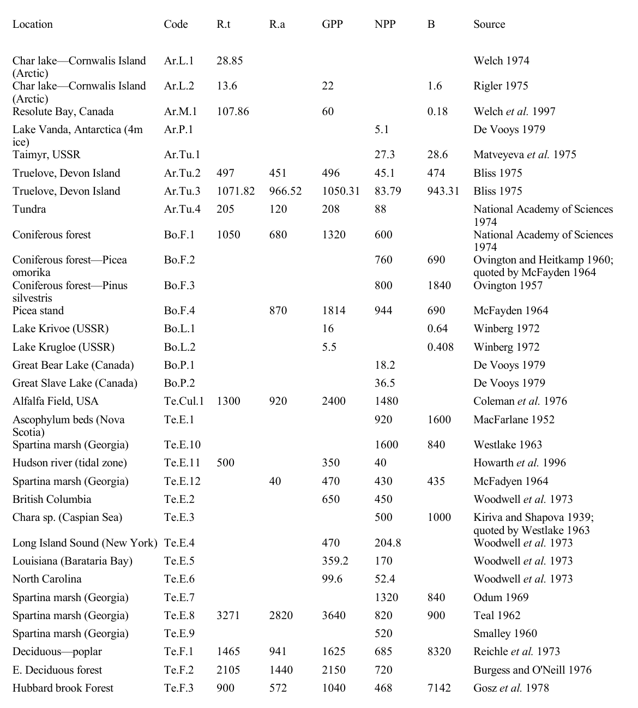
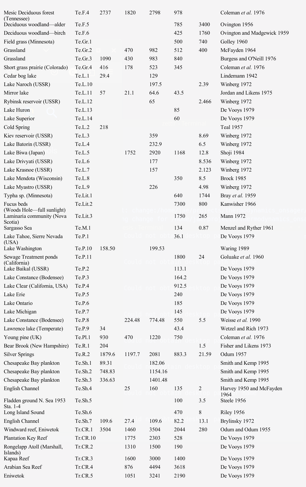
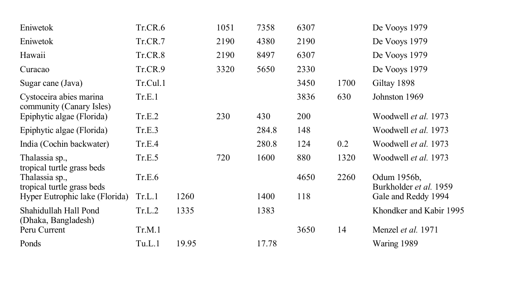

# Introduction[^1]

All ecological processes are subject to thermodynamic laws[^2]. Even the most basic attempts to account for or model matter and energy flows necessarily begin by invoking conservation of energy and matter, and as such, irreversible losses of energy from the system. There have been many attempts to understand this connection and draw inferences from it, due to the possibility of similarly and dramatically reducing the very large degrees of freedom required to describe ecological systems into a few variables of ecological "state", and perhaps, even understanding the directionality of ecological dynamics.

Unfortunately, most ecological systems exhibit matter and energy cycling and boundary flows that occur at many space and time scales. This makes accounting for *entropy* very difficult or impossible (Meysman and Bruers 2010). As such, many resort to model-based, information-theoretic representations of microscopic variability as an analogue to microscopic *disorder*. Further, due to the rather spectacular successes of Boltzmann (1877), many authors conflate the two concepts of macroscopic entropy and microscopic disorder. Indeed, it is only when both the microscopic and the macroscopic descriptions of a given system in focus can be shown to converge that one can begin to suggest that the system is reasonably understood. In molecular motion, this connection has been demonstrated and so it can be said to be understood. But in ecological systems, both microscopic and macroscopic representations are far from convergent. It is, therefore, necessary to keep these two streams separate as they carry different perspectives and one needs to be cognizant of how much, or how little, they converge, such that one can gauge how well an ecological system is understood.

Here, key issues related to the application of thermodynamics in the field of ecology are reviewed (see also: Chapman et al. 2016, Fath et al. 2004, Chakrabarti and Ghosh 2009, Meysman and Bruers 2010, Yen et al. 2014, Choi 2019). In particular, the discussion touches upon the conceptual beauty and challenges of information-theoretic Order Principles; the macroscopic, *extrinsic* focus of free energy gradient dissipation approaches with their limitations; and finally upon Onsager's (1931a,b) far-reaching contributions to connect the two: microscopic with the macroscopic, which has still not yet been sufficiently appreciated by ecologists, even after almost a hundred years since their expression (in the companion work, Choi 2026, focus is  upon empirical validation and extension of the map between ecological community matrices to Onsager conductivity matrices).

# Microscopic Order

A systematic understanding of macroscopic thermodynamic states of matter was established by Carnot (1824), Thomson (Lord Kelvin) (1849), and Clausius (1850), demonstrating that a small set of state variables (temperature, pressure, volume) suffices to characterize bulk physical behavior despite the underlying systems containing vast numbers of atoms and molecules. Non-statistical, axiomatic, and geometric formulations of the $2^{\text{nd}}$ law of thermodynamics subsequently provided rigorous metric foundations for thermodynamic entropy independent of thermal cycle heuristics (Carathéodory 1909, Lieb and Yngvason 1999). In parallel, Boltzmann (1877) and Gibbs (1902) developed the complementary statistical-mechanical foundation, linking macroscopic entropy $S$ to the multiplicity of accessible microscopic configurations $\Omega$ in phase space:

$$S = k_{\mathrm{B}} \ln \Omega$$

where $k_{\mathrm{B}}$ is Boltzmann's constant (Planck 1901, Ehrenfest and Ehrenfest 1912).

The canonical illustration is an isolated volume containing $N$ identical gas molecules initially constrained to uniform positions, velocities, and momenta. In the $6N$-dimensional phase space (three spatial coordinates and three momentum components per molecule), this highly constrained configuration occupies a minimal volume ($\Omega \approx 1$), corresponding to low microscopic dispersion and an initial reference entropy. When external constraints are removed, intermolecular collisions irreversibly disperse particle trajectories across a rapidly expanding volume of accessible phase space. Free energy is converted into distributed kinetic motion and irreversible entropy generation, driving the system monotonically toward thermodynamic equilibrium, where potential energy is minimized, and entropy $S$ and phase-space volume $\Omega$ attain their global maximum. 

Similarly, an internal combustion engine takes the chemical potential energy of fuel and in the process of burning it, converts it into dispersed gases, small particulates and heat, some fraction of which becomes *entropy*. From a microscopic perspective: the physical-chemical model of long-chained hydrocarbons and associated bond energies, the fuel goes from a structured to a dis-aggregated state with many more degrees of freedom, higher randomness, and lower potential to do work. In such isolated or closed systems, *order* goes to *disorder*.

Schrödinger (1944) pointed out that biological systems seem to operate in a different manner. The example he used was DNA, which he described as a curious "aperiodic crystal". He noted that hereditary material replicates itself with high fidelity, as mutation rates are much lower than would be expected from unconstrained thermal degradation in chemical reactions of similarly large molecules (Drake et al. 1998). Even in the absence of an explicit genetic and biochemical understanding of DNA structure (Watson and Crick 1953) and kinetic proofreading (Hopfield 1974), he was able to deduce that it was this genetic fidelity that formed the basis for life: replication and fidelity. 

This local stability is maintained by chemical activation energies and covalent bond stability, proofreading enzyme systems and repair proteins (Hopfield 1974), and Darwinian selection (viability filter). Indeed, stable life cycles, developmental canalization (Waddington 1942, 1957), phenotypic plasticity, ordered metabolic pathways such as the tricarboxylic acid (Krebs) cycle (Krebs and Johnson 1937), predator-prey interactions, host-parasite interactions, habitat-niche partitioning, animal migration patterns, and spatial species distributions all represent examples of *constrained* dynamical processes of *order $\rightarrow$ order*. These are the mainstay of biology and ecology: feedback cycles and their regulatory inter-relationships (Levins 1968, May 1973, Yodzis 1981, 1988). More generally, such open self-maintaining configurations are known as *dissipative structures* (Prigogine 1967, Glansdorff and Prigogine 1971, Glansdorff et al. 1974, Nicolis and Prigogine 1977); they describe locally stable, *order $\rightarrow$ order* systems that maintain their internal structure and low local entropy at the cost of continuous free-energy degradation and entropy export to their surrounding environment. When the accounting boundary encompasses both the biological structure and its surrounding environment, the overall thermodynamic effect is *(local order $\leftrightarrow$ local order) $\rightarrow$ (global disorder)*, drawing high-grade free energy in and exporting entropy out. Physical and chemical analogues include turbulent energy cascades (Richardson 1922, Kolmogorov 1941), Rayleigh-Bénard convection cells (Bénard 1900, Rayleigh 1916), Belousov-Zhabotinsky oscillating chemical waves (Belousov 1959, Zhabotinsky 1964, Zaikin and Zhabotinsky 1970), and reaction-diffusion morphogenesis patterns (Turing 1952, Glansdorff and Prigogine 1971, Nicolis and Prigogine 1977). Living systems, in the act of growth, maintenance, and reproduction, tap into external matter and energy flows to sustain local order (Bertalanffy 1950, Zotin and Zotina 1967).

Schrödinger (1944) also considered the steps required for the origin and diversification of life, from simple prebiotic compounds to autocatalytic matter-energy cycles (Lotka 1922) and eventually the evolution of template replication mechanisms involving RNA, DNA, proteins, and membrane compartmentalization in the presence of persistent free-energy gradients (*hypercycles* of Eigen and Schuster 1979, Wicken 1980). Each structural step represents an increase in complexity (*order*); and each diversification of a functional role or niche represents an expansion in the number of potential functional states (which can be formally represented as an expansion in accessible macroscopic or network states). These evolutionary dynamics operate under the perpetual selective pressure of co-evolving competitors, predators, and pathogens, epitomized by the Red Queen hypothesis (Van Valen 1973, 1976, Bell 1982), whereby continuous adaptation is mandatory merely to maintain persistent organismal fitness in a non-stationary adaptive landscape (England 2013). Thus in biological systems, transitions of the form *disorder $\rightarrow$ order*, or more accurately, *order $\rightarrow$ more complex order* via persistent dissipation, are frequently observed.

This apparent tension between local biological organization (*[dis]order $\rightarrow$ order*) and the $2^{\text{nd}}$ law expectation of increasing total *entropy* (*order $\rightarrow$ disorder*) has been proposed by several authors as a thermodynamic signature distinguishing living from non-living systems. Lovelock (1972) and Lovelock and Margulis (1974) used this logic to formulate the "Gaia hypothesis": planetary atmospheres dominated by living processes exhibit extreme, dis-equilibrated chemical compositions far removed from abiotic thermodynamic equilibrium. The continuous throughput of solar radiation and geochemical cycles drives living matter to construct and sustain internal organization by pumping out entropy into planetary reservoirs.

![Heuristic representation of the principles of order and corresponding changes in entropy. (A) *order $\rightarrow$ disorder*: the $2^{\text{nd}}$ law such as in simple heat engines (red dashed lines); (B) *order $\rightarrow$ order*: homeostatic behavior in biochemical systems, stable ecological systems, and genetic stability (green self-loop, "dissipative structures"); and (C) *disorder $\rightarrow$ order*: development, evolution, succession, and adaptation (blue lines). In all cases, when the boundaries are expanded to include both the local system and its immediate environment, global entropy increases monotonically (from state 1 to state 2), preserving the Second Law.](media/order_principles.png){#fig_cascade}

To illustrate how these three regimes coexist within a single physical cascade, consider a parcel of water flowing downhill along multiple paths and streams (Fig. \ref{fig_cascade}, area A). A tagged volume of water in an elevated lake initially occupies a state of high gravitational potential energy, low macroscopic kinetic energy, and uniform temperature and pressure. As it flows downhill, gravitational potential energy transforms into kinetic energy, and viscous friction across channel beds gradually dissipates that kinetic energy into thermal heat and ambient entropy: *order $\rightarrow$ disorder* ($2^{\text{nd}}$ law). 

In ecology, there is an understanding that these matter and energy flows are borrowed by biota, capturing a small fraction of energy and matter (ecological transfer efficiencies are characteristically low relative to bulk fluid flux) and slowing down its passage by redirecting mass into living structures through growth and reproduction before its final dissipation: *order $\rightarrow$ order* (Fig. \ref{fig_cascade}, area B). Standing biomass acts as a dynamic capacitor that absorbs energetic pulses, while metabolic dissipation discharges that stored energy as thermal heat.

Finally, if the frame shifts to ever smaller eddy scales in turbulent fluid flows (Richardson 1922, Kolmogorov 1941) or to biomass size spectra across trophic levels in an aquatic ecosystem (Sheldon et al. 1972, Kerr 1974, Platt and Denman 1977, 1978, Rodriguez and Mullin 1986, Boudreau and Dickie 1992, Choi et al. 1999), the energy flux cascades across hierarchical compartments. Viscous foliar drag and biological metabolism dampen high-frequency environmental perturbations, illustrating how organized multiscale structures emerge from turbulent driving: *disorder $\rightarrow$ order* (Fig. \ref{fig_cascade}, area C).

When living systems reproduce and generate heritable variation, selective pressures filter functional variants, canalizing developmental pathways and directing ecological succession: *disorder $\rightarrow$ order*. When the boundary of analysis is drawn around the combined system of living biota plus their surrounding energetic reservoirs, the aggregate process always yields a net increase in total entropy (from state 1 to state 2 in Fig. \ref{fig_cascade}): *(local order $\leftrightarrow$ local order) $\rightarrow$ (global disorder)*. Biological self-organization therefore operates as an engine of entropy production rather than a violation of physical law (Prigogine 1967, Schneider and Kay 1994, England 2013).

Numerous variational and "Order Principles" have been proposed to characterize the macroscopic directionality of biological systems. Lotka (1922) suggested that natural selection maximizes total energy throughput: systems that capture more available power outcompete rivals (the "maximum power principle", later formalized by Odum and Pinkerton 1955). Shannon (1948) introduced an information-theoretic entropy to measure the uncertainty of discrete probability distributions, which Kullback and Leibler (1951) extended to relative entropy (informational divergence). Jaynes (1957) demonstrated that statistical mechanics can be formulated as an inference problem maximizing informational entropy subject to known physical constraints. In ecosystems, information-theoretic measures have been applied to trophic flow networks through Ulanowicz's concept of ascendency (Ulanowicz 1986, Ulanowicz and Hannon 1987).

A rigorous evaluation of microscopic *order* and *disorder* requires an explicit dynamical and statistical *model* of the system. Because information-theoretic measures depend on the chosen state variables, coarse-graining categories, and parameterization, purely formal entropy indices applied to ecological models such as Lotka-Volterra interaction models (Michaelian 2005, Chakrabarti and Ghosh 2009) or aggregate input-output flow networks (Patten 1978), yield model-dependent descriptors rather than absolute thermodynamic state functions. Historically, it was precisely the quantitative discrepancy between classical statistical models of molecular and radiation states and empirical calorimetry that revealed missing physical degrees of freedom, motivating quantum statistical mechanics (Planck 1901, Schrödinger 1944, Jaynes 1957). In ecology, information-theoretic indices have been applied to trophic flow topologies (Ulanowicz and Hannon 1987, Ulanowicz et al. 2006), genome size and coding complexity (Jørgensen et al. 1995), phylogenetic branching (Wicken 1980, Wiley and Brooks 1982), and maximum-entropy species distribution modeling (Elith et al. 2011). While these statistical tools quantify network diversity, constraint, or occurrence probability, connecting them to physical thermodynamics requires mapping their coarse-grained states to physical energy and matter pools with explicit microstate multiplicities and transition energetics.

# Macroscopic Entropy

Given the lack of satisfactory microscopic model representations of ecosystem phenomena, many have attempted instead to describe ecosystem processes in terms of macroscopic state variables. Such a whole system-level (*extensive*) approach is perhaps best exemplified by the engineering tradition which traces its origin directly to the founding work of Carnot (1824). The whole system free energy available to do useful work is the state variable of interest, carefully controlled and measured. Engineering applications usually focus upon systems whose boundaries can be defined explicitly (for example, a machine or heat engine) and revolve around well-defined forms of energy and matter transformation with an explicitly defined reference or ground state. These conditions permit repeated measurements of free energy and entropy, so that transfer efficiencies can be calculated to permit systematic performance analysis of the whole system.  

Following this macroscopic tradition, Lindeman (1942), E.P. Odum (1969), Kay (1991), Aoki (1993, 1995), Schneider and Kay (1994), Müller (1998), Choi et al. (1999), Schneider and Sagan (2005), and Jørgensen (2012) analyzed *extensive* free-energy gradients and their degradation across whole ecosystems. Aoki (1993, 1995) estimated whole-lake entropy production from radiation and heat budgets; Choi et al. (1999) examined dissipative signatures in plankton size spectra; and Schneider and Kay (1994) used satellite measurements of evapotranspiration and surface temperature as proxies for ecosystem energy degradation. However, applying whole-system *extensive* thermodynamics to open ecosystems encounters fundamental difficulties when multiple mass-energy transformations operate simultaneously across wide spatial, temporal, and organizational scales with porous boundaries, undefined chemical reference states, and internal trophic cycling (Meysman and Bruers 2010). Moreover, chemical compounds that serve as high-grade free-energy resources for one guild of organisms may be metabolically inert or even toxic to another. 

To address internal cycling in macroscopic budgets, Patten (1978) expanded steady-state compartment flows into first-order linear input-output transitive closures, while H.T. Odum (1996) traced cumulative solar energy transformations into "emergy" conversion ratios. While these accounting frameworks confirm that macroscopic irreversible dissipation is strictly positive in accordance with the $2^{\text{nd}}$ law, aggregate throughput alone does not uniquely determine the internal stability, feedback structure, or direction of perturbation recovery of multi-species communities. Resolving how internal ecological interactions respond to perturbations requires moving from aggregate black-box budgets to the linear and local non-equilibrium formalism of Onsager (1931a,b), Prigogine (1955), and de Groot and Mazur (1962).

# Onsager's relations and conjugate effects

Onsager's contributions (Onsager 1931a,b, Onsager and Machlup 1953, Casimir 1945, Mazur 1997, Verhás 2014) tied macroscopic entropy production to microscopic statistical mechanics for generalized thermodynamic systems. This formulation is revisited here, focusing on the relationship between Onsager's relations and the well-known Le Chatelier-Braun principle (Le Chatelier 1884, Braun 1887, Bertalanffy 1950, Prigogine and Defay 1954, de Groot and Mazur 1962, Gündüz and Gündüz 2014). When this extensive concept is applied to local control volume elements in an intensive field approach (Prigogine 1955, de Groot and Mazur 1962), a deeper and more rigorous understanding of the connections between thermodynamics and ecology emerges.

Onsager's relations generalize empirical transport laws, such as Fourier's law of thermal conduction (Fourier 1822), Ohm's law of electrical conduction (Ohm 1827), and Fick's law of molecular diffusion (Fick 1855), into a unified framework governed by total entropy production (Onsager 1931a,b, de Groot and Mazur 1962). In classical physical systems, extensive state deviations displace a system from equilibrium, generating conjugate thermodynamic forces defined by the entropy gradient (Einstein 1910, Greene and Callen 1951, Callen 1985). In the linear regime near equilibrium, these forces drive conjugate fluxes of extensive quantities through a matrix of phenomenological conductivities. Under the assumption of microscopic reversibility of equilibrium fluctuations, Onsager (1931a,b) proved that the phenomenological cross-conductivities are strictly symmetric ($L_{ij} = L_{ji}$; Casimir 1945). Furthermore, the Second Law of Thermodynamics dictates that the internal entropy production rate is non-negative, requiring the symmetric part of the conductivity matrix to be positive semidefinite, and strictly positive definite on an independent process basis (de Groot and Mazur 1962).

When pairs of irreversible transport processes are coupled through these symmetric cross-coefficients, they are referred to as conjugate processes. Experimental confirmation of Onsager reciprocity across physical and chemical systems is extensive (reviewed by Miller 1960). Classic physical examples include thermoelectric coupling, where a temperature gradient drives an electric current (the Seebeck effect; Seebeck 1826) and an electrical current drives a reversible heat flux (the Peltier effect; Peltier 1834, Thomson 1854), as well as thermomagnetic Nernst-Ettingshausen effects (von Ettingshausen and Nernst 1886, Nernst 1887). In biological physics, analogous reciprocal couplings govern membrane electrodynamics and coupled enzymatic pathways (Kedem and Katchalsky 1958, Katchalsky and Curran 1965, Oster et al. 1971, Mikulecky 1985).

## Resolving the Apparent Breakdown of Reciprocity in Ecology

When theoretical ecologists and physicists first attempted to apply Onsager's reciprocal relations to living communities, they encountered an immediate conceptual paradox. Ecologists formulate multi-species interactions through demographic differential equations whose linearized dynamics near steady state are governed by the demographic community matrix or Jacobian $\mathbf{A}$ (May 1972, 1973, Yodzis 1981, 1988). Because feeding interactions are inherently directional, in that a predator gains biomass by consuming a prey population while the prey population declines, community interaction matrices are fundamentally asymmetric ($A_{ij} \ne A_{ji}$).

Assuming that the demographic matrix $\mathbf{A}$ must serve directly as the physical Onsager conductivity matrix $\mathbf{L}$, it was concluded that living communities violate Onsager reciprocity and operate outside the domain of non-equilibrium physical thermodynamics (MacArthur 1970, Ulanowicz and Hannon 1987, Michaelian 2005, Chakrabarti and Ghosh 2009, Meysman and Bruers 2010). MacArthur (1970) demonstrated that symmetric resource competition minimizes a scalar carrying-capacity potential, but noted that this variational principle collapsed when predation was included. Ulanowicz and Hannon (1987) examined input-output flow networks and asserted that ecological exchanges inherently break reciprocity. Michaelian (2005) tested Lotka-Volterra community matrices as Onsager conductivities and concluded that ecological networks violate reciprocal symmetry, challenging Prigogine's stationary dissipation theorems.

This apparent conflict arises from a fundamental category error: the demographic community matrix $\mathbf{A}$ is not the physical conductivity matrix $\mathbf{L}$. The demographic matrix describes the temporal rate of change of population biomasses ($\delta\dot{\mathbf{x}} = \mathbf{A}\delta\mathbf{x}$), whereas Onsager conductivities relate physical thermodynamic fluxes to intensive driving forces ($\mathbf{J} = \mathbf{L}\mathbf{X}$). The community matrix is a composite dynamical operator that conflates underlying physical transport conductivities with the heterogeneous biomass storage capacities of biological compartments.

A physical analogy illustrates this distinction. Consider two fluid reservoirs connected by a physical pipe with conductivity $L$. One reservoir is a massive freshwater lake (representing a large detrital or forest biomass pool), while the second reservoir is a small household container (representing a specialized, rare predator population). If liquid is transferred between them, the physical transport conductivity $L$ through the pipe is identical in both directions. However, transferring a hundred gallons produces an imperceptible change in the surface water level of the lake, whereas that exact same volume transfer induces a dramatic water-level surge in the small container. The demographic interaction coefficient $A_{ij} = \partial \dot{x}_i / \partial x_j$ does not measure the physical pipe conductivity $L$; rather, it measures the rate of water-level change in compartment $i$ per unit level displacement in compartment $j$. Because the demographic community matrix scales the underlying physical fluxes by the inverse storage capacities of the receiving compartments, it is inherently asymmetric ($A_{ij} \ne A_{ji}$) even when the underlying physical transport conductivities are completely reciprocal and symmetric ($L_{ij} = L_{ji}$).

This conflation resolves through continuous Lyapunov covariance factorization (Appendix A.1; Lyapunov 1892, Tomita and Tomita 1974, Graham 1977, Ao 2004, Qian 2006). Let $\mathbf{C} = \langle \delta\mathbf{x}\delta\mathbf{x}^{\mathsf{T}}\rangle = k_{\mathrm{B}}\mathbf{H}^{-1}$ denote the stationary fluctuation covariance matrix, which functions as the thermodynamic storage capacitance of the ecological network. The total demographic drift operator $-\mathbf{A}\mathbf{C}$ decomposes uniquely into a symmetric dissipative component and an antisymmetric circulation component:

$$-\mathbf{A}\mathbf{C} = \mathbf{D}_{\mathrm{sym}} + \boldsymbol{\Omega}$$

Inverting the capacitance matrix yields the structural factorization of the demographic community matrix:

$$\mathbf{A} = -(\mathbf{D}_{\mathrm{sym}} + \boldsymbol{\Omega})\mathbf{C}^{-1}$$

This factorization clarifies the dual nature of living ecosystems through two distinct physical operators. The symmetric Onsager dissipation tensor $\mathbf{D}_{\mathrm{sym}} = \mathbf{D}_{\mathrm{sym}}^{\mathsf{T}} \succ 0$ represents pure, irreversible thermodynamic dissipation. It acts as an energetic restorative pull that draws perturbed populations monotonically downhill along the thermodynamic entropy surface toward the stationary attractor, strictly satisfying Onsager reciprocity ($D_{ij} = D_{ji}$) and guaranteeing compliance with the Second Law of Thermodynamics. In contrast, the antisymmetric probability circulation tensor $\boldsymbol{\Omega} = -\boldsymbol{\Omega}^{\mathsf{T}}$ represents non-dissipative cyclic motion in state space, capturing the persistent directional trophic fluxes characteristic of living food webs, including predator-prey population cycles, seasonal succession, and microbial nutrient recycling loops. Because $\boldsymbol{\Omega}$ is skew-symmetric, it does no net thermodynamic work against the entropy gradient, circulating currents perpetually in state space as sustained by continuous boundary throughput of solar irradiance and chemical nutrients.

Thus, Onsager reciprocity is not broken in living systems. The symmetric dissipative core $\mathbf{D}_{\mathrm{sym}}$ preserves reciprocal symmetry, while the asymmetry of the demographic matrix $\mathbf{A}$ reflects the superposition of physical capacitance heterogeneity $\mathbf{C}^{-1}$ and non-equilibrium circulation $\boldsymbol{\Omega}$. Full mathematical derivations and proofs are detailed in Appendix A.1.

## The Le Chatelier-Braun Principle and Ecological Conjugate Effects

Within the linear range of non-equilibrium thermodynamics, Onsager's reciprocal relations provide a rigorous formulation of the Le Chatelier-Braun principle (Le Chatelier 1884, Braun 1887, Bertalanffy 1950, Prigogine and Defay 1954, de Groot and Mazur 1962, Horn and Johnson 2012, Gündüz and Gündüz 2014). In classical physical chemistry, this principle states that when a system at equilibrium is subjected to an external perturbation, internal processes adjust in such a manner as to oppose and moderate the perturbation.

In a multi-component network, this moderation is governed by the coupling between primary and secondary irreversible pathways. When an external force acts upon a primary ecological process while all secondary forces are clamped, the system responds with a direct flux determined solely by the primary self-conductivity. However, when secondary coupled processes are permitted to relax freely to zero-flux stationarity, the induced cross-fluxes redistribute the disturbance across the network.

As proved in Appendix A.2 using the matrix Schur complement (Schur 1917, Prigogine and Defay 1954, Horn and Johnson 2012), the effective conductivity governing the primary process under free secondary relaxation is strictly reduced relative to the isolated response:

$$0 < L_{ii,\mathrm{eff}} \le L_{ii}$$

Furthermore, perturbations in state space decay monotonically along a quadratic Lyapunov functional:

$$\dot{V}(\delta\mathbf{x}) = -\delta\mathbf{x}^{\mathsf{T}}\mathbf{C}^{-1}\mathbf{D}_{\mathrm{sym}}\mathbf{C}^{-1}\delta\mathbf{x} < 0 \quad (\delta\mathbf{x} \ne \mathbf{0})$$

Coupled irreversible pathways absorb and redistribute disturbances, moderating net force displacements and driving stable relaxation back toward the stationary state. These reciprocal stabilizing responses are designated as conjugate effects, emphasizing their thermodynamic origin through Onsager transport.

A wide spectrum of ecological interactions embodies these conjugate effects, operating as coupled thermodynamic mass-energy exchanges within physical and chemical gradients. In symbiotic and mutualistic partnerships, such as plant-mycorrhizal associations and coral-zooxanthellae symbioses (Boucher 1985, Bronstein 1994), reciprocal nutrient and carbohydrate exchanges create mutually reinforcing pathways that buffer both partners against environmental shortages. Under severe drought stress, terrestrial plants allocate up to twenty percent of their photosynthetically fixed carbon to arbuscular mycorrhizal fungal networks in the rhizosphere (Smith and Read 2008). In return, extensive fungal hyphae forage soil micropores for moisture and immobile phosphorus, buffering the plant against water-potential collapse. This reciprocal cross-coupling represents a direct biological manifestation of the matrix Schur complement, where secondary pathway relaxation moderates primary environmental stress ($L_{ii,\mathrm{eff}} \le L_{ii}$).

Similarly, in soil microbial loops, plant roots release organic exudates in the rhizosphere that stimulate bacterial growth. In turn, bacterial grazing by protozoa and nematodes releases mineralized ammonium and orthophosphate directly adjacent to root hairs (Clarholm 1985, Bonkowski 2004). When environmental nutrient availability drops, increased root exudation accelerates bacterial grazing, releasing stored minerals back to the plant and moderating nutrient pulse shocks. In parasite-host regulation, co-evolutionary dynamics between hosts and parasites represent reciprocal feedbacks (Van Valen 1973, Hamilton 1980). At the population scale, parasitic culling prevents host populations from exceeding local carrying capacities and exhausting resources, while at the organismal level, regular exposure to commensal and parasitic fauna canalizes immune system calibration against autoimmune disorders, as documented by the hygiene hypothesis (Strachan 1989, 2000, Rook 2009, Smith et al. 2012).

Apex predation provides a classic stabilizing conjugate response that regularizes prey abundance and damps destructive herbivore oscillations (Paine 1966, Estes and Palmisano 1974). In Pacific coastal kelp forests, sea otters (*Enhydra lutris*) prey upon herbivorous sea urchins (*Strongylocentrotus purpuratus*); when otters are removed, unchecked urchin reproduction overgrazes giant kelp beds (*Macrocystis pyrifera*), transforming productive three-dimensional forests into barren rocky plains (Estes and Palmisano 1974). Similarly, the reintroduction of gray wolves (*Canis lupus*) to Yellowstone National Park moderated destructive elk (*Cervus canadensis*) browsing along riparian zones, allowing willow and aspen stands to regenerate and stabilizing riverbank geomorphology (Ripple and Beschta 2004). In contrast, introducing white-tailed deer to predator-free islands led to severe habitat denudation followed by mass starvation and population collapse (Russell et al. 2001, Kennett et al. 2003). Secondary relaxation of predatory consumption moderates primary vegetation perturbations, fulfilling the Le Chatelier-Braun principle.

At planetary scales, homeostatic biotic feedbacks regulate surface temperature and atmospheric chemical disequilibrium over geological epochs, as formalized by the Gaia hypothesis (Lovelock 1972, Lovelock and Margulis 1974) and Daisyworld models (Watson and Lovelock 1983). Conversely, when anthropogenic exploitation or severe climatic stress severs coupled conjugate pathways, positive feedbacks can push ecosystems past tipping points into alternative persistent states. The collapse of the northwest Atlantic cod stock (Choi et al. 2004, Frank et al. 2005) and its stabilization in a distinct, macroalgae- and invertebrate-dominated regime (Choi 2023) exemplifies how an ecological network reorganizes following the disruption of historical conjugate feedbacks through order-through-fluctuation dynamics (Prigogine et al. 1972, Babloyantz 1986).

Onsager's relations and conjugate effects provide a mechanistic framework linking these empirical ecological observations to the underlying laws of non-equilibrium physics. Reciprocal trophic couplings reflect causal thermodynamic constraints rather than coincidental statistical correlations.

# Local stability, local order, and the resistance-resilience continuum

To apply non-equilibrium thermodynamics to open, spatially heterogeneous ecosystems, Meixner (1941, 1943), Prigogine (1947, 1955), de Groot and Mazur (1962), and Gyarmati (1970) formulated Onsager's relations as a local, intensive field theory within an infinitesimal or control volume element. Within an open control volume, the internal entropy production rate is strictly non-negative by the Second Law, while the total entropy change of the volume element also includes boundary exchange fluxes with the surrounding environment.

This distinction between extensive whole-system budgets and local intensive field elements is essential for ecological thermodynamics (Choi et al. 1999, Choi and Patten 2001). Whole-ecosystem boundaries are often geographically and trophically porous (Meysman and Bruers 2010). However, within a local biological compartment, the local equilibrium hypothesis holds: thermodynamic state variables, chemical potentials, and intensive forces remain well-defined locally even when the global ecosystem is far from thermodynamic equilibrium (Meixner 1941, 1943, Prigogine 1955, Keizer 1987).

An open biological compartment can maintain or increase its internal structural order, decreasing its local entropy, so long as it exports entropy to its surroundings at a rate exceeding its internal production (Prigogine 1955, Schneider and Kay 1994, England 2013). Moreover, unlike physical heat engines constrained by rigid metallic walls, biological compartments expand and contract through growth, reproduction, and mortality. The true physical container for biological dissipation is standing biomass rather than geometric spatial coordinates, resolving the dimensional ambiguities that have historically hindered ecosystem thermodynamic budgets.

This trade-off is illustrated by contrasting two extreme ecological life-history strategies: an ancient coastal redwood forest (*Sequoia sempervirens*) and an ephemeral vernal pool diatom bloom. An old-growth redwood stand possesses massive biomass capacitance: it can withstand multi-year climatic droughts, seasonal wildfires, and pest outbreaks without experiencing catastrophic structural disruption, exhibiting high entropic Resistance. However, if such a forest is clear-cut, centuries or millennia are required for full structural recovery, representing low kinetic Resilience. In contrast, an ephemeral vernal pool or open-ocean diatom bloom maintains minimal standing capacitance: an acute unseasonal frost or grazing pulse can decimate the population within hours (low Resistance). However, because mass-specific metabolic turnover is extraordinary, the population rebounds to carrying capacity within days once favorable conditions return, exhibiting high kinetic Resilience. Natural ecosystems organize along a Resistance-Resilience trade-off continuum balancing standing capacitance against kinetic turnover.

![The relationship between respiration rate, representing metabolic entropy production, and biomass, representing biological storage capacitance. Data compiled from global ecosystems across climatic zones and community types (see Choi 2002). High resilience systems with elevated respiration-to-biomass ratios, such as marine pelagic plankton communities (a), exhibit rapid recovery turnover but low resistance capacitance to absorb disturbances. Conversely, low resilience systems with low respiration-to-biomass ratios, such as mature forests (d) and coral reefs (c), possess immense biomass storage resistance but lower mass-specific kinetic turnover. Intermediate systems, such as rocky intertidal zones (b), occupy a balanced midpoint along this stability trade-off continuum.](media/appendix1.png){#fig_respiration_biomass}

The empirical relationship between respiration rate and biomass across global ecosystems (Fig. \ref{fig_respiration_biomass}) provides direct evidence for this local intensive scaling. Respiration reflects metabolic entropy production, while biomass represents biological capacitance. Because organismal metabolic rate scales allometrically with body size according to Kleiber's law ($B^{-1/4}$; Kleiber 1932, 1947, Hemmingsen 1960, Peters 1983, Brown et al. 2004), mass-specific metabolic dissipation decreases systematically as individual body size increases.

This allometric scaling defines two complementary pillars of ecosystem stability. Entropic Resistance is governed by the static standing biomass storage capacitance matrix $\mathbf{C} = k_{\mathrm{B}}\mathbf{H}^{-1}$. Systems dominated by large, long-lived biomass capacitors, such as mature forests (Fig. \ref{fig_respiration_biomass}d) and coral reefs (Fig. \ref{fig_respiration_biomass}c), possess large entropic storage capacity, absorbing external energetic shocks and environmental pulses with small displacements in chemical potential and community state. Conversely, Kinetic Resilience is governed by mass-specific dissipative turnover, corresponding to the relaxation operator $\mathbf{C}^{-1}\mathbf{D}_{\mathrm{sym}}$. Systems dominated by small, rapid-turnover organisms, such as marine pelagic plankton (Fig. \ref{fig_respiration_biomass}a), exhibit high mass-specific metabolic rates and rapid population turnover, recovering rapidly from disturbances but possessing low standing capacitance to buffer acute perturbations.

These two pillars organize ecosystems along a hyperbolic stability continuum: systems cannot maximize both resistance and resilience simultaneously (Choi et al. 1999, Choi and Patten 2001, Fath et al. 2001, Choi 2002). Marine pelagic ecosystems achieve persistence through rapid metabolic turnover (high resilience, low resistance), whereas mature terrestrial forests achieve persistence through massive structural capacitance (high resistance, lower kinetic resilience).

# Discussion: novel conceptual synthesis and ecological implications

## Clarification of Novelty and Established Physical Principles

In evaluating the theoretical contributions of this framework, it is essential to distinguish between established physical-mathematical principles and novel ecological insights. The mathematical formulations employed throughout this work represent established results across several physical and engineering disciplines. In modern stochastic thermodynamics and non-equilibrium statistical mechanics, decomposing drift vector fields into a symmetric dissipative friction tensor and an antisymmetric non-conservative probability circulation tensor is textbook material. For driven molecular motors, chemical master equations, and mesoscopic biophysical reaction networks (Graham 1977, Ao 2004, Qian 2006, Seifert 2012), it is widely recognized that open systems break microscopic detailed balance ($\boldsymbol{\Omega} \ne \mathbf{0}$) while positive-definite symmetric dissipation ($\mathbf{D}_{\mathrm{sym}} \succ 0$) governs thermodynamic entropy production. 

Similarly, in electrical network theory, Bernard Tellegen established in 1948 that any non-reciprocal linear dynamical system can be uniquely factored into a symmetric matrix of dissipative conductances (resistors) and a skew-symmetric matrix of non-dissipative coupling elements termed gyrators, which rotate signals across ports without dissipating real power. In control engineering, aerospace systems, and matrix theory, solving the continuous algebraic Lyapunov equation ($\mathbf{A}\mathbf{C} + \mathbf{C}\mathbf{A}^{\mathsf{T}} = -2\mathbf{D}_{\mathrm{sym}}$) has served for decades as the standard analytical tool for evaluating stationary covariance, internal damping, and state-space Gramians (Lyapunov 1892, Bartels and Stewart 1972, Horn and Johnson 2012). In continuum mechanics and fluid dynamics, this separation represents the exact counterpart of the Helmholtz-Hodge decomposition, which partitions vector fields into potential gradient descent and solenoidal vorticity circulation. Furthermore, the Gaussian fluctuation expansion around entropy Hessians originates with Einstein (1910), Greene and Callen (1951), and Callen (1985), while the matrix Schur complement reduction governing the Le Chatelier-Braun principle was proven by Schur (1917) and Prigogine and Defay (1954). The present work makes no claim to inventing new linear algebra or establishing novel mathematical theorems.

The primary novelty of this work lies in the interdisciplinary translation and conceptual synthesis that resolves fifty years of theoretical impasse in ecology. Historically, theoretical ecology developed Lotka-Volterra predator-prey dynamics through phenomenological population modeling rather than physical transport theory. When ecological theorists examined the demographic community matrix $\mathbf{A}$, they treated it either as an unstructured random matrix (May 1972) or as a direct physical conductivity (MacArthur 1970, Ulanowicz and Hannon 1987). Because predator-prey interactions exhibit opposing demographic signs ($A_{12} < 0, A_{21} > 0$), ecologists concluded that ecological feeding networks violated Onsager reciprocity, placing living systems outside physical thermodynamics. 

The Lyapunov covariance factorization $\mathbf{A} = -(\mathbf{D}_{\mathrm{sym}} + \boldsymbol{\Omega})\mathbf{C}^{-1}$ demonstrates that this historical schism was based on a category error: the demographic community matrix $\mathbf{A}$ is not an Onsager conductivity, but a composite operator that convolves symmetric dissipation $\mathbf{D}_{\mathrm{sym}}$, antisymmetric circulation $\boldsymbol{\Omega}$, and standing biomass capacitance storage $\mathbf{C}$. Physical Onsager reciprocity is strictly satisfied in the symmetric dissipation tensor $\mathbf{D}_{\mathrm{sym}} = \mathbf{D}_{\mathrm{sym}}^{\mathsf{T}} \succ 0$, while directional predation asymmetry belongs entirely to the orthogonal circulation tensor $\boldsymbol{\Omega} = -\boldsymbol{\Omega}^{\mathsf{T}}$. 

Beyond resolving the reciprocity paradox, grounding ecological dynamics in physical capacitance reconciles dimensional inconsistencies that previously confounded open-system thermodynamics. Normalizing variables by arbitrary surface area or water depth creates artificial spatial coordinates; identifying standing biomass as the true physical capacitance container aligns ecological population states with intensive thermodynamic potentials. This formulation unifies the long-standing ecological debate surrounding ecosystem stability by showing that communities organize along an intrinsic Resistance-Resilience trade-off continuum governed by standing capacitance storage $\mathbf{C}$ and mass-specific turnover velocity $\mathbf{C}^{-1}\mathbf{D}_{\mathrm{sym}}$. Finally, coupled ecological feedbacks—such as mutualistic facilitation, predator-prey stabilization, and pest regulation—are shown to emerge as physical manifestations of the Le Chatelier-Braun principle operating through convolved Onsager transport pathways.

## Implications for Ecosystem Management and Conservation

This thermodynamic framework carries direct practical implications for ecosystem monitoring, conservation, and resource management. Traditional resource management frequently focuses on maximizing standing biomass or yield of individual harvested species. However, the thermodynamic framework reveals that ecosystem persistence requires a balanced trade-off between capacitance storage (resistance) and turnover rate (resilience). Artificially maximizing single-species biomass while suppressing natural size-structure diversity impairs the mass-specific dissipative pathways that provide kinetic recovery following acute climatic anomalies. High-turnover ecosystems, such as pelagic fisheries and coastal upwelling zones, exhibit rapid recovery under normal conditions, but because their biomass capacitance is minimal, they possess low entropic resistance. When subjected to chronic harvesting combined with thermal extremes, these systems cannot absorb perturbations through static buffering, causing their resilience to collapse rapidly once recruitment loops are severed.

Furthermore, ecological cycles such as seasonal phytoplankton blooms and predator-prey oscillations are not inefficiencies or signs of instability. In this formulation, probability circulation $\boldsymbol{\Omega}$ represents the non-dissipative cyclic movement of energy and nutrients that maintains ecosystem connectivity without degrading the potential landscape; suppressing natural population fluctuations through heavy artificial culling can distort circulation loops, degrading network stability. Finally, because the effective conductivity $L_{ii,\mathrm{eff}}$ and the Lyapunov decay rate are sensitive to the positive-definiteness of the dissipative core $\mathbf{D}_{\mathrm{sym}}$, approaching a tipping point manifests as curvature flattening, critical slowing down, and variance explosion. Tracking these thermodynamic signatures provides physics-based early-warning metrics before irreversible state collapse occurs.

## Connections to Part II: Multi-Scale Extensions and Empirical Analyses

The present manuscript establishes the theoretical framework and mathematical derivations governing the relationship between demographic community matrices, Onsager conductivities, and the Le Chatelier-Braun principle. In the companion manuscript (Choi 2026), advanced applications and empirical extensions of this framework are developed. These include extending discrete compartment models to continuous biomass size distributions through the physical model of a flexible forest canopy coupled to Kolmogorov fluid turbulence, showing how structural capacitors and foliar viscous drag dissipate energetic perturbations across scales. In addition, non-linear demographic jump processes are formulated via chemical master equations and Van Kampen asymptotic expansions, deriving non-equilibrium Helmholtz-Hodge vector field decompositions and stationary entropy production trace formulas. Finally, the complete analytical and numerical software suite is applied to real-world ecological networks, including the classic benthic food web of Cone Spring (Tilly 1968) and marine pelagic nutrient-phytoplankton-zooplankton-detritus-fish ecosystems.

# Summary

Thermodynamics provides a systematic framework for ecological theory. In ecological science, the discipline stands in a position analogous to early thermal physics during the transition from phenomenological calorimetry to statistical mechanics. Integrating Boltzmann's statistical entropy with Onsager's reciprocal transport theory provides a coherent framework linking microscopic demographic interactions to macroscopic energy and material flows. Developing a rigorous appreciation of Onsager's reciprocal constraints offers a pathway toward unified, physics-based ecological models that bridge population biology, community ecology, and ecosystem energetics.

# Appendix: The Details

## A.1: Demographic community matrix (**A**) vs Onsager conductivity matrix (**L**)

The relationship between the demographic community matrix $\mathbf{A}$ and the physical Onsager phenomenological conductivity matrix $\mathbf{L}$ is clarified by the continuous Lyapunov covariance factorization.

Let an ecological system be described by $n$ independent extensive state variables $\mathbf{x} = (x_1, \dots, x_n)^{\mathsf{T}}$, representing compartment biomasses or energy pools in contact with external energetic and material reservoirs at temperature $T$. Let $\mathbf{x}^*$ denote the stationary reference state, and $\delta\mathbf{x} = \mathbf{x} - \mathbf{x}^*$ the state deviation from stationarity.

Following the thermodynamic fluctuation theory of Einstein (1910), Greene and Callen (1951), and Callen (1985), the total entropy change $\Delta S_{\mathrm{tot}}(\delta\mathbf{x})$ of the system plus its environment is expanded in a Taylor series about the stationary state $\mathbf{x}^*$:

$$\Delta S_{\mathrm{tot}}(\delta\mathbf{x}) = \Delta S_{\mathrm{tot}}(\mathbf{0}) + \left.\nabla \Delta S_{\mathrm{tot}}\right|_{\mathbf{x}^*}^{\mathsf{T}}\delta\mathbf{x} - \frac{1}{2}\delta\mathbf{x}^{\mathsf{T}}\mathbf{H}\delta\mathbf{x} + \mathcal{O}(\|\delta\mathbf{x}\|^3)$$

At a stationary state, first-order entropy variations vanish ($\left.\nabla \Delta S_{\mathrm{tot}}\right|_{\mathbf{x}^*} = \mathbf{0}$). Defining $\Delta S_{\mathrm{tot}}(\mathbf{0}) = 0$, the expansion truncates at second order:

$$\Delta S_{\mathrm{tot}}(\delta\mathbf{x}) = -\frac{1}{2}\delta\mathbf{x}^{\mathsf{T}}\mathbf{H}\delta\mathbf{x}$$

where $\mathbf{H} = -\partial^2 \Delta S_{\mathrm{tot}} / \partial\mathbf{x}^2\big|_{\mathbf{x}^*}$ is the symmetric, positive-definite entropy Hessian (entropic curvature matrix). Positive-definiteness ($\mathbf{H} = \mathbf{H}^{\mathsf{T}} \succ 0$) is a rigorous requirement of thermodynamic stability, ensuring that total entropy attains an isolated local maximum at the stationary state (Glansdorff and Prigogine 1971, Callen 1985).

Thermodynamic conjugate forces $\mathbf{X} = (X_1, \dots, X_n)^{\mathsf{T}}$ are defined as the gradient of total entropy with respect to state displacements:

$$\mathbf{X} = \nabla_{\delta\mathbf{x}} \Delta S_{\mathrm{tot}} = -\mathbf{H}\delta\mathbf{x}$$

By Einstein's fluctuation probability formula, the stationary probability density $P(\delta\mathbf{x})$ of microscopic fluctuations about the steady state is:

$$P(\delta\mathbf{x}) \propto \exp\left( \frac{\Delta S_{\mathrm{tot}}(\delta\mathbf{x})}{k_{\mathrm{B}}} \right) = \exp\left( -\frac{1}{2k_{\mathrm{B}}}\delta\mathbf{x}^{\mathsf{T}}\mathbf{H}\delta\mathbf{x} \right)$$

This distribution is a multivariate zero-mean Gaussian with covariance matrix:

$$\mathbf{C} = \langle \delta\mathbf{x}\delta\mathbf{x}^{\mathsf{T}} \rangle = k_{\mathrm{B}}\mathbf{H}^{-1}$$

The entropy Hessian (thermodynamic stiffness matrix) $\mathbf{H}$ and the stationary fluctuation covariance matrix $\mathbf{C}$ are exact matrix inverses up to Boltzmann's constant $k_{\mathrm{B}}$:

$$\mathbf{H} = k_{\mathrm{B}}\mathbf{C}^{-1}$$

In biological networks, $\mathbf{C}$ represents the thermodynamic storage capacitance matrix, measuring the capacity of each compartment to store biomass and absorb energetic fluctuations without generating steep thermodynamic force gradients.
 

In linear non-equilibrium thermodynamics, thermodynamic forces $\mathbf{X}$ drive conjugate irreversible fluxes $\mathbf{J} = (J_1, \dots, J_n)^{\mathsf{T}}$ according to linear phenomenological relations (Onsager 1931a,b, de Groot and Mazur 1962):

$$\mathbf{J} = \mathbf{L}\mathbf{X}$$

where $\mathbf{L} = [L_{ij}]$ is the phenomenological conductivity matrix. The internal entropy production rate $\sigma$ is the bilinear product of forces and fluxes:

$$\sigma = \mathbf{J}^{\mathsf{T}}\mathbf{X} = \mathbf{X}^{\mathsf{T}}\mathbf{L}_s\mathbf{X} \ge 0$$

where $\mathbf{L}_s = \frac{1}{2}(\mathbf{L} + \mathbf{L}^{\mathsf{T}}) \succ 0$ is the symmetric part of the conductivity matrix. Under microscopic reversibility, Onsager proved that $\mathbf{L} = \mathbf{L}^{\mathsf{T}} = \mathbf{L}_s$.

In theoretical ecology, the temporal evolution of compartment deviations is described by linearized demographic differential equations:

$$\delta\dot{\mathbf{x}} = \mathbf{A}\delta\mathbf{x}$$

where $\mathbf{A} = [\partial f_i / \partial x_j\big|_{\mathbf{x}^*}]$ is the demographic community matrix (Jacobian).

To link demographic dynamics with physical transport, recognize that the rate of change of compartment biomass equals the net convergence of physical and chemical fluxes:

$$\delta\dot{\mathbf{x}} = -\nabla \cdot \mathbf{J} = -\mathbf{B}\mathbf{J}$$

where $\mathbf{B}$ is the stoichiometric incidence matrix mapping pathway fluxes to compartment accumulations. When fluxes are expressed in terms of thermodynamic forces:

$$\delta\dot{\mathbf{x}} = -\mathbf{B}\mathbf{L}\mathbf{X} = -\mathbf{B}\mathbf{L}(-\mathbf{H}\delta\mathbf{x}) = -\mathbf{B}\mathbf{L}\mathbf{H}\delta\mathbf{x} = -\mathbf{B}\mathbf{L}(k_{\mathrm{B}}\mathbf{C}^{-1})\delta\mathbf{x}$$

Comparing this expression with the demographic equation $\delta\dot{\mathbf{x}} = \mathbf{A}\delta\mathbf{x}$ reveals:

$$\mathbf{A} = -k_{\mathrm{B}}\mathbf{B}\mathbf{L}\mathbf{C}^{-1}$$

This fundamental identity demonstrates why the demographic community matrix $\mathbf{A}$ cannot be equated with the physical conductivity $\mathbf{L}$. Even if the phenomenological transport matrix $\mathbf{L}$ is strictly symmetric ($L_{ij} = L_{ji}$), the community matrix $\mathbf{A}$ incorporates the inverse capacitance matrix $\mathbf{C}^{-1} = \mathbf{H} / k_{\mathrm{B}}$. Because biological compartments differ by orders of magnitude in standing biomass and hence capacitance, $\mathbf{C}^{-1}$ is a heterogeneous metric tensor. The matrix product of a symmetric matrix $\mathbf{L}$ and a heterogeneous diagonal matrix $\mathbf{C}^{-1}$ is mathematically asymmetric: $(\mathbf{L}\mathbf{C}^{-1})^{\mathsf{T}} = \mathbf{C}^{-1}\mathbf{L} \ne \mathbf{L}\mathbf{C}^{-1}$. Consequently, asymmetry in $\mathbf{A}$ ($A_{ij} \ne A_{ji}$) is an expected physical consequence of capacitance heterogeneity rather than evidence that living systems violate Onsager reciprocity.

### Continuous Lyapunov Covariance Factorization

To decompose the demographic matrix $\mathbf{A}$ into its dissipative and non-equilibrium components without requiring prior knowledge of microscopic reaction networks, consider the stationary continuous Lyapunov equation governing linear stochastic differential equations (Lyapunov 1892, Tomita and Tomita 1974, Willems 1972):

$$\delta\dot{\mathbf{x}} = \mathbf{A}\delta\mathbf{x} + \boldsymbol{\xi}(t)$$

where $\boldsymbol{\xi}(t)$ is Gaussian white noise with symmetric diffusion tensor $\langle \boldsymbol{\xi}(t)\boldsymbol{\xi}^{\mathsf{T}}(t') \rangle = 2\mathbf{D}\delta(t - t')$, with $\mathbf{D} = \mathbf{D}^{\mathsf{T}} \succ 0$. The stationary covariance $\mathbf{C} = \langle \delta\mathbf{x}\delta\mathbf{x}^{\mathsf{T}} \rangle$ satisfies:

$$\mathbf{A}\mathbf{C} + \mathbf{C}\mathbf{A}^{\mathsf{T}} = -2\mathbf{D}_{\mathrm{sym}}$$

where $\mathbf{D}_{\mathrm{sym}} = \mathbf{D} \succ 0$.

Now evaluate the total covariance-weighted drift operator $-\mathbf{A}\mathbf{C}$. Any square matrix decomposes uniquely into symmetric and antisymmetric components:

$$-\mathbf{A}\mathbf{C} = \operatorname{sym}(-\mathbf{A}\mathbf{C}) + \operatorname{asym}(-\mathbf{A}\mathbf{C})$$

Define the symmetric component $\mathbf{D}_{\mathrm{sym}}$ and the antisymmetric component $\boldsymbol{\Omega}$:

$$\mathbf{D}_{\mathrm{sym}} = -\frac{1}{2}(\mathbf{A}\mathbf{C} + \mathbf{C}\mathbf{A}^{\mathsf{T}}) = \mathbf{D}_{\mathrm{sym}}^{\mathsf{T}} \succ 0$$

$$\boldsymbol{\Omega} = -\frac{1}{2}(\mathbf{A}\mathbf{C} - \mathbf{C}\mathbf{A}^{\mathsf{T}}) = -\boldsymbol{\Omega}^{\mathsf{T}}$$

Substituting these definitions into the drift operator yields:

$$-\mathbf{A}\mathbf{C} = \mathbf{D}_{\mathrm{sym}} + \boldsymbol{\Omega}$$

Multiplying from the right by the inverse capacitance matrix $\mathbf{C}^{-1}$:

$$\mathbf{A} = -(\mathbf{D}_{\mathrm{sym}} + \boldsymbol{\Omega})\mathbf{C}^{-1}$$

This completes the proof. The demographic community matrix $\mathbf{A}$ factors cleanly into three distinct physical operators: a symmetric, positive-definite dissipative conductivity $\mathbf{D}_{\mathrm{sym}}$ that satisfies Onsager reciprocity ($D_{ij} = D_{ji}$) and drives monotonic downhill relaxation, an antisymmetric probability circulation tensor $\boldsymbol{\Omega}$ that quantifies cyclic, non-equilibrium flux currents sustained by external energy throughput, and the thermodynamic storage capacitance matrix $\mathbf{C} = k_{\mathrm{B}}\mathbf{H}^{-1}$, which normalizes dynamics by the physical storage capacity of biological compartments.

## Appendix A.2: Le Chatelier-Braun principle via the Schur complement

Le Chatelier-Braun principle for coupled non-equilibrium networks can be seen as a secondary pathway that moderates primary perturbations via the matrix Schur complement, resulting in asymptotic stability through a quadratic Lyapunov decay theorem.
 
Consider an ecological network whose linearized thermodynamic fluxes $\delta\mathbf{J}$ and conjugate forces $\delta\mathbf{X}$ are coupled through a symmetric, positive-definite Onsager conductivity matrix $\mathbf{L} = \mathbf{L}^{\mathsf{T}} \succ 0$.

Partition the network into a primary perturbed process (subscript $i$) and the remaining $n - 1$ secondary coupled processes (subscript $-i$):

$$\begin{pmatrix} \delta J_i \\ \delta\mathbf{J}_{-i} \end{pmatrix} = \begin{pmatrix} L_{ii} & \mathbf{L}_{i,-i} \\ \mathbf{L}_{-i,i} & \mathbf{L}_{-i,-i} \end{pmatrix} \begin{pmatrix} \delta X_i \\ \delta\mathbf{X}_{-i} \end{pmatrix}$$

where $L_{ii} > 0$ is the primary self-conductivity, $\mathbf{L}_{-i,-i} \in \mathbb{R}^{(n-1) \times (n-1)}$ is the submatrix of secondary conductivities, and $\mathbf{L}_{i,-i} = \mathbf{L}_{-i,i}^{\mathsf{T}}$ represents cross-coupling. Because $\mathbf{L} \succ 0$, the submatrix $\mathbf{L}_{-i,-i}$ is strictly positive definite and invertible ($\mathbf{L}_{-i,-i}^{-1} \succ 0$).

Two contrasting operational boundary conditions define the network's response to an external perturbation $\delta X_i$. Under clamped secondary forces (the isolated response), secondary forces are held fixed at their reference values ($\delta\mathbf{X}_{-i} = \mathbf{0}$), yielding the primary flux response:
$$\left.\delta J_i\right|_{\mathrm{clamped}} = L_{ii}\delta X_i$$
In contrast, under free secondary relaxation (the unconstrained stationary response), secondary processes are unconstrained and adjust rapidly until their net conjugate fluxes reach stationary balance ($\delta\mathbf{J}_{-i} = \mathbf{0}$). Setting $\delta\mathbf{J}_{-i} = \mathbf{L}_{-i,i}\delta X_i + \mathbf{L}_{-i,-i}\delta\mathbf{X}_{-i} = \mathbf{0}$ yields the relaxed secondary forces:
$$\delta\mathbf{X}_{-i} = -\mathbf{L}_{-i,-i}^{-1}\mathbf{L}_{-i,i}\delta X_i$$

### Effective Conductivity and the Schur Complement

Substituting the relaxed secondary forces $\delta\mathbf{X}_{-i}$ back into the primary flux equation yields:

$$\left.\delta J_i\right|_{\mathrm{free}} = L_{ii}\delta X_i + \mathbf{L}_{i,-i}\left( -\mathbf{L}_{-i,-i}^{-1}\mathbf{L}_{-i,i}\delta X_i \right) = \left( L_{ii} - \mathbf{L}_{i,-i}\mathbf{L}_{-i,-i}^{-1}\mathbf{L}_{-i,i} \right) \delta X_i$$

The effective phenomenological conductivity governing the primary process is therefore:

$$L_{ii,\mathrm{eff}} = L_{ii} - \mathbf{L}_{i,-i}\mathbf{L}_{-i,-i}^{-1}\mathbf{L}_{-i,i}$$

This expression is the matrix Schur complement of the block $\mathbf{L}_{-i,-i}$ in $\mathbf{L}$ (Schur 1917, Boyd and Vandenberghe 2004, Horn and Johnson 2012).

Because the full Onsager matrix is strictly positive definite ($\mathbf{L} \succ 0$), its principal submatrix is positive definite ($\mathbf{L}_{-i,-i} \succ 0$), which implies that its inverse is also positive definite ($\mathbf{L}_{-i,-i}^{-1} \succ 0$). For any non-zero cross-coupling vector ($\mathbf{L}_{i,-i} \ne \mathbf{0}$), the quadratic correction term is strictly positive:

$$\mathbf{L}_{i,-i}\mathbf{L}_{-i,-i}^{-1}\mathbf{L}_{-i,i} = \mathbf{L}_{i,-i}\mathbf{L}_{-i,-i}^{-1}\mathbf{L}_{i,-i}^{\mathsf{T}} > 0$$

Furthermore, by the standard properties of Schur complements for positive-definite matrices (Horn and Johnson 2012), $L_{ii,\mathrm{eff}} > 0$. Therefore:

$$0 < L_{ii,\mathrm{eff}} \le L_{ii}$$

This inequality is the Le Chatelier-Braun principle in linear non-equilibrium thermodynamics (Le Chatelier 1884, Braun 1887, Prigogine and Defay 1954): unconstrained internal relaxation of secondary coupled pathways always moderates and reduces the effective conductivity of a primary disturbance. Coupled pathways absorb and buffer energetic shocks, diminishing the primary flux response compared to an isolated system.
 
To show that perturbations decay asymptotically back toward the stationary state, consider the quadratic candidate Lyapunov functional $V(\delta\mathbf{x})$ defined by the entropic curvature tensor:

$$V(\delta\mathbf{x}) = \frac{1}{2}\delta\mathbf{x}^{\mathsf{T}}\mathbf{C}^{-1}\delta\mathbf{x} = \frac{1}{2k_{\mathrm{B}}}\delta\mathbf{x}^{\mathsf{T}}\mathbf{H}\delta\mathbf{x} = -\frac{\Delta S_{\mathrm{tot}}(\delta\mathbf{x})}{k_{\mathrm{B}}}$$

Because $\mathbf{C}^{-1} = \mathbf{H} / k_{\mathrm{B}} \succ 0$, $V(\delta\mathbf{x}) > 0$ for all $\delta\mathbf{x} \ne \mathbf{0}$, and $V(\mathbf{0}) = 0$.

Differentiating $V(\delta\mathbf{x})$ with respect to time along the trajectories of the linearized system $\delta\dot{\mathbf{x}} = \mathbf{A}\delta\mathbf{x}$:

$$\dot{V}(\delta\mathbf{x}) = \frac{1}{2}\delta\dot{\mathbf{x}}^{\mathsf{T}}\mathbf{C}^{-1}\delta\mathbf{x} + \frac{1}{2}\delta\mathbf{x}^{\mathsf{T}}\mathbf{C}^{-1}\delta\dot{\mathbf{x}} = \frac{1}{2}\delta\mathbf{x}^{\mathsf{T}}(\mathbf{A}^{\mathsf{T}}\mathbf{C}^{-1} + \mathbf{C}^{-1}\mathbf{A})\delta\mathbf{x}$$

Using the identity $\mathbf{A} = -(\mathbf{D}_{\mathrm{sym}} + \boldsymbol{\Omega})\mathbf{C}^{-1}$ from Appendix A.1:

$$\mathbf{C}^{-1}\mathbf{A} = -\mathbf{C}^{-1}(\mathbf{D}_{\mathrm{sym}} + \boldsymbol{\Omega})\mathbf{C}^{-1}$$

$$\mathbf{A}^{\mathsf{T}}\mathbf{C}^{-1} = -\mathbf{C}^{-1}(\mathbf{D}_{\mathrm{sym}} - \boldsymbol{\Omega})\mathbf{C}^{-1}$$

Summing these two expressions, the antisymmetric circulation tensor $\boldsymbol{\Omega}$ cancels identically:

$$\mathbf{A}^{\mathsf{T}}\mathbf{C}^{-1} + \mathbf{C}^{-1}\mathbf{A} = -\mathbf{C}^{-1}\mathbf{D}_{\mathrm{sym}}\mathbf{C}^{-1} - \mathbf{C}^{-1}\mathbf{D}_{\mathrm{sym}}\mathbf{C}^{-1} = -2\mathbf{C}^{-1}\mathbf{D}_{\mathrm{sym}}\mathbf{C}^{-1}$$

Substituting this result into the Lyapunov time derivative:

$$\dot{V}(\delta\mathbf{x}) = -\delta\mathbf{x}^{\mathsf{T}}\mathbf{C}^{-1}\mathbf{D}_{\mathrm{sym}}\mathbf{C}^{-1}\delta\mathbf{x}$$

Because $\mathbf{C}^{-1} \succ 0$ and $\mathbf{D}_{\mathrm{sym}} \succ 0$, the composite matrix $\mathbf{C}^{-1}\mathbf{D}_{\mathrm{sym}}\mathbf{C}^{-1}$ is strictly positive definite:

$$\dot{V}(\delta\mathbf{x}) < 0 \quad \forall \; \delta\mathbf{x} \ne \mathbf{0}$$

This establishes the Non-Equilibrium Lyapunov Decay Theorem (Lyapunov 1892, Tomita and Tomita 1974, Willems 1972). Any non-zero perturbation $\delta\mathbf{x}$ decays monotonically to zero ($V(\delta\mathbf{x}) \to 0$ as $t \to \infty$). Because antisymmetric probability circulation $\boldsymbol{\Omega}$ does no net thermodynamic work against the potential ($-\delta\mathbf{x}^{\mathsf{T}}\mathbf{C}^{-1}\boldsymbol{\Omega}\mathbf{C}^{-1}\delta\mathbf{x} = 0$), monotonic stability is driven entirely by symmetric Onsager dissipation $\mathbf{D}_{\mathrm{sym}}$ operating through the inverse capacitance metric $\mathbf{C}^{-1}$, ensuring that ecological networks return stably to steady state following environmental disturbances.

# References

Bonkowski, M. (2004). Protozoa and plant growth: the microbial loop in soil revisited. *New Phytologist*, 162(3), pp. 617-631.

Clarholm, M. (1985). Interactions of bacteria, protozoa and plants leading to mineralization of soil nitrogen. *Soil Biology and Biochemistry*, 17(2), pp. 181-187.

Ripple, W. J. and Beschta, R. L. (2004). Wolves and the ecology of fear: can predation risk structure ecosystems? *BioScience*, 54(8), pp. 755-766.

Smith, S. E. and Read, D. J. (2008). *Mycorrhizal Symbiosis*. Third Edition. Academic Press, London.

Aitchison, J. (1986). *The Statistical Analysis of Compositional Data*. Chapman and Hall, London.

Amari, S. (1985). *Differential-Geometrical Methods in Statistics*. Lecture Notes in Statistics, Vol. 28. Springer-Verlag, New York.

Amari, S. (2016). *Information Geometry and Its Applications*. Applied Mathematical Sciences, Vol. 194. Springer, Tokyo.

Ao, P. (2004). Potential in stochastic differential equations: novel construction. *Journal of Physics A: Mathematical and General*, 37(3), pp. L25-L30.

Aoki, I. (1989). Ecological interpretations of information-theoretic entropy and its application to Lake Biwa. *Ecological Modelling*, 45(2), pp. 135-144.

Aoki, I. (1993). Entropy balance of Lake Biwa. *Ecological Modelling*, 67, pp. 115-127.

Aoki, I. (1995). Entropy production in living systems: from organisms to ecosystems. *Thermochimica Acta*, 250, pp. 359-370.

Babloyantz, A. (1986). *Molecules, Dynamics, and Life: An Introduction to Self-Organization of Matter*. John Wiley & Sons, New York.

Barato, A. C. and Seifert, U. (2015). Thermodynamic uncertainty relation for biomolecular processes. *Physical Review Letters*, 114(15), p.158101.

Bell, G. (1982). *The Masterpiece of Nature: The Evolution and Genetics of Sexuality*. University of California Press, Berkeley.

Belousov, B. P. (1959). A periodic reaction and its mechanism. *Compilation of Abstracts on Radiation Medicine*, 147, pp. 145-147.

Bénard, H. (1900). Les tourbillons cellulaires dans une nappe liquide transportant de la chaleur par convection en régime permanent. *Revue Générale des Sciences Pures et Appliquées*, 11, pp. 1261-1271, 1309-1328.

Bertalanffy, L. von (1950). The theory of open systems in physics and biology. *Science*, 111(2872), pp. 23-29.

Bode, H. W. (1945). *Network Analysis and Feedback Amplifier Design*. D. Van Nostrand Company, New York.

Boltzmann, L. (1877). Über die Beziehung zwischen dem zweiten Hauptsatze der mechanischen Wärmetheorie und der Wahrscheinlichkeitsrechnung respektive den Sätzen über das Wärmegleichgewicht. *Wiener Berichte*, 76, pp. 373-435.

Boucher, D. H. (ed.) (1985). *The Biology of Mutualism: Ecology and Evolution*. Croom Helm, London.

Boudreau, P. R. and Dickie, L. M. (1992). Biomass spectra of aquatic ecosystems in relation to fisheries yield. *Canadian Journal of Fisheries and Aquatic Sciences*, 49(8), pp. 1528-1538.

Boyd, S. and Vandenberghe, L. (2004). *Convex Optimization*. Cambridge University Press, Cambridge.

Braun, F. (1887). Ueber die Gültigkeit des Le Chatelier-Braunschen Princips. *Annalen der Physik und Chemie*, 269(2), pp. 337-353.

Briedis, D. and Seagrave, R. C. (1984). Energy dissipation in oscillating chemical reactions. *The Journal of Chemical Physics*, 80(7), pp. 3209-3217.

Bronstein, J. L. (1994). Our current understanding of mutualism. *The Quarterly Review of Biology*, 69(1), pp. 31-51.

Brown, J. H., Gillooly, J. F., Allen, A. P., Savage, V. M. and West, G. B. (2004). Toward a metabolic theory of ecology. *Ecology*, 85(7), pp. 1771-1789.

Byers, R. N. and Hansell, R. I. C. (1996). Harmonic analysis of periodic solutions in ecological models. *Journal of Theoretical Biology*, 182(2), pp. 107-124.

Callen, H. B. (1985). *Thermodynamics and an Introduction to Thermostatistics*. 2nd edn. John Wiley & Sons, New York.

Callen, H. B. and Welton, T. A. (1951). Irreversibility and generalized noise. *Physical Review*, 83(1), pp. 34-40.

Carathéodory, C. (1909). Untersuchungen über die Grundlagen der Thermodynamik. *Mathematische Annalen*, 67(3), pp. 355-386.

Carnot, S. (1824). *Réflexions sur la Puissance Motrice du Feu et sur les Machines Propres à Développer Cette Puissance*. Bachelier, Paris.

Casimir, H. B. G. (1945). On Onsager's principle of microscopic reversibility. *Reviews of Modern Physics*, 17(2-3), pp. 343-350.

Central Intelligence Agency (1996). *The World Factbook*. Central Intelligence Agency, Washington, DC.

Chakrabarti, C. G. and Ghosh, S. (2009). On non-equilibrium thermodynamics and stability of Lotka-Volterra systems. *Modern Physics Letters B*, 23(16), pp. 2051-2059.

Chapman, R. M., Campbell, D. E. and Fath, B. D. (2016). Maximum entropy production: An organizing principle for whole-ecosystem functioning. *Ecological Modelling*, 338, pp. 1-10.

Choi, J. S. (2002). *The Macroecology of Pelagic Ecosystems: Size-Structured Energy Flow and Perturbation Dynamics*. PhD dissertation, Dalhousie University, Halifax, Nova Scotia.

Choi, J. S. (2019). The application of information theory and non-equilibrium thermodynamics to ecological monitoring. *Ecological Indicators*, 98, pp. 278-290.

Choi, J. S. (2023). Nonlinear dynamics, environmental forcing, and alternative stable states in collapsed marine fisheries. *Canadian Journal of Fisheries and Aquatic Sciences*, 80(5), pp. 812-828.

Choi, J. S. (2026). Reconciling ecological population dynamics with non-equilibrium thermodynamics: Continuous Lyapunov factorization and the allometric energy cascade (Part II). *bioRxiv*, preprint.

Choi, J. S. and Patten, B. C. (2001). Sustainable development: Lessons from the thermodynamic evolution of ecosystems. *International Journal of Sustainable Development & World Ecology*, 8(3), pp. 219-236.

Choi, J. S., Frank, K. T. and Leggett, W. C. (1999). Parametric and non-parametric approaches to the analysis of ecosystem perturbation spectra. *Marine Ecology Progress Series*, 188, pp. 263-275.

Choi, J. S., Frank, K. T., Leggett, W. C. and Taggart, C. T. (2004). Transition to an alternate state in a continental shelf ecosystem. *Canadian Journal of Fisheries and Aquatic Sciences*, 61(4), pp. 505-510.

Clausius, R. (1850). Ueber die bewegende Kraft der Wärme und die Gesetze, welche sich daraus für die Wärmelehre selbst ableiten lassen. *Annalen der Physik*, 155(3), pp. 368-397.

Crooks, G. E. (1999). Entropy production fluctuation theorem and the nonequilibrium work relation for free energy differences. *Physical Review E*, 60(3), pp. 2721-2726.

Dawkins, R. (1986). *The Blind Watchmaker: Why the Evidence of Evolution Reveals a Universe Without Design*. W.W. Norton & Company.

de Groot, S. R. and Mazur, P. (1962). *Non-Equilibrium Thermodynamics*. North-Holland Publishing Company, Amsterdam.

de Ruiter, P. C., Neutel, A. M. and Moore, J. C. (1995). Energetics, patterns of interaction strengths, and stability in real ecosystems. *Science*, 269(5228), pp.1257-1260.

DeAngelis, D.L. (1980). Energy flow, nutrient cycling, and ecosystem resilience. *Ecology*, 61(4), pp.764-771.

Dewar, R. C. (2003). Information theory explanation of the fluctuation theorem, maximum entropy production and self-organized criticality in non-equilibrium stationary states. *Journal of Physics A: Mathematical and General*, 36(3), pp. 631-641.

Dewar, R.C. (2010). Maximum entropy production and plant optimization theories. *Philosophical Transactions of the Royal Society of London B: Biological Sciences*, 365, pp.1429-1435.

Dewar, R.C. and Porté, A. (2008). Statistical mechanics unifies different ecological patterns. *Journal of Theoretical Biology*, 251, pp.389-403.

Drake, J. W., Charlesworth, B., Charlesworth, D. and Crow, J. F. (1998). Rates of spontaneous mutation. *Genetics*, 148(4), pp. 1667-1686.

Ducklow, H. W., Steinberg, D. K. and Buesseler, K. O. (2001). Upper ocean carbon export and the biological pump. *Oceanography*, 14(4), pp. 50-58.

Ehrenfest, P. and Ehrenfest, T. (1912). *The Conceptual Foundations of the Statistical Approach in Mechanics*. Cornell University Press, Ithaca, NY.

Eigen, M. and Schuster, P. (1979). *The Hypercycle: A Principle of Natural Self-Organization*. Springer-Verlag, Berlin.

Einstein, A. (1905). Über die von der molekularkinetischen Theorie der Wärme geforderte Bewegung von in ruhenden Flüssigkeiten suspendierten Teilchen. *Annalen der Physik*, 322(8), pp. 549-560.

Einstein, A. (1910). Theorie der Opaleszenz von homogenen Flüssigkeiten und Flüssigkeitsgemischen in der Nähe des kritischen Zustandes. *Annalen der Physik*, 338(16), pp. 1275-1298.

Elith, J., Phillips, S. J., Hastie, T., Dudík, M., Chee, Y. E. and Yates, C. J. (2011). A statistical explanation of MaxEnt for ecologists. *Diversity and Distributions*, 17(1), pp. 43-57.

Elton, C. (1927). *Animal Ecology*. Sidgwick and Jackson, London.

England, J. L. (2013). Statistical physics of self-replication. *The Journal of Chemical Physics*, 139(12), p. 121923.

Eppley, R. W. and Peterson, B. J. (1979). Particulate organic matter flux and planktonic new production in the deep ocean. *Nature*, 282(5740), pp. 677-680.

Estes, J. A. and Palmisano, J. F. (1974). Sea otters: their role in structuring nearshore communities. *Science*, 185(4156), pp. 1058-1060.

Estes, J. A., Tinker, M. T., Williams, T. M. and Doak, D. F. (1998). Killer whale predation on sea otters linking oceanic and nearshore ecosystems. *Science*, 282(5388), pp.473-476.

Evans, D. J., Cohen, E. G. D. and Morriss, G. P. (1993). Probability of second law violations in shearing steady states. *Physical Review Letters*, 71(15), pp. 2401-2404.

Eyink, G. L. (1990). Dissipation and large fluctuations in nonequilibrium thermodynamics. *Journal of Statistical Physics*, 61(3-4), pp. 533-572.

Fasham, M. J. R., Ducklow, H. W. and McKelvie, S. M. (1990). A nitrogen-based model of plankton dynamics in the oceanic mixed layer. *Journal of Marine Research*, 48(3), pp.591-639.

Fath, B. D., Jørgensen, S. E., Patten, B. C. and Straškraba, M. (2004). Ecosystem, an objective view. *Ecological Modelling*, 177(1-2), pp. 243-245.

Fath, B. D., Patten, B. C. and Choi, J. S. (2001). Complementarity of ecological goal functions. *Journal of Theoretical Biology*, 208(4), pp. 493-506.

Fick, A. (1855). Ueber Diffusion. *Annalen der Physik und Chemie*, 170(1), pp. 59-86.

Fourier, J. (1822). *Théorie Analytique de la Chaleur*. Firmin Didot, Paris.

Frank, K. T., Petrie, B., Choi, J. S. and Leggett, W. C. (2005). Trophic cascades in a formerly cod-dominated ecosystem. *Science*, 308(5728), pp. 1621-1623.

Freidlin, M. I. and Wentzell, A. D. (1984). *Random Perturbations of Dynamical Systems*. Springer-Verlag, New York.

Freudenberg, J. S. and Looze, D. P. (1985). Right half plane poles and zeros and design limitations in feedback systems. *IEEE Transactions on Automatic Control*, 30(6), pp. 555-565.

Gallavotti, G. and Cohen, E. G. D. (1995). Dynamical ensembles in nonequilibrium statistical mechanics. *Physical Review Letters*, 74(14), pp. 2694-2697.

Gibbs, J. W. (1902). *Elementary Principles in Statistical Mechanics*. Charles Scribner's Sons, New York.

Gillespie, D. T. (1977). Exact stochastic simulation of coupled chemical reactions. *The Journal of Physical Chemistry*, 81(25), pp.2340-2361.

Gillespie, D. T. (1992). A rigorous derivation of the chemical master equation. *Physica A: Statistical Mechanics and its Applications*, 188(1-3), pp.404-425.

Gingrich, T. R., Horowitz, J. M., Perunov, N. and England, J. L. (2016). Dissipation bounds all steady-state current fluctuations. *Physical Review Letters*, 116(12), p.120601.

Gladyshev, G.P. (1978). On the thermodynamics of biological evolution. *Journal of Theoretical Biology*, 75, pp.425-441.

Glansdorff, P. and Prigogine, I. (1971). *Thermodynamic Theory of Structure, Stability and Fluctuations*. Wiley-Interscience, London.

Glansdorff, P., Nicolis, G. and Prigogine, I. (1974). The thermodynamic stability theory of non-equilibrium states. *Proceedings of the National Academy of Sciences*, 71(1), pp. 197-199.

Godrèche, C. and Luck, J. M. (2019). Characterising the nonequilibrium stationary states of Ornstein-Uhlenbeck processes. *Journal of Physics A: Mathematical and Theoretical*, 52(3), p. 035002.

Gould, S.J. and Lewontin, R.C. (1979). The spandrels of San Marco and the Panglossian paradigm: a critique of the adaptationist programme. *Proceedings of the Royal Society of London, Series B: Biological Sciences*, 205, pp.581-598.

Graham, R. (1977). Covariant formulation of non-equilibrium statistical thermodynamics. *Zeitschrift für Physik B Condensed Matter*, 26(4), pp. 397-405.

Grebogi, C., Ott, E. and Yorke, J. A. (1983). Crises, sudden changes in chaotic attractors, and transient chaos. *Physica D: Nonlinear Phenomena*, 7(1-3), pp.181-200.

Greene, R. F. and Callen, H. B. (1951). On the formalism of thermodynamic fluctuation theory. *Physical Review*, 83(6), pp. 1231-1235.

Grimm, V. and Wissel, C. (1997). Babel, or the ecological stability discussions: an inventory and analysis of terminology and a guide for avoiding confusion. *Oecologia*, 109, pp.323-334.

Gündüz, G. and Gündüz, U. (2014). The mathematical formulation of Le Chatelier-Braun principle for non-equilibrium thermodynamics. *Journal of Non-Equilibrium Thermodynamics*, 39(2), pp. 91-104.

Gyarmati, I. (1970). *Non-Equilibrium Thermodynamics: Field Theory and Variational Principles*. Springer-Verlag, Berlin.

Haken, H. (1983). *Synergetics: An Introduction. Nonequilibrium Phase Transitions and Self-Organization in Physics, Chemistry, and Biology*. Springer-Verlag, Berlin.

Halbach, U. (1973). Life table data and population dynamics of the rotifer *Brachionus calyciflorus* Pallas as influenced by temperature, food and cell density. *Oecologia*, 12(3), pp. 263-294.

Hamilton, W. D. (1980). Sex versus non-sex versus parasite. *Oikos*, 35(2), pp. 282-290.

Hastings, A. and Powell, T. (1991). Chaos in a three-species food chain. *Ecology*, 72(3), pp.896-903.

Helmholtz, H. von. (1858). Uber Integrale der hydrodynamischen Gleichungen, welche den Wirbelbewegungen entsprechen. *Journal fur die reine und angewandte Mathematik*, 55, pp. 25-55.

Hemmingsen, A. M. (1960). Energy metabolism in relation to body size across animal organisms. *Reports of the Steno Memorial Hospital*, 9(2), pp. 1-110.

Hodge, W. V. D. (1941). *The Theory and Applications of Harmonic Integrals*. Cambridge University Press, Cambridge.

Holdaway, R.J., Sparrow, A.D. and Coomes, D.A. (2010). Trends in entropy production during ecosystem development in the Amazon Basin. *Philosophical Transactions of the Royal Society of London B: Biological Sciences*, 365, pp.1437-1447.

Holling, C.S. (1973). Resilience and stability of ecological systems. *Annual Review of Ecology and Systematics*, 4, pp.1-23.

Hopfield, J. J. (1974). Kinetic proofreading: a new mechanism for reducing errors in biosynthetic processes requiring high specificity. *Proceedings of the National Academy of Sciences*, 71(10), pp. 4135-4139.

Horn, R. A. and Johnson, C. R. (2012). *Matrix Analysis*. 2nd edn. Cambridge University Press, Cambridge.

Hutchinson, G.E. (1959). Homage to Santa Rosalia, or why are there so many kinds of animals? *The American Naturalist*, 93(870), pp.145-159.

Jarzynski, C. (1997). Nonequilibrium equality for free energy differences. *Physical Review Letters*, 78(14), pp. 2690-2693.

Jaynes, E. T. (1957). Information theory and statistical mechanics. *Physical Review*, 106(4), pp. 620-630.

Johnson, J. B. (1928). Thermal agitation of electricity in conductors. *Physical Review*, 32(1), pp. 97-109.

Johnson, L. (1981). The thermodynamic origin of ecosystems. *Canadian Journal of Fisheries and Aquatic Sciences*, 38(5), pp.571-590.

Jørgensen, S. E. (2012). *Introduction to Systems Ecology*. CRC Press, Boca Raton, FL.

Jørgensen, S. E., Patten, B. C. and Straškraba, M. (1995). Ecosystem emerging: 4. growth. *Ecological Modelling*, 126, pp. 249-284.

Katchalsky, A. and Curran, P. F. (1965). *Nonequilibrium Thermodynamics in Biophysics*. Harvard University Press, Cambridge, MA.

Kay, J. J. (1991). A nonequilibrium thermodynamic framework for discussing ecosystem integrity. *Environmental Management*, 15(4), pp. 483-495.

Kedem, O. and Katchalsky, A. (1958). Thermodynamic analysis of the permeability of biological membranes to non-electrolytes. *Biochimica et Biophysica Acta*, 27, pp. 229-246.

Keizer, J. (1987). *Statistical Thermodynamics of Nonequilibrium Processes*. Springer-Verlag, New York.

Kennett, D. J., Anderson, A. and Winterhalder, B. (2003). The ideal free distribution, food production, and the colonization of Oceania. In: Fitzhugh, B. and Habu, J. (eds.), *Beyond Foraging and Collecting*. Springer, Boston, MA, pp. 265-288.

Kerr, S. R. (1974). Theory of size distribution in ecological communities. *Journal of the Fisheries Research Board of Canada*, 31(12), pp. 1859-1862.

Kerr, S. R. and Dickie, L. M. (2001). *The Biomass Spectrum: A Predator-Prey Theory of Aquatic Production*. Columbia University Press, New York.

Kleiber, M. (1932). Body size and metabolism. *Hilgardia*, 6(11), pp. 315-353.

Kleiber, M. (1947). Body size and metabolic rate. *Physiological Reviews*, 27(4), pp. 511-541.

Kleidon, A. (2010). A basic introduction to the thermodynamics of the Earth system far from equilibrium and maximum entropy production. *Philosophical Transactions of the Royal Society of London B: Biological Sciences*, 365, pp.1303-1315.

Klein, M. J. and Meijer, P. H. E. (1954). Principle of minimum entropy production. *Physical Review*, 96(2), pp. 250-255.

Kolmogorov, A. N. (1941). The local structure of turbulence in incompressible viscous fluid for very large Reynolds numbers. *Proceedings of the USSR Academy of Sciences*, 30(4), pp. 301-305.

Kondepudi, D. and Prigogine, I. (1998). *Modern Thermodynamics: From Heat Engines to Dissipative Structures*. John Wiley & Sons, Chichester.

Krebs, H. A. and Johnson, W. A. (1937). The role of citric acid in intermediate metabolism in animal tissues. *Enzymologia*, 4, pp. 148-156.

Kubo, R. (1957). Statistical-mechanical theory of irreversible processes. I. General theory and simple applications to magnetic and conduction problems. *Journal of the Physical Society of Japan*, 12(6), pp. 570-586.

Kubo, R. (1966). The fluctuation-dissipation theorem. *Reports on Progress in Physics*, 29(1), pp. 255-284.

Kullback, S. and Leibler, R. A. (1951). On information and sufficiency. *The Annals of Mathematical Statistics*, 22(1), pp. 79-86.

Kuznetsov, Y. A. (1998). *Elements of Applied Bifurcation Theory*. 2nd ed. Springer-Verlag, New York.

Landi, G. T. and Paternostro, M. (2021). Irreversible entropy production, from quantum to classical. *Reviews of Modern Physics*, 93(3), p.035008.

Landsberg, P. T. (1961). *Thermodynamics with Quantum Statistical Illustrations*. Interscience Publishers, New York.

Landsberg, P. T. (1972). The fourth law of thermodynamics. *Nature Physical Science*, 238, pp. 229-231.

Lax, M. (1960). Fluctuations from the nonequilibrium steady state. *Reviews of Modern Physics*, 32(1), pp. 25-64.

Le Chatelier, H. (1884). Sur un énoncé général des lois des équilibres chimiques. *Comptes Rendus Hebdomadaires des Séances de l'Académie des Sciences*, 99, pp. 786-789.

Lebowitz, J. L. and Spohn, H. (1999). A Gallavotti-Cohen-type symmetry in the large deviation functional for stochastic dynamics. *Journal of Statistical Physics*, 95(1-2), pp. 333-365.

Levins, R. (1968). *Evolution in Changing Environments: Some Theoretical Explorations*. Princeton University Press, Princeton, NJ.

Lieb, E. H. and Yngvason, J. (1999). The physics and mathematics of the second law of thermodynamics. *Physics Reports*, 310(1), pp. 1-96.

Lieth, H. (1973). Primary production: Terrestrial ecosystems. *Human Ecology*, 1(4), pp. 303-332.

Lieth, H. (1975). Modeling the primary productivity of the world. In: Lieth, H. and Whittaker, R. H. (eds.), *Primary Productivity of the Biosphere*. Springer-Verlag, New York, pp. 237-263.

Lindeman, R. L. (1942). The trophic-dynamic aspect of ecology. *Ecology*, 23(4), pp. 399-417.

Lotka, A. J. (1922). Contribution to the energetics of evolution. *Proceedings of the National Academy of Sciences*, 8(6), pp. 147-151.

Lovelock, J. E. (1972). Gaia as seen through the atmosphere. *Atmospheric Environment*, 6(8), pp. 579-580.

Lovelock, J. E. and Margulis, L. (1974). Atmospheric homeostasis by and for the biosphere: the Gaia hypothesis. *Tellus*, 26(1-2), pp. 2-10.

Lurié, D. and Wagensberg, J. (1979). Non-equilibrium thermodynamics and biological growth and development. *Journal of Theoretical Biology*, 78, pp.241-250.

Lyapunov, A. M. (1892). *The General Problem of the Stability of Motion*. Kharkov Mathematical Society, Kharkov. (Reprinted: Taylor & Francis, London, 1992).

MacArthur, R. (1970). Species packing and competitive equilibrium for many species. *Theoretical Population Biology*, 1(1), pp.1-11.

MacArthur, R.H. and Pianka, E.R. (1966). On optimal use of a patchy environment. *The American Naturalist*, 100(916), pp.603-609.

Maes, C. (1999). The fluctuation theorem as a Gibbs property. *Journal of Statistical Physics*, 95(1-2), pp. 367-392.

Mann, K.H. (1972). Ecological energetics of the seaweed zone in a marine bay on the Atlantic Coast of Canada. I. Zonation and biomass of seaweeds. *Marine Biology*, 12, pp.1-10.

Margalef, R. (1963). On certain unifying principles in ecology. *The American Naturalist*, 97(897), pp.357-374.

Margalef, R. (1968). *Perspectives in Ecological Theory*. University of Chicago Press, Chicago.

Martyushev, L. M. and Seleznev, V. D. (2006). Maximum entropy production principle in physics, chemistry and biology. *Physics Reports*, 426(1), pp. 1-45.

Martyushev, L.M. (2010). The maximum entropy production principle: two basic questions. *Philosophical Transactions of the Royal Society of London B: Biological Sciences*, 365, pp.1333-1334.

Matsuno, K. (1978). Evolution of dissipative systems: a theoretical basis for Margalef's principle on ecosystems. *Journal of Theoretical Biology*, 70, pp.23-31.

May, R. M. (1972). Will a large complex system be stable? *Nature*, 238(5364), pp.413-414.

May, R. M. (1973). *Stability and Complexity in Model Ecosystems*. Princeton University Press, Princeton, NJ.

May, R. M. (1974). Biological populations with nonoverlapping generations: stable points, stable cycles, and chaos. *Science*, 186(4164), pp.645-647.

Mayr, E. (1991). The ideological resistance to Darwin's theory of natural selection. *Proceedings of the American Philosophical Society*, 135, pp.123-139.

Mazur, P. (1997). Fluctuations and irreversible processes. *Physica A: Statistical Mechanics and its Applications*, 244(1-4), pp. 433-440.

McCann, K. and Yodzis, P. (1994). Nonlinear dynamics and amoebic persistence. *The American Naturalist*, 144(6), pp.873-879.

Meixner, J. (1941). Zur Thermodynamik der Thermodiffusion. *Annalen der Physik*, 431(5), pp. 333-356.

Meixner, J. (1943). Zur Thermodynamik der irreversiblen Prozesse in Gasen. *Annalen der Physik*, 435(4), pp. 244-270.

Meixner, J. (1973). The entropy problem in thermodynamics of processes. *Rheologica Acta*, 12, pp. 465-467.

Meysman, F. J. R. and Bruers, S. (2010). Ecosystem functioning and maximum entropy production: a critique. *Ecological Modelling*, 221(5), pp. 840-855.

Michaelian, K. (2005). Thermodynamic stability of ecosystems. *arXiv:nlin/0504043*.

Mikulecky, D. C. (1985). Network thermodynamics in biology and medicine. *American Journal of Physiology-Regulatory, Integrative and Comparative Physiology*, 248(3), pp. R317-R328.

Miller, D. G. (1960). Thermodynamics of irreversible processes. The experimental verification of the Onsager reciprocal relations. *Chemical Reviews*, 60(1), pp. 15-37.

Müller, F. (1998). Gradients in ecological systems. *Ecological Modelling*, 108(1-3), pp. 3-21.

Nernst, W. (1887). Ueber die elektromotorischen Kräfte, welche durch den Magnetismus in von einem Wärmestrome durchflossenen Metallplatten geweckt werden. *Annalen der Physik und Chemie*, 267(8), pp. 760-789.

Nicolis, G. and Prigogine, I. (1977). *Self-Organization in Nonequilibrium Systems: From Dissipative Structures to Order through Fluctuations*. Wiley-Interscience, New York.

Nicolis, G. and Prigogine, I. (1989). *Exploring Complexity: An Introduction*. W.H. Freeman, New York.

Nyquist, H. (1928). Thermal agitation of electric charge in conductors. *Physical Review*, 32(1), pp. 110-113.

O'Neill, R.V., DeAngelis, D.L., Waide, J.B. and Allen, T.F.H. (1986). *A Hierarchical Concept of Ecosystems*. Monographs in Population Biology 23. Princeton University Press, Princeton, NJ. 253 p.

Odum, E. P. (1969). The strategy of ecosystem development. *Science*, 164(3877), pp. 262-270.

Odum, H. T. (1996). *Environmental Accounting: Emergy and Environmental Decision Making*. John Wiley & Sons, New York.

Odum, H. T. and Pinkerton, R. C. (1955). Time's speed regulator: the optimum efficiency for maximum power output in physical and biological systems. *American Scientist*, 43(2), pp. 331-343.

Odum, H.T. (1956). Primary production in flowing waters. *Limnology and Oceanography*, 1(2), pp.102-117.

Ohm, G. S. (1827). *Die galvanische Kette, mathematisch bearbeitet*. T.H. Riemann, Berlin.

Olson, J. S. (1975). Productivity of forest ecosystems. In: Reichle, D. E. (ed.), *Productivity of World Ecosystems*. National Academy of Sciences, Washington, DC, pp. 33-43.

Onsager, L. (1931a). Reciprocal relations in irreversible processes. I. *Physical Review*, 37(4), pp. 405-426.

Onsager, L. (1931b). Reciprocal relations in irreversible processes. II. *Physical Review*, 38(12), pp. 2265-2279.

Onsager, L. and Machlup, S. (1953). Fluctuations and irreversible processes. *Physical Review*, 91(6), pp. 1505-1512.

Oster, G. F., Perelson, A. S. and Katchalsky, A. (1971). Network thermodynamics. *Nature*, 234(5329), pp. 393-399.

Öttinger, H.C., Peletier, M.A. and Montefusco, A. (2021). A framework of nonequilibrium statistical mechanics. I. Role and types of fluctuations. *Journal of Non-Equilibrium Thermodynamics*, 46, pp.1-13.

Paine, R. T. (1966). Food web complexity and species diversity. *The American Naturalist*, 100(910), pp. 65-75.

Patten, B. C. (1978). Systems approach to the concept of environment. *The Ohio Journal of Science*, 78(4), pp. 206-222.

Peltier, J. C. A. (1834). Nouvelles expériences sur la caloricité des courans électriques. *Annales de Chimie et de Physique*, 56, pp. 371-386.

Peters, R. H. (1983). *The Ecological Implications of Body Size*. Cambridge University Press, Cambridge.

Peters, R. H. (1991). *A Critique for Ecology*. Cambridge University Press, Cambridge.

Pimm, S. L. (1984). The complexity and stability of ecosystems. *Nature*, 307(5949), pp. 321-326.

Planck, M. (1901). Ueber das Gesetz der Energieverteilung im Normalspektrum. *Annalen der Physik*, 309(3), pp. 553-563.

Platt, T. and Denman, K. (1977). Organisation in the pelagic ecosystem. *Helgoländer wissenschaftliche Meeresuntersuchungen*, 30(1-4), pp. 575-581.

Platt, T. and Denman, K. (1978). The structure of pelagic ecosystems. *Rapports et Procès-Verbaux des Réunions du Conseil International pour l'Exploration de la Mer*, 173, pp. 60-65.

Prigogine, I. (1947). *Étude Thermodynamique des Phénomènes Irréversibles*. Desoer, Liège.

Prigogine, I. (1955). *Introduction to Thermodynamics of Irreversible Processes*. Charles C Thomas, Springfield, IL.

Prigogine, I. (1967). Structure, dissipation and life. In: Marois, M. (ed.), *Theoretical Physics and Biology*. North-Holland, Amsterdam, pp. 23-52.

Prigogine, I. and Defay, R. (1954). *Chemical Thermodynamics*. Longmans Green & Co., London.

Prigogine, I., Nicolis, G. and Babloyantz, A. (1972). Thermodynamics of evolution. *Physics Today*, 25(11), pp. 23-28.

Qian, H. (2001). Mesoscopic biochemical basis of entropy production and the detailed balance. *Physical Review E*, 65(1), p.012101.

Qian, H. (2006). Open-system nonequilibrium steady state: statistical thermodynamics, fluctuations, and chemical oscillations. *The Journal of Physical Chemistry B*, 110(31), pp. 15063-15074.

Rayleigh, Lord (1916). On convection currents in a horizontal layer of fluid, when the higher temperature is on the under side. *Philosophical Magazine*, 32(192), pp. 529-546.

Regier, H. A. and Kay, J. J. (1996). An heuristic model of transformations of the aquatic ecosystems of the Great Lakes-St. Lawrence River Basin. *Journal of Aquatic Ecosystem Health*, 5(1), pp. 3-21.

Reis, A. H. (2014). Thermodynamic aspects of self-organization: constructal law and maximum entropy production. *Physica A: Statistical Mechanics and its Applications*, 407, pp. 358-369.

Richardson, L. F. (1922). *Weather Prediction by Numerical Process*. Cambridge University Press, Cambridge.

Rodin, L. E., Bazilevich, N. I. and Rozov, N. N. (1975). Productivity of world ecosystems. In: Reichle, D. E. (ed.), *Productivity of World Ecosystems*. National Academy of Sciences, Washington, DC, pp. 13-26.

Rodriguez, J. and Mullin, M. M. (1986). Relation between biomass and body weight of plankton in a steady state oceanic ecosystem. *Limnology and Oceanography*, 31(2), pp. 361-370.

Rook, G. A. W. (2009). Review series on helminths, immune modulation and the hygiene hypothesis: the broader implications of the hygiene hypothesis. *Immunology*, 126(1), pp. 3-11.

Russell, F. L., Zippin, D. B. and Fowler, N. L. (2001). Effects of white-tailed deer (*Odocoileus virginianus*) on plants, plant populations and communities: a review. *The American Midland Naturalist*, 146(1), pp. 1-26.

Scheffer, M., Carpenter, S., Foley, J. A., Folke, C. and Walker, B. (2001). Catastrophic shifts in ecosystems. *Nature*, 413(6856), pp.591-596.

Schindler, D. E. and Scheuerell, M. D. (2002). Habitat coupling in lake ecosystems. *Oikos*, 98(2), pp. 177-189.

Schnakenberg, J. (1976). Network theory of microscopic and macroscopic behavior of master equation systems. *Reviews of Modern Physics*, 48(4), pp. 571-585.

Schneider, E. D. and Kay, J. J. (1994). Life as a manifestation of the second law of thermodynamics. *Mathematical and Computer Modelling*, 19(6-8), pp. 25-48.

Schneider, E. D. and Sagan, D. (2005). *Into the Cool: Energy Flow, Thermodynamics, and Life*. University of Chicago Press, Chicago.

Schrödinger, E. (1944). *What is Life? The Physical Aspect of the Living Cell*. Cambridge University Press, Cambridge.

Schur, J. (1917). Über Potenzreihen, die im Innern des Einheitskreises beschränkt sind. *Journal für die reine und angewandte Mathematik*, 147, pp. 205-232.

Seebeck, T. J. (1826). Magnetische Polarisation der Metalle und Erze durch Temperatur-Differenz. *Annalen der Physik und Chemie*, 82(2), pp. 133-160.

Seifert, U. (2005). Entropy production along a stochastic trajectory and an integral fluctuation theorem. *Physical Review Letters*, 95(4), p. 040602.

Seifert, U. (2012). Stochastic thermodynamics, fluctuation theorems and molecular machines. *Reports on Progress in Physics*, 75(12), p. 126001.

Shannon, C. E. (1948). A mathematical theory of communication. *Bell System Technical Journal*, 27(3), pp. 379-423.

Sheldon, R. W., Prakash, A. and Sutcliffe, W. H. (1972). The size distribution of particles in the ocean. *Limnology and Oceanography*, 17(3), pp. 327-340.

Shiner, J. S. and Sieniutycz, S. (1994). Variational and extremum principles in macroscopic thermodynamics. *Physica A: Statistical Mechanics and its Applications*, 208(3-4), pp. 415-430.

Smith, M. I., Yatsunenko, T., Manary, M. J., Trehan, I., Mkakosya, R., Cheng, J., Kau, A. L., Rich, S. S., Concannon, P., Lander, E. S., Gordon, J. I. et al. (2012). Gut microbiomes of Malawian twin pairs discordant for kwashiorkor. *Science*, 339(6119), pp. 548-554.

Strachan, D. P. (1989). Hay fever, hygiene, and household size. *BMJ*, 299(6710), pp. 1259-1260.

Strachan, D. P. (2000). Family size, infection and atopy: the first decade of the 'hygiene hypothesis'. *Thorax*, 55(Suppl 1), pp. S2-S10.

Strogatz, S. H. (2018). *Nonlinear Dynamics and Chaos: With Applications to Physics, Biology, Chemistry, and Engineering*. 2nd ed. CRC Press, Boca Raton.

Tansley, A. G. (1935). The use and abuse of vegetational terms and concepts. *Ecology*, 16(3), pp. 284-307.

Tellegen, B. D. H. (1952). A general network theorem, with applications. *Philips Research Reports*, 7(4), pp.259-269.

Thomson, W. (1854). On the dynamical theory of heat. Part V. On the thermo-electric currents in fluids. *Transactions of the Royal Society of Edinburgh*, 21(1), pp. 123-170.

Thomson, W. (Lord Kelvin) (1849). An account of Carnot's theory of the motive power of heat; with numerical results deduced from Regnault's experiments on steam. *Transactions of the Royal Society of Edinburgh*, 16(5), pp. 541-574.

Tilly, L. J. (1968). The structure and dynamics of Cone Spring. *Ecological Monographs*, 38(2), pp.169-197.

Tome, T. (2006). Entropy production in nonequilibrium steady states: A Fokker-Planck study. *Brazilian Journal of Physics*, 36(4A), pp. 1285-1289.

Tomita, K. and Tomita, H. (1974). Irreversible circulation of fluctuation. *Progress of Theoretical Physics*, 51(6), pp. 1731-1749.

Turing, A. M. (1952). The chemical basis of morphogenesis. *Philosophical Transactions of the Royal Society of London B: Biological Sciences*, 237(641), pp. 37-72.

Ulanowicz, R. E. (1986). *Growth and Development: Ecosystems Phenomenology*. Springer-Verlag, New York.

Ulanowicz, R. E. and Hannon, B. M. (1987). Input-output reciprocal interactions in ecosystems. *Journal of Theoretical Biology*, 127(3), pp. 303-318.

Ulanowicz, R. E., Jørgensen, S. E. and Fath, B. D. (2006). Exergy, information and ascendency in information networks. *Computers & Chemical Engineering*, 30(10-12), pp. 1547-1553.

van Kampen, N. G. (1992). *Stochastic Processes in Physics and Chemistry*. North-Holland, Amsterdam.

Van Valen, L. (1973). A new evolutionary law. *Evolutionary Theory*, 1, pp. 1-30.

Van Valen, L. (1976). Energy and evolution. *Evolutionary Theory*, 1, pp. 179-229.

Vanriel, P. and Johnson, L. (1995). Action principles as determinants of ecosystem structure: the autonomous lake as a reference system. *Ecology*, 76, pp.1741-1757.

Verhás, J. (2014). Onsager's reciprocal relations and their applications. *Journal of Non-Equilibrium Thermodynamics*, 39(1), pp. 39-50.

von Ettingshausen, A. and Nernst, W. (1886). Ueber das Auftreten electromotorischer Kräfte in Metallplatten, welche von einem Wärmestrome durchflossen werden und sich im magnetischen Felde befinden. *Annalen der Physik und Chemie*, 265(10), pp. 343-347.

Waddington, C. H. (1942). Canalization of development and the inheritance of acquired characters. *Nature*, 150(3811), pp. 563-565.

Waddington, C. H. (1957). *The Strategy of the Genes*. George Allen & Unwin, London.

Washida, T. (1995). Ecosystem configurations consequent on the maximum respiration hypothesis. *Ecological Modelling*, 78, pp.173-193.

Watson, A. J. and Lovelock, J. E. (1983). Biological homeostasis of the global environment: the parable of Daisyworld. *Tellus B*, 35(4), pp. 286-289.

Watson, J. D. and Crick, F. H. C. (1953). Molecular structure of nucleic acids: a structure for deoxyribose nucleic acid. *Nature*, 171(4356), pp. 737-738.

Webster, J. R., Waide, J. B. and Patten, B. C. (1975). Nutrient cycling and the stability of ecosystems. In: Howell, F. G., Gentry, J. B. and Smith, M. H. (eds.), *Mineral Cycling in Southeastern Ecosystems*. ERDA Symposium Series, Washington, DC, pp. 1-27.

West, G. B., Brown, J. H. and Enquist, B. J. (1997). A general model for the origin of allometric scaling laws in biology. *Science*, 276(5309), pp. 122-126.

Whittaker, R.H. (1953). A consideration of climax theory: the climax as a population and pattern. *Ecological Monographs*, 23, pp.41-78.

Wicken, J. S. (1980). A thermodynamic theory of evolution. *Journal of Theoretical Biology*, 87(1), pp. 9-23.

Wiesenfeld, K. and Moss, F. (1995). Stochastic resonance and the benefits of noise: from ice ages to crayfish and SQUIDs. *Nature*, 373(6509), pp. 33-36.

Wiley, E. O. and Brooks, D. R. (1982). Victims of history: a nonequilibrium approach to evolution. *Systematic Zoology*, 31(1), pp. 1-24.

Willems, J. C. (1972). Dissipative dynamical systems part I: General theory. *Archive for Rational Mechanics and Analysis*, 45(5), pp. 321-351.

World Conservation Monitoring Centre (1992). *Global Biodiversity: Status of the Earth's Living Resources*. Chapman & Hall, London.

Yen, J. D. L., Paganin, D. M., Thomson, J. R. and Mac Nally, R. (2014). Thermodynamic extremization principles and their relevance to ecology. *Austral Ecology*, 39(6), pp. 619-632.

Yodzis, P. (1981). The stability of real ecosystems. *Nature*, 289(5799), pp. 674-676.

Yodzis, P. (1988). *Introduction to Theoretical Ecology*. Harper & Row, New York.

Zaikin, A. N. and Zhabotinsky, A. M. (1970). Concentration wave propagation in two-dimensional liquid-phase self-oscillating system. *Nature*, 225(5232), pp. 535-537.

Zhabotinsky, A. M. (1964). Periodic liquid phase oxidation reactions. *Doklady Akademii Nauk SSSR*, 157(2), pp. 392-395.

Zhang, X.-J., Qian, H. and Qian, M. (2012). Stochastic theory of nonequilibrium steady states and its applications: A network perspective. *Physics Reports*, 518(1-2), pp. 1-70.

Ziegler, H. (1983). *An Introduction to Thermomechanics*. 2nd edn. North-Holland, Amsterdam.

Zotin, A. I. and Zotina, R. S. (1967). Thermodynamic aspects of developmental biology. *Journal of Theoretical Biology*, 17(1), pp. 57-75.

<!--
Data for Figure 2.

Rates are expressed as g C m^-2 yr^-1 and the mean standing biomass (B) as g C m^-2. R.t is the total system respiration rate; R.a is the autotrophic respiration rate; GPP is gross primary production; NPP is net primary production. The codes are structured as follows: [climatic region].[ecological type].[ID number]. Climatic regions: Te=temperate; Tr=tropical; Ar=arctic; Bo=boreal. Ecological types: E=estuary/brackish water; L=whole lake; P=freshwater pelagic; Lit=littoral; M=marine pelagic; Sh=continental shelf; CR=coral reef; R=river; Tu=tundra; Gr=grassland; Cul=culture and F=forest. Conversion factors are given in Appendix 8. Net Primary Production (NPP) and Average Standing Biomass (B) estimates were calculated from percentage cover of vegetational type (World Conservation Monitoring Centre 1992, Central Intelligence Agency 1996), in conjunction with NPP and B estimates for each vegetational type compiled by the IBP (Rodin et al. 1975, Olson 1975, Lieth 1973, 1975).

-->

[^1]: This paper examines the intersection between non-equilibrium thermodynamics, particularly in the tradition developed by Onsager, and ecological dynamics. Interdisciplinary thermodynamic ecology often suffers from fragmented terminology and disparate analytical traditions. This work aims to identify core theoretical milestones and provide a coherent methodological framework for examining thermodynamic constraints on living systems.

[^2]: Landsberg's (1961, 1972) representation of the laws of thermodynamics are amongst the most concise and clear as they are simple postulates of existence: the zeroth law postulates that empirical temperature exists; the first law establishes that internal energy exists and is conserved; the second law dictates that entropy and absolute temperature exist, such that every transformation incurs unrecoverable loss; the third law states that systems cannot attain absolute zero; and the fourth law asserts that extensive (aggregate) and intensive (density) variables exist for equilibrium states and at least some subset of near-equilibrium and non-equilibrium states.

[^3]: The $4^{\text{th}}$ law, attributable to Landsberg (1972), is not universally acknowledged as a thermodynamic "law". Though not controversial, it is important in the Onsager-Prigogine-Landsberg school and merits emphasis as it is not always appreciated in the ecological literature. To emphasize this distinction, the qualification (*local, intensive*) is highlighted throughout this work. When system volume is assumed constant, *intensive* and *extensive* quantities are frequently conflated, particularly in atmospheric applications. In ecological systems, macroscopic (*extensive*) biovolume variations of several orders of magnitude complicate naive applications of whole-system Onsager relations. Defining thermodynamic states within constant local biovolume elements provides a mathematically rigorous foundation for applying Onsager's reciprocity.

[^4]: The Le Chatelier-Braun principle, formulated in 1884-1888 (Le Chatelier 1884, Braun 1887, Gündüz and Gündüz 2014), describes how physical-chemical systems in equilibrium respond to external perturbations by shifting internal equilibria to moderate the perturbation. The generalized linear non-equilibrium manifestation of this moderation is designated as *conjugate effects* to highlight the underlying Onsager transport mechanism.

[^5]: Extremum principles for entropy production have generated substantial debate. Following Onsager (1931a,b) and Onsager and Machlup (1953), and later formalized by Shiner and Sieniutycz (1994), linear near-equilibrium systems exhibit minimum dissipation when unconstrained internal forces relax toward steady state under fixed boundary fluxes, and maximum dissipation under fixed boundary forces. This work operates strictly within the linear range of Onsager's relations, where these extremum properties are mathematically well-defined.
